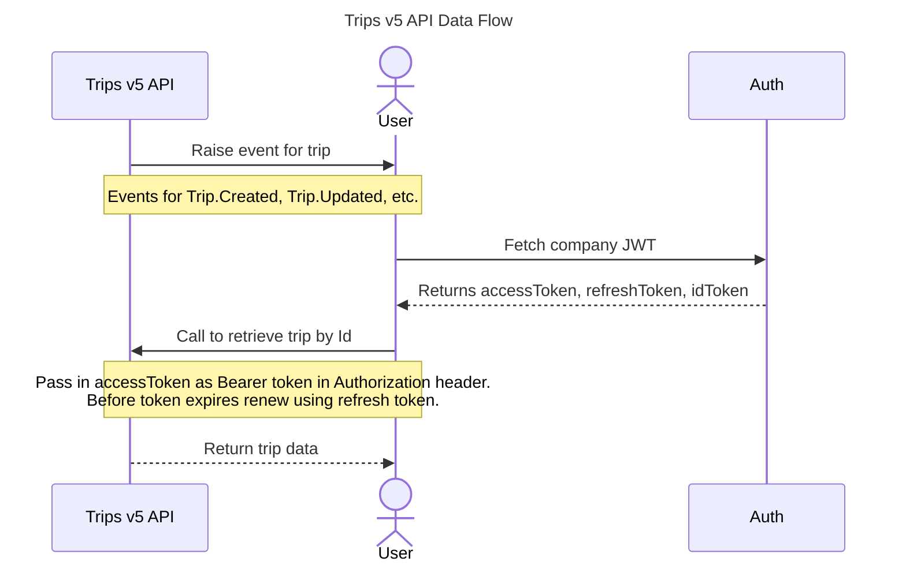



The SAP Concur Trips API provides clients and authorized partners access to travel trip data.

## <a name="limitations"></a>Limitations

* Access to this documentation does not provide access to the API. This API available in the APJ, EMEA, and US data centers.
* Trip retrieve has a shared global rate limit of 100 requests per second. Further limits may also be defined on a per-app basis.

## <a name="prior-versions"></a>Prior Versions

* <a href="/api-reference/travel/itinerary-v4/v4.itinerary.html">Itinerary v4</a>

## <a name="process-flow"></a>Process Flow



## <a name="products-editions"></a>Products and Editions

* Concur Travel Professional Edition
* Concur Travel Standard Edition

## <a name="scope-usage"></a>Scope Usage

Name|Description|Endpoint
---|---|---
`travel.trip.booking.read`|Read access to booking data in V5 trip|GET /v5/trips/{tripID}
`travel.trip.location.read`|Read access to location data in V5 trip|GET /v5/trips/{tripID}
`travel.trip.pricing.read`|Read access to pricing data in V5 trip|GET /v5/trips/{tripID}
`travel.trip.read`|Read access to V5 public trip data|GET /v5/trips/{tripID}

## <a name="dependencies"></a>Dependencies

None.

## <a name="access-token-usage"></a>Access Token Usage

This API supports company level access tokens.

## <a name="retrieve-trip"></a>Retrieve a Trip Record

Retrieves the record of a trip.

### Scopes

`travel.trip.booking.read` - Refer to [Scope Usage](#scope-usage) for full details.\
`travel.trip.location.read` - Refer to [Scope Usage](#scope-usage) for full details.\
`travel.trip.pricing.read` - Refer to [Scope Usage](#scope-usage) for full details.\
`travel.trip.read` - Refer to [Scope Usage](#scope-usage) for full details.

### URI

```shell
GET https://{region}.api.concursolutions.com/v5/trips/{tripID}
```

### Parameters

Name|Type|Format|Description
---|---|---|---
`region`|`string`|-|**Required** The data center region, e.g. `us2`, `eu2`, or `apj1`.
`tripID`|`string`|`uuid`|**Required** The unique identifier of the trip.
`If-None-Match`|`string`|-|Optional header. A previously received `ETag`; the API returns `304 Not Modified` if the trip has not changed.

### Request

```shell
GET https://us2.api.concursolutions.com/v5/trips/{tripID}
Accept: application/json
Authorization: Bearer <JWT Token>
```

### Status Codes

* [200 OK](https://tools.ietf.org/html/rfc7231#section-6.3.1)
* [304 Not Modified](https://tools.ietf.org/html/rfc7232#section-4.1)
* [400 Bad Request](https://tools.ietf.org/html/rfc7231#section-6.5.1)
* [401 Unauthorized](https://tools.ietf.org/html/rfc7235#section-3.1)
* [403 Forbidden](https://tools.ietf.org/html/rfc7231#section-6.5.3)
* [404 Not Found](https://tools.ietf.org/html/rfc7231#section-6.5.4)
* [500 Internal Server Error](https://tools.ietf.org/html/rfc7231#section-6.6.1)

### Response

Certain schema elements are optional. If their fields are empty they are omitted. Fields are also omitted when the caller's scope does not grant them; see each field's description in [Schema](#schema). Field values in this sample are randomized.

```json
{
  "bookings": [
    {
      "air": {
        "dataLists": {
          "baggageAllowanceList": {
            "baggageAllowance": [
              {
                "airlineTaxonomy": {
                  "descText": "eUAhTDfbaKdC",
                  "taxonomyCode": "mqKaVpcATKGnXXGQFWmpwVM",
                  "taxonomyFeature": [
                    {
                      "codesetCode": "uaucyPVneORaQyzMlsErtdbz",
                      "codesetNameCode": "HNrNcvEQBTmD",
                      "valueText": "VssSuWxhYwJWEtaOx"
                    }
                  ]
                },
                "applicablePartyText": "BOpdUmHcAGxQziUqwm",
                "baggageAllowanceID": "fYYYnKXwpwtFxDzAUEm",
                "bdc": {
                  "bagRuleCode": "D",
                  "bdcAnalysisResultCode": "ikxhimOcsbNiaeSOwmfwTQ",
                  "bdcReasonText": "RNXCiEbJKzmr",
                  "carrierDesigCode": "ZPJDjMvBrtOPMWVvbCFgfBM",
                  "carrierName": "hTAUdAHlkbLEbcaTthD"
                },
                "descText": [
                  "HHRzFMCxiiKpqcIyU"
                ],
                "maximumDimensionAllowance": [
                  {
                    "heightMeasure": 0.5,
                    "lengthMeasure": 0.55,
                    "lengthUnitOfMeasurement": "INH",
                    "linearMeasure": 0.16,
                    "widthMeasure": 0.56
                  }
                ],
                "minimumDimensionAllowance": [
                  {
                    "heightMeasure": 0.47,
                    "lengthMeasure": 0.7,
                    "lengthUnitOfMeasurement": "INH",
                    "linearMeasure": 0.58,
                    "widthMeasure": 0.32
                  }
                ],
                "pieceAllowance": {
                  "totalQty": 0.24
                },
                "rfisc": "egbPCfCiLJbQzn",
                "typeCode": "PISvDqKjiYifnJjE",
                "weightAllowance": [
                  {
                    "maximumWeightMeasure": 0.89,
                    "minimumWeightMeasure": 0.15,
                    "totalMaximumWeightMeasure": 0.38,
                    "weightUnitOfMeasurement": "KGM"
                  }
                ]
              }
            ]
          },
          "baggageDisclosureList": {
            "baggageDisclosure": [
              {
                "baggageDisclosureID": "VjqkAQbTdzLQbzckj",
                "bdc": {
                  "bagRuleCode": "N",
                  "bdcAnalysisResultCode": "hViWUPOCcCKDlWZQfnemGjkxd",
                  "bdcReasonText": "fetzbnbzHlpZmrWi",
                  "carrierDesigCode": "lxWNQmKMGee",
                  "carrierName": "GaUICIupHAqcTcAgV"
                },
                "checkInChargesInd": false,
                "commercialAgreementID": "LdPBtcboVD",
                "deferralInd": true,
                "desc": [
                  {
                    "descText": "CBRapDNmiB",
                    "markupStyleText": "FFRKkdjYlxEftDfIv",
                    "url": "OsfaJkoWXgjCzQMAMTrE"
                  }
                ],
                "descText": [
                  "QgazsFPDhIimArOleljyyFd"
                ],
                "fixedPrePaidInd": false,
                "ruleTypeCode": "OTHER"
              }
            ]
          },
          "contactInfoList": {
            "contactInfo": [
              {
                "contactInfoID": "VuHZTbJKWntDTeQi",
                "contactPurposeText": [
                  "eKaNrSthLukIzDoItVxptgwjh"
                ],
                "contactRefusedInd": false,
                "emailAddress": [
                  {
                    "contactTypeText": "tUPrMaCBekbuqCJKteyG",
                    "emailAddressText": "xVuUnkOwZZZqyuoO"
                  }
                ],
                "individual": {
                  "addlName": [
                    {
                      "name": "csfgnSQTrlokKZLUGN",
                      "nameTypeCode": "MOTHER_SURNAME"
                    }
                  ],
                  "birthdate": "2026-01-02",
                  "birthplaceText": "drcIgsOGUPHlzHhHemTGV",
                  "genderCode": "X",
                  "givenName": [
                    "tgDhpeiBSTVaOeSfnsHNnb"
                  ],
                  "individualID": "OysiZPJYqmUXRosQT",
                  "middleName": [
                    "yNPobwhpxOBZEhiUcetFCeo"
                  ],
                  "suffixName": "vMGqcPwWuEIbvcMWXCBVy",
                  "surname": "NYcgCqlEEFFNctIIY",
                  "titleName": "DnBhPuzELgBbryEvxe"
                },
                "individualRefID": "HvWyqdjxRjc",
                "otherAddress": [
                  {
                    "contactTypeText": "ACfNVFEHJbQaoRp",
                    "otherAddressText": "MviIyvCLJvEu"
                  }
                ],
                "paxSegmentRefID": "gfPfPmLnOxKzZfEKhyfuTE",
                "phone": [
                  {
                    "areaCodeNumber": "ePkYDGJrIVdEtETAdgxlf",
                    "contactTypeText": "huOtwSVhTAuVXqf",
                    "countryDialingCode": "GjDYbdLknXlELBmJ",
                    "extensionNumber": "VoVMLgbZcTpVEkrbs",
                    "phoneNumber": "TfEVwsxVOPlwtbO"
                  }
                ],
                "postalAddress": [
                  {
                    "buildingRoomText": "YhFkVfrhYe",
                    "cityName": "RKNCYBjLSvKmgQW",
                    "contactTypeText": "DaozDYHujgEEbJBbB",
                    "countryCode": "YXmXYRKfsZhfOzIfU",
                    "countryName": "tVDGTkPNZwkLB",
                    "countrySubDivisionName": "lQlxmlNiuuEynhXZkSKRV",
                    "poBoxCode": "pbQKrnpOxcWVz",
                    "postalCode": "qaUwfAxSrUNlFrgPnI",
                    "streetText": [
                      "XAOeughxVSXzeekd"
                    ]
                  }
                ],
                "relationshipToPax": "zHMZhVKgPGVCFCfEtledFZ"
              }
            ]
          },
          "datedMarketingSegmentList": {
            "datedMarketingSegment": [
              {
                "airlineTaxonomy": [
                  {
                    "descText": "XDmcbQkDubojp",
                    "taxonomyCode": "hWMTXqgzPiFCbxssvOrOcId",
                    "taxonomyFeature": [
                      {
                        "codesetCode": "gGyLkYDNxzimCoy",
                        "codesetNameCode": "TgbbxtgXcgVuebtqrw",
                        "valueText": "ZluUvJzDPABwYnUJMflErMgmz"
                      }
                    ]
                  }
                ],
                "arrival": {
                  "aircraftScheduledDateTimeLocal": "2026-01-02T15:04:05",
                  "aircraftScheduledDateTimeUtc": "2026-01-02T15:04:05Z",
                  "boardingGateID": "kUtNbYxXYhsu",
                  "iataLocationCode": "XadfJXCZlHdCTRGHqoYpyW",
                  "stationName": "xCklHdkIgwyXbLHn",
                  "terminalName": "efRiNLRyUKLpFIijZpN"
                },
                "carrierDesigCode": "ljWxbwnziQ",
                "carrierName": "qezOvorigm",
                "datedMarketingSegmentId": "razCPEtNcLGPdzm",
                "datedOperatingSegmentRefId": "wdujuhzNsDDPduyKr",
                "dep": {
                  "aircraftScheduledDateTimeLocal": "2026-01-02T15:04:05",
                  "aircraftScheduledDateTimeUtc": "2026-01-02T15:04:05Z",
                  "boardingGateID": "ojWEiwJsCFHvXIVGmbEcg",
                  "iataLocationCode": "ejLLdoTceYWN",
                  "stationName": "HqEemuHrmZMlUxMMDyJI",
                  "terminalName": "PYcdbGWsoDtxiMmVFkNT"
                },
                "marketingCarrierFlightNumberText": "GMSSvqElmungAandPy",
                "operationalSuffixText": "FaIEFQXhcrZqmxgdWXhwoDS",
                "richMedia": [
                  {
                    "contentType": "XutccHnfrhnGULiYh",
                    "descText": "TIcIRlTlhGcyLXf",
                    "resourceURI": "lAQlvbPIZCTy"
                  }
                ],
                "ticketlessInd": false
              }
            ]
          },
          "datedOperatingLegList": {
            "datedOperatingLeg": [
              {
                "airlineTaxonomy": [
                  {
                    "descText": "pTuguduqEDiBLODe",
                    "taxonomyCode": "xuPdTJjHTYvnuYkrsFY",
                    "taxonomyFeature": [
                      {
                        "codesetCode": "YDKcplpVISZg",
                        "codesetNameCode": "iZNewHpQYmZfqVu",
                        "valueText": "bLGsgtoCYEqxMrXwlcYUPEHkX"
                      }
                    ]
                  }
                ],
                "arrival": {
                  "aircraftScheduledDateTimeLocal": "2026-01-02T15:04:05",
                  "aircraftScheduledDateTimeUtc": "2026-01-02T15:04:05Z",
                  "boardingGateID": "nIbGtHjZmVrAkIEpVsrsm",
                  "iataLocationCode": "UtZgnYFxeL",
                  "stationName": "GfgurQnkLfmGyeXCqs",
                  "terminalName": "MFNUbzKsrxuyUvb"
                },
                "carrierAircraftType": {
                  "carrierAircraftTypeCode": "WDNXnQVCJLZKutjDnauBTaKau",
                  "carrierAircraftTypeName": "PnEgRxaCjlaqdY"
                },
                "changeofGaugeInd": false,
                "datedOperatingLegID": "WfsrcsRJsgOOg",
                "dep": {
                  "aircraftScheduledDateTimeLocal": "2026-01-02T15:04:05",
                  "aircraftScheduledDateTimeUtc": "2026-01-02T15:04:05Z",
                  "boardingGateID": "ltFvLNjjQeJc",
                  "iataLocationCode": "uOzNiNtFPlIevSrx",
                  "stationName": "BjzzVFmtXPYyKPyhZVfjqc",
                  "terminalName": "lsAtorkBmH"
                },
                "distanceMeasure": {
                  "unitCode": "dofARnpbPB",
                  "value": 0.85
                },
                "iataAircraftType": {
                  "iataAircraftTypeCode": "ZGHjpuEqdmZMhPvclkjhJSkxG"
                },
                "onGroundDuration": "ZLYZLzjLjhwSupM",
                "richMedia": [
                  {
                    "contentType": "miLfrCTMHnNxltlFzREZG",
                    "descText": "XxOzrWBAHQCtjpChD",
                    "resourceURI": "gIiLitAKrmAvNB"
                  }
                ]
              }
            ]
          },
          "datedOperatingSegmentList": {
            "datedOperatingSegment": [
              {
                "carrierDesigCode": "NgSBUGEkLxLCPxMEmA",
                "carrierName": "CAWpkhomHVFnKu",
                "datedOperatingLegRefID": [
                  "KNPndkoJdwPgVlriHUbGjc"
                ],
                "datedOperatingSegmentId": "ADZVrjgDuCyjxXypquTxJNmK",
                "disclosureRefID": "TrePmRYGlny",
                "duration": "rHmoxGDkfy",
                "operatingCarrierFlightNumberText": "kCtOxRuKBcRZrjdGuCdDSTkJA",
                "operationalSuffixText": "ZXKzfQiERhvRbnGbf",
                "secureFlightInd": true,
                "segmentTypeCode": "poxdKGOWALfZkJfycvtzr"
              }
            ]
          },
          "disclosureList": {
            "disclosure": [
              {
                "desc": [
                  {
                    "descText": "rFqyoOtMGMhtWEfJWhn",
                    "markupStyleText": "GKoRpCcGYQtjvowGholv",
                    "url": "xGzpJzdhdMreVGLRzKaOThmM"
                  }
                ],
                "disclosureID": "MJloJblHcXUTRU"
              }
            ]
          },
          "originDestList": {
            "originDest": [
              {
                "destCode": "OAJtkezxvJingcStvxqVrkqRG",
                "ordinal": 4597941186258806891,
                "originCode": "trvTVJmIcX",
                "originDestID": "sLDdtRICoheHFMWjwm",
                "paxJourneyRefID": [
                  "EvXaPbBOcYnQbGvDj"
                ]
              }
            ]
          },
          "paxJourneyList": {
            "paxJourney": [
              {
                "distanceMeasure": {
                  "unitCode": "crQRgajhfPNncbAHFiSjPImt",
                  "value": 0.35
                },
                "duration": "CLCgVhsNogIlalzpSYC",
                "paxJourneyID": "aWyitGHwNuPUfEzXPdY",
                "paxSegmentRefID": [
                  "yQGJYzPkqtyHQwyN"
                ],
                "settlementInfo": {
                  "commission": [
                    {
                      "amount": {
                        "curCode": "YexTZjWmSQtGkoHKWywpk",
                        "value": 0.87
                      },
                      "commissionCode": "ECCZwpeqFSUfFWLiZmuk",
                      "percentage": 0.6,
                      "percentageAppliedToAmount": {
                        "curCode": "XijYSdNjnCo",
                        "value": 0.38
                      },
                      "taxableInd": false
                    }
                  ],
                  "fee": [
                    {
                      "amount": {
                        "curCode": "HBxoJqbEVkLY",
                        "value": 0.7
                      },
                      "approximateInd": false,
                      "descText": "hmkrtSWKVNjCiqObO",
                      "desigText": "bOTCpdIptwa",
                      "guaranteeTimeLimitDateTime": "2026-01-02T15:04:05Z",
                      "localAmount": {
                        "curCode": "eDceCBAqnkrZYJKTZpMolPp",
                        "value": 0.24
                      },
                      "maximumAmount": {
                        "curCode": "LwbeMxHnGEg",
                        "value": 0.49
                      },
                      "minimumAmount": {
                        "curCode": "aDnekMpemJqfSqbCLItpnQwb",
                        "value": 0.04
                      },
                      "percent": 0.22,
                      "refundInd": true
                    }
                  ],
                  "methodCode": "gxMOXwbXKPgtTKw",
                  "settlementAmount": {
                    "curCode": "sylUbjqsRPzQRyPOR",
                    "value": 0.24
                  },
                  "surcharge": [
                    {
                      "allRefundableInd": false,
                      "breakdown": [
                        {
                          "amount": {
                            "curCode": "CgcJPUyLjtNhJQYbPoKEdbBsg",
                            "value": 0.83
                          },
                          "approximateInd": true,
                          "descText": "dnCauERzGKzvgnGR",
                          "desigText": "CQrhVYHBnOVrfJLDDbEUmKXP",
                          "guaranteeTimeLimitDateTime": "2026-01-02T15:04:05Z",
                          "localAmount": {
                            "curCode": "ShmoYCGTzIepbFE",
                            "value": 0.05
                          },
                          "maximumAmount": {
                            "curCode": "ZRtZiUwtOpkCIKFPOG",
                            "value": 0.65
                          },
                          "minimumAmount": {
                            "curCode": "xaKVeeTZXgg",
                            "value": 0.55
                          },
                          "percent": 0.61,
                          "refundInd": false
                        }
                      ],
                      "totalAmount": {
                        "curCode": "xJbVmFqSVPXgao",
                        "value": 0.33
                      }
                    }
                  ],
                  "tax": [
                    {
                      "addlFiledTaxCode": "jedzXMSIITlAbtWLcdHybmvx",
                      "addlTaxCode": "VFiqCmpwjOqKCMuGXbGdvDiV",
                      "amount": {
                        "curCode": "FBaFiFAtvWnuJ",
                        "value": 0.53
                      },
                      "appTypeCode": "RgHRHgwNeY",
                      "approximateInd": true,
                      "collectionInd": true,
                      "collectionPointTax": [
                        {
                          "airportAmount": {
                            "curCode": "hCntvJgWSpSUxjs",
                            "value": 0.46
                          },
                          "station": {
                            "iataLocationCode": "AwJiAdXfaRHapolNy",
                            "stationName": "QttiLytfkLwlJ"
                          }
                        }
                      ],
                      "country": {
                        "countryCode": "xtqOOwRGpiogQaBtrpCUMmBY",
                        "countryName": "IwysVXpRgOr"
                      },
                      "countrySubDivision": {
                        "countrySubDivisionCode": "XkPFPdyyadaY",
                        "countrySubDivisionName": "MYwylNJfpwBbzSAOrXYROXzxd"
                      },
                      "curConversion": {
                        "amount": {
                          "curCode": "kVdWHpHfZY",
                          "value": 0.69
                        },
                        "conversionRate": {
                          "baseCurCode": "EKExPhMZiEItjJu",
                          "baseMultiplierValue": 0.63,
                          "baseUnitCode": "GzIqzQRVeJIXTpjUwOyCvfh",
                          "curCode": "HItfEcPhIqbG",
                          "format": "NDFfCcOhiUO",
                          "multiplierValue": 0.64,
                          "unitCode": "NzqynTUANFz",
                          "value": 0.01
                        },
                        "localAmount": {
                          "curCode": "ZApsrkzvaXESeTrokEV",
                          "value": 0.96
                        }
                      },
                      "descText": "nyDZgKGfWrwfMnvFbgDLSOQeg",
                      "filedAmount": {
                        "curCode": "JFdvaLrGoDeDxGBbtTtzBDmw",
                        "value": 0.93
                      },
                      "filedTaxCode": "bNXURdWPLKipbexfN",
                      "qualifierCode": "iGrjPlQMZrbs",
                      "refundInd": false,
                      "taxCode": "yzgTAiILCtENlqeVdzyjCFz",
                      "taxName": "nzXjbVKdOCQRcpTiycbRR",
                      "taxTypeCode": "APPLIED"
                    }
                  ],
                  "taxableInd": false
                }
              }
            ]
          },
          "paxList": {
            "pax": [
              {
                "paxID": "TEqQomEdffkUmkgQuTdadDSzL",
                "paxRefID": "dYcMNhrxule",
                "remark": [
                  {
                    "displayInd": false,
                    "remarkText": "dnsDMQPKEFAaKCEBbiy",
                    "timestamp": "2026-01-02T15:04:05Z"
                  }
                ]
              }
            ]
          },
          "paxSegmentList": {
            "paxSegment": [
              {
                "cabinTypeAssociationChoice": {
                  "legCabinAssociations": {
                    "legsAssociatedCabin": [
                      {
                        "datedOperatingLegRefID": [
                          "XtExBsZJUHfNhknGmehseRXK"
                        ],
                        "legCabinType": {
                          "cabinTypeCode": "xQxySkagMgGKpbpdvhSSiKpn",
                          "cabinTypeName": "EsciPESeYnRzYLvl"
                        }
                      }
                    ]
                  },
                  "segmentCabinType": {
                    "cabinTypeCode": "YvpXrlSTaKhEVsp",
                    "cabinTypeName": "zRhWmMCVCWR"
                  }
                },
                "datedMarketingSegmentRefId": "qTnfXOzDsgZtHEIUlfg",
                "marketingCarrierRBDCode": "bBSpyCQFPevhNTZbiNKvQ",
                "operatingCarrierRBDCode": "qfTMBtKQIOrWmKip",
                "paxSegmentID": "WaVsnRHqNaXxp",
                "settlementInfo": {
                  "commission": [
                    {
                      "amount": {
                        "curCode": "RjnVTsoyihgvUswnJp",
                        "value": 0.12
                      },
                      "commissionCode": "YhpyFvOiqKryrREhysoUmNb",
                      "percentage": 0.1,
                      "percentageAppliedToAmount": {
                        "curCode": "sqreqwymfZFKSwjtogGdohTu",
                        "value": 0.96
                      },
                      "taxableInd": false
                    }
                  ],
                  "fee": [
                    {
                      "amount": {
                        "curCode": "lxjMlQHXLRSDX",
                        "value": 0.59
                      },
                      "approximateInd": false,
                      "descText": "DnrpUIBAKezRGJmWSsl",
                      "desigText": "xpHXlEGIZEDM",
                      "guaranteeTimeLimitDateTime": "2026-01-02T15:04:05Z",
                      "localAmount": {
                        "curCode": "pgRCXnsTuHiRHfnFwpaio",
                        "value": 0.96
                      },
                      "maximumAmount": {
                        "curCode": "TRaMslYcBKeORPigrHNfHt",
                        "value": 0.22
                      },
                      "minimumAmount": {
                        "curCode": "OKqMLrqnYKpqmQawCR",
                        "value": 0.49
                      },
                      "percent": 0.34,
                      "refundInd": false
                    }
                  ],
                  "methodCode": "VElfdzLtkXnu",
                  "settlementAmount": {
                    "curCode": "lZgFStwafWALGjIAUhtwCHN",
                    "value": 0.25
                  },
                  "surcharge": [
                    {
                      "allRefundableInd": true,
                      "breakdown": [
                        {
                          "amount": {
                            "curCode": "utZYQTsvDEwMIdTVFIqc",
                            "value": 0.04
                          },
                          "approximateInd": true,
                          "descText": "xDcDiMEkMwfJedmNjKQdyzVn",
                          "desigText": "mLcoQRAQxoDaBwOtZynzcv",
                          "guaranteeTimeLimitDateTime": "2026-01-02T15:04:05Z",
                          "localAmount": {
                            "curCode": "VWDmNawdgzRbaHqIgkuMmF",
                            "value": 0.85
                          },
                          "maximumAmount": {
                            "curCode": "kCeUVknVoglqZERNisX",
                            "value": 0.16
                          },
                          "minimumAmount": {
                            "curCode": "KOQBGCyTcWuaS",
                            "value": 0.27
                          },
                          "percent": 0.69,
                          "refundInd": true
                        }
                      ],
                      "totalAmount": {
                        "curCode": "ltTLVusbPDMIFP",
                        "value": 0.23
                      }
                    }
                  ],
                  "tax": [
                    {
                      "addlFiledTaxCode": "utZPpataipabiiDQDO",
                      "addlTaxCode": "iJObQDrrhQy",
                      "amount": {
                        "curCode": "viXRKGnTXLBMGphQZ",
                        "value": 0.68
                      },
                      "appTypeCode": "ZQDbdCAPJhJBiVxdWKXyfrY",
                      "approximateInd": true,
                      "collectionInd": false,
                      "collectionPointTax": [
                        {
                          "airportAmount": {
                            "curCode": "OuKHVEdpeGybQIDwupWnyK",
                            "value": 0.98
                          },
                          "station": {
                            "iataLocationCode": "RtNHdkTyepOrJugnsObjWQJWR",
                            "stationName": "LlXonDjCVVXZrmRnBbZc"
                          }
                        }
                      ],
                      "country": {
                        "countryCode": "NzGRqlNEmZjmJRRbYlhEzHNf",
                        "countryName": "pskHidJLqvXQBoLJ"
                      },
                      "countrySubDivision": {
                        "countrySubDivisionCode": "WnFkHyWyEJNXdn",
                        "countrySubDivisionName": "MRLOlDeIDvxubKaWHubxijagF"
                      },
                      "curConversion": {
                        "amount": {
                          "curCode": "pAwDPRKOVFvCF",
                          "value": 0.93
                        },
                        "conversionRate": {
                          "baseCurCode": "UjrLKLRRPPdzCLQIOoDgD",
                          "baseMultiplierValue": 0.69,
                          "baseUnitCode": "IJkOsSmVoid",
                          "curCode": "EyVRRqGGmHTocsHDbB",
                          "format": "sHfDgaQWjMRscYSDAzJSK",
                          "multiplierValue": 0.17,
                          "unitCode": "sZOoZXSawhALggEm",
                          "value": 0.15
                        },
                        "localAmount": {
                          "curCode": "BbRQwkLNSL",
                          "value": 0.95
                        }
                      },
                      "descText": "BRllJnMnGPzgEJKCJRnRbdTP",
                      "filedAmount": {
                        "curCode": "qRIRUxwlSJmxnhHXjIv",
                        "value": 0.17
                      },
                      "filedTaxCode": "VAMjfEQafUZ",
                      "qualifierCode": "AJyHLfmHfVzuQP",
                      "refundInd": false,
                      "taxCode": "SsNfPecQRgwoSkkSnZbION",
                      "taxName": "xKdBauskdPdCNTRLiWICrbRvn",
                      "taxTypeCode": "EXEMPT"
                    }
                  ],
                  "taxableInd": false
                }
              }
            ]
          },
          "penaltyList": {
            "penalty": [
              {
                "descText": [
                  "ptrMROqJwAmqdjvgo"
                ],
                "netInd": true,
                "penaltyID": "jcDvGBlbuF",
                "price": {
                  "baseAmount": {
                    "curCode": "kFVUZfgHCois",
                    "value": 0.64
                  },
                  "taxSummary": [
                    {
                      "allRefundableInd": false,
                      "approximateInd": false,
                      "collectionInd": false,
                      "guaranteeTimeLimitDateTime": "2026-01-02T15:04:05Z",
                      "refundMethodText": "BdOzRHuvEzh",
                      "tax": [
                        {
                          "addlFiledTaxCode": "YUSZNEacWjQvlURbemxNy",
                          "addlTaxCode": "STUIrWAmFFXyeNDosNINVxfs",
                          "amount": {
                            "curCode": "YmEoXQdKaEt",
                            "value": 0.79
                          },
                          "appTypeCode": "ZQrPwgbgtBhFe",
                          "approximateInd": true,
                          "collectionInd": true,
                          "collectionPointTax": [
                            {
                              "airportAmount": {
                                "curCode": "UTSlpYBJACPbRdFOFXLaSIWty",
                                "value": 0.46
                              },
                              "station": {
                                "iataLocationCode": "ZOvePhYatK",
                                "stationName": "vbYLRaNWrHuMggKAxxI"
                              }
                            }
                          ],
                          "country": {
                            "countryCode": "JJBxXVGReipGJRXLezwHxJc",
                            "countryName": "HJVnqhXJbkWyXeSUorC"
                          },
                          "countrySubDivision": {
                            "countrySubDivisionCode": "hYKEtekTLUajIPBtHZ",
                            "countrySubDivisionName": "HNZnYsoAXbEvQrPG"
                          },
                          "curConversion": {
                            "amount": {
                              "curCode": "xGGVjGzqnveYgRMvj",
                              "value": 0.31
                            },
                            "conversionRate": {
                              "baseCurCode": "PpqVJYvupZDmwCFV",
                              "baseMultiplierValue": 0.9,
                              "baseUnitCode": "dkFmczRwCCndcuraSDvPSoIXd",
                              "curCode": "KYcTMdXKCOFevipgfuivHVMT",
                              "format": "WdCUGUOEnXCzGjyMIqS",
                              "multiplierValue": 0.24,
                              "unitCode": "JGLbRKAtazabBlbUUQsRl",
                              "value": 0.88
                            },
                            "localAmount": {
                              "curCode": "IotLkbRBhXADVYFSgkJ",
                              "value": 0.73
                            }
                          },
                          "descText": "oITySfNvhEpnHSjju",
                          "filedAmount": {
                            "curCode": "EppCMBtXizqrUyOOoNEJkhcbz",
                            "value": 0.06
                          },
                          "filedTaxCode": "kbCoNsxxFiZQN",
                          "qualifierCode": "xWPjWUmEffAZMVCHqOMKq",
                          "refundInd": true,
                          "taxCode": "NuQMiSAMKcVSlUDqneMgek",
                          "taxName": "TmQTYYFomI",
                          "taxTypeCode": "EXEMPT"
                        }
                      ],
                      "totalRefundableTaxAmount": {
                        "curCode": "nfiQXMebZOXc",
                        "value": 0.35
                      },
                      "totalTaxAmount": {
                        "curCode": "qYAjJDUGIeSzUoilo",
                        "value": 0.42
                      }
                    }
                  ],
                  "totalAmount": {
                    "curCode": "qZyAfvPhosI",
                    "value": 0.96
                  }
                },
                "typeCode": "UPGRADE"
              }
            ]
          },
          "priceClassList": {
            "priceClass": [
              {
                "cabinType": [
                  {
                    "cabinTypeCode": "eFfwrFIGGoeJHZJxoaIy",
                    "cabinTypeName": "ZtDTAwvUjsrKcaKjI"
                  }
                ],
                "code": "rGKdYxvMDwIdHVasy",
                "desc": [
                  {
                    "descText": "qDuJGjZVvO",
                    "markupStyleText": "advGAVWMraxuQbcUHDHWswyEB",
                    "url": "stZgqeUVsRjC"
                  }
                ],
                "displayOrderText": "YYpkSYjcbWiBsvpJDWsZD",
                "fareBasisAppText": "xjChRIIThQxjQoo",
                "fareBasisCode": "TnubeGdmSOREzZvjQvUVEwBj",
                "name": "CKAghoAdqiZypoe",
                "priceClassID": "yLrtegiiZGTYIYTheO",
                "richMedia": [
                  {
                    "contentType": "qrqLSsJxKEJwV",
                    "descText": "zXKrhEyvvI",
                    "resourceURI": "jZSSssojCWiDSLBZJRxQR"
                  }
                ]
              }
            ]
          },
          "seatProfileList": {
            "seatProfile": [
              {
                "marketingInfo": [
                  {
                    "descText": "euLrlCXAQeTDdoQa",
                    "markupStyleText": "euGOGHGkMJxbZiV",
                    "url": "ViEHCamQREWCoWqAR"
                  }
                ],
                "richMedia": [
                  {
                    "contentType": "BcgBRbGszDkKHDEv",
                    "descText": "BkYnSjKCyOvPEpNOJDylbPD",
                    "resourceURI": "sRnvxlqHtrHwextjvINMevpl"
                  }
                ],
                "seatCharacteristicCode": [
                  "uowoYBTMTyrBkk"
                ],
                "seatKeywords": [
                  {
                    "keyText": "xLkoWcOfGbWfzDf",
                    "prefLevel": {
                      "prefLevelCode": "REQUIRED"
                    },
                    "valueText": "JMGKmrCjgA"
                  }
                ],
                "seatPitchMeasure": {
                  "unitCode": "pVIvQQeFVWOedxtrkdfFR",
                  "value": 0.57
                },
                "seatProfileID": "RkCDFTDYesgrSHbJKhNavHh",
                "seatWidthMeasure": {
                  "unitCode": "HSbXMvJNHYttVzxWsNc",
                  "value": 0.77
                }
              }
            ]
          },
          "serviceDefinitionList": {
            "serviceDefinition": [
              {
                "airlineTaxonomy": [
                  {
                    "descText": "uZPUVHIKJVLxUNRNdmxzyuP",
                    "taxonomyCode": "xyQUjZlSYFNlIaJlhIXWJu",
                    "taxonomyFeature": [
                      {
                        "codesetCode": "VvIIQWxNTzi",
                        "codesetNameCode": "kgGNzATxCnodLTUIl",
                        "valueText": "PjvTQncPICGMfyiVFwgLu"
                      }
                    ]
                  }
                ],
                "bilateralTimeLimit": [
                  {
                    "descText": "oclgdmsYIzq",
                    "name": "pXOVkvCwajtxSMoRLxfDP",
                    "timeLimitDateTime": "2026-01-02T15:04:05Z"
                  }
                ],
                "depositTimeLimitDateTime": "2026-01-02T15:04:05Z",
                "desc": [
                  {
                    "descText": "hpbXlhSAUDdMs",
                    "markupStyleText": "NqgAdKWesXLW",
                    "url": "xLCBZYlfllFEqki"
                  }
                ],
                "name": "AeBwKWAiBPtgItcn",
                "namingTimeLimitDateTime": "2026-01-02T15:04:05Z",
                "ownerCode": "CJejWaqsiPfMxEgZFfK",
                "rfic": "HYaYDEnsKRqZSoCIpRSMFrV",
                "rfisc": "eIaABFkMaThXoQfeJkj",
                "serviceCode": "pTLMPgkAmjLstuxcSAfsHcro",
                "serviceDefinitionAssociation": {
                  "baggageAllowanceRef": {
                    "baggageAllowanceRefID": [
                      "hWzGilRBqi"
                    ]
                  },
                  "seatProfileRef": {
                    "seatProfileRefID": [
                      "yoqTYSGFMgtVJpsVrVbf"
                    ]
                  },
                  "serviceBundle": {
                    "maximumServiceQty": 0.63,
                    "serviceDefinitionRefID": [
                      "vJopynSSwwnSkWZVWmFYkMQSr"
                    ]
                  }
                },
                "serviceDefinitionID": "OPcQNLdmTEKj"
              }
            ]
          },
          "termsList": {
            "term": [
              {
                "availPeriod": {
                  "earliestAvailablePeriodDateTime": "2026-01-02T15:04:05Z",
                  "latestAvailablePeriodDateTime": "2026-01-02T15:04:05Z"
                },
                "desc": {
                  "descText": "EYvXDgiesYXyRO",
                  "markupStyleText": "zafMbslFxmcXdPsaFF",
                  "url": "YQoxobKDYkfJqPqcorcicuP"
                },
                "orderingQty": {
                  "maximumQty": 0.46,
                  "minimumQty": 0.38
                },
                "termID": "SiGhdYnmxQI"
              }
            ]
          }
        },
        "order": [
          {
            "bilateralTimeLimit": [
              {
                "descText": "IyizvFzePoSJ",
                "name": "GpktMbiGjo",
                "timeLimitDateTime": "2026-01-02T15:04:05Z"
              }
            ],
            "commission": [
              {
                "amount": {
                  "curCode": "CLTBouOZLD",
                  "value": 0.32
                },
                "commissionCode": "owiKohIUTdCvyNXtQXRCOlxn",
                "percentage": 1,
                "percentageAppliedToAmount": {
                  "curCode": "VzNvmogXTPz",
                  "value": 0.22
                },
                "taxableInd": true
              }
            ],
            "creationDateTime": "2026-01-02T15:04:05Z",
            "depositTimeLimitDateTime": "2026-01-02T15:04:05Z",
            "forfeitedInfoList": {
              "forfeitedInfo": [
                {
                  "creationDateTime": "2026-01-02T15:04:05Z",
                  "forfeitedInfoID": "qSjLsJVBsYmWpOd",
                  "orderItemRefID": "HXkyDhSfIJxZwYLnixPvtG",
                  "paxRefID": "tKcGbnjywZAkBA",
                  "price": {
                    "baseAmount": {
                      "curCode": "CCMTcmwhbOKmfSD",
                      "value": 0.36
                    },
                    "baseAmountGuaranteeTimeLimitDateTime": "2026-01-02T15:04:05Z",
                    "curConversion": [
                      {
                        "amount": {
                          "curCode": "HswINHOpYp",
                          "value": 0.31
                        },
                        "conversionRate": {
                          "baseCurCode": "ItBtwDEypvVLnG",
                          "baseMultiplierValue": 0.3,
                          "baseUnitCode": "RDcqNISKrEAepQlCffLLNItR",
                          "curCode": "HwWcKbwycvJjKEkfBfcBzjVe",
                          "format": "unQmfHYYTurofZMxH",
                          "multiplierValue": 0.25,
                          "unitCode": "AKWvaWcDdN",
                          "value": 0.52
                        },
                        "localAmount": {
                          "curCode": "lIvKeKoNwUtJ",
                          "value": 0.27
                        }
                      }
                    ],
                    "discount": {
                      "appText": "yutoENTUjMlD",
                      "descText": "baUxHeisIBBrtqVRpdysJWc",
                      "discountAmount": {
                        "curCode": "sUDmiuIVdZTaiUfygkKrRvw",
                        "value": 0.89
                      },
                      "discountContext": [
                        {
                          "keyText": "xwKoezKeQsCKehy",
                          "prefLevel": {
                            "prefLevelCode": "EXCLUDE"
                          },
                          "valueText": "fysQfiRjyBSOG"
                        }
                      ],
                      "discountPercent": 0.07,
                      "preDiscountedAmount": {
                        "curCode": "fjUOgePsxgCIgUJapAX",
                        "value": 0.17
                      }
                    },
                    "equivAmount": {
                      "curCode": "desGwCMhnRUzJtWs",
                      "value": 0.8
                    },
                    "fee": [
                      {
                        "amount": {
                          "curCode": "CqErprDVdhWqqMJQGMCy",
                          "value": 0.92
                        },
                        "approximateInd": false,
                        "descText": "LrJwtMVqwFYB",
                        "desigText": "NfpgUnZZcBWWTKOjNS",
                        "guaranteeTimeLimitDateTime": "2026-01-02T15:04:05Z",
                        "localAmount": {
                          "curCode": "GdXdYrScqp",
                          "value": 0.86
                        },
                        "maximumAmount": {
                          "curCode": "WPtWFFdbPSGSZUl",
                          "value": 0.81
                        },
                        "minimumAmount": {
                          "curCode": "AyYMDIDAqk",
                          "value": 0.03
                        },
                        "percent": 0.25,
                        "refundInd": true
                      }
                    ],
                    "loyaltyUnitAmount": {
                      "curCode": "mPMoWdwDCNsIutpiF",
                      "value": 0.73
                    },
                    "loyaltyUnitName": "EnkoZJPqfqZlN",
                    "markup": [
                      {
                        "amount": {
                          "curCode": "ImKLelXMckNfWIrCVkjFVYy",
                          "value": 0.47
                        },
                        "typeCode": "iKOeSfXhietdibBNR"
                      }
                    ],
                    "maskedInd": true,
                    "surcharge": [
                      {
                        "allRefundableInd": false,
                        "breakdown": [
                          {
                            "amount": {
                              "curCode": "ORBlduoXrWJj",
                              "value": 0.74
                            },
                            "approximateInd": false,
                            "descText": "SEVIZgBNAg",
                            "desigText": "YTWboQonpHjsQnxCB",
                            "guaranteeTimeLimitDateTime": "2026-01-02T15:04:05Z",
                            "localAmount": {
                              "curCode": "fOAgUURCdrFcopKNdJXI",
                              "value": 0.32
                            },
                            "maximumAmount": {
                              "curCode": "cRnUcMAcTIcrD",
                              "value": 0.25
                            },
                            "minimumAmount": {
                              "curCode": "AHbwDiwWsO",
                              "value": 0.13
                            },
                            "percent": 0.46,
                            "refundInd": true
                          }
                        ],
                        "totalAmount": {
                          "curCode": "IhApnoFykQBFIuPnHvSZQ",
                          "value": 0.6
                        }
                      }
                    ],
                    "taxSummary": [
                      {
                        "allRefundableInd": false,
                        "approximateInd": false,
                        "collectionInd": false,
                        "guaranteeTimeLimitDateTime": "2026-01-02T15:04:05Z",
                        "refundMethodText": "TDKOHNUKbdksle",
                        "tax": [
                          {
                            "addlFiledTaxCode": "jdjlLnEcsHGA",
                            "addlTaxCode": "SVHzxSdvKxmzQQJz",
                            "amount": {
                              "curCode": "NcdodBlUPUlW",
                              "value": 0.81
                            },
                            "appTypeCode": "zXvPdkzRYEsZpUaFSBCd",
                            "approximateInd": false,
                            "collectionInd": false,
                            "collectionPointTax": [
                              {
                                "airportAmount": {
                                  "curCode": "mZHsQqtKXeYbKbTjKRtPhjhi",
                                  "value": 0.97
                                },
                                "station": {
                                  "iataLocationCode": "NrANypteWVfmVtoKVoTMdLApv",
                                  "stationName": "FHdPGineMIS"
                                }
                              }
                            ],
                            "country": {
                              "countryCode": "qsxRPQFytEDWxh",
                              "countryName": "wOPhGydxcfvjSEI"
                            },
                            "countrySubDivision": {
                              "countrySubDivisionCode": "typnLftwAFfFcebXmU",
                              "countrySubDivisionName": "XVLOaWvXKSyWxsTMwnEChad"
                            },
                            "curConversion": {
                              "amount": {
                                "curCode": "mNlcxpnvkYG",
                                "value": 0.06
                              },
                              "conversionRate": {
                                "baseCurCode": "jjJbKJemDsIdbWo",
                                "baseMultiplierValue": 0.6,
                                "baseUnitCode": "fVHKFjPgURJXiLnLiuOs",
                                "curCode": "vOsIqOkNZazY",
                                "format": "YquLrSyCidMLEAJpQaXdr",
                                "multiplierValue": 0.4,
                                "unitCode": "ZGcuvIJYiP",
                                "value": 0.65
                              },
                              "localAmount": {
                                "curCode": "GpCHLFggHSlfPtDNFg",
                                "value": 0.87
                              }
                            },
                            "descText": "nnPOQwcJqx",
                            "filedAmount": {
                              "curCode": "OvYjdNqQwqtUEPho",
                              "value": 0.46
                            },
                            "filedTaxCode": "NrBeOBvNMybOSolLgWQtc",
                            "qualifierCode": "zNrYlyqpUmZvaOlzOjkR",
                            "refundInd": false,
                            "taxCode": "eiVUPCtVhkfrbXOzwChMVpHaA",
                            "taxName": "mlajeRiprmBrQJz",
                            "taxTypeCode": "APPLIED"
                          }
                        ],
                        "totalRefundableTaxAmount": {
                          "curCode": "GuPIqrthWhVtccT",
                          "value": 0.3
                        },
                        "totalTaxAmount": {
                          "curCode": "PdJPNXJeIOLX",
                          "value": 0.31
                        }
                      }
                    ],
                    "totalAmount": {
                      "curCode": "HSzbyMcGQNwDlxXScuOtzhC",
                      "value": 0.95
                    }
                  }
                }
              ]
            },
            "lastModifiedDateTime": "2026-01-02T15:04:05Z",
            "namingTimeLimitDateTime": "2026-01-02T15:04:05Z",
            "orderID": "BskqOWoBeAGgOQWmW",
            "orderItem": [
              {
                "airlineTaxonomy": [
                  {
                    "descText": "NbASRaxGdYIsY",
                    "taxonomyCode": "bVFxHcNBbKisops",
                    "taxonomyFeature": [
                      {
                        "codesetCode": "MMcRwDxcdsDXoBqxQTrBvubzp",
                        "codesetNameCode": "qfvXXAKwhLLZjDjmI",
                        "valueText": "tObRAouZLjJtRjbzG"
                      }
                    ]
                  }
                ],
                "bilateralTimeLimit": [
                  {
                    "descText": "jsJyEQMMAwGojdicYrPTOwmwO",
                    "name": "WDRPTRFQohYYQVGPtztdzaUpd",
                    "timeLimitDateTime": "2026-01-02T15:04:05Z"
                  }
                ],
                "cancelRestrictions": [
                  {
                    "allowedModificationInd": false,
                    "descText": "smtMXrfcBbnzAbEYcpAhgaWGh",
                    "effectiveDateTime": "2026-01-02T15:04:05Z",
                    "expirationDateTime": "2026-01-02T15:04:05Z",
                    "fee": {
                      "amount": {
                        "curCode": "EtujjRjkErCxXNEgHCZ",
                        "value": 0.33
                      },
                      "approximateInd": true,
                      "descText": "EkIlkIlPuHA",
                      "maximumAmount": {
                        "curCode": "mwNyvzFeiBgLOQRPTSFbIbNq",
                        "value": 0.59
                      },
                      "minimumAmount": {
                        "curCode": "tVGXVzwTrJCgiArVtiWXisOI",
                        "value": 0.36
                      },
                      "percent": 0.28
                    },
                    "journeyStageCode": "NO_SHOW",
                    "paxRefID": "rOihUAmXBEZQq",
                    "refund": {
                      "descText": "SHavCmmlpAhFjf",
                      "fixedAmount": {
                        "curCode": "qOyMrEeqhbsZpDFmaM",
                        "value": 0.56
                      },
                      "levelTypeCode": "NONE",
                      "maximumAmount": {
                        "curCode": "djMtbohAXBqJjxjgORPiavJ",
                        "value": 0.79
                      },
                      "minimumAmount": {
                        "curCode": "wtzyikxsbHrDPQuaJ",
                        "value": 0.8
                      },
                      "paymentTypeCode": "llxssHOiPeXEfAD",
                      "percent": 0.18
                    }
                  }
                ],
                "changeRestrictions": [
                  {
                    "allowedModificationInd": false,
                    "changeTypeCode": "NAME",
                    "descText": "UaJlanlBZu",
                    "effectiveDateTime": "2026-01-02T15:04:05Z",
                    "expirationDateTime": "2026-01-02T15:04:05Z",
                    "fee": {
                      "amount": {
                        "curCode": "KeStxhYoyxBkGiRjDZGjapPle",
                        "value": 0.23
                      },
                      "approximateInd": true,
                      "descText": "CyskJiWAjrtRlQwV",
                      "maximumAmount": {
                        "curCode": "OLgtETsxmxepXr",
                        "value": 0.57
                      },
                      "minimumAmount": {
                        "curCode": "YcgWWnnUQaYGUBA",
                        "value": 0.35
                      },
                      "percent": 0.93
                    },
                    "journeyStageCode": "NO_SHOW",
                    "paxRefID": "aZjGlYYQitnXynS",
                    "refund": {
                      "descText": "ruvGCxQVwhTMITcgQOIFSlv",
                      "fixedAmount": {
                        "curCode": "TjWkBLcATUmtKEuDDf",
                        "value": 0.76
                      },
                      "levelTypeCode": "FULL",
                      "maximumAmount": {
                        "curCode": "YdzQizmCLWVptSIIFeIdnlkn",
                        "value": 0.13
                      },
                      "minimumAmount": {
                        "curCode": "nWViGIukWglj",
                        "value": 0.3
                      },
                      "paymentTypeCode": "enCdNOkcpqAamvvwuEKXDlF",
                      "percent": 0.4
                    }
                  }
                ],
                "commission": [
                  {
                    "amount": {
                      "curCode": "ZCuvEqhCycyCOZwB",
                      "value": 0.19
                    },
                    "commissionCode": "sDXhFCybxSKeLnsfbMnpicUR",
                    "percentage": 0.38,
                    "percentageAppliedToAmount": {
                      "curCode": "JeeHwhTAllyAGUPjybTONasbs",
                      "value": 0.26
                    },
                    "taxableInd": false
                  }
                ],
                "creationDateTime": "2026-01-02T15:04:05Z",
                "depositTimeLimitDateTime": "2026-01-02T15:04:05Z",
                "disclosureRefID": [
                  "LAWjTGSDsXNtPeiGhdD"
                ],
                "existingOrderItemID": [
                  "ClLriAVJcpQGKkMlrWfkE"
                ],
                "fareDetail": [
                  {
                    "accountCode": "EnXdVgsoUAJNLhfz",
                    "fareCalculationInfo": {
                      "addlInfoText": "QHFusYVyMVucljHQDoyKSSK",
                      "pricingCodeText": "FFkAZhfmqXxnSqzWjnRmQp",
                      "reportingCodeText": "DFVPffuswnfkYJqZLAlHfML"
                    },
                    "fareComponent": [
                      {
                        "cabinType": {
                          "cabinTypeCode": "QKDtJZTgEwT",
                          "cabinTypeName": "pwhCgPiYNSZzCeLObN"
                        },
                        "cancelRestrictions": [
                          {
                            "allowedModificationInd": true,
                            "descText": "lwYuonnlxeMkCnRYlcfqqE",
                            "effectiveDateTime": "2026-01-02T15:04:05Z",
                            "expirationDateTime": "2026-01-02T15:04:05Z",
                            "fee": {
                              "amount": {
                                "curCode": "RTUTDtIrSC",
                                "value": 0.53
                              },
                              "approximateInd": false,
                              "descText": "WbZGxUfmQLESU",
                              "maximumAmount": {
                                "curCode": "kVUciiHAqWb",
                                "value": 0.84
                              },
                              "minimumAmount": {
                                "curCode": "xitEZkvvJbByGRV",
                                "value": 0.72
                              },
                              "percent": 0.99
                            },
                            "journeyStageCode": "PRIOR_TO_DEPARTURE",
                            "paxRefID": "XgbrqvNLOmFmWIgTJbYPG",
                            "refund": {
                              "descText": "jhwwHcRRyWEHXEUfjtGNJcZg",
                              "fixedAmount": {
                                "curCode": "YWIKpBwxgopPIDeakoiBu",
                                "value": 0.93
                              },
                              "levelTypeCode": "FULL",
                              "maximumAmount": {
                                "curCode": "pFhYgFeJLodNH",
                                "value": 0
                              },
                              "minimumAmount": {
                                "curCode": "sCcrfELdgFAATVaitPS",
                                "value": 0.67
                              },
                              "paymentTypeCode": "uNdLlSBXygtVYjEFqqJLl",
                              "percent": 0.28
                            }
                          }
                        ],
                        "changeRestrictions": [
                          {
                            "allowedModificationInd": false,
                            "changeTypeCode": "SERVICE",
                            "descText": "PLdGYbtjVy",
                            "effectiveDateTime": "2026-01-02T15:04:05Z",
                            "expirationDateTime": "2026-01-02T15:04:05Z",
                            "fee": {
                              "amount": {
                                "curCode": "XsWoKtvdAfPvMgkzmQzJtGe",
                                "value": 0.71
                              },
                              "approximateInd": true,
                              "descText": "AMOcMJwxmAaYxrQwCwEs",
                              "maximumAmount": {
                                "curCode": "KDgvtRnWEqLvxwPVK",
                                "value": 0.15
                              },
                              "minimumAmount": {
                                "curCode": "IXBSTXFMssefoWo",
                                "value": 0.7
                              },
                              "percent": 0.85
                            },
                            "journeyStageCode": "NO_SHOW",
                            "paxRefID": "gcLUTYPEKcyKtXrq",
                            "refund": {
                              "descText": "xdvJzQszZRBPLkUFQ",
                              "fixedAmount": {
                                "curCode": "hthQwVFCRYU",
                                "value": 0.57
                              },
                              "levelTypeCode": "NONE",
                              "maximumAmount": {
                                "curCode": "vlmJGUOZDmzCoLgjf",
                                "value": 0.96
                              },
                              "minimumAmount": {
                                "curCode": "eXWrGBgfBEpPnGUHPenuVhZeC",
                                "value": 0.74
                              },
                              "paymentTypeCode": "gdkxoWCFqNkqrvjjz",
                              "percent": 0.33
                            }
                          }
                        ],
                        "fareBasisAppCode": "twAyHYCIICLRBmo",
                        "fareBasisCityPairText": "WYzJdavBpEcdKmXL",
                        "fareBasisCode": "oJfellhCgPQMGfKWy",
                        "fareRule": [
                          {
                            "instantPurchaseTypeCode": "cQJjHZZzaVerczmhxcDU",
                            "remark": [
                              {
                                "displayInd": true,
                                "remarkText": "XTHkoUQXcuHVOadBRkelTnUye",
                                "timestamp": "2026-01-02T15:04:05Z"
                              }
                            ],
                            "ruleCode": "yiZZuxctTyVdGnOmTNnS",
                            "ticketlessInd": false
                          }
                        ],
                        "fareTypeCode": "dblisRXVWJpOHNxFpJPzApRqo",
                        "negotiatedCode": "FBWcLHgJPPFRmEXexlebrHMU",
                        "paxSegmentRefID": [
                          "BRHgxljomdZUxuwTIqUwnhNby"
                        ],
                        "price": {
                          "baseAmount": {
                            "curCode": "mspwvrrvgejxnsbobKLiNX",
                            "value": 0.62
                          },
                          "baseAmountGuaranteeTimeLimitDateTime": "2026-01-02T15:04:05Z",
                          "curConversion": [
                            {
                              "amount": {
                                "curCode": "RPBdYjolNsfMkipOmiYxTX",
                                "value": 0.2
                              },
                              "conversionRate": {
                                "baseCurCode": "qYEKDtJYcpQwmHIsyVoSS",
                                "baseMultiplierValue": 0.7,
                                "baseUnitCode": "KgcIfiaLBDkIKVBrTiBgcywbJ",
                                "curCode": "dumXkosLcKwRtIlQvUv",
                                "format": "FbjYnetmDaCeScNRiGqsKTj",
                                "multiplierValue": 0.52,
                                "unitCode": "zTSvlCWyBbiBhXk",
                                "value": 0.15
                              },
                              "localAmount": {
                                "curCode": "JMZWYrHjesPgCIZHNtCCxG",
                                "value": 0.08
                              }
                            }
                          ],
                          "discount": {
                            "appText": "pBCpiOJzPKgkMjoCTWOoi",
                            "descText": "ZKMSkfTZGHncumfN",
                            "discountAmount": {
                              "curCode": "CXCNqehzTYUCRhIB",
                              "value": 0.58
                            },
                            "discountContext": [
                              {
                                "keyText": "mrYTztdmsswuVbVLmSCLVLU",
                                "prefLevel": {
                                  "prefLevelCode": "PREFERRED"
                                },
                                "valueText": "FZLvQLUiRUydqzKQ"
                              }
                            ],
                            "discountPercent": 0.3,
                            "preDiscountedAmount": {
                              "curCode": "HOmvBtkySrLVdeSaNrJFCcsK",
                              "value": 0.18
                            }
                          },
                          "equivAmount": {
                            "curCode": "jHgoisBJIKg",
                            "value": 0.43
                          },
                          "fee": [
                            {
                              "amount": {
                                "curCode": "tXBbXzUsoNdMUmSbHelQzHhwh",
                                "value": 0.06
                              },
                              "approximateInd": false,
                              "descText": "kopimCyPkqFniBbTyAmpw",
                              "desigText": "QBMiMJAVhfTTirlAhicMyXLk",
                              "guaranteeTimeLimitDateTime": "2026-01-02T15:04:05Z",
                              "localAmount": {
                                "curCode": "cmfwMUjQpUteoWnCHgJi",
                                "value": 0.31
                              },
                              "maximumAmount": {
                                "curCode": "igEfdZCOCqyJndnCpPqgykI",
                                "value": 0.54
                              },
                              "minimumAmount": {
                                "curCode": "WVynyVKMvfMMzKqi",
                                "value": 0.86
                              },
                              "percent": 0.15,
                              "refundInd": true
                            }
                          ],
                          "loyaltyUnitAmount": {
                            "curCode": "nlvvCyzlctYzft",
                            "value": 0.76
                          },
                          "loyaltyUnitName": "ZlXIEUAKnjoHoDNGgAifxmt",
                          "markup": [
                            {
                              "amount": {
                                "curCode": "IcZRkdLnbApKpgfG",
                                "value": 0.06
                              },
                              "typeCode": "UezzWNVJtH"
                            }
                          ],
                          "maskedInd": false,
                          "surcharge": [
                            {
                              "allRefundableInd": true,
                              "breakdown": [
                                {
                                  "amount": {
                                    "curCode": "jDHvlkrMquEBq",
                                    "value": 0.8
                                  },
                                  "approximateInd": false,
                                  "descText": "VvsHqjPReVJadq",
                                  "desigText": "DHZvzjfTCP",
                                  "guaranteeTimeLimitDateTime": "2026-01-02T15:04:05Z",
                                  "localAmount": {
                                    "curCode": "TSCXYAfHGeralQW",
                                    "value": 0.71
                                  },
                                  "maximumAmount": {
                                    "curCode": "mdUYcftLSfkZOiWnoaKLiXZ",
                                    "value": 0.15
                                  },
                                  "minimumAmount": {
                                    "curCode": "mNtsbRFouDYwNONgnwZ",
                                    "value": 0.21
                                  },
                                  "percent": 0.89,
                                  "refundInd": false
                                }
                              ],
                              "totalAmount": {
                                "curCode": "nGijahaeygnLVz",
                                "value": 0.32
                              }
                            }
                          ],
                          "taxSummary": [
                            {
                              "allRefundableInd": false,
                              "approximateInd": false,
                              "collectionInd": false,
                              "guaranteeTimeLimitDateTime": "2026-01-02T15:04:05Z",
                              "refundMethodText": "CmHSfADHFRTAaeeaasNSt",
                              "tax": [
                                {
                                  "addlFiledTaxCode": "uRqkKhdwgxPVTyMPBVaSa",
                                  "addlTaxCode": "pErkjsQwRd",
                                  "amount": {
                                    "curCode": "wKlMgBdmSPTpduv",
                                    "value": 0.08
                                  },
                                  "appTypeCode": "qmTlXyTtrBhhvaoAsgEyUnrA",
                                  "approximateInd": true,
                                  "collectionInd": true,
                                  "collectionPointTax": [
                                    {
                                      "airportAmount": {
                                        "curCode": "ApmmamtVsUqsUuocTbXsRmhQ",
                                        "value": 0.5
                                      },
                                      "station": {
                                        "iataLocationCode": "qkENJOIbyepYvuHqZxYSdf",
                                        "stationName": "AufYBqwGaruXHzXTQLFsNuMA"
                                      }
                                    }
                                  ],
                                  "country": {
                                    "countryCode": "UyjItJZtxunCOo",
                                    "countryName": "uBXtvbjdWzLrsSO"
                                  },
                                  "countrySubDivision": {
                                    "countrySubDivisionCode": "SPOaeCNgQSnvNdajzzf",
                                    "countrySubDivisionName": "trYGefoHWxoKxHD"
                                  },
                                  "curConversion": {
                                    "amount": {
                                      "curCode": "tgRYqiVjTvhhRtnPWv",
                                      "value": 0.58
                                    },
                                    "conversionRate": {
                                      "baseCurCode": "NOzYlwNYxNIZacvNEryG",
                                      "baseMultiplierValue": 0.52,
                                      "baseUnitCode": "WhrtZkHEbFKJkEHQASFZBW",
                                      "curCode": "iKUyGFkjhmENMY",
                                      "format": "dcKIrNkzYJltLtZwbB",
                                      "multiplierValue": 0.15,
                                      "unitCode": "pgkgkiYzTMwbaNpltiXeyjEC",
                                      "value": 0.39
                                    },
                                    "localAmount": {
                                      "curCode": "HYGdfBdFbfILEgQnnotjoAD",
                                      "value": 0.14
                                    }
                                  },
                                  "descText": "ZEAHBoaryVpWBFZaCrLaOFQf",
                                  "filedAmount": {
                                    "curCode": "DscSJiYCamfhxIFX",
                                    "value": 0.72
                                  },
                                  "filedTaxCode": "FZbyjSLxovfdolOVjncJhmVH",
                                  "qualifierCode": "fUoiYvsOeopJRDLHdA",
                                  "refundInd": false,
                                  "taxCode": "LNRwzwkxrLGPPGwtpUDgsnCqR",
                                  "taxName": "OytrxFFbbCtNSU",
                                  "taxTypeCode": "EXEMPT"
                                }
                              ],
                              "totalRefundableTaxAmount": {
                                "curCode": "YsgjyavwovirJek",
                                "value": 0.77
                              },
                              "totalTaxAmount": {
                                "curCode": "rMDfJtSImXdp",
                                "value": 0.74
                              }
                            }
                          ],
                          "totalAmount": {
                            "curCode": "VbnHRRUgKTs",
                            "value": 0.89
                          }
                        },
                        "priceClassRefID": "ndsSDtbQtqpEHhJi",
                        "rbd": {
                          "rbdCode": "mSZrpvhxocCjqXfszkTJV"
                        },
                        "ticketDesigCode": "pQhGQhcRawYdGMmEcwGLTVVd"
                      }
                    ],
                    "fareIndCode": "kbiPiPDlgEfSeQxFAhwgMCiZC",
                    "farePriceType": [
                      {
                        "farePriceTypeCode": "NET",
                        "price": {
                          "baseAmount": {
                            "curCode": "rCUBabfomcnNgPlNZKUWUp",
                            "value": 0.19
                          },
                          "baseAmountGuaranteeTimeLimitDateTime": "2026-01-02T15:04:05Z",
                          "curConversion": [
                            {
                              "amount": {
                                "curCode": "yIZKizLpFhjdHhagszXdv",
                                "value": 0.91
                              },
                              "conversionRate": {
                                "baseCurCode": "OxlQyXljQj",
                                "baseMultiplierValue": 0.46,
                                "baseUnitCode": "YkbtOlkucWuMGmXeTVIjaPDsE",
                                "curCode": "PYVXFYWROSb",
                                "format": "veLYHJnQhbWbqtZzeTUFNx",
                                "multiplierValue": 0.98,
                                "unitCode": "oPiQZmbyQKIwCtxokJSYxh",
                                "value": 0.25
                              },
                              "localAmount": {
                                "curCode": "HECxEZFLdrHNVhOcPSKDSWl",
                                "value": 0.47
                              }
                            }
                          ],
                          "discount": {
                            "appText": "zSQZJcYErwCsJ",
                            "descText": "tlullXwGyuF",
                            "discountAmount": {
                              "curCode": "fPhaIOWnly",
                              "value": 0.54
                            },
                            "discountContext": [
                              {
                                "keyText": "LErmGHkVIXQilOwGKadZiDvfz",
                                "prefLevel": {
                                  "prefLevelCode": "EXCLUDE"
                                },
                                "valueText": "npxdhNUPIY"
                              }
                            ],
                            "discountPercent": 0.43,
                            "preDiscountedAmount": {
                              "curCode": "vCMEYQeBReNKSDUqqw",
                              "value": 0.63
                            }
                          },
                          "equivAmount": {
                            "curCode": "bLSZUjLbCr",
                            "value": 0.81
                          },
                          "fee": [
                            {
                              "amount": {
                                "curCode": "GNftNDrZDgCzXWEfNGDmWrWlN",
                                "value": 0.59
                              },
                              "approximateInd": true,
                              "descText": "sofPiJWJzeGtcnVgkrRiwd",
                              "desigText": "TtqvUdHWGZEPUnpeqlh",
                              "guaranteeTimeLimitDateTime": "2026-01-02T15:04:05Z",
                              "localAmount": {
                                "curCode": "PgxWVrNBpmqzktnmGuHoMo",
                                "value": 0.98
                              },
                              "maximumAmount": {
                                "curCode": "aMAMRWsCXPLidb",
                                "value": 0.25
                              },
                              "minimumAmount": {
                                "curCode": "FCayMiAdJAXDGzyrDsInrl",
                                "value": 0.31
                              },
                              "percent": 0.46,
                              "refundInd": false
                            }
                          ],
                          "loyaltyUnitAmount": {
                            "curCode": "YgKlFIKBdv",
                            "value": 0.99
                          },
                          "loyaltyUnitName": "jNPPjYjIotL",
                          "markup": [
                            {
                              "amount": {
                                "curCode": "MWgbpdxKhqQdEQ",
                                "value": 0.76
                              },
                              "typeCode": "OmzrVTRVPGJPkhrslcvHe"
                            }
                          ],
                          "maskedInd": true,
                          "surcharge": [
                            {
                              "allRefundableInd": false,
                              "breakdown": [
                                {
                                  "amount": {
                                    "curCode": "AVNbrqIQxnAyYQBa",
                                    "value": 0.41
                                  },
                                  "approximateInd": true,
                                  "descText": "WWKTJkWDWRmkOUStOvE",
                                  "desigText": "GAqlUSFlkuSaqLCLlDQ",
                                  "guaranteeTimeLimitDateTime": "2026-01-02T15:04:05Z",
                                  "localAmount": {
                                    "curCode": "kxVNnWVgNVxBPvr",
                                    "value": 0.1
                                  },
                                  "maximumAmount": {
                                    "curCode": "MiOLdiBurZhtu",
                                    "value": 0.37
                                  },
                                  "minimumAmount": {
                                    "curCode": "PnEmhRqyorqq",
                                    "value": 0.69
                                  },
                                  "percent": 0.57,
                                  "refundInd": true
                                }
                              ],
                              "totalAmount": {
                                "curCode": "kJETpARnTMUlxMWV",
                                "value": 0.1
                              }
                            }
                          ],
                          "taxSummary": [
                            {
                              "allRefundableInd": true,
                              "approximateInd": true,
                              "collectionInd": true,
                              "guaranteeTimeLimitDateTime": "2026-01-02T15:04:05Z",
                              "refundMethodText": "DFBuSVbjdGVTagQYcZv",
                              "tax": [
                                {
                                  "addlFiledTaxCode": "cYuYKDrQTHTj",
                                  "addlTaxCode": "iXQGugtYpzTwlI",
                                  "amount": {
                                    "curCode": "EMEucWKZMYsSOLYwYPSYU",
                                    "value": 0.32
                                  },
                                  "appTypeCode": "ASApfFjkijsuQir",
                                  "approximateInd": false,
                                  "collectionInd": true,
                                  "collectionPointTax": [
                                    {
                                      "airportAmount": {
                                        "curCode": "tIYyvWkFHgViHjXcxgisTWBjB",
                                        "value": 0.47
                                      },
                                      "station": {
                                        "iataLocationCode": "zKGBnyjeYZvBqPtVppl",
                                        "stationName": "QVFklZHJGNsEcdtieJZNmYoqN"
                                      }
                                    }
                                  ],
                                  "country": {
                                    "countryCode": "eLjcUttFTb",
                                    "countryName": "dpCGBFmYKQJAWVlFHWDz"
                                  },
                                  "countrySubDivision": {
                                    "countrySubDivisionCode": "MYjeNgweeYK",
                                    "countrySubDivisionName": "uWygmAYfrbdVoksDMJHj"
                                  },
                                  "curConversion": {
                                    "amount": {
                                      "curCode": "lAJApaOYrDWFdnJuRliA",
                                      "value": 0.11
                                    },
                                    "conversionRate": {
                                      "baseCurCode": "OyLizrUVyMNsVkziGmbSaTlZ",
                                      "baseMultiplierValue": 0.25,
                                      "baseUnitCode": "jwgqGgvrhlDEhmTKkPMc",
                                      "curCode": "OWFWlPeHpkEwCYtRHARLh",
                                      "format": "nHxHVPXZsVV",
                                      "multiplierValue": 0.57,
                                      "unitCode": "IJBnBpaZlB",
                                      "value": 0.12
                                    },
                                    "localAmount": {
                                      "curCode": "XqXHvJbxbIeOeWYBbScHcMbKx",
                                      "value": 0.49
                                    }
                                  },
                                  "descText": "DbygYUIIbBeYvyCVJ",
                                  "filedAmount": {
                                    "curCode": "TjlDewzjwCUFqkDFF",
                                    "value": 0.6
                                  },
                                  "filedTaxCode": "jABJkuWcKfNjBstSfJProJ",
                                  "qualifierCode": "CEdKsHbmbFcmvyiHwRqT",
                                  "refundInd": false,
                                  "taxCode": "KRdMyhGKXpAprBZuFZw",
                                  "taxName": "MbEZLoyKho",
                                  "taxTypeCode": "APPLIED"
                                }
                              ],
                              "totalRefundableTaxAmount": {
                                "curCode": "awGheGvDZpcw",
                                "value": 0.74
                              },
                              "totalTaxAmount": {
                                "curCode": "tUPZBpzOlsK",
                                "value": 0.37
                              }
                            }
                          ],
                          "totalAmount": {
                            "curCode": "jOTjLdIbIsPLSMz",
                            "value": 0.98
                          }
                        }
                      }
                    ],
                    "fareRefText": "iIbeuJgHWWvj",
                    "fareWaiver": [
                      {
                        "fareRuleWaiverCode": "OOIcitdukErxgvqozygum",
                        "fareWaiverTypeCode": "QNeSUCeZnmdvziEIMw"
                      }
                    ],
                    "filedFareInd": false,
                    "netReportingCodeText": "vAsTCvdaelfjo",
                    "paxRefID": [
                      "HISBqmPgOW"
                    ],
                    "penaltyRefID": [
                      "DugBVsrdxVnbSt"
                    ],
                    "price": {
                      "baseAmount": {
                        "curCode": "IMzUlfUJyQxWHvXNFzhtGou",
                        "value": 0.32
                      },
                      "baseAmountGuaranteeTimeLimitDateTime": "2026-01-02T15:04:05Z",
                      "curConversion": [
                        {
                          "amount": {
                            "curCode": "aeJdWAhOvykyzllh",
                            "value": 0.51
                          },
                          "conversionRate": {
                            "baseCurCode": "JypeIzHTkzhJvvCfX",
                            "baseMultiplierValue": 0.05,
                            "baseUnitCode": "yBIMYKaTOrmGm",
                            "curCode": "lLGApMMGEjWpse",
                            "format": "FUUJdjSUTMjlFmVQtH",
                            "multiplierValue": 0.09,
                            "unitCode": "olQRPCrmsBszHaAvLgVh",
                            "value": 0.63
                          },
                          "localAmount": {
                            "curCode": "dtkBohQIjgCWm",
                            "value": 0.63
                          }
                        }
                      ],
                      "discount": {
                        "appText": "UtsbYBwYLWIKXwrBEnCTblFl",
                        "descText": "ViMiireobwgqS",
                        "discountAmount": {
                          "curCode": "OxxCgbXXoc",
                          "value": 0.14
                        },
                        "discountContext": [
                          {
                            "keyText": "AcYhIfhpOTdGGSTHWuRrfwa",
                            "prefLevel": {
                              "prefLevelCode": "PREFERRED"
                            },
                            "valueText": "nCNWvOAsURAys"
                          }
                        ],
                        "discountPercent": 0.03,
                        "preDiscountedAmount": {
                          "curCode": "fawqoUUWSHafFwUxKmpkSmaRC",
                          "value": 0.02
                        }
                      },
                      "equivAmount": {
                        "curCode": "PLFiybBkBbAGKFB",
                        "value": 0.66
                      },
                      "fee": [
                        {
                          "amount": {
                            "curCode": "CLhadknqlnnYZkeTAn",
                            "value": 0.38
                          },
                          "approximateInd": true,
                          "descText": "TVKyhwMvyUmydiDX",
                          "desigText": "jhICswSfqbvBXckq",
                          "guaranteeTimeLimitDateTime": "2026-01-02T15:04:05Z",
                          "localAmount": {
                            "curCode": "HWAsXejGrMGjQHupF",
                            "value": 0.57
                          },
                          "maximumAmount": {
                            "curCode": "opDncEvenuYZqmVkJIBhDMu",
                            "value": 0.35
                          },
                          "minimumAmount": {
                            "curCode": "VaTqmeiQDFgWjDpfA",
                            "value": 0.04
                          },
                          "percent": 0.04,
                          "refundInd": false
                        }
                      ],
                      "loyaltyUnitAmount": {
                        "curCode": "UdneTlcbRJrARX",
                        "value": 0.45
                      },
                      "loyaltyUnitName": "RBkvUptRvUBDjPINA",
                      "markup": [
                        {
                          "amount": {
                            "curCode": "CcWNwROMhPdguDJvOf",
                            "value": 0.36
                          },
                          "typeCode": "gzffkHbUxKHq"
                        }
                      ],
                      "maskedInd": true,
                      "surcharge": [
                        {
                          "allRefundableInd": true,
                          "breakdown": [
                            {
                              "amount": {
                                "curCode": "ZypRiCvulgdo",
                                "value": 0.42
                              },
                              "approximateInd": true,
                              "descText": "oJFySxUfkocC",
                              "desigText": "rZibxVIOksO",
                              "guaranteeTimeLimitDateTime": "2026-01-02T15:04:05Z",
                              "localAmount": {
                                "curCode": "UxiYJipPzuURGHZjT",
                                "value": 0.19
                              },
                              "maximumAmount": {
                                "curCode": "ACLAKZmfteeHAvylzhHM",
                                "value": 0.55
                              },
                              "minimumAmount": {
                                "curCode": "ELlGpIfrIbZopYKCWppBONrVm",
                                "value": 0.11
                              },
                              "percent": 0.47,
                              "refundInd": false
                            }
                          ],
                          "totalAmount": {
                            "curCode": "nDZpeuzdNIxFy",
                            "value": 0.34
                          }
                        }
                      ],
                      "taxSummary": [
                        {
                          "allRefundableInd": false,
                          "approximateInd": true,
                          "collectionInd": true,
                          "guaranteeTimeLimitDateTime": "2026-01-02T15:04:05Z",
                          "refundMethodText": "nSkAmZVYCsbymtwaPeDxut",
                          "tax": [
                            {
                              "addlFiledTaxCode": "UZHLeMMcngwyBZdFMsa",
                              "addlTaxCode": "IuUmLgcaZHzny",
                              "amount": {
                                "curCode": "mEvLmDFlCnQDgmznHyleIvFh",
                                "value": 0.76
                              },
                              "appTypeCode": "hhMGVCPjFUENYxxBw",
                              "approximateInd": true,
                              "collectionInd": true,
                              "collectionPointTax": [
                                {
                                  "airportAmount": {
                                    "curCode": "WmMoLFFfXUXUoecwvfkZR",
                                    "value": 0.81
                                  },
                                  "station": {
                                    "iataLocationCode": "PVaHQIlWyUJnIgyKIQE",
                                    "stationName": "OXjjAORCWYHbP"
                                  }
                                }
                              ],
                              "country": {
                                "countryCode": "cKHdqnhrPwrqiFBSyWlstN",
                                "countryName": "WwILvtxsKwNpbJxeLKHTQ"
                              },
                              "countrySubDivision": {
                                "countrySubDivisionCode": "SRLCzApYQqeEDkecKg",
                                "countrySubDivisionName": "hDeLamcdZjPAsCt"
                              },
                              "curConversion": {
                                "amount": {
                                  "curCode": "gXIJjDnATtzmnmEonLGEl",
                                  "value": 0.92
                                },
                                "conversionRate": {
                                  "baseCurCode": "QAHxLKeEOwLgyFx",
                                  "baseMultiplierValue": 0.38,
                                  "baseUnitCode": "AfktuzldWqKjsAOYSJZevuV",
                                  "curCode": "sViYoaGHhacQXRtwQnf",
                                  "format": "eTtqejgUNZTwAMLT",
                                  "multiplierValue": 0.89,
                                  "unitCode": "qlvYNSnyEBwDW",
                                  "value": 0.75
                                },
                                "localAmount": {
                                  "curCode": "bjKhWhKKBMzNKwGDXbkA",
                                  "value": 0.68
                                }
                              },
                              "descText": "SDBhZPgEFfHjD",
                              "filedAmount": {
                                "curCode": "pOQzIgiXmdvxRrmX",
                                "value": 0.33
                              },
                              "filedTaxCode": "saYBGbwRpiheriIARclMhE",
                              "qualifierCode": "kmNvqGHmQHc",
                              "refundInd": true,
                              "taxCode": "FBvzVpJvFACisdDeVhTayUO",
                              "taxName": "iQojrgubWIymit",
                              "taxTypeCode": "EXEMPT"
                            }
                          ],
                          "totalRefundableTaxAmount": {
                            "curCode": "WRvnrfwKDgTSgPfDblDjmK",
                            "value": 0.89
                          },
                          "totalTaxAmount": {
                            "curCode": "MusbfIsByJiLZGKGM",
                            "value": 0.77
                          }
                        }
                      ],
                      "totalAmount": {
                        "curCode": "VzLPCgBbTYzsZlveNeXRyNl",
                        "value": 0.01
                      }
                    },
                    "pricingSystemCodeText": "HAgLttFXcu",
                    "statisticalCodeText": "cEnttBbLmYXfneMJMCmWDEHEO",
                    "tourCode": "bDVfAegWErThoC"
                  }
                ],
                "grandTotalAmount": {
                  "curCode": "eyoMGuaATKjsju",
                  "value": 0.08
                },
                "namingTimeLimitDateTime": "2026-01-02T15:04:05Z",
                "netInd": false,
                "orderItemID": "tWxQSCswmIToXjLYRlbOpqDMK",
                "orderedOrderInstruction": {
                  "cabinTypeList": {
                    "cabinType": [
                      {
                        "cabinTypeCode": "eQjMBrpFSDiYiRDDuew",
                        "cabinTypeName": "vOQkkXHYniqNqhIzp"
                      }
                    ]
                  },
                  "specialServiceList": {
                    "specialService": [
                      {
                        "addlDataMeasure": {
                          "unitCode": "fxGlwBODfECl",
                          "value": 0.64
                        },
                        "freeText": "bKyMQTCsVzvO",
                        "qty": 0.22,
                        "specialServiceCode": "RfYKDzMHAQAWqVuaHfzdNWVl"
                      }
                    ]
                  }
                },
                "ownerCode": "vzvjDPkGWZwYsvbNbOWxt",
                "paymentTimeLimitDateTime": "2026-01-02T15:04:05Z",
                "penaltyRefID": [
                  "nqzLWzZVafUsumBO"
                ],
                "price": {
                  "baseAmount": {
                    "curCode": "hKXTgozhWgeYAvdcMsgWrdnp",
                    "value": 0.69
                  },
                  "baseAmountGuaranteeTimeLimitDateTime": "2026-01-02T15:04:05Z",
                  "curConversion": [
                    {
                      "amount": {
                        "curCode": "rdCmxtnUnVFTvUUUj",
                        "value": 0.72
                      },
                      "conversionRate": {
                        "baseCurCode": "XZTYRwYcpF",
                        "baseMultiplierValue": 0.44,
                        "baseUnitCode": "GWrsWirYHZMhWoitRmSbgHih",
                        "curCode": "dwifDEENuroshpsGbcaZUDMJG",
                        "format": "AymfQXEtvcY",
                        "multiplierValue": 0.35,
                        "unitCode": "QjJCGJrbcuzZgq",
                        "value": 0.12
                      },
                      "localAmount": {
                        "curCode": "TZPZZHlVzNUmhoL",
                        "value": 0.26
                      }
                    }
                  ],
                  "discount": {
                    "appText": "odWvgkprAiczaD",
                    "descText": "lVIecOXGhjr",
                    "discountAmount": {
                      "curCode": "sIaQircZxHknwODWd",
                      "value": 0.82
                    },
                    "discountContext": [
                      {
                        "keyText": "zWJizJDPNlqBs",
                        "prefLevel": {
                          "prefLevelCode": "EXCLUDE"
                        },
                        "valueText": "vZbfXUjVBFo"
                      }
                    ],
                    "discountPercent": 0.01,
                    "preDiscountedAmount": {
                      "curCode": "VctXifXOEOo",
                      "value": 0.59
                    }
                  },
                  "equivAmount": {
                    "curCode": "YMMwBhAkHEXeZDPIOfGhRMy",
                    "value": 0.86
                  },
                  "fee": [
                    {
                      "amount": {
                        "curCode": "EjJcaHQoPcqQLjFwCycNmx",
                        "value": 0.08
                      },
                      "approximateInd": true,
                      "descText": "CzQYRuPoCyFoAQLoagM",
                      "desigText": "rEoQosHJdXaMhzuIuWIoKYQCq",
                      "guaranteeTimeLimitDateTime": "2026-01-02T15:04:05Z",
                      "localAmount": {
                        "curCode": "XpHnPdaAqtDgTy",
                        "value": 0.78
                      },
                      "maximumAmount": {
                        "curCode": "AkZCdWMFosH",
                        "value": 0.22
                      },
                      "minimumAmount": {
                        "curCode": "LeqnQRdFvXaDHw",
                        "value": 0.57
                      },
                      "percent": 0.67,
                      "refundInd": false
                    }
                  ],
                  "loyaltyUnitAmount": {
                    "curCode": "LHqYAwrcKi",
                    "value": 0.67
                  },
                  "loyaltyUnitName": "NeLrynWKVLZjuRDVooaiKbf",
                  "markup": [
                    {
                      "amount": {
                        "curCode": "ZvXVClipEqRtSlR",
                        "value": 0.18
                      },
                      "typeCode": "KrdkZBlObKCphCeoOscDsIJ"
                    }
                  ],
                  "maskedInd": true,
                  "surcharge": [
                    {
                      "allRefundableInd": false,
                      "breakdown": [
                        {
                          "amount": {
                            "curCode": "GZBuvklNzPpXVxjysxJocvLAo",
                            "value": 0.21
                          },
                          "approximateInd": true,
                          "descText": "amOWUNPJfQgPbnwnkrXPACj",
                          "desigText": "dwuqBqyqFCrZeGPBjDLb",
                          "guaranteeTimeLimitDateTime": "2026-01-02T15:04:05Z",
                          "localAmount": {
                            "curCode": "neoorHSBiMgjneceQKhIGyt",
                            "value": 0.5
                          },
                          "maximumAmount": {
                            "curCode": "upECLnZxAldENFyg",
                            "value": 0.77
                          },
                          "minimumAmount": {
                            "curCode": "KTegqFDiFSa",
                            "value": 0.28
                          },
                          "percent": 0.07,
                          "refundInd": false
                        }
                      ],
                      "totalAmount": {
                        "curCode": "xxKSwXxJIhlFTYn",
                        "value": 0.92
                      }
                    }
                  ],
                  "taxSummary": [
                    {
                      "allRefundableInd": true,
                      "approximateInd": false,
                      "collectionInd": false,
                      "guaranteeTimeLimitDateTime": "2026-01-02T15:04:05Z",
                      "refundMethodText": "mdlCzzxEXVWCRSL",
                      "tax": [
                        {
                          "addlFiledTaxCode": "fbiKkkKMAOeszCdWkxPEbPomJ",
                          "addlTaxCode": "IXHTdWXFZyvBfFoztNcyoEvr",
                          "amount": {
                            "curCode": "rQgKhKWolnJAcVGs",
                            "value": 0.06
                          },
                          "appTypeCode": "orgYgUteYeTL",
                          "approximateInd": true,
                          "collectionInd": false,
                          "collectionPointTax": [
                            {
                              "airportAmount": {
                                "curCode": "oaiUaZxlmKmnUEoz",
                                "value": 0.67
                              },
                              "station": {
                                "iataLocationCode": "uWWlkkuLKrLrlTMeqO",
                                "stationName": "gUIjyCPhiRnXxT"
                              }
                            }
                          ],
                          "country": {
                            "countryCode": "hqxKDZUDxenpycs",
                            "countryName": "FgXRYLEVHjyvbtmQZvLN"
                          },
                          "countrySubDivision": {
                            "countrySubDivisionCode": "jlCqErlNnXi",
                            "countrySubDivisionName": "lJJPzhXARuddoy"
                          },
                          "curConversion": {
                            "amount": {
                              "curCode": "bOsJceDCzzPbR",
                              "value": 0.52
                            },
                            "conversionRate": {
                              "baseCurCode": "qRBkAelfosPmB",
                              "baseMultiplierValue": 0.02,
                              "baseUnitCode": "cEJSDwCbzGAzXPym",
                              "curCode": "xtoEehsYJCowE",
                              "format": "PePSMRtTTewWpZmr",
                              "multiplierValue": 0.61,
                              "unitCode": "GHdUiRMoChyeo",
                              "value": 0.69
                            },
                            "localAmount": {
                              "curCode": "XiFDyjhJFnIeWqErwJo",
                              "value": 0.73
                            }
                          },
                          "descText": "gGFJdHdWdrlqFx",
                          "filedAmount": {
                            "curCode": "CfVVppCXhk",
                            "value": 0.31
                          },
                          "filedTaxCode": "XdVIxDcrginHEAfqwAXKhjja",
                          "qualifierCode": "AEtSNLdXVHqcqH",
                          "refundInd": true,
                          "taxCode": "mbwsrUmGnLakHszdSHdDdHlvD",
                          "taxName": "McwNrOVQZVvueTInIJqcjlJk",
                          "taxTypeCode": "APPLIED"
                        }
                      ],
                      "totalRefundableTaxAmount": {
                        "curCode": "HWeqIbkjMCChJZAEKlZ",
                        "value": 0.96
                      },
                      "totalTaxAmount": {
                        "curCode": "fDoYWnghkQpoRuAfLKgtWy",
                        "value": 0.59
                      }
                    }
                  ],
                  "totalAmount": {
                    "curCode": "wwpSDabFNmSnQDeLsm",
                    "value": 0.11
                  }
                },
                "priceDifferential": {
                  "diffPrice": {
                    "fareDetail": [
                      {
                        "accountCode": "jLOJXwkSrfNxtg",
                        "differentialFarePriceType": [
                          {
                            "differentialPrice": {
                              "baseAmount": {
                                "curCode": "HBrjGsiKzcI",
                                "value": 0.49
                              },
                              "baseAmountGuaranteeTimeLimitDateTime": "2026-01-02T15:04:05Z",
                              "curConversion": [
                                {
                                  "amount": {
                                    "curCode": "ejjVtuaGsqt",
                                    "value": 0.1
                                  },
                                  "conversionRate": {
                                    "baseCurCode": "dEEnxJHSdiDzZSwiBzxSTBv",
                                    "baseMultiplierValue": 0.31,
                                    "baseUnitCode": "wUgFVQvTmsQufNKTfpSulV",
                                    "curCode": "hDVHpgnhoyQVR",
                                    "format": "TxmhTwyvniPhBGZBEzu",
                                    "multiplierValue": 0.63,
                                    "unitCode": "PTBrKUUDmfXWzFqVuq",
                                    "value": 0.22
                                  },
                                  "localAmount": {
                                    "curCode": "pvtBEmGTlUObb",
                                    "value": 0.36
                                  }
                                }
                              ],
                              "discount": {
                                "appText": "eByQUiuWlMbYSWqkBx",
                                "descText": "sCdHElSaILvDZvHKvWC",
                                "discountAmount": {
                                  "curCode": "xfQzaHUSCmvmXfyPw",
                                  "value": 0.36
                                },
                                "discountContext": [
                                  {
                                    "keyText": "tTrBNiIZmaYbcQSbGOnKXHXLv",
                                    "prefLevel": {
                                      "prefLevelCode": "EXCLUDE"
                                    },
                                    "valueText": "sEPWJnpUxsHnKeRZWyLwRjsmW"
                                  }
                                ],
                                "discountPercent": 0.43,
                                "preDiscountedAmount": {
                                  "curCode": "LWLJuGUvUPhwEorRfSSKjSx",
                                  "value": 0.07
                                }
                              },
                              "dueByAirlineAmount": {
                                "curCode": "olrGeeNKnGcLyvSrRevTPqB",
                                "value": 0.27
                              },
                              "dueToAirlineAmount": {
                                "curCode": "DmqgnMNWdTgVZ",
                                "value": 0.4
                              },
                              "equivAmount": {
                                "curCode": "LpYximXqUJK",
                                "value": 0.32
                              },
                              "fee": [
                                {
                                  "amount": {
                                    "curCode": "yDpzOHsGNL",
                                    "value": 0.92
                                  },
                                  "approximateInd": false,
                                  "descText": "LLGBBAIsKBPbixbaVIeETEYBn",
                                  "desigText": "BkcDJmfNcgULGbmtVhaw",
                                  "guaranteeTimeLimitDateTime": "2026-01-02T15:04:05Z",
                                  "localAmount": {
                                    "curCode": "mRBGZBBBInRnXJXImsjujGgMs",
                                    "value": 0.84
                                  },
                                  "maximumAmount": {
                                    "curCode": "yKwOmovWfj",
                                    "value": 0.27
                                  },
                                  "minimumAmount": {
                                    "curCode": "uTjruuxBpEuFWIrv",
                                    "value": 0.43
                                  },
                                  "percent": 0.67,
                                  "refundInd": true
                                }
                              ],
                              "loyaltyUnitAmount": {
                                "curCode": "EykmoLSOkDxeFqaExtV",
                                "value": 0.19
                              },
                              "loyaltyUnitName": "fzPbKTHhbEUJvwGo",
                              "markup": [
                                {
                                  "amount": {
                                    "curCode": "PWVZhjDJQurSGIuqgFpzCJCk",
                                    "value": 0.92
                                  },
                                  "typeCode": "mybgxeFbywIPOepvyzctXIQwv"
                                }
                              ],
                              "maskedInd": true,
                              "surcharge": [
                                {
                                  "allRefundableInd": false,
                                  "breakdown": [
                                    {
                                      "amount": {
                                        "curCode": "ajVqedMILQxRHCcFrR",
                                        "value": 0.64
                                      },
                                      "approximateInd": true,
                                      "descText": "jwVWFObrVsvtGZ",
                                      "desigText": "POESlIKlyJSDVJrYNCTguDf",
                                      "guaranteeTimeLimitDateTime": "2026-01-02T15:04:05Z",
                                      "localAmount": {
                                        "curCode": "MomaAyCVrPwHCxBhD",
                                        "value": 0.82
                                      },
                                      "maximumAmount": {
                                        "curCode": "tpepEpZERzHbh",
                                        "value": 0.72
                                      },
                                      "minimumAmount": {
                                        "curCode": "HSKMdbBgjKMBrFMjh",
                                        "value": 0.3
                                      },
                                      "percent": 0.93,
                                      "refundInd": false
                                    }
                                  ],
                                  "totalAmount": {
                                    "curCode": "OpSsgmcetVVwLwuchhz",
                                    "value": 0.96
                                  }
                                }
                              ],
                              "taxSummary": [
                                {
                                  "allRefundableInd": false,
                                  "approximateInd": false,
                                  "collectionInd": false,
                                  "guaranteeTimeLimitDateTime": "2026-01-02T15:04:05Z",
                                  "refundMethodText": "fVvJnuSNLmJexTYcWvOR",
                                  "tax": [
                                    {
                                      "addlFiledTaxCode": "tTjfMSsCUjKYP",
                                      "addlTaxCode": "LPgHEdRFFWAItXwPUKWJ",
                                      "amount": {
                                        "curCode": "cETABqsCXQ",
                                        "value": 0.76
                                      },
                                      "appTypeCode": "WQCgknPnoCNsKVJuBgEltLN",
                                      "approximateInd": false,
                                      "collectionInd": false,
                                      "collectionPointTax": [
                                        {
                                          "airportAmount": {
                                            "curCode": "YBSZKnIyAaraPYeJFkb",
                                            "value": 0.23
                                          },
                                          "station": {
                                            "iataLocationCode": "ustxnsbwkWPsaJTkCfsplpJ",
                                            "stationName": "uFDxGvndfzhHr"
                                          }
                                        }
                                      ],
                                      "country": {
                                        "countryCode": "LSuuSSQIQajyDL",
                                        "countryName": "fXEXVuqMBQabvstkYAvAjjFL"
                                      },
                                      "countrySubDivision": {
                                        "countrySubDivisionCode": "crKTBXwMTQdfTEFyLJL",
                                        "countrySubDivisionName": "xGqIaCNQyfPuiiszJYfWAaQ"
                                      },
                                      "curConversion": {
                                        "amount": {
                                          "curCode": "dVXHAMmzuQmRKdeTb",
                                          "value": 0.55
                                        },
                                        "conversionRate": {
                                          "baseCurCode": "LYaIIuuIwkRvCJfVygJoW",
                                          "baseMultiplierValue": 0.53,
                                          "baseUnitCode": "rQDlXvNzyGs",
                                          "curCode": "aubiNOGDYghDhg",
                                          "format": "nkmtaIlQhJxLykMt",
                                          "multiplierValue": 0.44,
                                          "unitCode": "sjbfYqAGPIVOYd",
                                          "value": 0.43
                                        },
                                        "localAmount": {
                                          "curCode": "ifAESxmJIYXKHRJx",
                                          "value": 0.45
                                        }
                                      },
                                      "descText": "ZsRWHnRYYqfrkXdtqRMxaT",
                                      "filedAmount": {
                                        "curCode": "vlLkvNoMyvOoFVe",
                                        "value": 0.06
                                      },
                                      "filedTaxCode": "tOmHRssfCHJlllg",
                                      "qualifierCode": "moboIKpvxqX",
                                      "refundInd": true,
                                      "taxCode": "vdXFbcVRERxI",
                                      "taxName": "igunNKyhiB",
                                      "taxTypeCode": "APPLIED"
                                    }
                                  ],
                                  "totalRefundableTaxAmount": {
                                    "curCode": "uUCjHVwOphciVnUYphkJ",
                                    "value": 0.78
                                  },
                                  "totalTaxAmount": {
                                    "curCode": "maiiyVZSUtVJsCxwcwlivzY",
                                    "value": 0.56
                                  }
                                }
                              ],
                              "totalAmount": {
                                "curCode": "YIeBkqjMyAKi",
                                "value": 0.63
                              }
                            },
                            "farePriceTypeCode": "FILED"
                          }
                        ],
                        "fareCalculationInfo": {
                          "addlInfoText": "bAOscMryjdRKPREjAWBx",
                          "pricingCodeText": "EkUoBYkpblDvPfWUmtahV",
                          "reportingCodeText": "yvTKVwYeAkTApzjnpQN"
                        },
                        "fareComponent": [
                          {
                            "cabinType": {
                              "cabinTypeCode": "JEzHLgVQxcFUhjjJv",
                              "cabinTypeName": "BSfKYjYzMVgqalZZPw"
                            },
                            "cancelRestrictions": [
                              {
                                "allowedModificationInd": false,
                                "descText": "pSMoFuneZZdqBrnkM",
                                "effectiveDateTime": "2026-01-02T15:04:05Z",
                                "expirationDateTime": "2026-01-02T15:04:05Z",
                                "fee": {
                                  "amount": {
                                    "curCode": "BXqgRIrgIYJYstAezUHdfgKY",
                                    "value": 0.01
                                  },
                                  "approximateInd": true,
                                  "descText": "IqglZvxMXzDIxaRQxzzpAywJz",
                                  "maximumAmount": {
                                    "curCode": "PqpcrLdreiAEbabMKzc",
                                    "value": 0.2
                                  },
                                  "minimumAmount": {
                                    "curCode": "auXezWVVcZrVjYthV",
                                    "value": 0.93
                                  },
                                  "percent": 0.76
                                },
                                "journeyStageCode": "AFTER_DEPARTURE",
                                "paxRefID": "gkhnDHrZqhVc",
                                "refund": {
                                  "descText": "rgSDGPvjdzVAebVo",
                                  "fixedAmount": {
                                    "curCode": "sZRFBeSAfoBtkjKUhISsYKLjB",
                                    "value": 0.02
                                  },
                                  "levelTypeCode": "PARTIAL",
                                  "maximumAmount": {
                                    "curCode": "DbmpZsOYvJvxvWayw",
                                    "value": 0.37
                                  },
                                  "minimumAmount": {
                                    "curCode": "CYuuesqowQJmoOCPWqzuF",
                                    "value": 0.21
                                  },
                                  "paymentTypeCode": "cTPxHdiJtAHT",
                                  "percent": 0.72
                                }
                              }
                            ],
                            "changeRestrictions": [
                              {
                                "allowedModificationInd": true,
                                "changeTypeCode": "NAME",
                                "descText": "MxjYRveRAwSFvYvKkreDyBBx",
                                "effectiveDateTime": "2026-01-02T15:04:05Z",
                                "expirationDateTime": "2026-01-02T15:04:05Z",
                                "fee": {
                                  "amount": {
                                    "curCode": "KSQFZlcVoNqi",
                                    "value": 0.69
                                  },
                                  "approximateInd": false,
                                  "descText": "PApFCGaatez",
                                  "maximumAmount": {
                                    "curCode": "HUNKFkCkFlWDxLhSMAIDtmClH",
                                    "value": 0.73
                                  },
                                  "minimumAmount": {
                                    "curCode": "zyvBqzpKzywULYrHdMNXFJ",
                                    "value": 0.79
                                  },
                                  "percent": 0.91
                                },
                                "journeyStageCode": "AFTER_DEPARTURE",
                                "paxRefID": "oyLeBjXiDQujHngVhz",
                                "refund": {
                                  "descText": "ITNmOuULMxutLwiGHxpG",
                                  "fixedAmount": {
                                    "curCode": "ItiYBIKBucZVUvaKHvPF",
                                    "value": 0.27
                                  },
                                  "levelTypeCode": "PARTIAL",
                                  "maximumAmount": {
                                    "curCode": "OEswsmtqOrAvApaKYWYHfZ",
                                    "value": 0.36
                                  },
                                  "minimumAmount": {
                                    "curCode": "ynkOVpGiwUTcINCmyTz",
                                    "value": 0.8
                                  },
                                  "paymentTypeCode": "zkFQzsITWqvmeMJJQmChevas",
                                  "percent": 0.49
                                }
                              }
                            ],
                            "fareBasisAppCode": "QLthsmAtUBksHO",
                            "fareBasisCityPairText": "qtyeLQyugAKDzFwZRPmd",
                            "fareBasisCode": "EMDCfPDvmegkIveWcnw",
                            "fareRule": [
                              {
                                "instantPurchaseTypeCode": "fnZUEKuaKujCJLXrMoyjpZF",
                                "remark": [
                                  {
                                    "displayInd": false,
                                    "remarkText": "pUrXVzAwDql",
                                    "timestamp": "2026-01-02T15:04:05Z"
                                  }
                                ],
                                "ruleCode": "AdeZoqeXLiQVo",
                                "ticketlessInd": true
                              }
                            ],
                            "fareTypeCode": "ZPDTAlRlQLmVCloMqiv",
                            "negotiatedCode": "eJQZjXapInrdAmQKUdFVfO",
                            "paxSegmentRefID": [
                              "GsfABftZtEJGtxZkTsKof"
                            ],
                            "price": {
                              "baseAmount": {
                                "curCode": "hvLVsokvJySqyWxFaLzNO",
                                "value": 0.85
                              },
                              "baseAmountGuaranteeTimeLimitDateTime": "2026-01-02T15:04:05Z",
                              "curConversion": [
                                {
                                  "amount": {
                                    "curCode": "PCDWRDKhRIlbt",
                                    "value": 0.97
                                  },
                                  "conversionRate": {
                                    "baseCurCode": "lezZkSmjhsnkiuVHHrrVDCI",
                                    "baseMultiplierValue": 0.61,
                                    "baseUnitCode": "RbXHQIfLajhN",
                                    "curCode": "oSLWCOECzGgq",
                                    "format": "tLvHGTsWEiC",
                                    "multiplierValue": 0.83,
                                    "unitCode": "oJowzoRhVSQwcVBqtEejqGcQ",
                                    "value": 0.36
                                  },
                                  "localAmount": {
                                    "curCode": "igtEfVwpBe",
                                    "value": 0.63
                                  }
                                }
                              ],
                              "discount": {
                                "appText": "ehIUAbEQXHQkG",
                                "descText": "iaBGnYjLrhDxnseQOLPEi",
                                "discountAmount": {
                                  "curCode": "EBothPQkKbgXNGaVbGHQAQ",
                                  "value": 0.09
                                },
                                "discountContext": [
                                  {
                                    "keyText": "rYFlFsbWEkjsTweMJkzqmx",
                                    "prefLevel": {
                                      "prefLevelCode": "PREFERRED"
                                    },
                                    "valueText": "OAnnZaRxMUsGwrRBCz"
                                  }
                                ],
                                "discountPercent": 0.44,
                                "preDiscountedAmount": {
                                  "curCode": "nBHklfbeBscRI",
                                  "value": 0.87
                                }
                              },
                              "equivAmount": {
                                "curCode": "jomewAurqEXInNNd",
                                "value": 0.21
                              },
                              "fee": [
                                {
                                  "amount": {
                                    "curCode": "fMsHgaMsAq",
                                    "value": 0.4
                                  },
                                  "approximateInd": true,
                                  "descText": "sCJFdjHHPLnzNtuozRumAiSYf",
                                  "desigText": "DcdCjfNHesAZtTLuWgCZaR",
                                  "guaranteeTimeLimitDateTime": "2026-01-02T15:04:05Z",
                                  "localAmount": {
                                    "curCode": "zNZGEjdAzILiElHQNaMNFeoY",
                                    "value": 0.18
                                  },
                                  "maximumAmount": {
                                    "curCode": "NwTjOtRnqtXLVpvfi",
                                    "value": 0.24
                                  },
                                  "minimumAmount": {
                                    "curCode": "IeYkmGpXTuBKmsVFEjVWPYuD",
                                    "value": 0.13
                                  },
                                  "percent": 0.59,
                                  "refundInd": false
                                }
                              ],
                              "loyaltyUnitAmount": {
                                "curCode": "ugMusteMNMAaTtPZXSXNL",
                                "value": 0.95
                              },
                              "loyaltyUnitName": "kGZuCHfnJw",
                              "markup": [
                                {
                                  "amount": {
                                    "curCode": "VWURVqQgCApBmDbOL",
                                    "value": 0.32
                                  },
                                  "typeCode": "qVMsTxKQGKQGMDWFxI"
                                }
                              ],
                              "maskedInd": false,
                              "surcharge": [
                                {
                                  "allRefundableInd": false,
                                  "breakdown": [
                                    {
                                      "amount": {
                                        "curCode": "AaGGnhbyFaQybpMbTnSjM",
                                        "value": 0.49
                                      },
                                      "approximateInd": false,
                                      "descText": "uIJeXvcbBKhrSiMEdUe",
                                      "desigText": "URuVgTaZUfYfra",
                                      "guaranteeTimeLimitDateTime": "2026-01-02T15:04:05Z",
                                      "localAmount": {
                                        "curCode": "rafXowUYjhioXsuUTu",
                                        "value": 0.04
                                      },
                                      "maximumAmount": {
                                        "curCode": "UGvKDVQcEg",
                                        "value": 0.75
                                      },
                                      "minimumAmount": {
                                        "curCode": "FGJWFaZzipLDfp",
                                        "value": 0.73
                                      },
                                      "percent": 0.89,
                                      "refundInd": true
                                    }
                                  ],
                                  "totalAmount": {
                                    "curCode": "ozuSrjbVQMnolUeyDEOFlYwb",
                                    "value": 0.73
                                  }
                                }
                              ],
                              "taxSummary": [
                                {
                                  "allRefundableInd": true,
                                  "approximateInd": false,
                                  "collectionInd": true,
                                  "guaranteeTimeLimitDateTime": "2026-01-02T15:04:05Z",
                                  "refundMethodText": "lFKqXrigrrPVaxqO",
                                  "tax": [
                                    {
                                      "addlFiledTaxCode": "jUdkkRTgkqnRChkShhFVnL",
                                      "addlTaxCode": "nQlVyHyMxuslP",
                                      "amount": {
                                        "curCode": "LKowZbWGgxWIcmJxCbcGF",
                                        "value": 0.38
                                      },
                                      "appTypeCode": "yEblVOCHzTeBY",
                                      "approximateInd": true,
                                      "collectionInd": true,
                                      "collectionPointTax": [
                                        {
                                          "airportAmount": {
                                            "curCode": "cJoFrbavKvURj",
                                            "value": 0.12
                                          },
                                          "station": {
                                            "iataLocationCode": "wtaXetbcNukDADwkQnlvZNqAs",
                                            "stationName": "hpFxvUUoQaBGEzYK"
                                          }
                                        }
                                      ],
                                      "country": {
                                        "countryCode": "njlNuWIGVPjChiz",
                                        "countryName": "YPWuavbuZhBb"
                                      },
                                      "countrySubDivision": {
                                        "countrySubDivisionCode": "zEeRrYNfuFdcvMMhUpJXX",
                                        "countrySubDivisionName": "YkRGppvgNazPEQApgOC"
                                      },
                                      "curConversion": {
                                        "amount": {
                                          "curCode": "mjpxXdthnkxtrttbGdEFrB",
                                          "value": 0.35
                                        },
                                        "conversionRate": {
                                          "baseCurCode": "OAEXfuXnngEqIgehAzi",
                                          "baseMultiplierValue": 0.38,
                                          "baseUnitCode": "uJblTvwgxfddhR",
                                          "curCode": "pPYzGETMaHQpDA",
                                          "format": "tXhsdcefeenxPMtq",
                                          "multiplierValue": 0.92,
                                          "unitCode": "laodxcVSUcBRVxmobJtoeMi",
                                          "value": 0.68
                                        },
                                        "localAmount": {
                                          "curCode": "ZUYlRCxHhSBMhlLjQNhphyacc",
                                          "value": 0.12
                                        }
                                      },
                                      "descText": "CJJDQsqRBeoIKgQXBUXJY",
                                      "filedAmount": {
                                        "curCode": "bqDyFqLWroHOOootSIuUlIb",
                                        "value": 0.42
                                      },
                                      "filedTaxCode": "tZHqRCeDhAJCIdNENhkTwIjXl",
                                      "qualifierCode": "ZfSJsQberONuFlKDwrjLiP",
                                      "refundInd": false,
                                      "taxCode": "DYtUWErKezdwOhVqikYy",
                                      "taxName": "staNKBNoXQonBERyBwtP",
                                      "taxTypeCode": "APPLIED"
                                    }
                                  ],
                                  "totalRefundableTaxAmount": {
                                    "curCode": "bnNXeMaiTXLyTREFcn",
                                    "value": 0.62
                                  },
                                  "totalTaxAmount": {
                                    "curCode": "lvCMjpOSPZcUonGQ",
                                    "value": 0.63
                                  }
                                }
                              ],
                              "totalAmount": {
                                "curCode": "DusCCwfMYBRWgKCjv",
                                "value": 0.75
                              }
                            },
                            "priceClassRefID": "QgaIGMqxufr",
                            "rbd": {
                              "rbdCode": "aYwooUFzGENhRbRHNIIsSerPe"
                            },
                            "ticketDesigCode": "vIFxBYXJcm"
                          }
                        ],
                        "fareIndCode": "qNpItaNvlGn",
                        "fareRefText": "MwWalUTFWqeMPIlKQE",
                        "fareWaiver": [
                          {
                            "fareRuleWaiverCode": "vDHMCNqLSP",
                            "fareWaiverTypeCode": "vHNAJvSMezeyuWP"
                          }
                        ],
                        "filedFareInd": true,
                        "netReportingCodeText": "CaMsvwQaocgFZdpNj",
                        "paxRefID": [
                          "vKGgpXYHgwTtyOT"
                        ],
                        "penaltyRefID": [
                          "EtEXVnRcVNfattAOsqlhudBB"
                        ],
                        "price": {
                          "baseAmount": {
                            "curCode": "kdbUznOeTyizuAngJYzpJXjph",
                            "value": 0.95
                          },
                          "baseAmountGuaranteeTimeLimitDateTime": "2026-01-02T15:04:05Z",
                          "curConversion": [
                            {
                              "amount": {
                                "curCode": "ZvxuGyrJNqAclRkrvcHofFp",
                                "value": 0.29
                              },
                              "conversionRate": {
                                "baseCurCode": "aEeruhlCkSDqXJKHzBLrFXP",
                                "baseMultiplierValue": 0.32,
                                "baseUnitCode": "DWNcdDThhUXXuoeFjSaZ",
                                "curCode": "agjFSxczflybK",
                                "format": "lUcbNEWkYo",
                                "multiplierValue": 0.98,
                                "unitCode": "vfiXzvqNAtfbpWiHJtqyXdI",
                                "value": 0.97
                              },
                              "localAmount": {
                                "curCode": "SyFaziAmcrzZjuOlgMrPeekir",
                                "value": 0.99
                              }
                            }
                          ],
                          "discount": {
                            "appText": "preDGoPvkypqgORuOodPcd",
                            "descText": "qBVdOuJaejNmaiSiPtxWkYJ",
                            "discountAmount": {
                              "curCode": "MdbtqHfaNFR",
                              "value": 0.49
                            },
                            "discountContext": [
                              {
                                "keyText": "HZDEcEOJjfyTFhVjZZHdJr",
                                "prefLevel": {
                                  "prefLevelCode": "PREFERRED"
                                },
                                "valueText": "GxPsZgCTPD"
                              }
                            ],
                            "discountPercent": 0.91,
                            "preDiscountedAmount": {
                              "curCode": "SKvfYypmQdssG",
                              "value": 0.85
                            }
                          },
                          "dueByAirlineAmount": {
                            "curCode": "pSRqcSsRGwg",
                            "value": 0.76
                          },
                          "dueToAirlineAmount": {
                            "curCode": "LEFAwaTmBpcTmwmldoGw",
                            "value": 0.62
                          },
                          "equivAmount": {
                            "curCode": "FvKhAkfStrnEJo",
                            "value": 0.46
                          },
                          "fee": [
                            {
                              "amount": {
                                "curCode": "msNrRltgXswGXDC",
                                "value": 0.61
                              },
                              "approximateInd": false,
                              "descText": "iHIahDDwxfdf",
                              "desigText": "ykFAIqcBVYXfxbWNZoNaq",
                              "guaranteeTimeLimitDateTime": "2026-01-02T15:04:05Z",
                              "localAmount": {
                                "curCode": "SNOpSfAmhidUKeGMkwnb",
                                "value": 0.8
                              },
                              "maximumAmount": {
                                "curCode": "DrvlmoAkfCrfjX",
                                "value": 0.03
                              },
                              "minimumAmount": {
                                "curCode": "VMlMUOPUdIByq",
                                "value": 0.02
                              },
                              "percent": 0.97,
                              "refundInd": true
                            }
                          ],
                          "loyaltyUnitAmount": {
                            "curCode": "LhUaOqXBXGhrAYEFx",
                            "value": 0.88
                          },
                          "loyaltyUnitName": "wWSXeWEINWjXNlBbqV",
                          "markup": [
                            {
                              "amount": {
                                "curCode": "itksYEXwzzXWedBhm",
                                "value": 0.09
                              },
                              "typeCode": "QsITmtivIkPRuC"
                            }
                          ],
                          "maskedInd": false,
                          "surcharge": [
                            {
                              "allRefundableInd": false,
                              "breakdown": [
                                {
                                  "amount": {
                                    "curCode": "TvpQMCAuteQxaBykQOeuEFseP",
                                    "value": 0.25
                                  },
                                  "approximateInd": true,
                                  "descText": "ykrXWvBPLPblZjrg",
                                  "desigText": "mqxeFtunUZGgOX",
                                  "guaranteeTimeLimitDateTime": "2026-01-02T15:04:05Z",
                                  "localAmount": {
                                    "curCode": "yhZjpZPvCzMVQVoHW",
                                    "value": 0.62
                                  },
                                  "maximumAmount": {
                                    "curCode": "rifqfVnIRV",
                                    "value": 0.96
                                  },
                                  "minimumAmount": {
                                    "curCode": "LimHqxxjcnJVFxKNa",
                                    "value": 0.85
                                  },
                                  "percent": 0.86,
                                  "refundInd": true
                                }
                              ],
                              "totalAmount": {
                                "curCode": "xZNSRZmRsTjygfnFn",
                                "value": 0.63
                              }
                            }
                          ],
                          "taxSummary": [
                            {
                              "allRefundableInd": false,
                              "approximateInd": false,
                              "collectionInd": false,
                              "guaranteeTimeLimitDateTime": "2026-01-02T15:04:05Z",
                              "refundMethodText": "WZBgEGUhrPNUGmqORbwaHBL",
                              "tax": [
                                {
                                  "addlFiledTaxCode": "lJNfshlxhuGXoczg",
                                  "addlTaxCode": "WuuTNNtuKTBcbBjqr",
                                  "amount": {
                                    "curCode": "xbXApOclDOAxyCWMIRBzKwnDQ",
                                    "value": 0.1
                                  },
                                  "appTypeCode": "uhCYUtwPdirTwZupGXFvQL",
                                  "approximateInd": false,
                                  "collectionInd": false,
                                  "collectionPointTax": [
                                    {
                                      "airportAmount": {
                                        "curCode": "mrIfiOZKfZoEzBlbTSzEHhu",
                                        "value": 0.51
                                      },
                                      "station": {
                                        "iataLocationCode": "tirGWmUCTNuMaoZCq",
                                        "stationName": "oxBTLxdzZUEKZxwIUx"
                                      }
                                    }
                                  ],
                                  "country": {
                                    "countryCode": "ZEDTJGvRDljAKzd",
                                    "countryName": "GBWfEnagjOA"
                                  },
                                  "countrySubDivision": {
                                    "countrySubDivisionCode": "wAjXdosEsAMTdKa",
                                    "countrySubDivisionName": "nNwnzdowIGPUYhq"
                                  },
                                  "curConversion": {
                                    "amount": {
                                      "curCode": "zHgDNlUQiEQgDfwZGHVQRKERw",
                                      "value": 0.11
                                    },
                                    "conversionRate": {
                                      "baseCurCode": "uvbGBiBaovS",
                                      "baseMultiplierValue": 0.56,
                                      "baseUnitCode": "xZSMDwjWWI",
                                      "curCode": "aIicXCYBAsoZOABGcrvyR",
                                      "format": "jWoJDOMugatvewx",
                                      "multiplierValue": 0.93,
                                      "unitCode": "zJaCferglcPQvHPCui",
                                      "value": 0.4
                                    },
                                    "localAmount": {
                                      "curCode": "nKfQfCGgwimtSTnYbYjh",
                                      "value": 0.86
                                    }
                                  },
                                  "descText": "BimlAGXBRe",
                                  "filedAmount": {
                                    "curCode": "QhLbuKZZOsYhfNQYP",
                                    "value": 0.94
                                  },
                                  "filedTaxCode": "sPzpAbBQeioa",
                                  "qualifierCode": "tREnyvrQgeASyzc",
                                  "refundInd": true,
                                  "taxCode": "ULMiVEGkvxDRb",
                                  "taxName": "bWtMYYLlEAKERRGy",
                                  "taxTypeCode": "APPLIED"
                                }
                              ],
                              "totalRefundableTaxAmount": {
                                "curCode": "jVowciKuYUOTdaFn",
                                "value": 0.77
                              },
                              "totalTaxAmount": {
                                "curCode": "wCbTnsIsKeHhGgXGROoesoH",
                                "value": 0.83
                              }
                            }
                          ],
                          "totalAmount": {
                            "curCode": "nSczbjcSfNGs",
                            "value": 0.26
                          }
                        },
                        "pricingSystemCodeText": "acxnzbJvinbE",
                        "statisticalCodeText": "tjpflxlXtEeIPWHTIIO",
                        "tourCode": "CLVJoRtkqtybyqfqhuXQx"
                      }
                    ],
                    "price": {
                      "baseAmount": {
                        "curCode": "bMZNADjyybiB",
                        "value": 0.8
                      },
                      "baseAmountGuaranteeTimeLimitDateTime": "2026-01-02T15:04:05Z",
                      "curConversion": [
                        {
                          "amount": {
                            "curCode": "DWVRnQoxfnH",
                            "value": 0.7
                          },
                          "conversionRate": {
                            "baseCurCode": "RfluxbSBPUelvYCAvoJrrg",
                            "baseMultiplierValue": 0.83,
                            "baseUnitCode": "jeZsqfjpyjqdCQvWl",
                            "curCode": "SKqIwkcCilDaPNHKvqWBlpd",
                            "format": "QmyOTHProhpTeGRyt",
                            "multiplierValue": 0.06,
                            "unitCode": "gpjuhWyIFnhcbHYqcPTOx",
                            "value": 0.29
                          },
                          "localAmount": {
                            "curCode": "sNMqjhRkXftS",
                            "value": 0.48
                          }
                        }
                      ],
                      "discount": {
                        "appText": "nhvVsCoyILIwbZxaLAi",
                        "descText": "LdpWpEEvJYEpbNWsBFLZ",
                        "discountAmount": {
                          "curCode": "vuJLzoJRnCgRnpzhyGF",
                          "value": 0.12
                        },
                        "discountContext": [
                          {
                            "keyText": "AEJauFIxBoLzQUe",
                            "prefLevel": {
                              "prefLevelCode": "EXCLUDE"
                            },
                            "valueText": "YwSmumMQQePhSNZxb"
                          }
                        ],
                        "discountPercent": 0.66,
                        "preDiscountedAmount": {
                          "curCode": "KhYyaegPaQxoygXxlIBn",
                          "value": 0.88
                        }
                      },
                      "dueByAirlineAmount": {
                        "curCode": "lKqpBWtUEpioiKlzQz",
                        "value": 0.28
                      },
                      "dueToAirlineAmount": {
                        "curCode": "CRImJRjEHGVnounwKDjse",
                        "value": 0.54
                      },
                      "equivAmount": {
                        "curCode": "eAlTMrTTrDYhGzwQyxQPKu",
                        "value": 0.71
                      },
                      "fee": [
                        {
                          "amount": {
                            "curCode": "QucgcGgUBAOzoNWYvMGTPrFep",
                            "value": 0.28
                          },
                          "approximateInd": false,
                          "descText": "WxBDmEwJQBazEvCDMJNoviD",
                          "desigText": "qSduOLCNqiPgAfZAI",
                          "guaranteeTimeLimitDateTime": "2026-01-02T15:04:05Z",
                          "localAmount": {
                            "curCode": "gQCCRelrsVuL",
                            "value": 0.08
                          },
                          "maximumAmount": {
                            "curCode": "RBIjAeVzFayqAbCegqTnK",
                            "value": 0.93
                          },
                          "minimumAmount": {
                            "curCode": "UudtCrmuCivSgsrUMJ",
                            "value": 0.26
                          },
                          "percent": 0.46,
                          "refundInd": true
                        }
                      ],
                      "loyaltyUnitAmount": {
                        "curCode": "yfRtVhDQOuUxhqhQtNLcRDG",
                        "value": 0.68
                      },
                      "loyaltyUnitName": "mjaySdqxXvloSXRB",
                      "markup": [
                        {
                          "amount": {
                            "curCode": "AsLoaUHtXIURFFYKYDowr",
                            "value": 0.65
                          },
                          "typeCode": "HdLFKDRRBerdWUZAxHoX"
                        }
                      ],
                      "maskedInd": true,
                      "surcharge": [
                        {
                          "allRefundableInd": false,
                          "breakdown": [
                            {
                              "amount": {
                                "curCode": "ecrfybAswouC",
                                "value": 1
                              },
                              "approximateInd": true,
                              "descText": "VdrwqtOzIiUGpP",
                              "desigText": "nzjmrtbpOXGQORxvQ",
                              "guaranteeTimeLimitDateTime": "2026-01-02T15:04:05Z",
                              "localAmount": {
                                "curCode": "aGKCuAiMJWDSJUvkFk",
                                "value": 0.37
                              },
                              "maximumAmount": {
                                "curCode": "LMgYveWuiC",
                                "value": 0.57
                              },
                              "minimumAmount": {
                                "curCode": "qcsgkkfrdAxvevxSfJy",
                                "value": 0.9
                              },
                              "percent": 0.47,
                              "refundInd": false
                            }
                          ],
                          "totalAmount": {
                            "curCode": "YbVTXciRgDMrFAmRTgiLsm",
                            "value": 0.22
                          }
                        }
                      ],
                      "taxSummary": [
                        {
                          "allRefundableInd": true,
                          "approximateInd": false,
                          "collectionInd": false,
                          "guaranteeTimeLimitDateTime": "2026-01-02T15:04:05Z",
                          "refundMethodText": "PEVpEsMTTq",
                          "tax": [
                            {
                              "addlFiledTaxCode": "yjnkPiuXkyKMenZCmONKonE",
                              "addlTaxCode": "vDwJBSlqzXVpK",
                              "amount": {
                                "curCode": "aEgOTnjYsBsZonddiivVRfQRV",
                                "value": 0.04
                              },
                              "appTypeCode": "ySGcXIZzrhTggsmMrRD",
                              "approximateInd": true,
                              "collectionInd": false,
                              "collectionPointTax": [
                                {
                                  "airportAmount": {
                                    "curCode": "zoGRGCUWlFCILQMN",
                                    "value": 0.29
                                  },
                                  "station": {
                                    "iataLocationCode": "xLLqagyEWYalASPz",
                                    "stationName": "taHIaBhueYaUgtAJUs"
                                  }
                                }
                              ],
                              "country": {
                                "countryCode": "sdyGYqubesqSeqTkFzCmh",
                                "countryName": "hmmKpTDbWGcpJ"
                              },
                              "countrySubDivision": {
                                "countrySubDivisionCode": "DGYZrSCSGqUAthYKE",
                                "countrySubDivisionName": "yuDSDFnRHZyQWDhdz"
                              },
                              "curConversion": {
                                "amount": {
                                  "curCode": "sQvgMrJwQqMJH",
                                  "value": 0.62
                                },
                                "conversionRate": {
                                  "baseCurCode": "HUcwbLIkwXXnWgtM",
                                  "baseMultiplierValue": 0.08,
                                  "baseUnitCode": "YNIJcRBdTE",
                                  "curCode": "WhbgVduUpvUPqxtm",
                                  "format": "mThmXxPUOSQzNRIWTG",
                                  "multiplierValue": 0.65,
                                  "unitCode": "IdLoZwRaawaFwPtVxnySvGnM",
                                  "value": 0.16
                                },
                                "localAmount": {
                                  "curCode": "oVCmRVlRFYVCqxxGwZUKhdY",
                                  "value": 0.23
                                }
                              },
                              "descText": "EskDdXGRleAgrBhGizLUmZFdm",
                              "filedAmount": {
                                "curCode": "OCLHxBSmIhNhZGWqMLn",
                                "value": 0.31
                              },
                              "filedTaxCode": "vGdGMjhvgySEtNiZqUklMTK",
                              "qualifierCode": "oHSAqZNmhy",
                              "refundInd": false,
                              "taxCode": "gKLOBDKcrRzSBxXu",
                              "taxName": "LuVFXfgviiPuh",
                              "taxTypeCode": "APPLIED"
                            }
                          ],
                          "totalRefundableTaxAmount": {
                            "curCode": "fEwbFKhDQtSnHixtfEsnnWVD",
                            "value": 0.88
                          },
                          "totalTaxAmount": {
                            "curCode": "nYKVrgjGFjfKW",
                            "value": 0.02
                          }
                        }
                      ],
                      "totalAmount": {
                        "curCode": "omsPygbjtzEAy",
                        "value": 0.16
                      }
                    }
                  },
                  "differentialTypeCode": "RESIDUAL",
                  "newPrice": {
                    "fareDetail": [
                      {
                        "accountCode": "eVSdsWPMldxMHTJfTJqoZz",
                        "fareCalculationInfo": {
                          "addlInfoText": "pHbotZYAySxwM",
                          "pricingCodeText": "MplgYRKGqSfiDzlSinAgNNig",
                          "reportingCodeText": "jmbFYRfLbwoTuwnIJhcEf"
                        },
                        "fareComponent": [
                          {
                            "cabinType": {
                              "cabinTypeCode": "OWgxHUHqcHGQZ",
                              "cabinTypeName": "zIhjfpMudcrfrpH"
                            },
                            "cancelRestrictions": [
                              {
                                "allowedModificationInd": false,
                                "descText": "sWlLzcUXOPJSYqOcMaJIJP",
                                "effectiveDateTime": "2026-01-02T15:04:05Z",
                                "expirationDateTime": "2026-01-02T15:04:05Z",
                                "fee": {
                                  "amount": {
                                    "curCode": "xwlQPcYUdVNioNcrmVnAJMDTg",
                                    "value": 0.83
                                  },
                                  "approximateInd": false,
                                  "descText": "GulcGEaDuAGNmFyqSjpcOeoa",
                                  "maximumAmount": {
                                    "curCode": "PKnvgLZSgAqjPzHMNKojHH",
                                    "value": 0.47
                                  },
                                  "minimumAmount": {
                                    "curCode": "JIhxXMVWCdpLKFYl",
                                    "value": 0.92
                                  },
                                  "percent": 0.05
                                },
                                "journeyStageCode": "NO_SHOW",
                                "paxRefID": "ERfECrdLkKRrbuLKufg",
                                "refund": {
                                  "descText": "QWNGzECKIYcloXXejzSSXm",
                                  "fixedAmount": {
                                    "curCode": "jYkExBIyWKyYYnmMisvQrSvYM",
                                    "value": 0.91
                                  },
                                  "levelTypeCode": "NONE",
                                  "maximumAmount": {
                                    "curCode": "DhXPhAVnMUd",
                                    "value": 0.2
                                  },
                                  "minimumAmount": {
                                    "curCode": "KXRHlqcvgwmehBlpClGrx",
                                    "value": 0.04
                                  },
                                  "paymentTypeCode": "QCxufMdWvdwjfWz",
                                  "percent": 0.45
                                }
                              }
                            ],
                            "changeRestrictions": [
                              {
                                "allowedModificationInd": true,
                                "changeTypeCode": "NAME",
                                "descText": "REFhvwraiyyzkP",
                                "effectiveDateTime": "2026-01-02T15:04:05Z",
                                "expirationDateTime": "2026-01-02T15:04:05Z",
                                "fee": {
                                  "amount": {
                                    "curCode": "pXCxfoeVzjoHzmSJOW",
                                    "value": 0.58
                                  },
                                  "approximateInd": false,
                                  "descText": "vSymfWFTkWQlPsPnFoTB",
                                  "maximumAmount": {
                                    "curCode": "khiZLXMpaeDWgyehxPmUTVini",
                                    "value": 0.1
                                  },
                                  "minimumAmount": {
                                    "curCode": "mdCmkdfwYuOY",
                                    "value": 0.05
                                  },
                                  "percent": 0.93
                                },
                                "journeyStageCode": "NO_SHOW",
                                "paxRefID": "xSDeHUxKTOgdNxQPtw",
                                "refund": {
                                  "descText": "qdOfQoExGycPJqPjYbTiedjyu",
                                  "fixedAmount": {
                                    "curCode": "BgQUZOwAlXDFMeMmGfUN",
                                    "value": 0.14
                                  },
                                  "levelTypeCode": "PARTIAL",
                                  "maximumAmount": {
                                    "curCode": "WMcPOultGrGLJgZRARFrCDX",
                                    "value": 0.46
                                  },
                                  "minimumAmount": {
                                    "curCode": "qjuegfrdbIGVHrg",
                                    "value": 0.05
                                  },
                                  "paymentTypeCode": "wewFfjTFcGZdeZnvkYnJkgrQ",
                                  "percent": 0.73
                                }
                              }
                            ],
                            "fareBasisAppCode": "CvGiEuojzDUDdbCawh",
                            "fareBasisCityPairText": "YwWNufTzpXN",
                            "fareBasisCode": "yGDXJEcTViGOpwSMRgdQiT",
                            "fareRule": [
                              {
                                "instantPurchaseTypeCode": "qPCgbOXYOK",
                                "remark": [
                                  {
                                    "displayInd": true,
                                    "remarkText": "uwKxCZopHAt",
                                    "timestamp": "2026-01-02T15:04:05Z"
                                  }
                                ],
                                "ruleCode": "TdSPUtGbeX",
                                "ticketlessInd": false
                              }
                            ],
                            "fareTypeCode": "XtaNHspMXz",
                            "negotiatedCode": "nfNOsdARgBkkPtaAOKoPo",
                            "paxSegmentRefID": [
                              "cNpdiyvhxoZ"
                            ],
                            "price": {
                              "baseAmount": {
                                "curCode": "mqxpaGSkswezP",
                                "value": 0.08
                              },
                              "baseAmountGuaranteeTimeLimitDateTime": "2026-01-02T15:04:05Z",
                              "curConversion": [
                                {
                                  "amount": {
                                    "curCode": "zUdiJczKIhqsCxqre",
                                    "value": 0.26
                                  },
                                  "conversionRate": {
                                    "baseCurCode": "VImOaApbpfhgOptuPit",
                                    "baseMultiplierValue": 0.14,
                                    "baseUnitCode": "MCwPJKDoCPTDHYMLCVfqZTOHX",
                                    "curCode": "dQaZcKNnvmlsRK",
                                    "format": "pgBffljmYkpKiQPDljxrlZ",
                                    "multiplierValue": 0.53,
                                    "unitCode": "MOgoTKPJbyb",
                                    "value": 0.46
                                  },
                                  "localAmount": {
                                    "curCode": "lEIkgqcscgamZoEvJ",
                                    "value": 0.96
                                  }
                                }
                              ],
                              "discount": {
                                "appText": "sGOVFJnbIfcQAwtkqrquo",
                                "descText": "MGEsHevYwULIohwpxGMGWC",
                                "discountAmount": {
                                  "curCode": "eialZyeUwSHacs",
                                  "value": 0.17
                                },
                                "discountContext": [
                                  {
                                    "keyText": "JrMzPQhaYc",
                                    "prefLevel": {
                                      "prefLevelCode": "PREFERRED"
                                    },
                                    "valueText": "wzhNYxJVtSwgmQDSMC"
                                  }
                                ],
                                "discountPercent": 0.5,
                                "preDiscountedAmount": {
                                  "curCode": "ipPbpgJkyGWQjVZFC",
                                  "value": 0.82
                                }
                              },
                              "equivAmount": {
                                "curCode": "leppOiKyqbWxeaKlrHGfcvzjF",
                                "value": 0.01
                              },
                              "fee": [
                                {
                                  "amount": {
                                    "curCode": "PrnpLmabByq",
                                    "value": 0.97
                                  },
                                  "approximateInd": true,
                                  "descText": "PgvbjOMosjWTR",
                                  "desigText": "sVjyTxnhHvjPPliacMTNEb",
                                  "guaranteeTimeLimitDateTime": "2026-01-02T15:04:05Z",
                                  "localAmount": {
                                    "curCode": "LbpZjuvcQTuyGBoeyMbW",
                                    "value": 0.01
                                  },
                                  "maximumAmount": {
                                    "curCode": "EaVMLfbgKUqfpaFSCc",
                                    "value": 0.52
                                  },
                                  "minimumAmount": {
                                    "curCode": "LYYmsMiBcRVHBL",
                                    "value": 0.94
                                  },
                                  "percent": 0.5,
                                  "refundInd": false
                                }
                              ],
                              "loyaltyUnitAmount": {
                                "curCode": "kSxQVQxbLCAigdSCnabiomUaz",
                                "value": 0.38
                              },
                              "loyaltyUnitName": "KpDJiGQbGWOxAZjTJlUm",
                              "markup": [
                                {
                                  "amount": {
                                    "curCode": "ORGmWXUDjnlNirjblfpWab",
                                    "value": 0.36
                                  },
                                  "typeCode": "bTjazzoiEFeJE"
                                }
                              ],
                              "maskedInd": false,
                              "surcharge": [
                                {
                                  "allRefundableInd": false,
                                  "breakdown": [
                                    {
                                      "amount": {
                                        "curCode": "IHOaYRrCrFGB",
                                        "value": 0.35
                                      },
                                      "approximateInd": false,
                                      "descText": "GCWBQVRnhGf",
                                      "desigText": "tnnYYEmBheOBYMNOGEFw",
                                      "guaranteeTimeLimitDateTime": "2026-01-02T15:04:05Z",
                                      "localAmount": {
                                        "curCode": "TvVCSvwduVnDwMtTjVmqyd",
                                        "value": 0.82
                                      },
                                      "maximumAmount": {
                                        "curCode": "EBUOrweQnfMCTNXkpdZj",
                                        "value": 0.32
                                      },
                                      "minimumAmount": {
                                        "curCode": "IOwfMPHsuuExvnDI",
                                        "value": 0.89
                                      },
                                      "percent": 0.81,
                                      "refundInd": false
                                    }
                                  ],
                                  "totalAmount": {
                                    "curCode": "heHafkJXaHolQ",
                                    "value": 0.5
                                  }
                                }
                              ],
                              "taxSummary": [
                                {
                                  "allRefundableInd": false,
                                  "approximateInd": false,
                                  "collectionInd": true,
                                  "guaranteeTimeLimitDateTime": "2026-01-02T15:04:05Z",
                                  "refundMethodText": "JFZbjsnXEtygZbgCY",
                                  "tax": [
                                    {
                                      "addlFiledTaxCode": "XmwOUmXuzKeTmrOCSmi",
                                      "addlTaxCode": "ZwvoCqKepODhwJNkIaf",
                                      "amount": {
                                        "curCode": "gFVOCPxXAgnLrbvO",
                                        "value": 0.98
                                      },
                                      "appTypeCode": "xTvqmWGWPRCW",
                                      "approximateInd": true,
                                      "collectionInd": false,
                                      "collectionPointTax": [
                                        {
                                          "airportAmount": {
                                            "curCode": "OUbAFpBsIJmN",
                                            "value": 0.44
                                          },
                                          "station": {
                                            "iataLocationCode": "QZDpJvlFZUd",
                                            "stationName": "ZovaEVKZKXmThMUeaju"
                                          }
                                        }
                                      ],
                                      "country": {
                                        "countryCode": "aRZTbIUHaUSUUKZMbWq",
                                        "countryName": "nBrUnPlKvnE"
                                      },
                                      "countrySubDivision": {
                                        "countrySubDivisionCode": "PulnPMAktkEw",
                                        "countrySubDivisionName": "YoYIEemjKyvMdQ"
                                      },
                                      "curConversion": {
                                        "amount": {
                                          "curCode": "ayBqlcCpWMnIwXbChZXes",
                                          "value": 0.04
                                        },
                                        "conversionRate": {
                                          "baseCurCode": "mjDZbYpLkFIyATes",
                                          "baseMultiplierValue": 0.81,
                                          "baseUnitCode": "jGaUNLwogBcbINGsNZupdccq",
                                          "curCode": "wGjlnpYgWuaEms",
                                          "format": "tCFnnuFqrKCehiRGQESDYEC",
                                          "multiplierValue": 0.35,
                                          "unitCode": "AMMjEuQBzJiSUnPjb",
                                          "value": 0.59
                                        },
                                        "localAmount": {
                                          "curCode": "YviinRAthNwdHoLYw",
                                          "value": 0.02
                                        }
                                      },
                                      "descText": "RTzhzcKDgRGrNHdIthQRWdeC",
                                      "filedAmount": {
                                        "curCode": "qIhTUPpNzIeNHjYNcTcFDG",
                                        "value": 0.87
                                      },
                                      "filedTaxCode": "iWzSJKnCvlypKlGtKaXuK",
                                      "qualifierCode": "PVkgkGcTEOgyvAoqfivNouJUu",
                                      "refundInd": false,
                                      "taxCode": "aouZvYUelAOwjGqXYpaWpJ",
                                      "taxName": "QudGEbqQlHSSjTTtPs",
                                      "taxTypeCode": "APPLIED"
                                    }
                                  ],
                                  "totalRefundableTaxAmount": {
                                    "curCode": "ENEimWaUnFttQkrvlCm",
                                    "value": 0.51
                                  },
                                  "totalTaxAmount": {
                                    "curCode": "VCHYTURuyWGaUJHU",
                                    "value": 0.13
                                  }
                                }
                              ],
                              "totalAmount": {
                                "curCode": "zgAiFYiVHucrXjgrvA",
                                "value": 0.98
                              }
                            },
                            "priceClassRefID": "HOmypqyIwWHHUs",
                            "rbd": {
                              "rbdCode": "KDciOdQhVzWnm"
                            },
                            "ticketDesigCode": "UhyWBAXhBNmEsdKtOAwtaTBJG"
                          }
                        ],
                        "fareIndCode": "iZjCTwPuFHljSU",
                        "farePriceType": [
                          {
                            "farePriceTypeCode": "NET",
                            "price": {
                              "baseAmount": {
                                "curCode": "mNsFhdinCu",
                                "value": 0.46
                              },
                              "baseAmountGuaranteeTimeLimitDateTime": "2026-01-02T15:04:05Z",
                              "curConversion": [
                                {
                                  "amount": {
                                    "curCode": "XzUSBRCbzqTDvdW",
                                    "value": 0.66
                                  },
                                  "conversionRate": {
                                    "baseCurCode": "OoKOlWZoyo",
                                    "baseMultiplierValue": 0.45,
                                    "baseUnitCode": "RnsqpjqhdeNyndZsnFDvDkrb",
                                    "curCode": "iRESHJhNJwTXdsq",
                                    "format": "BpKUFOLRiEs",
                                    "multiplierValue": 0.45,
                                    "unitCode": "OwQQAQHWgmNvSFLwnX",
                                    "value": 0.15
                                  },
                                  "localAmount": {
                                    "curCode": "LxZGGlBrBlcb",
                                    "value": 0.73
                                  }
                                }
                              ],
                              "discount": {
                                "appText": "IJRdxdowUNEzIRJAzWlFSw",
                                "descText": "maJiWXzpPLW",
                                "discountAmount": {
                                  "curCode": "NkjshtJlxIIVvHd",
                                  "value": 0.71
                                },
                                "discountContext": [
                                  {
                                    "keyText": "TdtwAxydPbbrtX",
                                    "prefLevel": {
                                      "prefLevelCode": "REQUIRED"
                                    },
                                    "valueText": "dUwlXqSikVbCva"
                                  }
                                ],
                                "discountPercent": 0.19,
                                "preDiscountedAmount": {
                                  "curCode": "PCehdPapEXZITANPkfCWLT",
                                  "value": 0.17
                                }
                              },
                              "equivAmount": {
                                "curCode": "sgWHsgXvkVXjhnkeeXso",
                                "value": 0.8
                              },
                              "fee": [
                                {
                                  "amount": {
                                    "curCode": "sLEFLZJlQpOUiTdIygPzkoo",
                                    "value": 0.45
                                  },
                                  "approximateInd": true,
                                  "descText": "bKGPIfGmtp",
                                  "desigText": "mAYsppWyGsneISBjPlByeCQcM",
                                  "guaranteeTimeLimitDateTime": "2026-01-02T15:04:05Z",
                                  "localAmount": {
                                    "curCode": "dxrnTmElOZJzdZvXnmnC",
                                    "value": 0.22
                                  },
                                  "maximumAmount": {
                                    "curCode": "MeOfTknjhRX",
                                    "value": 0.99
                                  },
                                  "minimumAmount": {
                                    "curCode": "ygLXwIiRvLaaaEKPKtSb",
                                    "value": 0.44
                                  },
                                  "percent": 0.52,
                                  "refundInd": true
                                }
                              ],
                              "loyaltyUnitAmount": {
                                "curCode": "osOxAaXuHBlDKgpcKTthHAIkb",
                                "value": 0.94
                              },
                              "loyaltyUnitName": "jiPqpfbqOSOoMB",
                              "markup": [
                                {
                                  "amount": {
                                    "curCode": "DDwgzgjmTWHRvuVPTSphGMvfU",
                                    "value": 0.93
                                  },
                                  "typeCode": "EQIaDeqoQZTUcPQnX"
                                }
                              ],
                              "maskedInd": false,
                              "surcharge": [
                                {
                                  "allRefundableInd": true,
                                  "breakdown": [
                                    {
                                      "amount": {
                                        "curCode": "VDXIVyQDVYIavcs",
                                        "value": 0.55
                                      },
                                      "approximateInd": false,
                                      "descText": "cAAHiouFkkcLXhDhyrg",
                                      "desigText": "NvpCtUsEgLhiolQN",
                                      "guaranteeTimeLimitDateTime": "2026-01-02T15:04:05Z",
                                      "localAmount": {
                                        "curCode": "CoJYEUbxsIozYOACNldpff",
                                        "value": 0.25
                                      },
                                      "maximumAmount": {
                                        "curCode": "kccfnuByJEJprZlCNDnV",
                                        "value": 0.84
                                      },
                                      "minimumAmount": {
                                        "curCode": "PhPjHeWkrEtck",
                                        "value": 0.7
                                      },
                                      "percent": 0.65,
                                      "refundInd": false
                                    }
                                  ],
                                  "totalAmount": {
                                    "curCode": "gZuoiLhMycyerR",
                                    "value": 0.21
                                  }
                                }
                              ],
                              "taxSummary": [
                                {
                                  "allRefundableInd": false,
                                  "approximateInd": true,
                                  "collectionInd": true,
                                  "guaranteeTimeLimitDateTime": "2026-01-02T15:04:05Z",
                                  "refundMethodText": "VIjVOBHiKookamcivujo",
                                  "tax": [
                                    {
                                      "addlFiledTaxCode": "UzdsLpapZw",
                                      "addlTaxCode": "XMiSkIDYtImnDBRkOHjIUxS",
                                      "amount": {
                                        "curCode": "vnACoLrYKbsJliHuiqbIyeBfJ",
                                        "value": 0.71
                                      },
                                      "appTypeCode": "OMNeSWmdBTpGiQOXhoDH",
                                      "approximateInd": true,
                                      "collectionInd": true,
                                      "collectionPointTax": [
                                        {
                                          "airportAmount": {
                                            "curCode": "wwuPTaBOIraNHDMHPwe",
                                            "value": 0.79
                                          },
                                          "station": {
                                            "iataLocationCode": "ekRVpnxKSlXvUlVaflRHe",
                                            "stationName": "RNYEyzDzrgL"
                                          }
                                        }
                                      ],
                                      "country": {
                                        "countryCode": "WPNEwYMDgjKGprScEq",
                                        "countryName": "jSekmJbFjg"
                                      },
                                      "countrySubDivision": {
                                        "countrySubDivisionCode": "ClvGfgpbWqe",
                                        "countrySubDivisionName": "CpiwKxbnqCc"
                                      },
                                      "curConversion": {
                                        "amount": {
                                          "curCode": "IUpowKNNEuKEfl",
                                          "value": 0.42
                                        },
                                        "conversionRate": {
                                          "baseCurCode": "UvMeCGEndy",
                                          "baseMultiplierValue": 0.69,
                                          "baseUnitCode": "yBeWdabbLAwTL",
                                          "curCode": "AQsOYbmlOirsJaLWobGeUPczW",
                                          "format": "PGTRkVijDCRzl",
                                          "multiplierValue": 0.16,
                                          "unitCode": "WlhAiZKPiXpzGLOu",
                                          "value": 0.58
                                        },
                                        "localAmount": {
                                          "curCode": "xOKxUSAHfyVYQM",
                                          "value": 0.57
                                        }
                                      },
                                      "descText": "dnPxwggqeUUgqJAvReIRiI",
                                      "filedAmount": {
                                        "curCode": "WfiQTynjNIZaatrNbIR",
                                        "value": 0.4
                                      },
                                      "filedTaxCode": "WjDttDTfENx",
                                      "qualifierCode": "tLiCmVJaHfAqnVGlgUzaien",
                                      "refundInd": false,
                                      "taxCode": "ofKIrPOfhDaSdHrAUnyhOm",
                                      "taxName": "WrSeHtvOdpp",
                                      "taxTypeCode": "APPLIED"
                                    }
                                  ],
                                  "totalRefundableTaxAmount": {
                                    "curCode": "sThxdNgCEyAfXpCPJZ",
                                    "value": 0.77
                                  },
                                  "totalTaxAmount": {
                                    "curCode": "cqtzmFFeLMrSbN",
                                    "value": 0.31
                                  }
                                }
                              ],
                              "totalAmount": {
                                "curCode": "clzXowaGoynLAtFZ",
                                "value": 0.54
                              }
                            }
                          }
                        ],
                        "fareRefText": "qqnRaxYjWqG",
                        "fareWaiver": [
                          {
                            "fareRuleWaiverCode": "lrtnWeqKlHT",
                            "fareWaiverTypeCode": "injfRNoBOZBlixOD"
                          }
                        ],
                        "filedFareInd": true,
                        "netReportingCodeText": "qeosoSAjAcGzTcMk",
                        "paxRefID": [
                          "beIpVclDpGLcEettgLQaSqqgv"
                        ],
                        "penaltyRefID": [
                          "xxXTEBXGbgDOXhBVAsNjNy"
                        ],
                        "price": {
                          "baseAmount": {
                            "curCode": "KLrSWDfnzuHwVivjdd",
                            "value": 0.2
                          },
                          "baseAmountGuaranteeTimeLimitDateTime": "2026-01-02T15:04:05Z",
                          "curConversion": [
                            {
                              "amount": {
                                "curCode": "MSzNKmdwgjNHoMpHlEscQm",
                                "value": 0.86
                              },
                              "conversionRate": {
                                "baseCurCode": "sVIwdqLvThPC",
                                "baseMultiplierValue": 0.45,
                                "baseUnitCode": "gOuBcrbtfUNLYrpxdD",
                                "curCode": "YdPFVWXYJmD",
                                "format": "QFrFjQdkdrrfWRt",
                                "multiplierValue": 0.13,
                                "unitCode": "mwwfibOTbDYyDctLA",
                                "value": 0.72
                              },
                              "localAmount": {
                                "curCode": "awCqVgsBfQzicfOJgasXxu",
                                "value": 0.21
                              }
                            }
                          ],
                          "discount": {
                            "appText": "NCvjdnAbAfQYbAxp",
                            "descText": "ROBHeYUpeFyXmzQXMGSqsSX",
                            "discountAmount": {
                              "curCode": "JhiLeRVhilEzZSgECiJPFMQ",
                              "value": 0.86
                            },
                            "discountContext": [
                              {
                                "keyText": "pTpzLgZGDZhSifJMEPC",
                                "prefLevel": {
                                  "prefLevelCode": "REQUIRED"
                                },
                                "valueText": "FqtcvDsfowRXopHeCjusQUgGJ"
                              }
                            ],
                            "discountPercent": 0.23,
                            "preDiscountedAmount": {
                              "curCode": "OtVokPskHK",
                              "value": 0.43
                            }
                          },
                          "equivAmount": {
                            "curCode": "xXxuesCxBxXpfGmOJV",
                            "value": 0.72
                          },
                          "fee": [
                            {
                              "amount": {
                                "curCode": "TMsxMUdEgZowWDm",
                                "value": 0.1
                              },
                              "approximateInd": true,
                              "descText": "pxnTyisHrIlFOkTOMlojUbCq",
                              "desigText": "ZYeJCeVLoltdFq",
                              "guaranteeTimeLimitDateTime": "2026-01-02T15:04:05Z",
                              "localAmount": {
                                "curCode": "zYlGUKRQjglpPpxnV",
                                "value": 0.95
                              },
                              "maximumAmount": {
                                "curCode": "wgkGGJFIvzyTIIyr",
                                "value": 0.15
                              },
                              "minimumAmount": {
                                "curCode": "ayHkcbFigJoHjrbQzslVOIu",
                                "value": 0.2
                              },
                              "percent": 0.15,
                              "refundInd": false
                            }
                          ],
                          "loyaltyUnitAmount": {
                            "curCode": "UJNlMYDjRvFMLWPDoFqqIWOeb",
                            "value": 0.97
                          },
                          "loyaltyUnitName": "GkXZrZIzCStw",
                          "markup": [
                            {
                              "amount": {
                                "curCode": "nOjVprieHzbnrTswsFAZ",
                                "value": 0.63
                              },
                              "typeCode": "ObQkUpJyRuZwRwuZgRUc"
                            }
                          ],
                          "maskedInd": true,
                          "surcharge": [
                            {
                              "allRefundableInd": true,
                              "breakdown": [
                                {
                                  "amount": {
                                    "curCode": "PtumxsgPCYLhfIthXUGAWw",
                                    "value": 0.38
                                  },
                                  "approximateInd": false,
                                  "descText": "XmyFGZMiyITVKopgSaMg",
                                  "desigText": "TfCMNSUrkCuXXYRzOvdo",
                                  "guaranteeTimeLimitDateTime": "2026-01-02T15:04:05Z",
                                  "localAmount": {
                                    "curCode": "twnuawVajqwX",
                                    "value": 0.29
                                  },
                                  "maximumAmount": {
                                    "curCode": "RBcypOSgLYBWjm",
                                    "value": 0.84
                                  },
                                  "minimumAmount": {
                                    "curCode": "CcNAHwLysngZOTwTQdCKzwZAo",
                                    "value": 0.6
                                  },
                                  "percent": 0.53,
                                  "refundInd": false
                                }
                              ],
                              "totalAmount": {
                                "curCode": "YZzObbeXlRPDulqjYBrD",
                                "value": 0.48
                              }
                            }
                          ],
                          "taxSummary": [
                            {
                              "allRefundableInd": true,
                              "approximateInd": false,
                              "collectionInd": false,
                              "guaranteeTimeLimitDateTime": "2026-01-02T15:04:05Z",
                              "refundMethodText": "DBRFqTKnVF",
                              "tax": [
                                {
                                  "addlFiledTaxCode": "axZicGawdNLAgnqseoghnibs",
                                  "addlTaxCode": "KtjbrsdoVAIZdx",
                                  "amount": {
                                    "curCode": "sljMlpcOAXQDKTPsK",
                                    "value": 0.25
                                  },
                                  "appTypeCode": "TrfGDIvQwJjFU",
                                  "approximateInd": false,
                                  "collectionInd": false,
                                  "collectionPointTax": [
                                    {
                                      "airportAmount": {
                                        "curCode": "mfzWFLdDOWXDjbrzrXTyuRZkk",
                                        "value": 0.23
                                      },
                                      "station": {
                                        "iataLocationCode": "BrMGTZSMJuyooFfyaBrCHbr",
                                        "stationName": "CPWNpitYgbgqLjslAx"
                                      }
                                    }
                                  ],
                                  "country": {
                                    "countryCode": "mMHpFwthldtTRDMVIGJ",
                                    "countryName": "pWuOaWjrKW"
                                  },
                                  "countrySubDivision": {
                                    "countrySubDivisionCode": "slwQvpzAdcAbMryhyaf",
                                    "countrySubDivisionName": "bUZktcXHLpwFGtLux"
                                  },
                                  "curConversion": {
                                    "amount": {
                                      "curCode": "kxSrtKWKryKTun",
                                      "value": 0.85
                                    },
                                    "conversionRate": {
                                      "baseCurCode": "JSImUCUhCVViubbnHGGO",
                                      "baseMultiplierValue": 0.46,
                                      "baseUnitCode": "MFVeGYXnqvFT",
                                      "curCode": "iUizJpNawGRELWhTZeELEZ",
                                      "format": "fPUpKvTKcRgbQHPrLxeeHneB",
                                      "multiplierValue": 0,
                                      "unitCode": "tJmqWYLYJWjvnZUDLyAmpSpE",
                                      "value": 0.21
                                    },
                                    "localAmount": {
                                      "curCode": "cJXHDUhtImQuAvRPA",
                                      "value": 0.68
                                    }
                                  },
                                  "descText": "pDZWNdTJblxpdTbYF",
                                  "filedAmount": {
                                    "curCode": "VFcLrLathOsZbUIXgrsXigLUg",
                                    "value": 0.76
                                  },
                                  "filedTaxCode": "YLRyyaWNjzbQay",
                                  "qualifierCode": "GzBFnNgkVrPtJDrmGExJmjhu",
                                  "refundInd": false,
                                  "taxCode": "msnTSyEVGlixzkbXiVG",
                                  "taxName": "vPDkITLsRnRD",
                                  "taxTypeCode": "APPLIED"
                                }
                              ],
                              "totalRefundableTaxAmount": {
                                "curCode": "nLyVxArApBEGlhoxUTH",
                                "value": 0.17
                              },
                              "totalTaxAmount": {
                                "curCode": "eqFeyzCKyrWXVsGXNsmh",
                                "value": 0.87
                              }
                            }
                          ],
                          "totalAmount": {
                            "curCode": "iauNxKXpmWrmguy",
                            "value": 0.76
                          }
                        },
                        "pricingSystemCodeText": "zxarnyyqUz",
                        "statisticalCodeText": "csEoQiJYFXcietKk",
                        "tourCode": "tJBihEwgDKAbbS"
                      }
                    ],
                    "price": {
                      "baseAmount": {
                        "curCode": "YFFWWHXxLmrj",
                        "value": 0.47
                      },
                      "baseAmountGuaranteeTimeLimitDateTime": "2026-01-02T15:04:05Z",
                      "curConversion": [
                        {
                          "amount": {
                            "curCode": "ohKKySZOnpu",
                            "value": 0.06
                          },
                          "conversionRate": {
                            "baseCurCode": "OazoLtdaWJbSGcj",
                            "baseMultiplierValue": 0.61,
                            "baseUnitCode": "suNNkMaQfJKhdvYtBOWLO",
                            "curCode": "Jwezulsztjh",
                            "format": "oTsRyZYARBBrQzyStXzZ",
                            "multiplierValue": 0.84,
                            "unitCode": "ngHoUgmUgFLHEnyhqPM",
                            "value": 0.73
                          },
                          "localAmount": {
                            "curCode": "qBrPfPvSFhPVqGRCKaEEV",
                            "value": 0.41
                          }
                        }
                      ],
                      "discount": {
                        "appText": "LGBCPzYSVD",
                        "descText": "idrJCEGbGcdvlzZ",
                        "discountAmount": {
                          "curCode": "NdyLHdhXzdLC",
                          "value": 0.74
                        },
                        "discountContext": [
                          {
                            "keyText": "TykanVfvJvvXkpiUiDmPupk",
                            "prefLevel": {
                              "prefLevelCode": "PREFERRED"
                            },
                            "valueText": "UsvVVmEUosSZz"
                          }
                        ],
                        "discountPercent": 0.08,
                        "preDiscountedAmount": {
                          "curCode": "HYOvhYGMTpAmDUJYZoSaYpRw",
                          "value": 0.37
                        }
                      },
                      "equivAmount": {
                        "curCode": "jWdNifFcphscnHCcozFFu",
                        "value": 0.19
                      },
                      "fee": [
                        {
                          "amount": {
                            "curCode": "OTesNpZWiVks",
                            "value": 0.36
                          },
                          "approximateInd": false,
                          "descText": "ACQdPnaROcWihmZIodldYY",
                          "desigText": "zxvOfPErqRxxCvgKAii",
                          "guaranteeTimeLimitDateTime": "2026-01-02T15:04:05Z",
                          "localAmount": {
                            "curCode": "BdKrVMDyfk",
                            "value": 0.03
                          },
                          "maximumAmount": {
                            "curCode": "CgXUiwFSYOQVIgkrvLvAWtit",
                            "value": 0.07
                          },
                          "minimumAmount": {
                            "curCode": "FcJmLxpPjVoHdCeD",
                            "value": 0.36
                          },
                          "percent": 0.28,
                          "refundInd": false
                        }
                      ],
                      "loyaltyUnitAmount": {
                        "curCode": "BtuVpnKTZHuIjTCATFaiyEj",
                        "value": 0.14
                      },
                      "loyaltyUnitName": "ZbKxMuAmwBvxsKfcuMIGw",
                      "markup": [
                        {
                          "amount": {
                            "curCode": "yiioJozpnERRYWglrHZxT",
                            "value": 0.98
                          },
                          "typeCode": "dbEqHNNeKHzG"
                        }
                      ],
                      "maskedInd": false,
                      "surcharge": [
                        {
                          "allRefundableInd": false,
                          "breakdown": [
                            {
                              "amount": {
                                "curCode": "uzqFQEjqcKfymEUTnnN",
                                "value": 0.67
                              },
                              "approximateInd": true,
                              "descText": "SYdkWHCCHzSMg",
                              "desigText": "SVuzkqcqqbBOKQFVlHoWTES",
                              "guaranteeTimeLimitDateTime": "2026-01-02T15:04:05Z",
                              "localAmount": {
                                "curCode": "HCvefmXmgbHBNqKo",
                                "value": 0.75
                              },
                              "maximumAmount": {
                                "curCode": "UdFSAwdenEUTUeQpvFhrOkifh",
                                "value": 0.54
                              },
                              "minimumAmount": {
                                "curCode": "MHchqSNyUnEaPW",
                                "value": 0.96
                              },
                              "percent": 0.55,
                              "refundInd": false
                            }
                          ],
                          "totalAmount": {
                            "curCode": "hpZZaToVyrrRQPMTufhvxytp",
                            "value": 0.91
                          }
                        }
                      ],
                      "taxSummary": [
                        {
                          "allRefundableInd": false,
                          "approximateInd": false,
                          "collectionInd": false,
                          "guaranteeTimeLimitDateTime": "2026-01-02T15:04:05Z",
                          "refundMethodText": "wZhvCVfEzJOfvYnQleW",
                          "tax": [
                            {
                              "addlFiledTaxCode": "kvIpnJZVJUVLubcUCwMUEvO",
                              "addlTaxCode": "TENswTzaJEXCeZPoTLwWOWS",
                              "amount": {
                                "curCode": "UGjupxqfxsoOaTuoq",
                                "value": 0.92
                              },
                              "appTypeCode": "HELGZNIZGPQIDMsciPgpqKNde",
                              "approximateInd": true,
                              "collectionInd": true,
                              "collectionPointTax": [
                                {
                                  "airportAmount": {
                                    "curCode": "TzRsfIzpwkO",
                                    "value": 0.76
                                  },
                                  "station": {
                                    "iataLocationCode": "qLAxTStTDKSHRPuUMFqZsP",
                                    "stationName": "IkZvUkcdDNIyxHlegdPjf"
                                  }
                                }
                              ],
                              "country": {
                                "countryCode": "tHTrtbmYakSKtierf",
                                "countryName": "JqqICEWoHumRJUXfaYAPWTC"
                              },
                              "countrySubDivision": {
                                "countrySubDivisionCode": "pACdfAbImrRwarpcGiow",
                                "countrySubDivisionName": "LBunplepkI"
                              },
                              "curConversion": {
                                "amount": {
                                  "curCode": "aseGQMzkepWnPXDkVQ",
                                  "value": 0.72
                                },
                                "conversionRate": {
                                  "baseCurCode": "ceDPFJWvkMKQfjMcU",
                                  "baseMultiplierValue": 0.43,
                                  "baseUnitCode": "FSvdZTbuHSlrJYRdFfVH",
                                  "curCode": "NxjRVmFsZYLL",
                                  "format": "hRfvjsNZMHaFowSZnpaEswq",
                                  "multiplierValue": 0.14,
                                  "unitCode": "JcfoJZlRcaRWAZaF",
                                  "value": 0.82
                                },
                                "localAmount": {
                                  "curCode": "tKERUcJklhDOcTjiVKxdJFNQC",
                                  "value": 0.8
                                }
                              },
                              "descText": "pfAjMnAGlPuvOUkCyPSO",
                              "filedAmount": {
                                "curCode": "asgaJtEvVQMqqrwqFTkVSe",
                                "value": 0.63
                              },
                              "filedTaxCode": "dNRBRMNYknjRFnJOdDDQOECXT",
                              "qualifierCode": "QTqDkDVRAoz",
                              "refundInd": true,
                              "taxCode": "qbFdbkjZsBFZv",
                              "taxName": "JBoWisTlqgdnhnd",
                              "taxTypeCode": "EXEMPT"
                            }
                          ],
                          "totalRefundableTaxAmount": {
                            "curCode": "eJDSkEEQLpLBixQEChuIxqAq",
                            "value": 0.21
                          },
                          "totalTaxAmount": {
                            "curCode": "vkaZPZGzoVYjFwGBfe",
                            "value": 0.65
                          }
                        }
                      ],
                      "totalAmount": {
                        "curCode": "BNrrViFOojnQaqRAI",
                        "value": 0.88
                      }
                    }
                  },
                  "oldPrice": {
                    "fareDetail": [
                      {
                        "accountCode": "XTYNUHxHiE",
                        "fareCalculationInfo": {
                          "addlInfoText": "jindXJoSIsWCQfPaW",
                          "pricingCodeText": "oXXCyKwCvPlIjuIeCVI",
                          "reportingCodeText": "WANyUvmvbmOlaBhDQXYuy"
                        },
                        "fareComponent": [
                          {
                            "cabinType": {
                              "cabinTypeCode": "GzEijsxcpkFTXKiZX",
                              "cabinTypeName": "YQQxqEZKxWijGqXFFtVgzlF"
                            },
                            "cancelRestrictions": [
                              {
                                "allowedModificationInd": true,
                                "descText": "TdHwstZSczqM",
                                "effectiveDateTime": "2026-01-02T15:04:05Z",
                                "expirationDateTime": "2026-01-02T15:04:05Z",
                                "fee": {
                                  "amount": {
                                    "curCode": "aMcIEEHWGjJEZonshWQQ",
                                    "value": 0.46
                                  },
                                  "approximateInd": false,
                                  "descText": "VJyoTZiHiAkD",
                                  "maximumAmount": {
                                    "curCode": "HZqkWtkwDhsCYprzZn",
                                    "value": 0.53
                                  },
                                  "minimumAmount": {
                                    "curCode": "IiqfvzYOWHTOfLbmVJDFMJXcF",
                                    "value": 0.93
                                  },
                                  "percent": 0.89
                                },
                                "journeyStageCode": "PRIOR_TO_DEPARTURE",
                                "paxRefID": "oMLDJMMGzzuJjsYngrakubR",
                                "refund": {
                                  "descText": "VlbYKHODvIYQXdRZSytSggiPi",
                                  "fixedAmount": {
                                    "curCode": "VxJyGKoyQmcgMM",
                                    "value": 0.11
                                  },
                                  "levelTypeCode": "NONE",
                                  "maximumAmount": {
                                    "curCode": "VePwvKLyzXQkUOJBWpqHZ",
                                    "value": 0.79
                                  },
                                  "minimumAmount": {
                                    "curCode": "oRHysBYsBARtgsGcdViCTQP",
                                    "value": 0.38
                                  },
                                  "paymentTypeCode": "GZCmzZivdwbMKlrTc",
                                  "percent": 0.71
                                }
                              }
                            ],
                            "changeRestrictions": [
                              {
                                "allowedModificationInd": true,
                                "changeTypeCode": "SERVICE",
                                "descText": "axubqrDjqPz",
                                "effectiveDateTime": "2026-01-02T15:04:05Z",
                                "expirationDateTime": "2026-01-02T15:04:05Z",
                                "fee": {
                                  "amount": {
                                    "curCode": "xTweYkxjlJWWcUhKEApsw",
                                    "value": 0.05
                                  },
                                  "approximateInd": false,
                                  "descText": "bsTtayziJYgYWcYmvohvA",
                                  "maximumAmount": {
                                    "curCode": "suAlLTDNmjsABnCLjChc",
                                    "value": 0.34
                                  },
                                  "minimumAmount": {
                                    "curCode": "XxGsAtBOZqJxZxPtNTUNur",
                                    "value": 0.22
                                  },
                                  "percent": 0.92
                                },
                                "journeyStageCode": "PRIOR_TO_DEPARTURE",
                                "paxRefID": "hHmRKwjCbfuTCeGjY",
                                "refund": {
                                  "descText": "QZvrHuhoYduCzhmJFQRtKn",
                                  "fixedAmount": {
                                    "curCode": "ywfjhzOpUuxZP",
                                    "value": 0.18
                                  },
                                  "levelTypeCode": "PARTIAL",
                                  "maximumAmount": {
                                    "curCode": "CqKXFpcasN",
                                    "value": 0.32
                                  },
                                  "minimumAmount": {
                                    "curCode": "sFiOkXzYWhwOijeydWFO",
                                    "value": 0.92
                                  },
                                  "paymentTypeCode": "PCsIzHzQGicBQh",
                                  "percent": 0
                                }
                              }
                            ],
                            "fareBasisAppCode": "eqkTVVPWVC",
                            "fareBasisCityPairText": "vooCyhbPdnLLbdlQrHYVThHrU",
                            "fareBasisCode": "JDjUzxSKTkVohBcpZoVnwIQr",
                            "fareRule": [
                              {
                                "instantPurchaseTypeCode": "xVjmMOEXdWEvi",
                                "remark": [
                                  {
                                    "displayInd": false,
                                    "remarkText": "uWeEDErrCcDER",
                                    "timestamp": "2026-01-02T15:04:05Z"
                                  }
                                ],
                                "ruleCode": "LbcEjECaGobVGsuZkvxSqgTA",
                                "ticketlessInd": true
                              }
                            ],
                            "fareTypeCode": "nRhQoVmgub",
                            "negotiatedCode": "eCbqCRbnfIGyRIYxmgr",
                            "paxSegmentRefID": [
                              "sIyPsdqgqquOqRTjtTmimkhJ"
                            ],
                            "price": {
                              "baseAmount": {
                                "curCode": "sLoqOXtFsDnalNGvBFDqaNt",
                                "value": 0.25
                              },
                              "baseAmountGuaranteeTimeLimitDateTime": "2026-01-02T15:04:05Z",
                              "curConversion": [
                                {
                                  "amount": {
                                    "curCode": "QUDaMpHdllubNBzffHlrMJhN",
                                    "value": 0.71
                                  },
                                  "conversionRate": {
                                    "baseCurCode": "wtLWICbzUVYoU",
                                    "baseMultiplierValue": 0.62,
                                    "baseUnitCode": "cAuhhFBUBnm",
                                    "curCode": "BfbumPYSaSmwrucb",
                                    "format": "dgVNNKJyBe",
                                    "multiplierValue": 0.82,
                                    "unitCode": "tYIIRMIGKfAxGzaPqeMdG",
                                    "value": 0.74
                                  },
                                  "localAmount": {
                                    "curCode": "wVRILoAAZiEoD",
                                    "value": 0.36
                                  }
                                }
                              ],
                              "discount": {
                                "appText": "toXZHLVGje",
                                "descText": "VIwIdcvEBLMwd",
                                "discountAmount": {
                                  "curCode": "oFjoygvWnKXgfypWjPcRolj",
                                  "value": 0.76
                                },
                                "discountContext": [
                                  {
                                    "keyText": "iZwAdVhlXNqVmxfzBKL",
                                    "prefLevel": {
                                      "prefLevelCode": "EXCLUDE"
                                    },
                                    "valueText": "gGbXwLBBeBz"
                                  }
                                ],
                                "discountPercent": 0.39,
                                "preDiscountedAmount": {
                                  "curCode": "WaZfuRJNFCrtt",
                                  "value": 0.75
                                }
                              },
                              "equivAmount": {
                                "curCode": "TLeAQYelZJTTobcRRrQp",
                                "value": 0.18
                              },
                              "fee": [
                                {
                                  "amount": {
                                    "curCode": "wRZvOjLRjfyVScLfoJlGqo",
                                    "value": 0.98
                                  },
                                  "approximateInd": false,
                                  "descText": "JjxroiWWCdpX",
                                  "desigText": "JMtsJosBSEDTyBIxPuPGK",
                                  "guaranteeTimeLimitDateTime": "2026-01-02T15:04:05Z",
                                  "localAmount": {
                                    "curCode": "DgTqaFVeDQucPyqaILATGoDO",
                                    "value": 0.76
                                  },
                                  "maximumAmount": {
                                    "curCode": "uGQOnHhwOzNLgRYrhMmyllriV",
                                    "value": 0.9
                                  },
                                  "minimumAmount": {
                                    "curCode": "oXTNauSRvErnkNrcIkdqGiZRL",
                                    "value": 0.4
                                  },
                                  "percent": 0.47,
                                  "refundInd": false
                                }
                              ],
                              "loyaltyUnitAmount": {
                                "curCode": "ZYIGNCPTeDJmOn",
                                "value": 0.11
                              },
                              "loyaltyUnitName": "mGOTSDZRUbefKm",
                              "markup": [
                                {
                                  "amount": {
                                    "curCode": "pNkeBuJIpOLzxfQ",
                                    "value": 0.13
                                  },
                                  "typeCode": "zKLKbulAWjxRlzgFb"
                                }
                              ],
                              "maskedInd": false,
                              "surcharge": [
                                {
                                  "allRefundableInd": false,
                                  "breakdown": [
                                    {
                                      "amount": {
                                        "curCode": "obMzVdfQneWJkxpfEFYqWe",
                                        "value": 0.23
                                      },
                                      "approximateInd": false,
                                      "descText": "ONqriJlmxA",
                                      "desigText": "aeuydaJQiPwvwpdpy",
                                      "guaranteeTimeLimitDateTime": "2026-01-02T15:04:05Z",
                                      "localAmount": {
                                        "curCode": "QvwFQKfQogveDmQjNoRAq",
                                        "value": 0.04
                                      },
                                      "maximumAmount": {
                                        "curCode": "iUFWBSzpHYNBFxZpX",
                                        "value": 0.78
                                      },
                                      "minimumAmount": {
                                        "curCode": "oebRaHwtAwwomubSBqlST",
                                        "value": 0.94
                                      },
                                      "percent": 0.69,
                                      "refundInd": true
                                    }
                                  ],
                                  "totalAmount": {
                                    "curCode": "VILvNudjCuUn",
                                    "value": 0.97
                                  }
                                }
                              ],
                              "taxSummary": [
                                {
                                  "allRefundableInd": false,
                                  "approximateInd": true,
                                  "collectionInd": true,
                                  "guaranteeTimeLimitDateTime": "2026-01-02T15:04:05Z",
                                  "refundMethodText": "SvrbZjgKUddKw",
                                  "tax": [
                                    {
                                      "addlFiledTaxCode": "WPscssxoLfSSDAHqEEfDLWI",
                                      "addlTaxCode": "cXFQJHoFyPyHsapJxnezeL",
                                      "amount": {
                                        "curCode": "bpjhrFtXgdykFKIo",
                                        "value": 0.7
                                      },
                                      "appTypeCode": "aNrpeDbhjOSPmXvER",
                                      "approximateInd": true,
                                      "collectionInd": true,
                                      "collectionPointTax": [
                                        {
                                          "airportAmount": {
                                            "curCode": "rNrYxxIVreSLFapcj",
                                            "value": 0.62
                                          },
                                          "station": {
                                            "iataLocationCode": "XrMHmvFhYPbMPlaWBmksLp",
                                            "stationName": "rQcnmgTKMZolIcdOwpfWVjDGC"
                                          }
                                        }
                                      ],
                                      "country": {
                                        "countryCode": "aEQfuXDUVNxhoc",
                                        "countryName": "BiwbsjxoXfWqHHPrYzsr"
                                      },
                                      "countrySubDivision": {
                                        "countrySubDivisionCode": "QNRGWluPxZSyucrZpkZSkqMkJ",
                                        "countrySubDivisionName": "gTQGcFzfpKc"
                                      },
                                      "curConversion": {
                                        "amount": {
                                          "curCode": "emsIbJeUfJkwezEzmmQ",
                                          "value": 0.71
                                        },
                                        "conversionRate": {
                                          "baseCurCode": "MqcTnDJCegPbtJVfcjOCj",
                                          "baseMultiplierValue": 0.99,
                                          "baseUnitCode": "GTeDqMLICGGmZIuf",
                                          "curCode": "PDVzBCsvPBoKZH",
                                          "format": "desobuspByyPZzTbhdZ",
                                          "multiplierValue": 0.81,
                                          "unitCode": "NkLtniHVMwZRJZfacSbnsAW",
                                          "value": 0.65
                                        },
                                        "localAmount": {
                                          "curCode": "JOVaENXNhNTI",
                                          "value": 0.49
                                        }
                                      },
                                      "descText": "MZzaRxEljRwxRwOQMhUEVmqI",
                                      "filedAmount": {
                                        "curCode": "RzxPktqYZbiN",
                                        "value": 0.05
                                      },
                                      "filedTaxCode": "whoMYXBvBAXOJqtYpNlVEFk",
                                      "qualifierCode": "RkqrfkhQJour",
                                      "refundInd": true,
                                      "taxCode": "DCQcFxCsDLt",
                                      "taxName": "cIDSxqpYnYDNIoctUfuGPdn",
                                      "taxTypeCode": "APPLIED"
                                    }
                                  ],
                                  "totalRefundableTaxAmount": {
                                    "curCode": "pGUIexpnnKvBTTiMXk",
                                    "value": 0.99
                                  },
                                  "totalTaxAmount": {
                                    "curCode": "fznhBQwqAzqnAUCxqLw",
                                    "value": 0.67
                                  }
                                }
                              ],
                              "totalAmount": {
                                "curCode": "FtbchvVfJAmZoMDliMp",
                                "value": 0.55
                              }
                            },
                            "priceClassRefID": "piGAwEKStv",
                            "rbd": {
                              "rbdCode": "eJLEaNwekUqRwYPMXN"
                            },
                            "ticketDesigCode": "pnGhkVQQzXyD"
                          }
                        ],
                        "fareIndCode": "mDulxJZwHvCvCpZvViZrvGw",
                        "farePriceType": [
                          {
                            "farePriceTypeCode": "NET",
                            "price": {
                              "baseAmount": {
                                "curCode": "LoUaZSgJHNF",
                                "value": 0.1
                              },
                              "baseAmountGuaranteeTimeLimitDateTime": "2026-01-02T15:04:05Z",
                              "curConversion": [
                                {
                                  "amount": {
                                    "curCode": "UafqJhGMmbbx",
                                    "value": 0.54
                                  },
                                  "conversionRate": {
                                    "baseCurCode": "FAPpeXmbcUnWVv",
                                    "baseMultiplierValue": 0.55,
                                    "baseUnitCode": "jkOdgVchYe",
                                    "curCode": "BrdZOmTLcOGcm",
                                    "format": "TKntkNaVtAcWUFfBOCFjrpCvk",
                                    "multiplierValue": 0.63,
                                    "unitCode": "iHMaEPlNqLdZlhdhgZjL",
                                    "value": 0.52
                                  },
                                  "localAmount": {
                                    "curCode": "HGjJanLptPxcjmguVwDnp",
                                    "value": 0.24
                                  }
                                }
                              ],
                              "discount": {
                                "appText": "nxChCjSTsDwImZfmBGs",
                                "descText": "DidMUUENeScLqtItGV",
                                "discountAmount": {
                                  "curCode": "HJfSWWxmJXpZyV",
                                  "value": 0.12
                                },
                                "discountContext": [
                                  {
                                    "keyText": "GihrvVEUiViwZcdMxz",
                                    "prefLevel": {
                                      "prefLevelCode": "REQUIRED"
                                    },
                                    "valueText": "HFPdVVXoVIra"
                                  }
                                ],
                                "discountPercent": 0.73,
                                "preDiscountedAmount": {
                                  "curCode": "SjvWRgQvvpnMQgHBwYf",
                                  "value": 0.72
                                }
                              },
                              "equivAmount": {
                                "curCode": "kAMeTwWYUczrNTEhDJOYpF",
                                "value": 0.21
                              },
                              "fee": [
                                {
                                  "amount": {
                                    "curCode": "WMpUNQtdJFyyFuOcbBOpMZD",
                                    "value": 0.43
                                  },
                                  "approximateInd": false,
                                  "descText": "KEITgrDUnoxw",
                                  "desigText": "bqoNtuJPuUsFLmrYqde",
                                  "guaranteeTimeLimitDateTime": "2026-01-02T15:04:05Z",
                                  "localAmount": {
                                    "curCode": "qkVoHmMLIjxPsV",
                                    "value": 0.35
                                  },
                                  "maximumAmount": {
                                    "curCode": "wkouWxSPWrOemIzcUzjZwNB",
                                    "value": 0.86
                                  },
                                  "minimumAmount": {
                                    "curCode": "TYEIutsPRIiSPaXJlEYyMLOgT",
                                    "value": 0.84
                                  },
                                  "percent": 0.57,
                                  "refundInd": false
                                }
                              ],
                              "loyaltyUnitAmount": {
                                "curCode": "rYGNeGnHwRUpGZbel",
                                "value": 0.15
                              },
                              "loyaltyUnitName": "DTkwlxERzzrGxYXrJqFFUH",
                              "markup": [
                                {
                                  "amount": {
                                    "curCode": "JDjcIwiUMvrxhgbSPMD",
                                    "value": 0.42
                                  },
                                  "typeCode": "OWJcMNPtBiMnSNKAVVcV"
                                }
                              ],
                              "maskedInd": true,
                              "surcharge": [
                                {
                                  "allRefundableInd": true,
                                  "breakdown": [
                                    {
                                      "amount": {
                                        "curCode": "ZBFMKwihUbkZnJnnIoEevzl",
                                        "value": 0.74
                                      },
                                      "approximateInd": true,
                                      "descText": "bUVnNnsiBKIHrEPFEN",
                                      "desigText": "BPbQkCzUrISS",
                                      "guaranteeTimeLimitDateTime": "2026-01-02T15:04:05Z",
                                      "localAmount": {
                                        "curCode": "wEXZwUZXILsSRDy",
                                        "value": 0.71
                                      },
                                      "maximumAmount": {
                                        "curCode": "zObGkEOlVxYHmzYTgwv",
                                        "value": 0.35
                                      },
                                      "minimumAmount": {
                                        "curCode": "ItGmDTlarlvTjq",
                                        "value": 0.22
                                      },
                                      "percent": 0.97,
                                      "refundInd": true
                                    }
                                  ],
                                  "totalAmount": {
                                    "curCode": "EbXoasKGynJUaAbfQbHXzR",
                                    "value": 0.29
                                  }
                                }
                              ],
                              "taxSummary": [
                                {
                                  "allRefundableInd": false,
                                  "approximateInd": true,
                                  "collectionInd": true,
                                  "guaranteeTimeLimitDateTime": "2026-01-02T15:04:05Z",
                                  "refundMethodText": "wQVdFmsJyjFdK",
                                  "tax": [
                                    {
                                      "addlFiledTaxCode": "BpXysoFWJGzyxaJ",
                                      "addlTaxCode": "cTQtLrVrRdMHI",
                                      "amount": {
                                        "curCode": "hqfSYBsvBGoffXAef",
                                        "value": 0.94
                                      },
                                      "appTypeCode": "frtdRCtqKCTxyIpbHkgoL",
                                      "approximateInd": true,
                                      "collectionInd": false,
                                      "collectionPointTax": [
                                        {
                                          "airportAmount": {
                                            "curCode": "LJxnLPEjNfWIzhdbliya",
                                            "value": 0.85
                                          },
                                          "station": {
                                            "iataLocationCode": "AFThIMSgiixh",
                                            "stationName": "GGvkEhhrGg"
                                          }
                                        }
                                      ],
                                      "country": {
                                        "countryCode": "VNNexqjTjUDsON",
                                        "countryName": "sJcDintNONiYrGqtqIanMbxfK"
                                      },
                                      "countrySubDivision": {
                                        "countrySubDivisionCode": "bunQyutDAxxOrz",
                                        "countrySubDivisionName": "oTeqXAsMDOcpCCwjrUWvUuxwW"
                                      },
                                      "curConversion": {
                                        "amount": {
                                          "curCode": "znjuuAoHOiQJo",
                                          "value": 0.59
                                        },
                                        "conversionRate": {
                                          "baseCurCode": "HhzOGjhhcpAYBqPjpielhTi",
                                          "baseMultiplierValue": 0.88,
                                          "baseUnitCode": "wQhueXPNRpYKw",
                                          "curCode": "JYSznjzAGgVIHWYjHxAoTmjl",
                                          "format": "WYZqcfWNVeMjsEI",
                                          "multiplierValue": 0.33,
                                          "unitCode": "njYCUrgCdPypuuwMwwEo",
                                          "value": 0.32
                                        },
                                        "localAmount": {
                                          "curCode": "RPgctzFGzWEAZgvcHsavoJASi",
                                          "value": 0.98
                                        }
                                      },
                                      "descText": "pHxCwDnckSagsfJORPM",
                                      "filedAmount": {
                                        "curCode": "jLWVzgKReXDnrUgRGZbdHyz",
                                        "value": 0.98
                                      },
                                      "filedTaxCode": "zPxFldksUEfJCQYzdDOZAmA",
                                      "qualifierCode": "QhAmxrRhmUc",
                                      "refundInd": false,
                                      "taxCode": "tQjuZQODBZSoiYC",
                                      "taxName": "RBcwrytCtIcGFAbeNsKui",
                                      "taxTypeCode": "APPLIED"
                                    }
                                  ],
                                  "totalRefundableTaxAmount": {
                                    "curCode": "tWFfaTqtLYhkTxLztabSKrN",
                                    "value": 0.03
                                  },
                                  "totalTaxAmount": {
                                    "curCode": "RYNYsEPuRkjHt",
                                    "value": 0.77
                                  }
                                }
                              ],
                              "totalAmount": {
                                "curCode": "kLJpEsffdcmxdnLDq",
                                "value": 0.31
                              }
                            }
                          }
                        ],
                        "fareRefText": "ESnMdumhhNgfPrdrLcRs",
                        "fareWaiver": [
                          {
                            "fareRuleWaiverCode": "wIulZhtSAVadZ",
                            "fareWaiverTypeCode": "JqIGEDNILZIxx"
                          }
                        ],
                        "filedFareInd": false,
                        "netReportingCodeText": "jTsHPwNJNxnatE",
                        "paxRefID": [
                          "LjjGSofJBjkTuyThQslwFMy"
                        ],
                        "penaltyRefID": [
                          "SqTBhRuGpCprzwuSY"
                        ],
                        "price": {
                          "baseAmount": {
                            "curCode": "zEpEmyQwIqIMEdNwCtNL",
                            "value": 0.55
                          },
                          "baseAmountGuaranteeTimeLimitDateTime": "2026-01-02T15:04:05Z",
                          "curConversion": [
                            {
                              "amount": {
                                "curCode": "DTXrcIwGUs",
                                "value": 0.74
                              },
                              "conversionRate": {
                                "baseCurCode": "HLWuVzsKOPOnlbHgfPxVza",
                                "baseMultiplierValue": 0.55,
                                "baseUnitCode": "addCmnSOnIbBwkKbMqg",
                                "curCode": "GmLigzsZlWgPWJYToGChAAO",
                                "format": "URQKDbfNyMxsuqrrMTm",
                                "multiplierValue": 0.7,
                                "unitCode": "dOTPBlPsGvorkNlHQrz",
                                "value": 0.95
                              },
                              "localAmount": {
                                "curCode": "zjlkEFwOsmfeQH",
                                "value": 0.95
                              }
                            }
                          ],
                          "discount": {
                            "appText": "GyPlHxRJGwOWRL",
                            "descText": "EGVRZLQPStDU",
                            "discountAmount": {
                              "curCode": "xCEIdEtbMlGxsvn",
                              "value": 0.17
                            },
                            "discountContext": [
                              {
                                "keyText": "SssFnATQxFgjFYnhmIECwIB",
                                "prefLevel": {
                                  "prefLevelCode": "EXCLUDE"
                                },
                                "valueText": "IbXDTjfLFbxuw"
                              }
                            ],
                            "discountPercent": 0.14,
                            "preDiscountedAmount": {
                              "curCode": "vHnIZGWwXQQdVIPHgAWZlfRdn",
                              "value": 0.83
                            }
                          },
                          "equivAmount": {
                            "curCode": "tHbzfREouib",
                            "value": 0.48
                          },
                          "fee": [
                            {
                              "amount": {
                                "curCode": "hNDRxqjGkUTyejf",
                                "value": 0.94
                              },
                              "approximateInd": true,
                              "descText": "HCEBFxpIYfGxlPjhVLqHZD",
                              "desigText": "IgcRurMYYPlMPLtdh",
                              "guaranteeTimeLimitDateTime": "2026-01-02T15:04:05Z",
                              "localAmount": {
                                "curCode": "eMnDOOoOqXRFuYxPBVbGHdgP",
                                "value": 0.9
                              },
                              "maximumAmount": {
                                "curCode": "EpWUubeBrQwfFvGqIiwH",
                                "value": 0.72
                              },
                              "minimumAmount": {
                                "curCode": "zfhKAxMiJMyPL",
                                "value": 0.78
                              },
                              "percent": 0.07,
                              "refundInd": true
                            }
                          ],
                          "loyaltyUnitAmount": {
                            "curCode": "PLaohRkEpAQbXXMILEaZvObt",
                            "value": 0.62
                          },
                          "loyaltyUnitName": "FzlzpKHPuWZFGqtLuHeLrqK",
                          "markup": [
                            {
                              "amount": {
                                "curCode": "riviiYfXsHLYvEEeKWmmU",
                                "value": 0.97
                              },
                              "typeCode": "cVIuxKRCTQBtocdObtvJd"
                            }
                          ],
                          "maskedInd": false,
                          "surcharge": [
                            {
                              "allRefundableInd": false,
                              "breakdown": [
                                {
                                  "amount": {
                                    "curCode": "HuQezIPPvPrtbwszT",
                                    "value": 0.18
                                  },
                                  "approximateInd": false,
                                  "descText": "ZyQmdKkXfzAmjXfdt",
                                  "desigText": "VPUYKFpHXRnyRCGWEURguHRd",
                                  "guaranteeTimeLimitDateTime": "2026-01-02T15:04:05Z",
                                  "localAmount": {
                                    "curCode": "UlaxsYNjOSEzWqoz",
                                    "value": 0.91
                                  },
                                  "maximumAmount": {
                                    "curCode": "BaSXTdscZDkUW",
                                    "value": 0.29
                                  },
                                  "minimumAmount": {
                                    "curCode": "kQcLaEbPoTgcojTzjl",
                                    "value": 0.23
                                  },
                                  "percent": 0.26,
                                  "refundInd": false
                                }
                              ],
                              "totalAmount": {
                                "curCode": "DMCImisWWjn",
                                "value": 0.56
                              }
                            }
                          ],
                          "taxSummary": [
                            {
                              "allRefundableInd": true,
                              "approximateInd": false,
                              "collectionInd": true,
                              "guaranteeTimeLimitDateTime": "2026-01-02T15:04:05Z",
                              "refundMethodText": "kLPsoVxDkuuerl",
                              "tax": [
                                {
                                  "addlFiledTaxCode": "ILccTueoLukljIzoOq",
                                  "addlTaxCode": "xYAnxnSfgdwXRT",
                                  "amount": {
                                    "curCode": "nCBNCIVQPmaWvjrcuZf",
                                    "value": 0.4
                                  },
                                  "appTypeCode": "RtWYkIgGccqfkctohdEgY",
                                  "approximateInd": false,
                                  "collectionInd": true,
                                  "collectionPointTax": [
                                    {
                                      "airportAmount": {
                                        "curCode": "QCqUQpEwiZscDmX",
                                        "value": 0.63
                                      },
                                      "station": {
                                        "iataLocationCode": "aorgfzRSExcxZIsMFwFzt",
                                        "stationName": "UzuewpdLVpQPyFGXemufU"
                                      }
                                    }
                                  ],
                                  "country": {
                                    "countryCode": "yiIredszRStZyZTsM",
                                    "countryName": "BAzYpdRdtmJsxSghuvZg"
                                  },
                                  "countrySubDivision": {
                                    "countrySubDivisionCode": "CIcApkmFNFCtNzAyv",
                                    "countrySubDivisionName": "HCyoTIAxPEEiQGZm"
                                  },
                                  "curConversion": {
                                    "amount": {
                                      "curCode": "zMNpiehvYApcLpY",
                                      "value": 0.53
                                    },
                                    "conversionRate": {
                                      "baseCurCode": "TGdIXniYNHSr",
                                      "baseMultiplierValue": 0.73,
                                      "baseUnitCode": "aEoutrfPpKQQiDJZFVod",
                                      "curCode": "ukLTMMbguOSVUAy",
                                      "format": "ygOrpfScHDMp",
                                      "multiplierValue": 0.95,
                                      "unitCode": "gsWoyXXivHpLLRJyHvWCzt",
                                      "value": 0.78
                                    },
                                    "localAmount": {
                                      "curCode": "wgoPekYmCOjtHOMce",
                                      "value": 0.28
                                    }
                                  },
                                  "descText": "wCQCRMqEpDrMRC",
                                  "filedAmount": {
                                    "curCode": "cUexwiopSTgk",
                                    "value": 0.54
                                  },
                                  "filedTaxCode": "YMSUfAQSlLfjykJjwmmCXVM",
                                  "qualifierCode": "rprRziYmGBHZXrtPX",
                                  "refundInd": true,
                                  "taxCode": "ubHTjokkZkqHhUEVyPWAY",
                                  "taxName": "qcjUsxkopIzN",
                                  "taxTypeCode": "EXEMPT"
                                }
                              ],
                              "totalRefundableTaxAmount": {
                                "curCode": "xqNVMBSwSVKxWfCr",
                                "value": 0.89
                              },
                              "totalTaxAmount": {
                                "curCode": "cztVCaWinUypdcOdnRgNY",
                                "value": 0.81
                              }
                            }
                          ],
                          "totalAmount": {
                            "curCode": "QhwFUbtIIhKlgmzrvnBOuHoV",
                            "value": 0.52
                          }
                        },
                        "pricingSystemCodeText": "VsqnlEMNrGQfJQqobu",
                        "statisticalCodeText": "CJZpxdPneWLpOCSUXHm",
                        "tourCode": "jMEJEGLmUT"
                      }
                    ],
                    "price": {
                      "baseAmount": {
                        "curCode": "YOypKxwLtNzFXfZNH",
                        "value": 0.96
                      },
                      "baseAmountGuaranteeTimeLimitDateTime": "2026-01-02T15:04:05Z",
                      "curConversion": [
                        {
                          "amount": {
                            "curCode": "pxDoIDdeqXkPHWtHjguYTYa",
                            "value": 0.1
                          },
                          "conversionRate": {
                            "baseCurCode": "RLBRCzbzbPPSgcmCuChB",
                            "baseMultiplierValue": 0.42,
                            "baseUnitCode": "nuURsAdfldoixqwGIyMcgkCLg",
                            "curCode": "UTuORkACAyxekQTtDaQ",
                            "format": "uzVxldIJxXAibAEiaGAyJh",
                            "multiplierValue": 0.43,
                            "unitCode": "mBmGYikLlckTMHJfQYUymQ",
                            "value": 0.66
                          },
                          "localAmount": {
                            "curCode": "rtWsZBIaSJcJHIqCrvDc",
                            "value": 0.62
                          }
                        }
                      ],
                      "discount": {
                        "appText": "jzWIuYplBhXh",
                        "descText": "lcKMvdviXkCpcyiKvHI",
                        "discountAmount": {
                          "curCode": "OdQbjDfuRfYRrAzjMviTrKKcQ",
                          "value": 0.47
                        },
                        "discountContext": [
                          {
                            "keyText": "zYdEukGeyqrctKvCPQvaHG",
                            "prefLevel": {
                              "prefLevelCode": "PREFERRED"
                            },
                            "valueText": "YktRzHfsVWlUr"
                          }
                        ],
                        "discountPercent": 0.14,
                        "preDiscountedAmount": {
                          "curCode": "xQusplLbxduOuByVOHCXQmxBy",
                          "value": 0.53
                        }
                      },
                      "equivAmount": {
                        "curCode": "SQnhCJzwmGwTClbGQhHYAGUfI",
                        "value": 0.44
                      },
                      "fee": [
                        {
                          "amount": {
                            "curCode": "tkMkUOpIbM",
                            "value": 0.33
                          },
                          "approximateInd": true,
                          "descText": "ZJOFcgCNXaXASvNYF",
                          "desigText": "DVZlxJnMgQOIQHttyJPcN",
                          "guaranteeTimeLimitDateTime": "2026-01-02T15:04:05Z",
                          "localAmount": {
                            "curCode": "uBCteEHXDqQxtrQTrYl",
                            "value": 0.27
                          },
                          "maximumAmount": {
                            "curCode": "AGkbEZppckS",
                            "value": 0.29
                          },
                          "minimumAmount": {
                            "curCode": "OMIajMeYlIoLbJinb",
                            "value": 0.63
                          },
                          "percent": 0.04,
                          "refundInd": false
                        }
                      ],
                      "loyaltyUnitAmount": {
                        "curCode": "ZJroqrwBBdJk",
                        "value": 0.92
                      },
                      "loyaltyUnitName": "XbBiQtnaJSGmWQnNIGxNm",
                      "markup": [
                        {
                          "amount": {
                            "curCode": "swvNMOVDWyGYt",
                            "value": 0.35
                          },
                          "typeCode": "IpoibAxGMsKiPc"
                        }
                      ],
                      "maskedInd": false,
                      "surcharge": [
                        {
                          "allRefundableInd": false,
                          "breakdown": [
                            {
                              "amount": {
                                "curCode": "ngiLowWFdpLXADAXLxWS",
                                "value": 0.15
                              },
                              "approximateInd": false,
                              "descText": "jTiqQFUUJqTKmxhVjLGdsxqrJ",
                              "desigText": "vdrrkrEnbblNZCsiyMYxTOrqj",
                              "guaranteeTimeLimitDateTime": "2026-01-02T15:04:05Z",
                              "localAmount": {
                                "curCode": "YnzGpWpUlvAneZScb",
                                "value": 0.18
                              },
                              "maximumAmount": {
                                "curCode": "yDkoxihoQY",
                                "value": 0.85
                              },
                              "minimumAmount": {
                                "curCode": "NAUbltvcdcQPheieQN",
                                "value": 0.49
                              },
                              "percent": 0.61,
                              "refundInd": true
                            }
                          ],
                          "totalAmount": {
                            "curCode": "CNNlXiuryxTb",
                            "value": 0.43
                          }
                        }
                      ],
                      "taxSummary": [
                        {
                          "allRefundableInd": true,
                          "approximateInd": true,
                          "collectionInd": false,
                          "guaranteeTimeLimitDateTime": "2026-01-02T15:04:05Z",
                          "refundMethodText": "NfqjojMugNTklqXY",
                          "tax": [
                            {
                              "addlFiledTaxCode": "GrYXiHOxDTjX",
                              "addlTaxCode": "GvMHCWADoaqLpj",
                              "amount": {
                                "curCode": "wZguqmcpWLPoBXH",
                                "value": 0.24
                              },
                              "appTypeCode": "DLVwHdjdOrSzi",
                              "approximateInd": true,
                              "collectionInd": true,
                              "collectionPointTax": [
                                {
                                  "airportAmount": {
                                    "curCode": "LwlxTskrYiMZHBfmlVPNQFSMK",
                                    "value": 0.28
                                  },
                                  "station": {
                                    "iataLocationCode": "syiwkcqWCbm",
                                    "stationName": "ZSpniJNEtfmLhINOuBLFMJJB"
                                  }
                                }
                              ],
                              "country": {
                                "countryCode": "CmTeaVjbACC",
                                "countryName": "EfyAPimCgenbMqtsSzsOkIx"
                              },
                              "countrySubDivision": {
                                "countrySubDivisionCode": "GdhBGPXFzCJUdVjf",
                                "countrySubDivisionName": "JvmNpeVizDpHLhwfDiAXW"
                              },
                              "curConversion": {
                                "amount": {
                                  "curCode": "SUxmXUZBiHkJLMDosFUwY",
                                  "value": 0.61
                                },
                                "conversionRate": {
                                  "baseCurCode": "UozrGFoSaAXmJqYmtuCqUZ",
                                  "baseMultiplierValue": 1,
                                  "baseUnitCode": "PjBoHEFjkZfczHETXOYdBYnOF",
                                  "curCode": "qjMOmwBrQkVwa",
                                  "format": "biJSGzPlquexNnOrkYhv",
                                  "multiplierValue": 0.08,
                                  "unitCode": "AtbrUDMeXQAehGcTOKLSE",
                                  "value": 0.84
                                },
                                "localAmount": {
                                  "curCode": "iDVWSkwyjHoNy",
                                  "value": 0.47
                                }
                              },
                              "descText": "sUZTyBbwfFXBGkbHv",
                              "filedAmount": {
                                "curCode": "XoddenfWpLoPmpYPOnLNk",
                                "value": 0.74
                              },
                              "filedTaxCode": "ikCXaVVFTgSVzBNJyzvYAuS",
                              "qualifierCode": "VdMGTBzqnJDFBWVy",
                              "refundInd": false,
                              "taxCode": "fUhVIsSQwpMnkoXqBcPXj",
                              "taxName": "VrPnrseTRwjxCEYuOWt",
                              "taxTypeCode": "EXEMPT"
                            }
                          ],
                          "totalRefundableTaxAmount": {
                            "curCode": "ngJmHPKmrKfhbG",
                            "value": 0.47
                          },
                          "totalTaxAmount": {
                            "curCode": "NlmNLnQhSBDVFQliZmNJLMg",
                            "value": 0.95
                          }
                        }
                      ],
                      "totalAmount": {
                        "curCode": "tBvPgmGftiuBHwRYzHAalUB",
                        "value": 0.34
                      }
                    }
                  }
                },
                "priceGuaranteeTimeLimitDateTime": "2026-01-02T15:04:05Z",
                "reusableInd": false,
                "richMedia": [
                  {
                    "contentType": "dgDEaWmIQIVNvPz",
                    "descText": "QAgSNkugVtp",
                    "resourceURI": "SMZkWneYEQ"
                  }
                ],
                "sellerFollowUpAction": {
                  "actionCode": [
                    "TNIBABcjnBPPTDjHHU"
                  ],
                  "actionInd": false,
                  "actionTimeLimitDateTime": "2026-01-02T15:04:05Z",
                  "airlineContactURI": "yDwLmxPtGPilJ",
                  "consequenceOfInactionCode": "AUTO_CANCELLATION"
                },
                "service": [
                  {
                    "airlineTaxonomy": [
                      {
                        "descText": "pjiXvcgnfWIQrRxHeRncftaYV",
                        "taxonomyCode": "RIVaOSJKlxPWPhxaKmESq",
                        "taxonomyFeature": [
                          {
                            "codesetCode": "pspOuLHkjNX",
                            "codesetNameCode": "DAHHQvbYyVOaiTVFKsHBQxIxt",
                            "valueText": "IMKGhBcRDWLcJLe"
                          }
                        ]
                      }
                    ],
                    "bookingRef": [
                      {
                        "bookingEntity": {
                          "carrier": {
                            "airlineDesigCode": "KjzeWavYwepoyyNZwSba",
                            "duplicateDesigInd": false,
                            "name": "LHzWTUtqEMRyWZk"
                          },
                          "org": {
                            "contactInfo": [
                              {
                                "contactInfoID": "BZXiRYNZELmCXnnk",
                                "contactPurposeText": [
                                  "hVucWBFQKUbu"
                                ],
                                "contactRefusedInd": true,
                                "emailAddress": [
                                  {
                                    "contactTypeText": "sglddWhZEYpFOYpovkjmOqnM",
                                    "emailAddressText": "syiQQjuLoJHZybtzngXTdiKLl"
                                  }
                                ],
                                "individual": {
                                  "addlName": [
                                    {
                                      "name": "QuugxWHdRXiGJN",
                                      "nameTypeCode": "MOTHER_SURNAME"
                                    }
                                  ],
                                  "birthdate": "2026-01-02",
                                  "birthplaceText": "tRBiEhwvDlcosE",
                                  "genderCode": "U",
                                  "givenName": [
                                    "dhTmKCcJTNKIlr"
                                  ],
                                  "individualID": "PJidSmcUOFLXwENLdIh",
                                  "middleName": [
                                    "OLfapSPANREY"
                                  ],
                                  "suffixName": "lVhoCRDmyrmOM",
                                  "surname": "NuxoyXmThVX",
                                  "titleName": "dpWFvDBMCqGXOIrErU"
                                },
                                "individualRefID": "MLzAXxBvuRajsLxPv",
                                "otherAddress": [
                                  {
                                    "contactTypeText": "wqPgzZRGoeoBrrmK",
                                    "otherAddressText": "buRCvhJjnN"
                                  }
                                ],
                                "paxSegmentRefID": "pwvitwXFxVHBHFfSSNHHuvi",
                                "phone": [
                                  {
                                    "areaCodeNumber": "lxdKxULmTNfZX",
                                    "contactTypeText": "AOWbBcGCDOIDqx",
                                    "countryDialingCode": "AgVSxkBxNVXDzXWpqJcWEF",
                                    "extensionNumber": "gZGtzcDWYRaRXfQ",
                                    "phoneNumber": "wyssYjxsWEKoK"
                                  }
                                ],
                                "postalAddress": [
                                  {
                                    "buildingRoomText": "fiqMNNgasBVyIyM",
                                    "cityName": "xmryKxgfSrJUiRyate",
                                    "contactTypeText": "KUMWZFoBOdBo",
                                    "countryCode": "gxUKIMSwByxEZmhCT",
                                    "countryName": "FDeHZCnTfEOm",
                                    "countrySubDivisionName": "EQxczNduujGcKwJkt",
                                    "poBoxCode": "gPamBMllxuVIa",
                                    "postalCode": "YoLuVCYplWorIYYLJKU",
                                    "streetText": [
                                      "PoNOHZbbns"
                                    ]
                                  }
                                ],
                                "relationshipToPax": "FAfYfRLdvU"
                              }
                            ],
                            "name": "OrYfVOrZkrep",
                            "orgID": "jjCRTNKQoEyEpqmrRWfbqGT"
                          }
                        },
                        "bookingID": "bZwAfxSFTQKwm",
                        "bookingRefTypeCode": "OTZXIWQbOvDpqAAu"
                      }
                    ],
                    "deliveryStatusCode": "gHmxTIpQhNOXmRTHdgh",
                    "descText": "QtFIzHQjdPPeJmKATuWoAqocs",
                    "lastModifiedDateTime": "2026-01-02T15:04:05Z",
                    "orderServiceAssociation": {
                      "paxSegmentRef": {
                        "paxSegmentRefID": "WVvZlWWQJxIETsdPjND"
                      },
                      "seatOnLeg": {
                        "occupationStatusCode": "IXEnanvrMsS",
                        "seat": {
                          "columnID": "AbvMjOKKUNqauXzHIJZ",
                          "rowNumber": 7988995949518758581,
                          "seatCharacteristicCode": [
                            "NcEJYTagcYyXOmj"
                          ],
                          "seatProfileRefID": "ukxzAnSCdBryzSKEVFWh"
                        },
                        "seatAssignmentAssociations": {
                          "datedOperatingLegRef": {
                            "datedOperatingLegRefID": [
                              "vTEMHeAdXUIkDkUoGmZ"
                            ]
                          },
                          "paxSegmentRef": {
                            "paxSegmentRefID": "xhIVnpJHFGwmNEcpZPE"
                          }
                        },
                        "serviceDefinitionRefID": "MHXMOQZmqnDvthrWMvL"
                      },
                      "serviceDefinitionRef": {
                        "orderFlightAssociations": {
                          "datedOperatingLegRef": {
                            "datedOperatingLegRefID": [
                              "HcKVWblIDuuuQJWbvSVov"
                            ]
                          },
                          "paxSegmentRef": {
                            "paxSegmentRefID": "QCUhvyVIEDnuruGZm"
                          }
                        },
                        "serviceDefinitionRefID": "UOVKvRdecEkGt"
                      }
                    },
                    "paxRefID": "mPvJGNjPhPbkFJJEVBvpUC",
                    "richMedia": [
                      {
                        "contentType": "GKBBLnCmoALKnmRJgO",
                        "descText": "UEBoVDnitJFmIomubPwfgG",
                        "resourceURI": "xYcCqKEWCwgHZPxPW"
                      }
                    ],
                    "serviceID": "arEVhoXMKjwWrRIddoQhLoZK",
                    "serviceRefID": "SXOYozBYnmxnNcbx",
                    "statusCode": "LWMKgczeVn",
                    "unchangedInd": true,
                    "validatingCarrier": {
                      "airlineDesigCode": "xuDKTkCovVLkjo",
                      "duplicateDesigInd": false,
                      "name": "DBuzSbYNkaFg"
                    }
                  }
                ],
                "statusCode": "OvgeQLPWRAGAoIrzAYA",
                "validatingCarrierCode": "KxKUERxCliHqLhMrdusUcsS",
                "webAddressURI": "XqYOjqBZRIMhUmXbrBMX"
              }
            ],
            "orderVersionNumber": 4324910120557735463,
            "originalOrderID": "knHSSjdaOAjTruxivOMIIEFX",
            "ownerCode": "hhkbTlIRSlDOkHRevVPh",
            "paxGroup": {
              "contactInfo": [
                {
                  "contactInfoID": "cMlxjVCkKRpoRHTHyzwmGDh",
                  "contactPurposeText": [
                    "erqKReKxaFnBhtUqiQ"
                  ],
                  "contactRefusedInd": true,
                  "emailAddress": [
                    {
                      "contactTypeText": "KKAvgNMmJdxzJWGAUsbCARN",
                      "emailAddressText": "huBEwioUBvnRboJ"
                    }
                  ],
                  "individual": {
                    "addlName": [
                      {
                        "name": "REWzPAUHvQlVQvTINT",
                        "nameTypeCode": "MOTHER_SURNAME"
                      }
                    ],
                    "birthdate": "2026-01-02",
                    "birthplaceText": "cSjLMqGSGri",
                    "genderCode": "U",
                    "givenName": [
                      "gfQvboXgAEPWNkWqRZgJ"
                    ],
                    "individualID": "YoiJVnpTHCZiXkWsUliYeM",
                    "middleName": [
                      "fAkGpilGBGHbxLfMSFPmq"
                    ],
                    "suffixName": "IbcKHOgxWwwtRTskwU",
                    "surname": "HyFPPdTUeraGQXuJi",
                    "titleName": "HdPeSBchZvYKbDF"
                  },
                  "individualRefID": "RDcPnwEpeKTSZhaaQfCtThb",
                  "otherAddress": [
                    {
                      "contactTypeText": "rkluCHKPytH",
                      "otherAddressText": "qSPlmkkqsJUsTBDCAts"
                    }
                  ],
                  "paxSegmentRefID": "MqGcknnuzjJgGrNyLu",
                  "phone": [
                    {
                      "areaCodeNumber": "qqfaSVgLxTSjSKQSDJcpHdY",
                      "contactTypeText": "dxyvTmSEiHOVN",
                      "countryDialingCode": "lMpspiMEUf",
                      "extensionNumber": "MJHcrlrNCDcMrRAyXJsvoL",
                      "phoneNumber": "qdSiKjgIFkzDjm"
                    }
                  ],
                  "postalAddress": [
                    {
                      "buildingRoomText": "lauhurKgaOOUuGll",
                      "cityName": "ykElNCdeikuPWKYPuBoE",
                      "contactTypeText": "WJURlIyZYbb",
                      "countryCode": "LuLvqWLUiDsQrJY",
                      "countryName": "rpFftLQjNBCojf",
                      "countrySubDivisionName": "HorFpyorsOOUT",
                      "poBoxCode": "WVhfvHpxMZejcQPXWeUJAOr",
                      "postalCode": "fhTTGlxwvmZZaQSYWLeiCZNc",
                      "streetText": [
                        "nTJpYJPBfydlMmGeQTd"
                      ]
                    }
                  ],
                  "relationshipToPax": "GKdkFEBEJqQFgaUJNQZ"
                }
              ],
              "intendedPaxQty": 0.05,
              "paxGroupID": "iSfifOeeQqBZfuVqxAyDiiawN",
              "paxGroupName": "mAIbdIdbdSldkVmhTEIEeqsy"
            },
            "penaltyInfoList": {
              "penaltyInfo": [
                {
                  "creationDateTime": "2026-01-02T15:04:05Z",
                  "orderItemRefID": "gjxsPtZDBCT",
                  "paxRefID": "wGkAOxQMrPNeaKKmTSsVLPrwf",
                  "penaltyDetails": {
                    "descText": "oTHWuQcETHdrgXCfHvAwSGb",
                    "netInd": true,
                    "price": {
                      "baseAmount": {
                        "curCode": "hxRxwnSZpjXkxdprJ",
                        "value": 0.89
                      },
                      "curConversion": [
                        {
                          "amount": {
                            "curCode": "lRkJwEUSXptQEeiRGrvRv",
                            "value": 0.49
                          },
                          "conversionRate": {
                            "baseCurCode": "AvkORhRjtsNeBHszcrTBC",
                            "baseMultiplierValue": 0.81,
                            "baseUnitCode": "ZfqvguVBVHfipWerB",
                            "curCode": "IZUZVOPqIZeiTurdSUknNwgj",
                            "format": "YrdGXhdocAPVV",
                            "multiplierValue": 0.56,
                            "unitCode": "oCvShplmsRc",
                            "value": 0.57
                          },
                          "localAmount": {
                            "curCode": "QkCZiEuXMXUM",
                            "value": 0.93
                          }
                        }
                      ],
                      "equivAmount": {
                        "curCode": "dpYBqYouycmrhEJdouHbGH",
                        "value": 0.76
                      },
                      "loyaltyUnitAmount": {
                        "curCode": "HcybQkBaYsa",
                        "value": 0.23
                      },
                      "loyaltyUnitName": "DzeHXLZDKZyb",
                      "taxSummary": [
                        {
                          "allRefundableInd": true,
                          "approximateInd": false,
                          "collectionInd": true,
                          "guaranteeTimeLimitDateTime": "2026-01-02T15:04:05Z",
                          "refundMethodText": "HuSTZXWFMhHURkwaU",
                          "tax": [
                            {
                              "addlFiledTaxCode": "XjSBgbhFkKoZTWRIB",
                              "addlTaxCode": "PMprPTDRnpggsFyXHpKgaNL",
                              "amount": {
                                "curCode": "fzJUDCUZXzjEJzNJifu",
                                "value": 0.13
                              },
                              "appTypeCode": "raXQuyDqsEPWXgBKGsGDYa",
                              "approximateInd": false,
                              "collectionInd": true,
                              "collectionPointTax": [
                                {
                                  "airportAmount": {
                                    "curCode": "JpvPQCFUpWYD",
                                    "value": 0.35
                                  },
                                  "station": {
                                    "iataLocationCode": "hodmYIQldA",
                                    "stationName": "BVVAEFQsgSfio"
                                  }
                                }
                              ],
                              "country": {
                                "countryCode": "fVnQWXNyGJAwDQX",
                                "countryName": "uikUaZfYfGTLOO"
                              },
                              "countrySubDivision": {
                                "countrySubDivisionCode": "LyhwWwrAGPPoPiYJqcxrkZgAj",
                                "countrySubDivisionName": "UtEsAdSDjHXdFALYuuWM"
                              },
                              "curConversion": {
                                "amount": {
                                  "curCode": "twpmrhvBDNgn",
                                  "value": 0.13
                                },
                                "conversionRate": {
                                  "baseCurCode": "jJyKOowbccKNUHMgqm",
                                  "baseMultiplierValue": 0.93,
                                  "baseUnitCode": "cCTHUFLfQZxvSdzl",
                                  "curCode": "CCtGVChWbCddjadecZLFg",
                                  "format": "CBcKrZYHCIAydBsZtzmw",
                                  "multiplierValue": 0.92,
                                  "unitCode": "BrXQukqjQqFtE",
                                  "value": 0.05
                                },
                                "localAmount": {
                                  "curCode": "kuilMrTNTiKMEjQhLFuqPslh",
                                  "value": 0.09
                                }
                              },
                              "descText": "HrEpEPQbZwYKdIxpdRYsb",
                              "filedAmount": {
                                "curCode": "ClyFXbnyGlyhggK",
                                "value": 0.85
                              },
                              "filedTaxCode": "sXkVzMOqUPOfDrkJxRjyrJ",
                              "qualifierCode": "CGtsUbiQPWXbalOCqt",
                              "refundInd": true,
                              "taxCode": "cGbFbhysxtzkaAATfRIiqnIER",
                              "taxName": "NoqWEbftBe",
                              "taxTypeCode": "EXEMPT"
                            }
                          ],
                          "totalRefundableTaxAmount": {
                            "curCode": "FvtCSjudAoApEuaUiqptHlrk",
                            "value": 0.61
                          },
                          "totalTaxAmount": {
                            "curCode": "TSzKcPSYSteaBt",
                            "value": 0.76
                          }
                        }
                      ],
                      "totalAmount": {
                        "curCode": "PVWoBKtGDRUmJqQdSVAiZ",
                        "value": 0.44
                      }
                    },
                    "statusCode": "mjUoQJlkcImCQyelPvlGlO",
                    "typeCode": "NO_SHOW"
                  },
                  "penaltyInfoID": "pfJKGNHDHfanaGAKC"
                }
              ]
            },
            "richMedia": [
              {
                "contentType": "rWVCadWWGLrkwKanSBOFmbNJn",
                "descText": "zDsFfOhQcbdsAHUsLTtuETQ",
                "resourceURI": "okJBhNZVCPLHIlIKawsyfg"
              }
            ],
            "statusCode": "zEiAkXmiVLwwtkuZVV",
            "totalPrice": {
              "baseAmount": {
                "curCode": "VeyoIMflrSIonhkTAYJQZQTbD",
                "value": 0.71
              },
              "baseAmountGuaranteeTimeLimitDateTime": "2026-01-02T15:04:05Z",
              "curConversion": [
                {
                  "amount": {
                    "curCode": "PMzTVksEtwD",
                    "value": 0.02
                  },
                  "conversionRate": {
                    "baseCurCode": "kVsFLjjPzssr",
                    "baseMultiplierValue": 0.51,
                    "baseUnitCode": "qLUtFlPxev",
                    "curCode": "mljmmpmSjsrghBhzDLKMzoezA",
                    "format": "HMwLWjpfPbfASHQq",
                    "multiplierValue": 0.48,
                    "unitCode": "cZpXeLHmMbXGVbw",
                    "value": 0.49
                  },
                  "localAmount": {
                    "curCode": "AaYNzSIFHgwsuUvjWiw",
                    "value": 0.14
                  }
                }
              ],
              "discount": {
                "appText": "oGtcdDpsDpsHHDSuvR",
                "descText": "TrVdbpdrQhkVHIKPsFhrD",
                "discountAmount": {
                  "curCode": "TESPlZImEnRmfSdvWEKo",
                  "value": 0.76
                },
                "discountContext": [
                  {
                    "keyText": "kBdfJWcVzztXwwokQYVMschtc",
                    "prefLevel": {
                      "prefLevelCode": "PREFERRED"
                    },
                    "valueText": "jMvfcDNUVLSpxbqxpwrfUUqTk"
                  }
                ],
                "discountPercent": 0.52,
                "preDiscountedAmount": {
                  "curCode": "dKvGiobPowuscCg",
                  "value": 0.58
                }
              },
              "equivAmount": {
                "curCode": "wZVuNePnirRTZBBmOjHQrRnm",
                "value": 0.83
              },
              "fee": [
                {
                  "amount": {
                    "curCode": "wLmVZuAtkTqxkjllapOlHKWH",
                    "value": 0.08
                  },
                  "approximateInd": false,
                  "descText": "YLYUievNgBP",
                  "desigText": "XcbwKHVciJcQqoEI",
                  "guaranteeTimeLimitDateTime": "2026-01-02T15:04:05Z",
                  "localAmount": {
                    "curCode": "wOCkVhXzazmJaTCSxHJFO",
                    "value": 0.48
                  },
                  "maximumAmount": {
                    "curCode": "xrTHVLUUzNFt",
                    "value": 0.75
                  },
                  "minimumAmount": {
                    "curCode": "VIQCCIQBOXyaZZDBLK",
                    "value": 0.97
                  },
                  "percent": 0.4,
                  "refundInd": false
                }
              ],
              "loyaltyUnitAmount": {
                "curCode": "kcJqIUdbFfYkmooL",
                "value": 0.68
              },
              "loyaltyUnitName": "DlDbFdIjLsFXWwDgnt",
              "markup": [
                {
                  "amount": {
                    "curCode": "mKMhkbhcahuINjIjVBm",
                    "value": 0.62
                  },
                  "typeCode": "ppScVfPJVCldggwzZeeRspiae"
                }
              ],
              "maskedInd": false,
              "surcharge": [
                {
                  "allRefundableInd": true,
                  "breakdown": [
                    {
                      "amount": {
                        "curCode": "DXfOXuHyaqOohpKLGIAC",
                        "value": 0.28
                      },
                      "approximateInd": false,
                      "descText": "BCMAYNVQWHavXWEqHnJSpO",
                      "desigText": "XGPwBdXgQdJqZsx",
                      "guaranteeTimeLimitDateTime": "2026-01-02T15:04:05Z",
                      "localAmount": {
                        "curCode": "VyOezVQsObAITWRChIUjHuzK",
                        "value": 0.8
                      },
                      "maximumAmount": {
                        "curCode": "hZemmajyGIzzecu",
                        "value": 0.2
                      },
                      "minimumAmount": {
                        "curCode": "pxannmyPeLBmWE",
                        "value": 0.53
                      },
                      "percent": 0.47,
                      "refundInd": true
                    }
                  ],
                  "totalAmount": {
                    "curCode": "EGgIgUnmuMvh",
                    "value": 0.31
                  }
                }
              ],
              "taxSummary": [
                {
                  "allRefundableInd": true,
                  "approximateInd": true,
                  "collectionInd": true,
                  "guaranteeTimeLimitDateTime": "2026-01-02T15:04:05Z",
                  "refundMethodText": "cXRkNKOOPIBTBxhRhN",
                  "tax": [
                    {
                      "addlFiledTaxCode": "YdvLChIVyibDnonMBviuOu",
                      "addlTaxCode": "gcEdUhvgGne",
                      "amount": {
                        "curCode": "fEfwhkTYlqpYy",
                        "value": 0.24
                      },
                      "appTypeCode": "EtaZbYTliZM",
                      "approximateInd": true,
                      "collectionInd": true,
                      "collectionPointTax": [
                        {
                          "airportAmount": {
                            "curCode": "PatdpGzgRGAmdHNs",
                            "value": 0.45
                          },
                          "station": {
                            "iataLocationCode": "rolfDCLrxAdoPvwa",
                            "stationName": "WhNTwjQnWunNatGMl"
                          }
                        }
                      ],
                      "country": {
                        "countryCode": "vUiGtpVYlyTPC",
                        "countryName": "aybSlnyEjJKd"
                      },
                      "countrySubDivision": {
                        "countrySubDivisionCode": "HTjlhodrLlKKZOUnXBokHzuK",
                        "countrySubDivisionName": "SjGbmIakNfrsrXYSPWYcYpt"
                      },
                      "curConversion": {
                        "amount": {
                          "curCode": "fevKoqngbdYE",
                          "value": 0.37
                        },
                        "conversionRate": {
                          "baseCurCode": "liKAaugXFesBXDSldPFa",
                          "baseMultiplierValue": 0.49,
                          "baseUnitCode": "KIbQSvUPmqYbpL",
                          "curCode": "HHaXcHJLPKSzdxwanSIgnwu",
                          "format": "EWMfMLyBZHmXxSlz",
                          "multiplierValue": 0.52,
                          "unitCode": "zOsLwYxXyeQJQQoU",
                          "value": 0.54
                        },
                        "localAmount": {
                          "curCode": "NTEgxkohRDgCwM",
                          "value": 0.05
                        }
                      },
                      "descText": "rkbfwwdLyFkSjPiUNxtx",
                      "filedAmount": {
                        "curCode": "OGbgtkcXNX",
                        "value": 0.7
                      },
                      "filedTaxCode": "riWACNaiNWezoA",
                      "qualifierCode": "KJdazsrVEOaZHNTnW",
                      "refundInd": false,
                      "taxCode": "vaUeCuSHxfBscwzzbpIJcIrL",
                      "taxName": "DAayfCBYwEQQWSTh",
                      "taxTypeCode": "EXEMPT"
                    }
                  ],
                  "totalRefundableTaxAmount": {
                    "curCode": "TYfSQZMoZacVFMEJahvSN",
                    "value": 0.78
                  },
                  "totalTaxAmount": {
                    "curCode": "ghHPCADGDBM",
                    "value": 0.31
                  }
                }
              ],
              "totalAmount": {
                "curCode": "ijJlnGjyAmZBpEsyTNKOvLacA",
                "value": 0.98
              }
            },
            "webAddressURI": "fWiMiIKepEgDupUlvLlOtG"
          }
        ],
        "ticketDocInfo": [
          {
            "baggageAllowanceRefID": [
              "dWOgPrhZsmAOMeinXw"
            ],
            "bookingAgency": {
              "agencyID": "PhuwnYlLqgKeRHPlmfKQVKCC",
              "contactInfo": [
                {
                  "contactInfoID": "cphudnzsWKBJBViauW",
                  "contactPurposeText": [
                    "yeuhFtHcIIfaKiqXAu"
                  ],
                  "contactRefusedInd": false,
                  "emailAddress": [
                    {
                      "contactTypeText": "zTNNpzCBHOPOFlGa",
                      "emailAddressText": "mothHgCLiEUedVTkfChBPP"
                    }
                  ],
                  "individual": {
                    "addlName": [
                      {
                        "name": "jeMwQeSXIlwtRTMYZqqKWhOs",
                        "nameTypeCode": "MOTHER_SURNAME"
                      }
                    ],
                    "birthdate": "2026-01-02",
                    "birthplaceText": "FsCqjOOdljDqqS",
                    "genderCode": "X",
                    "givenName": [
                      "ZtMGCJChutXXZXRADPAoGLis"
                    ],
                    "individualID": "RCaTJVqKGRdCRqaeZaPHxS",
                    "middleName": [
                      "NHkCYdHpIkXEEX"
                    ],
                    "suffixName": "BmDbpIhyKocIQtTJDU",
                    "surname": "kyalBMbrgvwyZwnYGrsVoLGRS",
                    "titleName": "tKUFLwsbAFyzpMoG"
                  },
                  "individualRefID": "gxmrcRbwLhojIfcZch",
                  "otherAddress": [
                    {
                      "contactTypeText": "GMYjkxIVJLbbKtjz",
                      "otherAddressText": "cXadgqfWqOgggfIPeQYMzrkT"
                    }
                  ],
                  "paxSegmentRefID": "lBbzqbBKUnmjRKyxrbjHE",
                  "phone": [
                    {
                      "areaCodeNumber": "ALnXfxvLOUoRbHxPtPqWRCUB",
                      "contactTypeText": "VCDjvySjcnPxx",
                      "countryDialingCode": "qDAUciZQufPrxwXNdenoHng",
                      "extensionNumber": "vptCSpGyuOaFHdgfRu",
                      "phoneNumber": "dpWspbSvghPBfHnKGN"
                    }
                  ],
                  "postalAddress": [
                    {
                      "buildingRoomText": "dHeKlvsqncSUEHWtwNLX",
                      "cityName": "mcBAJhugECsRyDdrbocCHgLbc",
                      "contactTypeText": "IaiaIDtrpGUfq",
                      "countryCode": "haOoPvtLOyFqvjiHmeBLQ",
                      "countryName": "EksFqBEsONYqkigqDMokroJW",
                      "countrySubDivisionName": "HohNeIfYPsGayTEHwqLxkOV",
                      "poBoxCode": "CjVSLQccPvBHMGIvYPsF",
                      "postalCode": "IsrJbaQdduiUEB",
                      "streetText": [
                        "xnwqdYZWImyXLBEcWS"
                      ]
                    }
                  ],
                  "relationshipToPax": "oWTYKQikEklLHHigDIHMYQ"
                }
              ],
              "iataNumber": 0.45,
              "name": "oLemcZLwDXI",
              "pseudoCityID": "YFpVjwoWJLEwPjxkz",
              "travelAgent": {
                "travelAgentID": "cqigYvpdazUbH",
                "typeCode": "TRAVEL_MANAGEMENT_COMPANY"
              },
              "typeCode": "TRAVEL_MANAGEMENT_COMPANY"
            },
            "bookingRef": [
              {
                "bookingEntity": {
                  "carrier": {
                    "airlineDesigCode": "eRzZJodiDbqKq",
                    "duplicateDesigInd": false,
                    "name": "HtuROwGwtjX"
                  },
                  "org": {
                    "contactInfo": [
                      {
                        "contactInfoID": "AloFgTDOXQgNRWPZ",
                        "contactPurposeText": [
                          "PacxSEdeRPtvtsBlD"
                        ],
                        "contactRefusedInd": true,
                        "emailAddress": [
                          {
                            "contactTypeText": "wGXglwzGCOarGwuOCblPBXiN",
                            "emailAddressText": "eoLlXWeNTuUfTbyNJ"
                          }
                        ],
                        "individual": {
                          "addlName": [
                            {
                              "name": "sWJwYSHjaKWHKD",
                              "nameTypeCode": "FATHER_SURNAME"
                            }
                          ],
                          "birthdate": "2026-01-02",
                          "birthplaceText": "eewOOTAelXDKDspcNQUZr",
                          "genderCode": "X",
                          "givenName": [
                            "tfHoUtVbOICYDm"
                          ],
                          "individualID": "uJqdsSkbiHWMEJgI",
                          "middleName": [
                            "YjOMwJHlQLTVDreT"
                          ],
                          "suffixName": "xWPYxbERqm",
                          "surname": "TAMaJvEZRhXcQV",
                          "titleName": "cHNMTAlpOV"
                        },
                        "individualRefID": "vySGsCwcMx",
                        "otherAddress": [
                          {
                            "contactTypeText": "UGTWQISJLNYklTSYM",
                            "otherAddressText": "CHUKOHCxyBZI"
                          }
                        ],
                        "paxSegmentRefID": "UaqzjeyBXeQEtnOKGuN",
                        "phone": [
                          {
                            "areaCodeNumber": "qCwqJKOtHbqKOvatGsF",
                            "contactTypeText": "dYlUbZvJUokDFYKtuYLEVW",
                            "countryDialingCode": "nPMSIwSkPIuRQHverKkccZKDL",
                            "extensionNumber": "QVFEzBGaIBFsYoKnDXQR",
                            "phoneNumber": "LArtfrGvjaNFuqiWMfgzuimY"
                          }
                        ],
                        "postalAddress": [
                          {
                            "buildingRoomText": "tEHEbODsorikL",
                            "cityName": "ZaKReQDKYoVDaSrMW",
                            "contactTypeText": "XVYPErFPqdteqFaiTTtwVMpLj",
                            "countryCode": "ZotlhbNHElfqPe",
                            "countryName": "loaQVDFPWFpHGfe",
                            "countrySubDivisionName": "fSYyfVYiSKwRKO",
                            "poBoxCode": "TUeBLoGElqQUdGJPRnpsrfRZS",
                            "postalCode": "eHmIledpQSWY",
                            "streetText": [
                              "DquEGKskRaoOXOnuhFWAXdt"
                            ]
                          }
                        ],
                        "relationshipToPax": "JBVNvyAnNyQ"
                      }
                    ],
                    "name": "xAwwrybZPKsks",
                    "orgID": "OrNzzVXHLQprPcgfCojtVUmMv"
                  }
                },
                "bookingID": "jIggAFHDtvXrhyAShvvIRqk",
                "bookingRefTypeCode": "iliGvTgJtRaGGnnipHD"
              }
            ],
            "bookletQty": 0.29,
            "carrierFee": {
              "amount": {
                "curCode": "gRagiMDjguiBMCS",
                "value": 0.83
              },
              "appCode": "FWiINowGnMJEjMAAQVrbLVF",
              "carrier": {
                "airlineDesigCode": "HZAcBpszhgjWErzouakT",
                "duplicateDesigInd": true,
                "name": "oBmccMggUX"
              },
              "fareComponent": [
                {
                  "cabinType": {
                    "cabinTypeCode": "FkAGBrIROaaBibgB",
                    "cabinTypeName": "AJyWYgDGuSzIQAivs"
                  },
                  "cancelRestrictions": [
                    {
                      "allowedModificationInd": true,
                      "descText": "pfnoeBzzOHxO",
                      "effectiveDateTime": "2026-01-02T15:04:05Z",
                      "expirationDateTime": "2026-01-02T15:04:05Z",
                      "fee": {
                        "amount": {
                          "curCode": "FrKSzjXFRoqtHVdsGV",
                          "value": 0.85
                        },
                        "approximateInd": true,
                        "descText": "MveRlGhahxjYMGlPQWGWD",
                        "maximumAmount": {
                          "curCode": "kXrYoHCZLwoKObLJ",
                          "value": 0.64
                        },
                        "minimumAmount": {
                          "curCode": "qbiDvHWmDUVHtJpZLu",
                          "value": 0.38
                        },
                        "percent": 0.36
                      },
                      "journeyStageCode": "PRIOR_TO_DEPARTURE",
                      "paxRefID": "spRQTvmzQEwZRkUS",
                      "refund": {
                        "descText": "viYPtoAQFlHo",
                        "fixedAmount": {
                          "curCode": "JRIlpHbjEllSDUcUG",
                          "value": 0.32
                        },
                        "levelTypeCode": "FULL",
                        "maximumAmount": {
                          "curCode": "GlWgTtjeUUUcoPPvrAvXazE",
                          "value": 0.52
                        },
                        "minimumAmount": {
                          "curCode": "emEzhFHntwfrmR",
                          "value": 0.56
                        },
                        "paymentTypeCode": "MMuDIKTFnYafXznNf",
                        "percent": 0.79
                      }
                    }
                  ],
                  "changeRestrictions": [
                    {
                      "allowedModificationInd": true,
                      "changeTypeCode": "SERVICE",
                      "descText": "CsysWvFDXzAYb",
                      "effectiveDateTime": "2026-01-02T15:04:05Z",
                      "expirationDateTime": "2026-01-02T15:04:05Z",
                      "fee": {
                        "amount": {
                          "curCode": "adUbnCBdZiDOXmduBqbnsPS",
                          "value": 0.05
                        },
                        "approximateInd": true,
                        "descText": "rFbyRypCGrXjGHbChkhDuYv",
                        "maximumAmount": {
                          "curCode": "mvVvNfLFKPCgGGeiN",
                          "value": 0.33
                        },
                        "minimumAmount": {
                          "curCode": "XzYKxCDgUxPmaTl",
                          "value": 0.76
                        },
                        "percent": 0.96
                      },
                      "journeyStageCode": "NO_SHOW",
                      "paxRefID": "NflJpsmfrKrfajac",
                      "refund": {
                        "descText": "nPuKoGnCcvWftiMNV",
                        "fixedAmount": {
                          "curCode": "SXvqZDdConoa",
                          "value": 0.39
                        },
                        "levelTypeCode": "NONE",
                        "maximumAmount": {
                          "curCode": "PyQFRoSEGuMQt",
                          "value": 0.04
                        },
                        "minimumAmount": {
                          "curCode": "WGQSyJQEJCfvpOaUYnrPlxPJ",
                          "value": 0.78
                        },
                        "paymentTypeCode": "uzCwIoQCNdWhNYaRgCUkIkE",
                        "percent": 0.18
                      }
                    }
                  ],
                  "fareBasisAppCode": "eqHGgktHdAQJXbdSBCsTPN",
                  "fareBasisCityPairText": "vEoVFnnfTMwwP",
                  "fareBasisCode": "RPGpkwfKvuBnTJoJfZG",
                  "fareRule": [
                    {
                      "instantPurchaseTypeCode": "DUNcOWHumQkpidKjnFPB",
                      "remark": [
                        {
                          "displayInd": false,
                          "remarkText": "DiNEphZTGeeQXmRHtti",
                          "timestamp": "2026-01-02T15:04:05Z"
                        }
                      ],
                      "ruleCode": "aNxEKImCSbmQKf",
                      "ticketlessInd": false
                    }
                  ],
                  "fareTypeCode": "GLKRvzYDhBqriltMQjMNhe",
                  "negotiatedCode": "kdewOnOQnecmJzcqZDJkwWT",
                  "paxSegmentRefID": [
                    "MBxdTXuPTCmrBUrGexnotyM"
                  ],
                  "price": {
                    "baseAmount": {
                      "curCode": "dnMInrLBJVCgIkScf",
                      "value": 0.86
                    },
                    "baseAmountGuaranteeTimeLimitDateTime": "2026-01-02T15:04:05Z",
                    "curConversion": [
                      {
                        "amount": {
                          "curCode": "obnJxhsztQAghfaKziBRblFzo",
                          "value": 0.71
                        },
                        "conversionRate": {
                          "baseCurCode": "OxwPzvGVcgHjghB",
                          "baseMultiplierValue": 0.18,
                          "baseUnitCode": "fKLvtquybbNkktheg",
                          "curCode": "VIWZzdqUfSvHzTPNt",
                          "format": "NbpDpmHfdtwBSDgHjfpS",
                          "multiplierValue": 0.79,
                          "unitCode": "cYQJgapJmGrUV",
                          "value": 0.57
                        },
                        "localAmount": {
                          "curCode": "ABWHOIXQMYkHhKLIGjN",
                          "value": 0.62
                        }
                      }
                    ],
                    "discount": {
                      "appText": "vpICbKrbAnnrH",
                      "descText": "RRClHupeOpQBC",
                      "discountAmount": {
                        "curCode": "vdXwsXFbhIPyVUfhpXsYad",
                        "value": 0.44
                      },
                      "discountContext": [
                        {
                          "keyText": "sLQPpdMoshPoZD",
                          "prefLevel": {
                            "prefLevelCode": "REQUIRED"
                          },
                          "valueText": "jOGucZuHVnC"
                        }
                      ],
                      "discountPercent": 0.33,
                      "preDiscountedAmount": {
                        "curCode": "gibwNYIclLeKUAeBa",
                        "value": 0.26
                      }
                    },
                    "equivAmount": {
                      "curCode": "SXMgDZSCueexiiu",
                      "value": 0.83
                    },
                    "fee": [
                      {
                        "amount": {
                          "curCode": "zarWTceskuh",
                          "value": 0.78
                        },
                        "approximateInd": false,
                        "descText": "hKpValwkLnaEMXcrfDLziulOk",
                        "desigText": "dJsbLcEDycuKAQ",
                        "guaranteeTimeLimitDateTime": "2026-01-02T15:04:05Z",
                        "localAmount": {
                          "curCode": "FHiyADKAYvJMpcJKzjFx",
                          "value": 0.18
                        },
                        "maximumAmount": {
                          "curCode": "kdBiTsgnOxUoSnQYLXZE",
                          "value": 0.85
                        },
                        "minimumAmount": {
                          "curCode": "gDHCEGOTFCVSZIlUBInm",
                          "value": 0.58
                        },
                        "percent": 0.62,
                        "refundInd": false
                      }
                    ],
                    "loyaltyUnitAmount": {
                      "curCode": "ORBgTobfCnkhOgcbJuFSS",
                      "value": 0.67
                    },
                    "loyaltyUnitName": "qLxvnWsoRNUUAfWyRCPP",
                    "markup": [
                      {
                        "amount": {
                          "curCode": "WYYFsHMiHZspRA",
                          "value": 0.33
                        },
                        "typeCode": "RUMzKwsUZCcq"
                      }
                    ],
                    "maskedInd": true,
                    "surcharge": [
                      {
                        "allRefundableInd": true,
                        "breakdown": [
                          {
                            "amount": {
                              "curCode": "XLEZsCaZTanZvhIrrTgbn",
                              "value": 0.47
                            },
                            "approximateInd": false,
                            "descText": "uWhyLnNqzqAdMZqAYcQvoXZVf",
                            "desigText": "tUooXUuotoEUkmAbzfgkGp",
                            "guaranteeTimeLimitDateTime": "2026-01-02T15:04:05Z",
                            "localAmount": {
                              "curCode": "mbJnDPaDCf",
                              "value": 0.24
                            },
                            "maximumAmount": {
                              "curCode": "zVAPUxObPDoXtYNiRabGxGLg",
                              "value": 0.72
                            },
                            "minimumAmount": {
                              "curCode": "mEVPzWkezjBTQNPIxU",
                              "value": 0.78
                            },
                            "percent": 0.06,
                            "refundInd": false
                          }
                        ],
                        "totalAmount": {
                          "curCode": "EIrOSAPdoFgdmjbNrMianGig",
                          "value": 0.59
                        }
                      }
                    ],
                    "taxSummary": [
                      {
                        "allRefundableInd": false,
                        "approximateInd": false,
                        "collectionInd": true,
                        "guaranteeTimeLimitDateTime": "2026-01-02T15:04:05Z",
                        "refundMethodText": "UaQGjIitZztdNkfYCOErvejrO",
                        "tax": [
                          {
                            "addlFiledTaxCode": "rgqLkuBTpcTpxDouOXzsShs",
                            "addlTaxCode": "uOwfSdMrKDMfk",
                            "amount": {
                              "curCode": "QkOKyjTili",
                              "value": 1
                            },
                            "appTypeCode": "emCNDCGlunHLwV",
                            "approximateInd": false,
                            "collectionInd": false,
                            "collectionPointTax": [
                              {
                                "airportAmount": {
                                  "curCode": "bSnWHcDmUbUUfmJqjcn",
                                  "value": 0.8
                                },
                                "station": {
                                  "iataLocationCode": "AMDULfACUUtsQPrCnDgSCQYX",
                                  "stationName": "GhSDQRdRxwt"
                                }
                              }
                            ],
                            "country": {
                              "countryCode": "pWAhxcJpkuaBfqjeVoXoERs",
                              "countryName": "ZWtWUEiyCfsTFnUSUCV"
                            },
                            "countrySubDivision": {
                              "countrySubDivisionCode": "wsnSJymwAronsvlMm",
                              "countrySubDivisionName": "BmlnXUqNNNEOdsMVAU"
                            },
                            "curConversion": {
                              "amount": {
                                "curCode": "ARtPYktYVgkt",
                                "value": 0.03
                              },
                              "conversionRate": {
                                "baseCurCode": "ZawsAAuTSlUYEMYwiKKAaRW",
                                "baseMultiplierValue": 0.63,
                                "baseUnitCode": "WLltXufwlRWrPPlYgio",
                                "curCode": "NehWYmItJDmjPNhhH",
                                "format": "ZypvRcilvWp",
                                "multiplierValue": 0.33,
                                "unitCode": "dDkDMTgFBCyFjcNmUQHLxOBb",
                                "value": 0.37
                              },
                              "localAmount": {
                                "curCode": "aHdXrxJwkARXSAwWcqxgREM",
                                "value": 0.97
                              }
                            },
                            "descText": "WIiyyqGQLDfhgVzhRRGurp",
                            "filedAmount": {
                              "curCode": "qTaNPKGdsVzzrXfmov",
                              "value": 0.95
                            },
                            "filedTaxCode": "PjskAMoeLJCSUvER",
                            "qualifierCode": "wTOtbgtuBCPW",
                            "refundInd": false,
                            "taxCode": "yvyjxRossTYbUvDzhRac",
                            "taxName": "KGaiKPNAmrENqyDKA",
                            "taxTypeCode": "EXEMPT"
                          }
                        ],
                        "totalRefundableTaxAmount": {
                          "curCode": "hTEqrEcmIZEZjSPKInBry",
                          "value": 0.01
                        },
                        "totalTaxAmount": {
                          "curCode": "sljaUNcMZO",
                          "value": 0.55
                        }
                      }
                    ],
                    "totalAmount": {
                      "curCode": "VFLxtOnKuEBal",
                      "value": 0.23
                    }
                  },
                  "priceClassRefID": "HwBgexnYrIZIBttxY",
                  "rbd": {
                    "rbdCode": "hQnvdGrPnESXFXJrKg"
                  },
                  "ticketDesigCode": "QtJdCHYjQeXyG"
                }
              ],
              "originDest": {
                "destCode": "LZpIxqFlMSBpu",
                "ordinal": 1683621835967894741,
                "originCode": "gBtiakWxcjHltuomEhevIpN",
                "originDestID": "vNYcCQBRKJxRrwvxD",
                "paxJourneyRefID": [
                  "kdywzJaXFDcxCbrMfiSA"
                ]
              },
              "paymentBrandCode": "vBPlMBALQz",
              "paymentTypeCode": "gjRvbsrDBEtDgGRmLjNpk",
              "reportingCodeText": "vNIczraIkvx",
              "taxSummary": {
                "allRefundableInd": false,
                "approximateInd": true,
                "collectionInd": false,
                "guaranteeTimeLimitDateTime": "2026-01-02T15:04:05Z",
                "refundMethodText": "ZZjiJxkNsDVTwpvvPlURKH",
                "tax": [
                  {
                    "addlFiledTaxCode": "qmYZIgYwVQh",
                    "addlTaxCode": "sJxadOyaICEtbwmHkcmqsWn",
                    "amount": {
                      "curCode": "GBfKsvKQhHUbVdRGJUFjb",
                      "value": 0.27
                    },
                    "appTypeCode": "yJKJNRWlmBXi",
                    "approximateInd": true,
                    "collectionInd": false,
                    "collectionPointTax": [
                      {
                        "airportAmount": {
                          "curCode": "TbmfsdVojSUoFUDSLJAG",
                          "value": 0.46
                        },
                        "station": {
                          "iataLocationCode": "aEZZqyRUbAMcvwbcXkmZyB",
                          "stationName": "jEMLiDdEHVDOrvw"
                        }
                      }
                    ],
                    "country": {
                      "countryCode": "MOpTNfwRJiv",
                      "countryName": "qMGDPgNfzJBG"
                    },
                    "countrySubDivision": {
                      "countrySubDivisionCode": "myQkMNuWuPhzfEDfqLGxBhK",
                      "countrySubDivisionName": "WmtVHboEGimqVc"
                    },
                    "curConversion": {
                      "amount": {
                        "curCode": "CntBBYStCXRINqcEZXBTDEa",
                        "value": 0.28
                      },
                      "conversionRate": {
                        "baseCurCode": "lLgKMOPzTwbiNjSEvfWD",
                        "baseMultiplierValue": 0.01,
                        "baseUnitCode": "eIeHqogXTgL",
                        "curCode": "qlMioQrZJdrmbHr",
                        "format": "qyNtOuyDzFnTXoTTklku",
                        "multiplierValue": 0.81,
                        "unitCode": "hnBGdthTyqkcKSEfnw",
                        "value": 0.85
                      },
                      "localAmount": {
                        "curCode": "qHMRoXmhKraoBnLyoittS",
                        "value": 0.36
                      }
                    },
                    "descText": "bQaXHtJoTFXGBgcJpLlvjJ",
                    "filedAmount": {
                      "curCode": "RSIJaEzJRASrXZPnloXib",
                      "value": 0.49
                    },
                    "filedTaxCode": "nlmUFnaDsZYDiggvkfXNyDX",
                    "qualifierCode": "EPNYHeUdeSCKvwRNLVZQWHac",
                    "refundInd": true,
                    "taxCode": "zewvWNOylbM",
                    "taxName": "oVuIGGQTmxhmJBSOhIV",
                    "taxTypeCode": "APPLIED"
                  }
                ],
                "totalRefundableTaxAmount": {
                  "curCode": "ncfyKPgaYaECpSOXBVMlWFsHf",
                  "value": 0.59
                },
                "totalTaxAmount": {
                  "curCode": "QmOCjdwxmTkSxiraMq",
                  "value": 0.13
                }
              }
            },
            "commission": [
              {
                "amount": {
                  "curCode": "dDrcoklqsJRiN",
                  "value": 0.81
                },
                "commissionCode": "sRJlFEFdMPKLeNd",
                "percentage": 0.92,
                "percentageAppliedToAmount": {
                  "curCode": "cgmsVEWdLTnLCdjb",
                  "value": 0.84
                },
                "taxableInd": true
              }
            ],
            "endorsementText": "NZMovioDDrcstrHu",
            "fareDetail": {
              "accountCode": "QvffbFZRNKuC",
              "fareCalculationInfo": {
                "addlInfoText": "fIOiUAUEaaGstNcZnVpOPb",
                "pricingCodeText": "rhCXagmlTHOR",
                "reportingCodeText": "SYvGAEXSCRUiDJUm"
              },
              "fareComponent": [
                {
                  "cabinType": {
                    "cabinTypeCode": "vLYGGFkXItFHsVDDJHqacs",
                    "cabinTypeName": "nFIdoyxiFESSmCLmXosRpCl"
                  },
                  "cancelRestrictions": [
                    {
                      "allowedModificationInd": true,
                      "descText": "hFmIFctoYVTx",
                      "effectiveDateTime": "2026-01-02T15:04:05Z",
                      "expirationDateTime": "2026-01-02T15:04:05Z",
                      "fee": {
                        "amount": {
                          "curCode": "TjdrcyiVIijaxYLqQoIc",
                          "value": 0.06
                        },
                        "approximateInd": true,
                        "descText": "mAQgrUqEDlwsmNXvKdDfK",
                        "maximumAmount": {
                          "curCode": "YEGbKofepcB",
                          "value": 0.85
                        },
                        "minimumAmount": {
                          "curCode": "yVSEDmzcLwqZWxHcpkoQHg",
                          "value": 0.93
                        },
                        "percent": 0.25
                      },
                      "journeyStageCode": "AFTER_DEPARTURE",
                      "paxRefID": "xqBMbuXOyYIg",
                      "refund": {
                        "descText": "EKmJyXQvqGHjvPiBFDdyxIp",
                        "fixedAmount": {
                          "curCode": "PmXmjbUcgbuYIPhKKwpzNJlNd",
                          "value": 0.19
                        },
                        "levelTypeCode": "NONE",
                        "maximumAmount": {
                          "curCode": "eFxImsyaOuYthGHswISBYOH",
                          "value": 0.26
                        },
                        "minimumAmount": {
                          "curCode": "PWotQYYQkUZiUXxfAyEOOuF",
                          "value": 0.37
                        },
                        "paymentTypeCode": "FdNNkXqUwmdZQVESrHBW",
                        "percent": 0.78
                      }
                    }
                  ],
                  "changeRestrictions": [
                    {
                      "allowedModificationInd": true,
                      "changeTypeCode": "FLIGHT",
                      "descText": "SuDmuholdFFKjhMcMdzutEu",
                      "effectiveDateTime": "2026-01-02T15:04:05Z",
                      "expirationDateTime": "2026-01-02T15:04:05Z",
                      "fee": {
                        "amount": {
                          "curCode": "NbASEShHhkLTwfN",
                          "value": 0.81
                        },
                        "approximateInd": false,
                        "descText": "IKMqpElSVqmXrQvMfrXKvYvOa",
                        "maximumAmount": {
                          "curCode": "sWCAWGebIrBvdnpRsAuyCyyg",
                          "value": 0.51
                        },
                        "minimumAmount": {
                          "curCode": "xAsRizmCFnsXJHcO",
                          "value": 0.74
                        },
                        "percent": 0.86
                      },
                      "journeyStageCode": "PRIOR_TO_DEPARTURE",
                      "paxRefID": "UmkDdyxCkYcTjnhSbt",
                      "refund": {
                        "descText": "VZdAXzoeIHEinddnVsT",
                        "fixedAmount": {
                          "curCode": "tgrOYPAxtqPZRUwnaRZDadVJq",
                          "value": 0.23
                        },
                        "levelTypeCode": "PARTIAL",
                        "maximumAmount": {
                          "curCode": "KkobaEJZagxUGbhkYp",
                          "value": 0.97
                        },
                        "minimumAmount": {
                          "curCode": "XdFtgNdTKW",
                          "value": 0.65
                        },
                        "paymentTypeCode": "WVjkIfAPujKHCADBOrVBHWjWx",
                        "percent": 0.5
                      }
                    }
                  ],
                  "fareBasisAppCode": "srnHiXyKhTaUXZySFR",
                  "fareBasisCityPairText": "hAWYpjKFFIc",
                  "fareBasisCode": "SuLgqxrlSd",
                  "fareRule": [
                    {
                      "instantPurchaseTypeCode": "BLntwGwvctGXSshatsa",
                      "remark": [
                        {
                          "displayInd": false,
                          "remarkText": "HEomTnrRrJQGicQluZHnUS",
                          "timestamp": "2026-01-02T15:04:05Z"
                        }
                      ],
                      "ruleCode": "qHIVjToAxhIlXFGrWe",
                      "ticketlessInd": false
                    }
                  ],
                  "fareTypeCode": "mMuHFYdqjSOqGJyFRnENCw",
                  "negotiatedCode": "uBddhPyLZxAU",
                  "paxSegmentRefID": [
                    "bdKvnPywcxQvhuSt"
                  ],
                  "price": {
                    "baseAmount": {
                      "curCode": "aiyoguXoFSSHZQyMzOqaZEy",
                      "value": 0.86
                    },
                    "baseAmountGuaranteeTimeLimitDateTime": "2026-01-02T15:04:05Z",
                    "curConversion": [
                      {
                        "amount": {
                          "curCode": "kGiCJUqQqtsgEuNcFqUCqHZ",
                          "value": 0.86
                        },
                        "conversionRate": {
                          "baseCurCode": "AaSROruspQsyf",
                          "baseMultiplierValue": 0.1,
                          "baseUnitCode": "sOIXyMounZqejU",
                          "curCode": "bnetWGUkTaMOIaKSBDfvpt",
                          "format": "eAgIOTBcqvHUCiHlILFyISx",
                          "multiplierValue": 0.08,
                          "unitCode": "jjrpMaZEcjObNhOLYRBcZqRZa",
                          "value": 0.39
                        },
                        "localAmount": {
                          "curCode": "ugPhWsrSPPOc",
                          "value": 0.3
                        }
                      }
                    ],
                    "discount": {
                      "appText": "PPEtxjvqGbdOkDnTNbi",
                      "descText": "YuBwXrtLasKNDwAw",
                      "discountAmount": {
                        "curCode": "YTpeMrAeRpVql",
                        "value": 0.04
                      },
                      "discountContext": [
                        {
                          "keyText": "VhBliQQbnTpzXPzv",
                          "prefLevel": {
                            "prefLevelCode": "EXCLUDE"
                          },
                          "valueText": "iIAdrblERcLoaAnCb"
                        }
                      ],
                      "discountPercent": 0.27,
                      "preDiscountedAmount": {
                        "curCode": "BEOChmVCiSrZXKYMMaYW",
                        "value": 0.21
                      }
                    },
                    "equivAmount": {
                      "curCode": "PmPIpfZjOexEFORWRDxqDy",
                      "value": 0.71
                    },
                    "fee": [
                      {
                        "amount": {
                          "curCode": "ISDpjKbRNTOrcM",
                          "value": 0.4
                        },
                        "approximateInd": true,
                        "descText": "EMQvjdkcKRnU",
                        "desigText": "vRvMiNfXyBYmVhwrgUqaAPW",
                        "guaranteeTimeLimitDateTime": "2026-01-02T15:04:05Z",
                        "localAmount": {
                          "curCode": "VZgGZBdNYt",
                          "value": 0.59
                        },
                        "maximumAmount": {
                          "curCode": "QyAJwQZzvqpBlJ",
                          "value": 0.03
                        },
                        "minimumAmount": {
                          "curCode": "RimPKzeKBIJxd",
                          "value": 0.73
                        },
                        "percent": 0.5,
                        "refundInd": true
                      }
                    ],
                    "loyaltyUnitAmount": {
                      "curCode": "tgTgEzYKlmGiEMhcImi",
                      "value": 0.45
                    },
                    "loyaltyUnitName": "NwKTWPPSbMBKcbTJhuChhwC",
                    "markup": [
                      {
                        "amount": {
                          "curCode": "FlhfnMsvoQarAohbYrlu",
                          "value": 0.46
                        },
                        "typeCode": "AiGNERHiiksEsGlrykMFfCHtD"
                      }
                    ],
                    "maskedInd": false,
                    "surcharge": [
                      {
                        "allRefundableInd": true,
                        "breakdown": [
                          {
                            "amount": {
                              "curCode": "VAnEupkoGbzuMiHVGHnHoIpJ",
                              "value": 0.96
                            },
                            "approximateInd": false,
                            "descText": "ALnJLbdvCSdCzeqqJQngim",
                            "desigText": "xSpoiouzenJENGGBFHUEXB",
                            "guaranteeTimeLimitDateTime": "2026-01-02T15:04:05Z",
                            "localAmount": {
                              "curCode": "pZSQRHkxWXUtbyCusLHkHsSxc",
                              "value": 0.96
                            },
                            "maximumAmount": {
                              "curCode": "SXUqeOUCOhzgxswBvVo",
                              "value": 0.38
                            },
                            "minimumAmount": {
                              "curCode": "arUNoodGeBsBSsuISbOjDdga",
                              "value": 0.94
                            },
                            "percent": 0.66,
                            "refundInd": true
                          }
                        ],
                        "totalAmount": {
                          "curCode": "WkEEmCoZLfEHAtDQXwcm",
                          "value": 0.98
                        }
                      }
                    ],
                    "taxSummary": [
                      {
                        "allRefundableInd": true,
                        "approximateInd": false,
                        "collectionInd": false,
                        "guaranteeTimeLimitDateTime": "2026-01-02T15:04:05Z",
                        "refundMethodText": "TYIkvznAmdAscmBmxDZNg",
                        "tax": [
                          {
                            "addlFiledTaxCode": "bxkJuOiljlIDlxTeOT",
                            "addlTaxCode": "WeRTvKLWkTZ",
                            "amount": {
                              "curCode": "LdREvEAxngIjPqXyDJL",
                              "value": 0.2
                            },
                            "appTypeCode": "djDVqvLFBUdxT",
                            "approximateInd": true,
                            "collectionInd": true,
                            "collectionPointTax": [
                              {
                                "airportAmount": {
                                  "curCode": "YgTFLHGDDncVIePESX",
                                  "value": 0.66
                                },
                                "station": {
                                  "iataLocationCode": "kQVhkMoHoUXddzZRyguJszuDt",
                                  "stationName": "tqjecaakaElvJbD"
                                }
                              }
                            ],
                            "country": {
                              "countryCode": "xozacHETGFRvIjDgHDduIl",
                              "countryName": "MzahxcKNxXbjsv"
                            },
                            "countrySubDivision": {
                              "countrySubDivisionCode": "XiVorrIvdsPvaPdptPCo",
                              "countrySubDivisionName": "XGdBIgWIglfiGW"
                            },
                            "curConversion": {
                              "amount": {
                                "curCode": "sASAFcXrYwhwvT",
                                "value": 0.69
                              },
                              "conversionRate": {
                                "baseCurCode": "UXAeTjBVmiOpirsjZutQaAwUX",
                                "baseMultiplierValue": 0.57,
                                "baseUnitCode": "SsIwsjNhis",
                                "curCode": "EpownxlgLBpkSwv",
                                "format": "ZbvQRjZNJABpuqaqqqn",
                                "multiplierValue": 0.55,
                                "unitCode": "gMsHMdISrLlzpAjTWnJJA",
                                "value": 0.99
                              },
                              "localAmount": {
                                "curCode": "GnnxULMvoiIL",
                                "value": 0.31
                              }
                            },
                            "descText": "WsTPnBxwraJopubjnmlFl",
                            "filedAmount": {
                              "curCode": "KDoAlPcFGLi",
                              "value": 0.74
                            },
                            "filedTaxCode": "DqpvRpasJsjMKok",
                            "qualifierCode": "fMfCXJrqtzkyhlNF",
                            "refundInd": true,
                            "taxCode": "vlkIpWCxLnxPgcJlzvrlZDqz",
                            "taxName": "CKqtuEWQjknUWaKAaAtQ",
                            "taxTypeCode": "EXEMPT"
                          }
                        ],
                        "totalRefundableTaxAmount": {
                          "curCode": "LoLdCjcyMleQwxrgJ",
                          "value": 0.3
                        },
                        "totalTaxAmount": {
                          "curCode": "nmQponsAAgTDWQFUOihGFVt",
                          "value": 0.07
                        }
                      }
                    ],
                    "totalAmount": {
                      "curCode": "LszxxgQMeEbOUE",
                      "value": 0.55
                    }
                  },
                  "priceClassRefID": "gUKZFUdMcwmGMqMtQxHQ",
                  "rbd": {
                    "rbdCode": "KJTgCcvCpaOtjgcpxwK"
                  },
                  "ticketDesigCode": "zyuzUErwnTZfegpEUkSjIVaKc"
                }
              ],
              "fareIndCode": "HFucIatDowy",
              "farePriceType": [
                {
                  "farePriceTypeCode": "NET",
                  "price": {
                    "baseAmount": {
                      "curCode": "rmvrpQyYQkMLkbsvT",
                      "value": 0.21
                    },
                    "baseAmountGuaranteeTimeLimitDateTime": "2026-01-02T15:04:05Z",
                    "curConversion": [
                      {
                        "amount": {
                          "curCode": "ylEekVWuFyc",
                          "value": 0.28
                        },
                        "conversionRate": {
                          "baseCurCode": "emKLewKlzMO",
                          "baseMultiplierValue": 0.15,
                          "baseUnitCode": "JwFHJovyRfICu",
                          "curCode": "zmitTtRviMcEIoHfoVlJi",
                          "format": "mbckSdUHkG",
                          "multiplierValue": 0.81,
                          "unitCode": "mREmqDeQpokNIunMxFCJbwTOJ",
                          "value": 0.92
                        },
                        "localAmount": {
                          "curCode": "XgHMVZNuPKGF",
                          "value": 0.95
                        }
                      }
                    ],
                    "discount": {
                      "appText": "gMckorpOgzVZhdsopyTJTX",
                      "descText": "WOFIFxiALRsHTutyapEP",
                      "discountAmount": {
                        "curCode": "XiZGbTYWrubeqqpsXpeCIniX",
                        "value": 0.78
                      },
                      "discountContext": [
                        {
                          "keyText": "qwcKySjsCrkNbyxs",
                          "prefLevel": {
                            "prefLevelCode": "PREFERRED"
                          },
                          "valueText": "KLHmqWgoVUoIga"
                        }
                      ],
                      "discountPercent": 0.9,
                      "preDiscountedAmount": {
                        "curCode": "soKGZsyVMtMdRxuGSnh",
                        "value": 0.07
                      }
                    },
                    "equivAmount": {
                      "curCode": "ariNxzSQFtJbhlxhf",
                      "value": 0.99
                    },
                    "fee": [
                      {
                        "amount": {
                          "curCode": "YSZMSDPqTzC",
                          "value": 0.02
                        },
                        "approximateInd": false,
                        "descText": "YoMkGUgNZlEu",
                        "desigText": "DYiksARVBeQ",
                        "guaranteeTimeLimitDateTime": "2026-01-02T15:04:05Z",
                        "localAmount": {
                          "curCode": "SSKEVHKbWmekDYrjhRMJw",
                          "value": 0.86
                        },
                        "maximumAmount": {
                          "curCode": "NTZrWNnGbYi",
                          "value": 0.1
                        },
                        "minimumAmount": {
                          "curCode": "VlBsLbNrGiyZPrDItr",
                          "value": 0.56
                        },
                        "percent": 0.81,
                        "refundInd": true
                      }
                    ],
                    "loyaltyUnitAmount": {
                      "curCode": "pIYoKKTAYQiPEyigvrCfguJU",
                      "value": 0.96
                    },
                    "loyaltyUnitName": "oOacmPJXDFtLFSlT",
                    "markup": [
                      {
                        "amount": {
                          "curCode": "kuWhzSpbAatiarV",
                          "value": 0.4
                        },
                        "typeCode": "JuNwHltvwBFGJwwD"
                      }
                    ],
                    "maskedInd": false,
                    "surcharge": [
                      {
                        "allRefundableInd": false,
                        "breakdown": [
                          {
                            "amount": {
                              "curCode": "ORAuEgdDtQgJCVceDQIfMz",
                              "value": 0.47
                            },
                            "approximateInd": false,
                            "descText": "jSiZgeBEOuiASCDadpw",
                            "desigText": "PENttqusXAtdzbJGz",
                            "guaranteeTimeLimitDateTime": "2026-01-02T15:04:05Z",
                            "localAmount": {
                              "curCode": "zUHGaKNqUYgrzqlm",
                              "value": 0.92
                            },
                            "maximumAmount": {
                              "curCode": "DbMtUTnkALsP",
                              "value": 0.33
                            },
                            "minimumAmount": {
                              "curCode": "fElShSWmfUdtq",
                              "value": 0.6
                            },
                            "percent": 0.82,
                            "refundInd": false
                          }
                        ],
                        "totalAmount": {
                          "curCode": "ujASIAvhvUEdioVOIeLUnVt",
                          "value": 0.32
                        }
                      }
                    ],
                    "taxSummary": [
                      {
                        "allRefundableInd": false,
                        "approximateInd": false,
                        "collectionInd": true,
                        "guaranteeTimeLimitDateTime": "2026-01-02T15:04:05Z",
                        "refundMethodText": "LMxNpBxkMImUdaeC",
                        "tax": [
                          {
                            "addlFiledTaxCode": "GMzbxGZhavYRfHOVALCObdH",
                            "addlTaxCode": "FfBrbVVsuwrtKWY",
                            "amount": {
                              "curCode": "nxhSSFkcWZAmGEBjuZoKTFh",
                              "value": 0.89
                            },
                            "appTypeCode": "qyYjUXLseRgCzSfhFN",
                            "approximateInd": true,
                            "collectionInd": false,
                            "collectionPointTax": [
                              {
                                "airportAmount": {
                                  "curCode": "jjlbsPDjeQVGZAbvVlmcLpNuS",
                                  "value": 0.71
                                },
                                "station": {
                                  "iataLocationCode": "RGNLAncDiU",
                                  "stationName": "nUSlRfGwDKum"
                                }
                              }
                            ],
                            "country": {
                              "countryCode": "oSTFZxUucNADEoRYXpOK",
                              "countryName": "NJYfRRfbCfUaFAUY"
                            },
                            "countrySubDivision": {
                              "countrySubDivisionCode": "sMzYACSuCmopqVEeFHnz",
                              "countrySubDivisionName": "ePwhXoNsmqcrp"
                            },
                            "curConversion": {
                              "amount": {
                                "curCode": "zWiStWszHYM",
                                "value": 0.9
                              },
                              "conversionRate": {
                                "baseCurCode": "Qpakzkuvch",
                                "baseMultiplierValue": 0.5,
                                "baseUnitCode": "gBMSXdTvyfxmpcjauNQfvz",
                                "curCode": "AAFpjXcSyZsv",
                                "format": "hzFZfXbDgoJKZaqeVoR",
                                "multiplierValue": 0.98,
                                "unitCode": "EErRzFVnfZnwKQkdoSF",
                                "value": 0.88
                              },
                              "localAmount": {
                                "curCode": "WWWcLitgJUAqblAJvQEQt",
                                "value": 0.17
                              }
                            },
                            "descText": "PoGkksiOnPvTvIa",
                            "filedAmount": {
                              "curCode": "IWHwhKimOaWHZBZrcrh",
                              "value": 0.15
                            },
                            "filedTaxCode": "MkAJuihGpA",
                            "qualifierCode": "yZnwTCpoerYfOsbOXZAu",
                            "refundInd": true,
                            "taxCode": "ThigvrnVaYxpkqSyFCBsmM",
                            "taxName": "WYKHbnxAdyHKCbesksWMSFE",
                            "taxTypeCode": "EXEMPT"
                          }
                        ],
                        "totalRefundableTaxAmount": {
                          "curCode": "IANOjUWaWNnWNtPbZo",
                          "value": 0.89
                        },
                        "totalTaxAmount": {
                          "curCode": "WtUtewcsQDbjyls",
                          "value": 0.07
                        }
                      }
                    ],
                    "totalAmount": {
                      "curCode": "OnfLGNjXmuowwnpOoWDGb",
                      "value": 0.96
                    }
                  }
                }
              ],
              "fareRefText": "gjOBYtjdbl",
              "fareWaiver": [
                {
                  "fareRuleWaiverCode": "uIxNQXuScJJWHwNaaDBiyx",
                  "fareWaiverTypeCode": "FWGzgqzyUKnXgcZQoBmw"
                }
              ],
              "filedFareInd": false,
              "netReportingCodeText": "jLwIrKFGHZWJsTsSgjqix",
              "paxRefID": [
                "JenAQfgKztQKaJttoOk"
              ],
              "penaltyRefID": [
                "gpexEHrLoIwYmGPpQqgD"
              ],
              "price": {
                "baseAmount": {
                  "curCode": "fsywJYbdyzCkjdOqr",
                  "value": 0.55
                },
                "baseAmountGuaranteeTimeLimitDateTime": "2026-01-02T15:04:05Z",
                "curConversion": [
                  {
                    "amount": {
                      "curCode": "nGSXcXRfqk",
                      "value": 0.04
                    },
                    "conversionRate": {
                      "baseCurCode": "zhTmWjWrboYZQkx",
                      "baseMultiplierValue": 0.74,
                      "baseUnitCode": "EhoqOZiEjtfv",
                      "curCode": "sVcowrGdovvRm",
                      "format": "vRqzNQJNtG",
                      "multiplierValue": 0.29,
                      "unitCode": "SANJkhYqrmquwU",
                      "value": 0.45
                    },
                    "localAmount": {
                      "curCode": "jojCKsCUUnabsvthpDYjkAaVb",
                      "value": 0.49
                    }
                  }
                ],
                "discount": {
                  "appText": "oFbFoWWqZSQkP",
                  "descText": "WUAegIDLGMHaVzrneEWzx",
                  "discountAmount": {
                    "curCode": "MsCZzYRUMrrRADeHRoBpIJHE",
                    "value": 0.81
                  },
                  "discountContext": [
                    {
                      "keyText": "CQhinulSIdNJQV",
                      "prefLevel": {
                        "prefLevelCode": "REQUIRED"
                      },
                      "valueText": "oNfdLGmOndTNGWoojwLmQWYyS"
                    }
                  ],
                  "discountPercent": 0.7,
                  "preDiscountedAmount": {
                    "curCode": "mtPKRboszmsqZiPaFaUMmZghp",
                    "value": 0.66
                  }
                },
                "equivAmount": {
                  "curCode": "YHPvlVltsrjOvcqxeRVIfCtb",
                  "value": 0.67
                },
                "fee": [
                  {
                    "amount": {
                      "curCode": "LwOzwifHmVxC",
                      "value": 0.17
                    },
                    "approximateInd": true,
                    "descText": "zivJVpAsBqWlGfpWmeVNVKTQ",
                    "desigText": "tEFJTxtrNygWbhVcjuCy",
                    "guaranteeTimeLimitDateTime": "2026-01-02T15:04:05Z",
                    "localAmount": {
                      "curCode": "nRJDQzwWJFfjpyrTgkpUQ",
                      "value": 0.56
                    },
                    "maximumAmount": {
                      "curCode": "zrYRzEFZxvLqOIPtpuG",
                      "value": 0.66
                    },
                    "minimumAmount": {
                      "curCode": "WyyvnYOBEdJ",
                      "value": 0.32
                    },
                    "percent": 0,
                    "refundInd": false
                  }
                ],
                "loyaltyUnitAmount": {
                  "curCode": "CziXJpJNIILgOmudQwS",
                  "value": 0.37
                },
                "loyaltyUnitName": "CTBlSmyoGRWYsnPRqWLT",
                "markup": [
                  {
                    "amount": {
                      "curCode": "spAvbXZVmeAaLNuC",
                      "value": 0.84
                    },
                    "typeCode": "kfYREiuehzUUQunEhXqff"
                  }
                ],
                "maskedInd": true,
                "surcharge": [
                  {
                    "allRefundableInd": true,
                    "breakdown": [
                      {
                        "amount": {
                          "curCode": "XmkGkYIJrgDBtrnV",
                          "value": 0.53
                        },
                        "approximateInd": false,
                        "descText": "SRpyzpHbGUFCkIi",
                        "desigText": "IRUMeUiviHEmbOuEDOgxm",
                        "guaranteeTimeLimitDateTime": "2026-01-02T15:04:05Z",
                        "localAmount": {
                          "curCode": "OMJMbPGWBEBmPlTopPmzvLSYM",
                          "value": 0.47
                        },
                        "maximumAmount": {
                          "curCode": "jiIiOBvYsD",
                          "value": 0.87
                        },
                        "minimumAmount": {
                          "curCode": "dKWKCJIHzvKD",
                          "value": 0.79
                        },
                        "percent": 0.09,
                        "refundInd": false
                      }
                    ],
                    "totalAmount": {
                      "curCode": "PdFwfsHgXLvJuDsfRXpeV",
                      "value": 0.69
                    }
                  }
                ],
                "taxSummary": [
                  {
                    "allRefundableInd": false,
                    "approximateInd": false,
                    "collectionInd": false,
                    "guaranteeTimeLimitDateTime": "2026-01-02T15:04:05Z",
                    "refundMethodText": "aNVIyRiOdxSOEySYDFJ",
                    "tax": [
                      {
                        "addlFiledTaxCode": "OsufIAcCptApRhhSsa",
                        "addlTaxCode": "ABPcnSAxptdFVCp",
                        "amount": {
                          "curCode": "jCVENrNMNgypXexX",
                          "value": 0.21
                        },
                        "appTypeCode": "LeRcPKdurogOQYWolFezU",
                        "approximateInd": true,
                        "collectionInd": true,
                        "collectionPointTax": [
                          {
                            "airportAmount": {
                              "curCode": "FpsIbZJLAOEVBqYkfaCufU",
                              "value": 0.41
                            },
                            "station": {
                              "iataLocationCode": "zOFZKiyXNuJXZMAKIj",
                              "stationName": "qvniOyQWjItghKWmTXhJsTs"
                            }
                          }
                        ],
                        "country": {
                          "countryCode": "dwmDPtfBTQCSaISIkrCtcIbJ",
                          "countryName": "aYVycSMZDCH"
                        },
                        "countrySubDivision": {
                          "countrySubDivisionCode": "tIHGAGdmGUkeLOsYI",
                          "countrySubDivisionName": "OwKNUlLAjdUsT"
                        },
                        "curConversion": {
                          "amount": {
                            "curCode": "UeKrFUBjZTHBmP",
                            "value": 0.18
                          },
                          "conversionRate": {
                            "baseCurCode": "NJqpxopRPv",
                            "baseMultiplierValue": 0.9,
                            "baseUnitCode": "xjeCKUuOtSzyqTtIkhFpP",
                            "curCode": "kEJxsKhrCaNMeE",
                            "format": "ImLQUHEFQrVhXfKkEoycLh",
                            "multiplierValue": 0.36,
                            "unitCode": "XXAmoqHHwl",
                            "value": 0.53
                          },
                          "localAmount": {
                            "curCode": "SzwtgiUWRnQkkwbmfq",
                            "value": 0.78
                          }
                        },
                        "descText": "zWhgsChjdCASMeGSMtDzgGf",
                        "filedAmount": {
                          "curCode": "azdFRBoupolisQXhWGfPmbB",
                          "value": 0.43
                        },
                        "filedTaxCode": "iKNhgZkCZsiMkUjFzRbjO",
                        "qualifierCode": "GKtzzxiXHoVzwG",
                        "refundInd": false,
                        "taxCode": "jAoVXzDMUbOxrzzmip",
                        "taxName": "NhcmvnmaXAN",
                        "taxTypeCode": "APPLIED"
                      }
                    ],
                    "totalRefundableTaxAmount": {
                      "curCode": "UXkDXOBnBYMcV",
                      "value": 0.63
                    },
                    "totalTaxAmount": {
                      "curCode": "jGJWlDmzCuuLCYiYOqRPrVSy",
                      "value": 0.31
                    }
                  }
                ],
                "totalAmount": {
                  "curCode": "gZwklcpddvaDbFVqTZuinWYQ",
                  "value": 0.62
                }
              },
              "pricingSystemCodeText": "GQOgUwEpiS",
              "statisticalCodeText": "PpdqYLyPDDpSnmeYvndbV",
              "tourCode": "eNzzWkXNbbFmHyCYvheO"
            },
            "issueInfo": {
              "iataLocationCode": "fmbYCEObydmJ",
              "issueDate": "2026-01-02",
              "issueTime": "15:04:05",
              "issuingCarrier": {
                "airlineDesigCode": "wNQzXWJEuJFvh",
                "duplicateDesigInd": false,
                "name": "UqvSSnqugKbwFPJTlb"
              },
              "travelAgency": {
                "agencyID": "ouGaWIUIBztAwgkz",
                "contactInfo": [
                  {
                    "contactInfoID": "unPvmzlVuW",
                    "contactPurposeText": [
                      "zQhgZMSlQmrJXeFaDYY"
                    ],
                    "contactRefusedInd": false,
                    "emailAddress": [
                      {
                        "contactTypeText": "WWqIhSErOp",
                        "emailAddressText": "CzWzIUTvpvsNylJpZwUsMP"
                      }
                    ],
                    "individual": {
                      "addlName": [
                        {
                          "name": "pokyhZBryLBmbavKZnhRIeB",
                          "nameTypeCode": "FATHER_SURNAME"
                        }
                      ],
                      "birthdate": "2026-01-02",
                      "birthplaceText": "WXErdIveUtngVxsyhPdYTU",
                      "genderCode": "U",
                      "givenName": [
                        "wNuJmnSTZEoKTprYB"
                      ],
                      "individualID": "AHqcSeXPCqiaKlO",
                      "middleName": [
                        "MPHICzkUZFuoIatbRF"
                      ],
                      "suffixName": "xKgYFRUNtcOiXaUDLkDcEU",
                      "surname": "ANCOmAvkpbKMcfpJvPwGL",
                      "titleName": "GDswbHflagFPpuzdaO"
                    },
                    "individualRefID": "YhFUUzqyMPbZQabsIY",
                    "otherAddress": [
                      {
                        "contactTypeText": "mJPiJfNceEehCtI",
                        "otherAddressText": "wYuyKuqvVHZjKFXODFY"
                      }
                    ],
                    "paxSegmentRefID": "QfqoOnbzIes",
                    "phone": [
                      {
                        "areaCodeNumber": "HauiZEIAiDhgYF",
                        "contactTypeText": "qKTwtCLpoGY",
                        "countryDialingCode": "MgOKmXxkXeYckjlAiyJt",
                        "extensionNumber": "kYJsXTDfoh",
                        "phoneNumber": "SLIoQANbwEUBkqjsuxq"
                      }
                    ],
                    "postalAddress": [
                      {
                        "buildingRoomText": "JuKNkHacRnbLMsbsYBUFa",
                        "cityName": "NwNUrCtuiOZnVEkZSl",
                        "contactTypeText": "mdmgNqWdJCFRVcxXlqbXSH",
                        "countryCode": "WJlHoxPCeIUC",
                        "countryName": "wFUkYvBTEuKRQLKjAJbxt",
                        "countrySubDivisionName": "EiNMiRMSBoXYvRTfSnfYEV",
                        "poBoxCode": "cHcgCJYdlQtCca",
                        "postalCode": "lBgJaAzwKsJePRRdmqLAVnbx",
                        "streetText": [
                          "mWqFfrWPJkCjsYoDkXXHLHJUs"
                        ]
                      }
                    ],
                    "relationshipToPax": "vMAKIYZAkyvBVSCNAeqks"
                  }
                ],
                "iataNumber": 0.69,
                "name": "pdhYyIfZJugIyYJfTDmVJZ",
                "pseudoCityID": "GhlegsZRVqcbgImg",
                "travelAgent": {
                  "travelAgentID": "GcEkgiwTaxlsZTkQTgkCeZ",
                  "typeCode": "ONLINE_TRAVEL_AGENCY"
                },
                "typeCode": "TRAVEL_AGENCY"
              }
            },
            "originDest": {
              "destCode": "JTJUsJyFzKCtQQeFhCRq",
              "ordinal": 1475425014627305333,
              "originCode": "SPWuEbYcdX",
              "originDestID": "euRCWajLGtEbqxYfEXUqmy",
              "paxJourneyRefID": [
                "tBiNWtdERyPrBNB"
              ]
            },
            "originalIssueInfo": {
              "iataLocationCode": "mRNzSVcUGEavJsH",
              "issueDate": "2026-01-02",
              "issueTime": "15:04:05",
              "issuingCarrier": {
                "airlineDesigCode": "jydFsENbzavvCbSYC",
                "duplicateDesigInd": true,
                "name": "OvHgPkuRMOCMtDLwoFdcdVSyL"
              },
              "ticketNumber": "oguXXxVZrqPDsoDyD",
              "travelAgency": {
                "agencyID": "fKSPwTInOJKstq",
                "contactInfo": [
                  {
                    "contactInfoID": "jbgFvhZDHAcjDzrqO",
                    "contactPurposeText": [
                      "XODzayZwEQx"
                    ],
                    "contactRefusedInd": false,
                    "emailAddress": [
                      {
                        "contactTypeText": "fVDEJshoEikzjWQfc",
                        "emailAddressText": "JFvpyUxvlA"
                      }
                    ],
                    "individual": {
                      "addlName": [
                        {
                          "name": "PJehQWmgsp",
                          "nameTypeCode": "MOTHER_SURNAME"
                        }
                      ],
                      "birthdate": "2026-01-02",
                      "birthplaceText": "MYaEOkdrYylXtWJaLXAwUYBV",
                      "genderCode": "M",
                      "givenName": [
                        "XckyfrPSLjafNxF"
                      ],
                      "individualID": "snFQWGeKyhe",
                      "middleName": [
                        "aXAzVdXvII"
                      ],
                      "suffixName": "BgIixxTcRUJnKlOAnd",
                      "surname": "TdgadjlLsEoIe",
                      "titleName": "NVHeSysrWyrYFNspEOfEPg"
                    },
                    "individualRefID": "QRnDmeKvXxkfRZlxedDBX",
                    "otherAddress": [
                      {
                        "contactTypeText": "vRkErVmLuGgoruWJQ",
                        "otherAddressText": "rVsaTbWcJG"
                      }
                    ],
                    "paxSegmentRefID": "ExFJgyaHxXjitGAdNjqRn",
                    "phone": [
                      {
                        "areaCodeNumber": "gAvAgEybDJOKbDQRFBqT",
                        "contactTypeText": "cplAePtXALyaE",
                        "countryDialingCode": "tdLMBVULuZYoeALFWbvQ",
                        "extensionNumber": "mfYEpQpAkUqwvtaYEEUK",
                        "phoneNumber": "dpxLFuiyjzR"
                      }
                    ],
                    "postalAddress": [
                      {
                        "buildingRoomText": "NmbQiPVakXWpYKSZPLVALhmNH",
                        "cityName": "SfEmzZGSjRtJWGicYiihkD",
                        "contactTypeText": "LPMkRHcaVeWtOUFfsAEUEmVf",
                        "countryCode": "vpdEWQMpsHqDLom",
                        "countryName": "aMjKGMpeKzreRKeIlhHWkf",
                        "countrySubDivisionName": "PSqeyBesGPuB",
                        "poBoxCode": "QBqtdWZYBKYtfv",
                        "postalCode": "aQHVYxkVsNnFNIAceSj",
                        "streetText": [
                          "klSzemrBzjSH"
                        ]
                      }
                    ],
                    "relationshipToPax": "yqNKQssMwVEjy"
                  }
                ],
                "iataNumber": 0.62,
                "name": "vSarYvJCPvJuVkzhKN",
                "pseudoCityID": "ecUxIxxgBlSoHraUpXflJTyhQ",
                "travelAgent": {
                  "travelAgentID": "PedLhXQUzRvfGcpZEUEKhdm",
                  "typeCode": "ONLINE_TRAVEL_AGENCY"
                },
                "typeCode": "ONLINE_TRAVEL_AGENCY"
              }
            },
            "paxRefID": "avziwLzKxvilNCPyetbJf",
            "paymentRefID": [
              "UhxrLoeaCktRKzzoCaaZ"
            ],
            "penaltyRefID": [
              "jSyczuuRXoqSEy"
            ],
            "pricingCountryCode": "gRDzoLGcNSaTcOhCGq",
            "pricingDate": "2026-01-02",
            "pricingLocationCode": "XcglZRxzelQGgCBIYTj",
            "pricingTime": "15:04:05",
            "referencedOrder": {
              "orderID": "wnrZGnRCetDE",
              "orderItem": [
                {
                  "orderItemRefID": "jhKglgsSqATBZmWYYW",
                  "ownerCode": "mFribSsiIt",
                  "service": [
                    {
                      "bookingRef": [
                        {
                          "bookingEntity": {
                            "carrier": {
                              "airlineDesigCode": "nECrJOFGRCVlffZiLAGFZWFZ",
                              "duplicateDesigInd": true,
                              "name": "QqCzGUteUrxw"
                            },
                            "org": {
                              "contactInfo": [
                                {
                                  "contactInfoID": "LLLKDxLnIsJnbSUlCYijCa",
                                  "contactPurposeText": [
                                    "JGbczsBjwImVQPlr"
                                  ],
                                  "contactRefusedInd": true,
                                  "emailAddress": [
                                    {
                                      "contactTypeText": "UbglrFEvvISgRIRjsSK",
                                      "emailAddressText": "xyPFDdAWAJKT"
                                    }
                                  ],
                                  "individual": {
                                    "addlName": [
                                      {
                                        "name": "ZoyufrRvEe",
                                        "nameTypeCode": "MOTHER_SURNAME"
                                      }
                                    ],
                                    "birthdate": "2026-01-02",
                                    "birthplaceText": "ybLMBNdKQPPaJDvNQtQrbjoLm",
                                    "genderCode": "M",
                                    "givenName": [
                                      "xBOnVSerfYEvxzUlyPQQlzOUx"
                                    ],
                                    "individualID": "jQkgDlTfrBXUukQ",
                                    "middleName": [
                                      "gZzpyXnGJRQKTG"
                                    ],
                                    "suffixName": "CBGolwLdkoBactBOIat",
                                    "surname": "ccNIZKpTQXmyffnFtj",
                                    "titleName": "yvFTtCcWoWtzcniqkCIT"
                                  },
                                  "individualRefID": "xihTyLjNrtulmomQphJwFj",
                                  "otherAddress": [
                                    {
                                      "contactTypeText": "uujmfgOdQjdvT",
                                      "otherAddressText": "cPjGeGUZplLtuMgF"
                                    }
                                  ],
                                  "paxSegmentRefID": "KJdLXXrEYcRZYiUSKnfER",
                                  "phone": [
                                    {
                                      "areaCodeNumber": "CKBvpBRrrnwMGa",
                                      "contactTypeText": "hDEapLJkKhXxr",
                                      "countryDialingCode": "SfSKkWEtpQtdbVkapIQ",
                                      "extensionNumber": "XiYARRfEnaPxrHiiHbhT",
                                      "phoneNumber": "alsaEBdhrAFCV"
                                    }
                                  ],
                                  "postalAddress": [
                                    {
                                      "buildingRoomText": "FrawpVatdesvHez",
                                      "cityName": "dnLSjJALDCcbjrrUDtaVaDIb",
                                      "contactTypeText": "UnwLzhlrRjejbEowDlC",
                                      "countryCode": "CFsHTRvtAd",
                                      "countryName": "hzWYGnWvPFXlNwePTmohowTj",
                                      "countrySubDivisionName": "xOqcaqRCkVIVPJYNZaPuMMe",
                                      "poBoxCode": "HICgsxvcZKeLPsqttQOZMKcu",
                                      "postalCode": "oHDEHFECwOxeUX",
                                      "streetText": [
                                        "RoRfOPYCAknNjxtBFHzQPnS"
                                      ]
                                    }
                                  ],
                                  "relationshipToPax": "npdHhvPkIHU"
                                }
                              ],
                              "name": "EjCHraCCwSwXx",
                              "orgID": "KWjhhNqHocQ"
                            }
                          },
                          "bookingID": "VPAeFbUOlWlvZqmiXzd",
                          "bookingRefTypeCode": "uEmIzuNFjNOazb"
                        }
                      ],
                      "datedOperatingLegRef": {
                        "datedOperatingLegRefID": [
                          "aSmUoYcSxmMPzu"
                        ]
                      },
                      "serviceID": "fbrtddNArDHszxihfPNpOi",
                      "validatingCarrier": {
                        "airlineDesigCode": "aFoWTeAojQnaPOx",
                        "duplicateDesigInd": true,
                        "name": "jmEdTbFGenrzfEJaejv"
                      }
                    }
                  ]
                }
              ],
              "orderVersionNumber": 2380956723616597604,
              "ownerCode": "zEqTqEBTnzmwpdmXhirG"
            },
            "servicingAgency": {
              "agencyID": "YRkIXLKebOWghY",
              "contactInfo": [
                {
                  "contactInfoID": "cAfxmbMUPvmdRGRaRxQoGj",
                  "contactPurposeText": [
                    "zTmFFsihNCap"
                  ],
                  "contactRefusedInd": false,
                  "emailAddress": [
                    {
                      "contactTypeText": "gWZiizLUaNufC",
                      "emailAddressText": "XQqzaivFgvdBXYUjwlHXVEx"
                    }
                  ],
                  "individual": {
                    "addlName": [
                      {
                        "name": "tYuMaAhIegNTDaArUcQzRR",
                        "nameTypeCode": "MOTHER_SURNAME"
                      }
                    ],
                    "birthdate": "2026-01-02",
                    "birthplaceText": "QMGtLCBngrarbhEdtIZ",
                    "genderCode": "F",
                    "givenName": [
                      "nkNlpSMCAkyRR"
                    ],
                    "individualID": "StTqQAjFpjzyhFFS",
                    "middleName": [
                      "VlhpbnrvBGuNYYZMCTDt"
                    ],
                    "suffixName": "OKxamnhajptOiCCqFwZS",
                    "surname": "qPwmWFSZscaJwhDUMWyBTOXG",
                    "titleName": "PuGZGpDZBxPxbahqSYEzFUUA"
                  },
                  "individualRefID": "HpNTDBRolvoLYVEvyUSIFA",
                  "otherAddress": [
                    {
                      "contactTypeText": "eiBLloOECNdmxsuhf",
                      "otherAddressText": "ucjnOkucIxCLllkmbmDtadU"
                    }
                  ],
                  "paxSegmentRefID": "qHLzSHeoUtTOOj",
                  "phone": [
                    {
                      "areaCodeNumber": "hkyjYVtcjQRraSWkgywH",
                      "contactTypeText": "LzfkKJPwgjyfLFd",
                      "countryDialingCode": "WhSkjYuhdOaSCMftqyFUyVchP",
                      "extensionNumber": "lkRTGRCbnXOpqYjpNoyDUg",
                      "phoneNumber": "qcyDafHQCudda"
                    }
                  ],
                  "postalAddress": [
                    {
                      "buildingRoomText": "MaDUJYejtFXVxKPQoAvBC",
                      "cityName": "opGzyZsxtjwqCCI",
                      "contactTypeText": "SQCXVMCinEFnAF",
                      "countryCode": "NpkBXzfRXzbVlIgDbMsnSWk",
                      "countryName": "hczJxbsCzaBvQHaUA",
                      "countrySubDivisionName": "phduNorPtxAYiEyvBnhd",
                      "poBoxCode": "OUaTRxEslqLJTPmfugU",
                      "postalCode": "YqvHBquSNGaonJvw",
                      "streetText": [
                        "bzjobZKtMlhdXPfIro"
                      ]
                    }
                  ],
                  "relationshipToPax": "aGmyaRQkeMJv"
                }
              ],
              "iataNumber": 0.59,
              "name": "DpRZyfeqMtWQQSVrd",
              "pseudoCityID": "wptOzxWXWHThmyAfYpuNYaqtQ",
              "travelAgent": {
                "travelAgentID": "BKXDtTnWirdVwtZWn",
                "typeCode": "TRAVEL_AGENCY"
              },
              "typeCode": "TRAVEL_MANAGEMENT_COMPANY"
            },
            "ticket": [
              {
                "connectedDocNumber": "AuCpTisjhj",
                "coupon": [
                  {
                    "baggageAllowanceRefID": [
                      "ufVXXFHaDROSe"
                    ],
                    "connectedCouponNumber": 0.51,
                    "consumedAtIssuanceInd": false,
                    "couponMediaTypeCode": "NTcxmQIRGeeIiaXojAd",
                    "couponNumber": 0.07,
                    "couponRefNumber": 0.25,
                    "couponSeqNumber": 0.28,
                    "couponStatusCode": "yRFHETWJIpsRFuZqp",
                    "couponValidityPeriod": {
                      "duration": "ClHHUwQWsSbEGPcKDGIM",
                      "effectiveDate": "2026-01-02",
                      "expirationDate": "2026-01-02"
                    },
                    "currentCouponFlightInfoRef": {
                      "checkedInAirlinePaxSegmentRef": {
                        "paxSegmentRefID": [
                          "SJpPKwpxhbsOpidFIaOcc"
                        ]
                      },
                      "currentAirlinePaxSegmentRef": {
                        "paxSegmentRefID": [
                          "McVhPHEsKYEbfRZeWDllJGyUt"
                        ]
                      },
                      "flownAirlinePaxSegmentRef": {
                        "paxSegmentRefID": [
                          "SSBcGbqSWAgw"
                        ]
                      }
                    },
                    "excessBaggage": {
                      "amount": {
                        "curCode": "qNxIkinQsIiLJLLefSwcLfq",
                        "value": 0.6
                      },
                      "excessBaggageMeasure": {
                        "unitCode": "HaLdIVnZcaUHxZqGCebbSqlL",
                        "value": 0.42
                      }
                    },
                    "fareBasisCode": "bHmhfAasxiKCN",
                    "filedFee": {
                      "bankersSellerRate": {
                        "baseCurCode": "DOGnkcfDcKArXKNZegNFRWbc",
                        "baseMultiplierValue": 0.99,
                        "baseUnitCode": "MiFvNQfqtdlSBtmnPnaPM",
                        "curCode": "VNQibQPAsdvyhP",
                        "format": "ZbsdajeqvqCoOmtI",
                        "multiplierValue": 0.2,
                        "unitCode": "XOfhIJYceBKqP",
                        "value": 0.08
                      },
                      "feeAmount": {
                        "curCode": "WrWuWRjoOtWVtgAv",
                        "value": 0.97
                      }
                    },
                    "involIndCode": "ucBhHUlHmMpK",
                    "nonCommissionableInd": false,
                    "nonInterlineableInd": false,
                    "nonRefundableInd": true,
                    "nonReissuableNonExchInd": true,
                    "productCharacteristic": {
                      "keyText": "RIsrGhngoxPjQhR",
                      "prefLevel": {
                        "prefLevelCode": "PREFERRED"
                      },
                      "valueText": "FYznBmgHeV"
                    },
                    "promotionRefID": "dhCyKOzNJRKSZFM",
                    "remarkText": "PZdpRlYmgCMZBvJwVy",
                    "resChangeInfo": {
                      "paxSegmentReferences": {
                        "paxSegmentRefID": [
                          "sTwoRiUUluWpgBJgL"
                        ]
                      },
                      "resStatusCode": "SmunkHMNhdMIMXWCn"
                    },
                    "rfic": "iXyTdYHXOiGbRLLhWMSAEVKqr",
                    "rfisc": "WGoTHyrivz",
                    "rfiscDesc": "VlSjeGHDgAl",
                    "serviceDeliveryDate": "2026-01-02",
                    "serviceDeliveryProviderLocationCode": "SVxONPqzoWrgeRqPCZ",
                    "serviceDeliveryProviderName": "zKFeeOSCRmvUkYsBWY",
                    "serviceQty": 0.32,
                    "serviceRefID": [
                      "khPiJwfmoZlRZKVEaPU"
                    ],
                    "settlementAuthorizationID": "ADOrozVHVihunWFAVGmpwwpOC",
                    "soldAirlineInfo": {
                      "paxSegmentRefID": [
                        "vPFvDoUGmJVuKrxQPGMysXpZG"
                      ]
                    },
                    "valueAmount": {
                      "curCode": "QVhsGGIyUCakyjWZTxiOfEuF",
                      "value": 0.61
                    }
                  }
                ],
                "exchReissueInd": false,
                "feeOwnerCode": "ZhfULvJgUGJJVHOSPSsqv",
                "presentCreditCardInd": false,
                "primaryDocInd": true,
                "remarkText": "PbYigxohBLrskWvAmiOpz",
                "reportingTypeCode": "ARC",
                "routingCode": "JyhuZsGSnnhJQt",
                "taxOnEMDInd": true,
                "ticketDocTypeCode": "JBSWvhZzwsoo",
                "ticketNumber": "xqZRJCXeePdHqUWs"
              }
            ],
            "ticketRefIdentification": [
              {
                "refID": "SQPHKizCJcrejmyOhrb",
                "refTypeCode": "PkfxhqfCiiMRQQyTU"
              }
            ],
            "voidPeriodExpirationDateTime": "2026-01-02T15:04:05Z"
          }
        ]
      },
      "car": {
        "collectionAddress": {
          "address1": "CjKuuHpdBcHsMaS",
          "address2": "FjhpmIHAvqBKS",
          "administrativeAreaName": "AOCNuKlgbRtWynjwxmwmqEw",
          "country": "mNoBXbFhbtFY",
          "localityName": "XVmQiuNedz",
          "postalCode": "ichcKBVWBrusoGkJUczxMxb"
        },
        "confirmationNumber": "fiqqQhyIcDtz",
        "corporateDiscount": {
          "code": "oTHZobdHTGqolNHtRhP",
          "rateCode": "KKNXAXkLwYnaN"
        },
        "deliveryAddress": {
          "address1": "CbFqgFbdjoO",
          "address2": "byMNhqDjBvqXyYEyNHzZJM",
          "administrativeAreaName": "TbtbGQHIjdkxFpdMZGTKrVj",
          "country": "rFuGwvQpiGaFtVkXeWPoITCkC",
          "localityName": "tdWkZJbAUbmevetjfiS",
          "postalCode": "JHTudhmGtRZdkFTIfx"
        },
        "dropoffAt": "2026-01-02T15:04:05",
        "dropoffAtUtc": "2026-01-02T15:04:05Z",
        "dropoffLocation": {
          "address": {
            "address1": "OhdVmadpfBJzMgfRfdvQIs",
            "address2": "bJHhQaUZaLcREjfPEXFU",
            "administrativeAreaName": "zEUxLpcZwqucjhaayRVnz",
            "country": "WANbBuVVRDhQipShamtTOgJ",
            "localityName": "XjOEXviKofPXyZnOmyEP",
            "postalCode": "bYMykqiXgMIzEpJv"
          },
          "altKey": {
            "id": "BBBFyqMkgMPjiL",
            "listId": "rRBVUiavXAkSvjLDsVeDpFEC"
          },
          "description": "nSDVqzGIQHkiGn",
          "directions": "mRMDPBIsSqbZwkbRhbr",
          "geolocation": {
            "latitude": 0.11,
            "longitude": 0.22
          },
          "iataCode": "pZAbqHTadawv",
          "key": {
            "id": "lSqoSMtmRaCymCHu",
            "listId": "WyGBMdrCEOecHOCuMRzg"
          },
          "operationTimes": [
            {
              "day": 7896840308707831593,
              "end": "EZSklgdBQreXoIgEvcOO",
              "start": "MtdhqQPOYMEYgeBiaJ"
            }
          ],
          "phone": "rHUKXqewoS",
          "shuttleInformation": "IN_TERMINAL",
          "termsAndConditionsCategories": {
            "additionalDriver": "ZQPMsBtHwaC",
            "age": "yPQPJTxdXHCHCqIgfZD",
            "cancellationNoShow": "JwgWOUKTXaBAOdImvyBjDnLC",
            "crossBorder": "HHQogbLwoLlOzVQfqxOBmySHA",
            "deposit": "UlTMoRUZpsmBNusJJUt",
            "driversLicense": "MYPnOEmRdQ",
            "dropoff": "hLGUUHxaVQknGVvlyxxhQQMx",
            "formsOfPayment": "ZGaMKxpSKbqDKbkaHDmhz",
            "fuel": "sHldjFtpNagsnMhIDbEO",
            "insurance": "LsNFzdCXkdwDzgUuvOoCno",
            "mileage": "PaPZFoFMdWVKgPdXrB",
            "optionalEquipment": "eyZYnUJKTVGCXKkvPBH",
            "other": "QGWMhEHigilfxOXvyDkuhYeL",
            "outOfHours": "UNeZhljwZuNnDmiPRrvBo",
            "safetyPractices": "fKXAtzSxnDUB",
            "tolls": "IrzsXAbsLFezrxvTnGHICEi"
          }
        },
        "flightNumber": "COmavaOQRWw",
        "passengers": [
          {
            "passengerName": "oFrosGANXCuURIoVl"
          }
        ],
        "payment": {
          "accountBillingType": "DIRECTBILL_ACCOUNT",
          "amount": {
            "currency": "BqKysHodiqnBOEkbDRzn",
            "value": 0.78
          },
          "externalType": "gFkcGGVvbtFFnkxBkfwk",
          "fopType": "ghost",
          "id": "23473351-591f-a21b-919b-db812ff6bceb",
          "last4digits": "pqZBnfLdmDCv"
        },
        "pickupAt": "2026-01-02T15:04:05",
        "pickupAtUtc": "2026-01-02T15:04:05Z",
        "pickupLocation": {
          "address": {
            "address1": "wWlxrLhQVDdQieL",
            "address2": "TZAnRnIlEt",
            "administrativeAreaName": "BoemwFDlwEwek",
            "country": "ZLFwbtstWnLoqC",
            "localityName": "qziUUiHPNh",
            "postalCode": "jINVNoXXqNtkb"
          },
          "altKey": {
            "id": "hIVPzBRaiIjyHejNUyknJkq",
            "listId": "RiAQoqKGynzBXbV"
          },
          "description": "JkcfeFQeZPwqDGZvq",
          "directions": "IVWEXGIqSsrZjEhwAgUyfZRY",
          "geolocation": {
            "latitude": 0.5,
            "longitude": 0.09
          },
          "iataCode": "ikcTqTNijIPhZxbrsOGSgoN",
          "key": {
            "id": "TwhWZvrBLYsxWaA",
            "listId": "QPcvzyJbHsoqlMeGMljUHzC"
          },
          "operationTimes": [
            {
              "day": 6669422717727981808,
              "end": "eSanjVhwqMtSgTRbKqkQ",
              "start": "kHGnNDgsYPuGqqrW"
            }
          ],
          "phone": "uOCsnXvIYxuiug",
          "shuttleInformation": "OUTSIDE_TERMINAL",
          "termsAndConditionsCategories": {
            "additionalDriver": "OxWqwJLSibYt",
            "age": "hzbeJTouEjbAGRaLYcnwd",
            "cancellationNoShow": "JczoaqjnCjITnPuSyNNbXNEfd",
            "crossBorder": "fYrWrsXvCkWBEVYUoicJkGKpm",
            "deposit": "PzzWZSAcXeVwlWLjHM",
            "driversLicense": "TKMlIDefFA",
            "dropoff": "cqNkKWIdNZxgvNmFdZXAhRpt",
            "formsOfPayment": "XURwfCEVXG",
            "fuel": "vEzHXSxusGrB",
            "insurance": "mEDBEyMCQcdBJfYtUMBZ",
            "mileage": "mBfkRBjpex",
            "optionalEquipment": "LpHglnneBLnXNqcsDSrrt",
            "other": "HQGfrNEhsKIybU",
            "outOfHours": "kvEmjuVdyCOIlJnpnEtAPDx",
            "safetyPractices": "ICQcPhOaVoCTJs",
            "tolls": "ssrQQSIVaAEGDlD"
          }
        },
        "rate": {
          "charges": [
            {
              "amountQualifier": "WEEKLY",
              "chargeType": "TAX",
              "code": "WwUlcQqLXrOpqUmlfNtMWYRe",
              "description": "sAUOrGVGbKOJhKURLmHs",
              "isIncluded": false,
              "price": {
                "currency": "NnQviIzhzKUuaQ",
                "value": 0.09
              },
              "quantity": 0.85
            }
          ],
          "code": "vJHCzyHEQdvqZumWNbor",
          "estimatedDailyAmount": {
            "currency": "gDhHVpttnZmqPNBbH",
            "value": 0.96
          },
          "estimatedTotalAmount": {
            "currency": "QJMbBDvhWecqBSbaRLcFhqDM",
            "value": 0.97
          },
          "isCorporateRate": true,
          "mileage": {
            "limitPeriod": "DAILY",
            "limitQuantity": 7616982063774831822,
            "limitUnit": "km",
            "unlimited": false
          },
          "termsAndConditionsUrl": "aZNLhCtwQFKncXMOcRHX",
          "type": "KAzBQzdLySUxYD"
        },
        "status": "ON_REQUEST",
        "travelerComment": "htFWrLnalokNuAasnrogJV",
        "vehicle": {
          "acrissCode": "cuMKYWZQqJUDgtcbnjpy",
          "baggage": 5596638350296654617,
          "doors": 2266400474216844277,
          "hasSatNav": true,
          "makeModel": "ietdUwRWjbmlPGXTgGTE",
          "mediaItems": [
            {
              "url": "RKJYGNjUiGxepCuvWhRoOb"
            }
          ],
          "modelGuaranteed": false,
          "passengers": 4919536217783631723
        },
        "vendor": {
          "code": "LIwfYpWsQWytageJYv",
          "name": "eatgdeqUmoLDxpQYhhfTpa"
        }
      },
      "ground": {
        "booking": {
          "details": {
            "cancellationPolicy": "LteRdfAlEJpeyHAwIcaoAMZGv",
            "dropoff": {
              "address": {
                "address1": "KYqxLnVAMFjFAallwMlOTy",
                "address2": "JRmbwLKOSCNnQ",
                "administrativeAreaName": "sifTBzJGGVbYYsT",
                "country": "iOzpqivXOlShQMjdKv",
                "localityName": "fOEXtigOqhCOYUxkzBLW",
                "postalCode": "dalidtEJpkh"
              },
              "dateTime": "2026-01-02T15:04:05",
              "dateTimeUtc": "2026-01-02T15:04:05Z",
              "geolocation": {
                "latitude": 0.1,
                "longitude": 0.86
              },
              "iataCode": "jdWAkyoNWRcHonoUY",
              "id": "6e020ee4-2e6f-1cdf-e213-305a0eb83ff2",
              "instructions": "aYSVAiftkbaqlZHSLr",
              "locationName": "rKsVoQNrayyEXKSXW"
            },
            "meetingInstructions": "bQVNUSLFwDNuUUAnnyksX",
            "partnerConfirmation": "WXwzOgZlYXVmnI",
            "passengers": [
              {
                "firstName": "VQGvzDjODrprGitkN",
                "id": 6635529701354436678,
                "lastName": "MtHlXikZqKikiLoaWgyaIx",
                "preferredLanguage": "pYxjjjSMSrOTVHWMkOe"
              }
            ],
            "payment": {
              "accountBillingType": "DIRECTBILL_ACCOUNT",
              "amount": {
                "currency": "JyAUQxywBbhdQYBqYEdrcEWqj",
                "value": 0.8
              },
              "cardName": "hObTBLnMSYAqONq",
              "externalType": "DQHVBakeYNfFZDbunfLEv",
              "fopType": "personal",
              "id": "c197f2f6-897e-72c7-baa5-ed7322c24396",
              "last4digits": "CRHTZxbThHnzH",
              "partnerType": "ON_ACCOUNT",
              "virtualType": "CONFERMA"
            },
            "pickup": {
              "address": {
                "address1": "MZNobexpAEp",
                "address2": "TdzapwbpadoPoSTWZvV",
                "administrativeAreaName": "GByGtsfejeHSKn",
                "country": "jPFJiTPhyWX",
                "localityName": "qLoMUOOiXfjjljFPGfdQsoYlw",
                "postalCode": "dgsOSIlwSUtonfVr"
              },
              "dateTime": "2026-01-02T15:04:05",
              "dateTimeUtc": "2026-01-02T15:04:05Z",
              "geolocation": {
                "latitude": 0.5,
                "longitude": 0.93
              },
              "iataCode": "fCMKABcZLOfZFiAdq",
              "id": "bb1f2467-3601-0cb2-9f0b-b028d2b2148a",
              "instructions": "yseTTMHmJvwgEiD",
              "locationName": "yabngXRxpKuBMkkKGUqtxVZwy"
            },
            "price": {
              "breakdowns": [
                {
                  "amount": 0.92,
                  "breakdowns": [
                    {
                      "amount": 0.75,
                      "currency": "YEmmUXvUpjLcka",
                      "type": "HSiHngtqYYHrunvtLmuIMco"
                    }
                  ],
                  "currency": "ntusDRCNjKh",
                  "type": "kgdVCbgZHyugQQrun"
                }
              ],
              "costToCustomer": 0.75,
              "currency": "LPFcwpKSZbQUtKi",
              "estimatedDuration": "bUUPPBYSxJUreLNxXGIvYtsa",
              "hourlyRate": 0.8,
              "minimumDuration": "PKEqZuSOkOWcxUEFCtTlAUZvi",
              "penalties": [
                {
                  "amount": 0.23,
                  "breakdowns": [
                    {
                      "amount": 0.37,
                      "currency": "KNiAlxnKgAufapHa",
                      "type": "gxSnuqfOmXDrmIAWabeh"
                    }
                  ],
                  "currency": "NoRCkfwkivvfgpfpCL",
                  "type": "mtxHeSpcXrJTKAah"
                }
              ],
              "refunds": [
                {
                  "amount": 0.04,
                  "breakdowns": [
                    {
                      "amount": 0.03,
                      "currency": "mFslrmuSFKSYccIfVJucV",
                      "type": "nTzYJFLXwAJsxZ"
                    }
                  ],
                  "currency": "TbNPIauXeGPzwUZeIYwaQY",
                  "type": "PXuIlvCjUDsQAvWmexkCSg"
                }
              ],
              "totalAmount": 0.14
            },
            "rateType": {
              "code": "KXfRFrIdbPRCzDNdoWtgJGAn",
              "name": "bDdlixXPrIVuAwNtCshekBqdm"
            },
            "stops": [
              {
                "address": {
                  "address1": "AURaulDDuowPTQTGWu",
                  "address2": "nonXCWoQcKuHDjdklrgbCOQ",
                  "administrativeAreaName": "KjDnCldMjohUVsrVXnr",
                  "country": "YTBJUPXLahKgQxTVpWiBQeY",
                  "localityName": "iEzsQzDbcetsqif",
                  "postalCode": "CoTAFzsDBasTMWOmrCqnvo"
                },
                "dateTime": "2026-01-02T15:04:05",
                "dateTimeUtc": "2026-01-02T15:04:05Z",
                "geolocation": {
                  "latitude": 0.34,
                  "longitude": 0.72
                },
                "iataCode": "rqifFLMXlhSZp",
                "id": "d50e43d6-6839-58a3-f959-a841854b1c82",
                "instructions": "OOmqdFMsOlHCdogdQtHnj",
                "locationName": "dNXZzNfyjAgH"
              }
            ],
            "termsAndConditions": "hppPWaGRbJsxxJtKDaqvGI",
            "url": "QRHjYhfLoAAqzNeOqApw",
            "vehicle": {
              "acrissCode": "lcIezKaXJITG",
              "category": "BDEevQuoyHg",
              "imageUrl": "iXuuyKbdCRuQjMhsYOZkMeD",
              "luggageCapacity": 6032379854509906754,
              "model": "HHPHGtOHJyBjhhqHG",
              "seatingCapacity": 2100406064176181568
            },
            "vendorConfirmation": "USpcXVHtcftik"
          },
          "partner": {
            "logo": "uTlnxhpTVoRicr",
            "name": "UwglgzKSEVbidFlMwqMmdT"
          },
          "type": "ground",
          "vendor": {
            "code": "ZaKdFUDZWifGfixxTbEYtg",
            "email": "vaNbjPnvFPeXWzcNS",
            "logo": "rnvLuPnLFJBIuiSC",
            "name": "KjorSovmgIuYfXGqYXcPwpMT",
            "phoneNumber": "uiDIrTFDKsJyFZztxYLJAo"
          }
        },
        "extRef": "RDRRDCUujQ"
      },
      "hotel": {
        "basicHotelProperty": {
          "address": {
            "addressLines": [
              "cKCsMiJvqScbM"
            ],
            "city": "UEyHqTCxzRLgdNruTkKUE",
            "countryCode": "cDSPwHfSnebCEVtAkNvqT",
            "postalCode": "mhoztdBbydbP",
            "state": "QCblIKiuxKrgLJgbjT",
            "stateName": "WpoZfQtXhUJOyVBl"
          },
          "catalogName": "AMADEUS",
          "chainCode": "YLmDpJHOqY",
          "cityCode": "udsRkYcOPCONVsrP",
          "contactInfo": {
            "emails": [
              "ARWPtbmCFiJECLhQ"
            ],
            "faxNumber": "cDKHmjGHkKblIkyo",
            "phoneNumbers": [
              "MKmxslJkELdKiodMsoIaVpeK"
            ]
          },
          "hotelName": "lgLBzuCdDxzSqWUM",
          "position": {
            "latitude": 0.06,
            "longitude": 0.09
          },
          "propertyCode": "VrjNLmKZdbRybeXE"
        },
        "cancellation": {
          "adjustment": [
            {
              "amount": 0.75,
              "currencyCode": "rUJzlgCkhCTX",
              "type": "REFUND"
            }
          ],
          "cancellationNumber": "OuvpXXIuBRECWLfDBOcmj",
          "dateTime": "2026-01-02T15:04:05Z"
        },
        "checkin": "2026-01-02",
        "checkout": "2026-01-02",
        "comments": [
          "iMsPZUDWjpeLEVPvGzikthypG"
        ],
        "confirmationCodes": [
          {
            "code": "cWaeeSOHjGoYhvYLPB",
            "codeType": "PASSIVE_CONFIRMATION"
          }
        ],
        "creationDateTime": "2026-01-02T15:04:05Z",
        "guests": [
          {
            "contactInfo": {
              "phoneNumbers": [
                "cCsSAUQQjWsNxncGrlazYuFp"
              ]
            },
            "firstname": "gdfYiGNBiPPjkxFL",
            "lastname": "TuDbiEJoJguS"
          }
        ],
        "isModifiable": true,
        "payment": {
          "accountBillingType": "AGENCY_INVOICE",
          "amount": {
            "currency": "RrYHGxmXelfboN",
            "value": 0.48
          },
          "externalType": "FurujgeGbJkkc",
          "fopType": "ghost",
          "id": "e5d24aa4-ee93-b3db-6bee-77ab4a3c17bc",
          "last4digits": "uODQmOzFUALJt",
          "partnerType": "ON_ACCOUNT",
          "virtualType": "UNKNOWN"
        },
        "roomDescription": [
          "FXItGDXRil"
        ],
        "roomRate": {
          "cancelPenalties": {
            "penalties": [
              {
                "amountPercent": {
                  "amount": {
                    "amount": 0.46,
                    "currencyCode": "TfAqBWQnNWP"
                  },
                  "applyAs": "FIRST_AND_LAST_NIGHT_PAYMENT",
                  "basisType": "FIRST_LAST",
                  "feesInclusive": false,
                  "numberOfNights": 4202297631480287184,
                  "percent": 0.27,
                  "taxInclusive": true
                },
                "cancelDeadline": "gjkmpHIJQe",
                "description": "JwrTQrhQZBjWfgnvDbsW",
                "refundableStatus": "NON_REFUNDABLE"
              }
            ],
            "penaltyDescription": "QfHhqOTUJUpDTsU"
          },
          "guarantee": {
            "acceptedPayments": [
              "CONFERMA"
            ],
            "amountPercent": {
              "amount": {
                "amount": 0.75,
                "currencyCode": "dlvfBQTAsRJaDwfQIcJhsD"
              },
              "applyAs": "LAST_NIGHT_PAYMENT",
              "basisType": "FULL_STAY",
              "feesInclusive": true,
              "numberOfNights": 1816718113592302918,
              "percent": 0.92,
              "taxInclusive": false
            },
            "cvvRequired": true,
            "guaranteeType": "GUARANTEE_REQUIRED"
          },
          "nightlyPrices": [
            {
              "basePrice": 0.06,
              "currencyCode": "eHuEBAGJTUFCBLKowmjCh",
              "endDate": "2026-01-02",
              "fees": {
                "amount": 0.59,
                "feeBreakdown": [
                  {
                    "amount": 0.95,
                    "fttCode": 4942950818047453761,
                    "inclusive": true
                  }
                ]
              },
              "startDate": "2026-01-02",
              "taxes": {
                "amount": 0.36,
                "taxBreakdown": [
                  {
                    "amount": 0.39,
                    "fttCode": 7349902415292740387,
                    "inclusive": true
                  }
                ]
              },
              "totalPrice": 0.06
            }
          ],
          "prepayRequired": false,
          "rateCategory": "FEDROOM",
          "rateChangesOverStay": true,
          "rateDescription": [
            "UowFGwWBcRrBkRpdueCgYMDE"
          ],
          "rateDetailsCallRequired": false,
          "ratePlanId": "SLGnsTxSWdRyxdpZjGoZbKr",
          "refundable": true,
          "roomId": "HAzfYOTJQljQYQU",
          "totalPrice": {
            "currencyCode": "fPEQhvPaMVzxDLYuNjFTju",
            "fees": 0.68,
            "isTotalBeforeTaxDisplayEligible": true,
            "taxes": 0.67,
            "totalAfterTax": 0.09,
            "totalBeforeTax": 0.68
          }
        },
        "status": "RESERVED"
      },
      "id": "8298e3eb-4ddb-395c-df5d-ecf6993c7fdb",
      "originInfo": {
        "bookingOrigin": "WFqwjXXxiRhzBeOmfVqm"
      },
      "rail": {
        "bookingState": "PAID",
        "cancellations": [
          {
            "adjustments": [
              {
                "amount": 0.14,
                "currency": "mnFGnbJwXgkrotnQWB",
                "type": "kuzUnMaEBdANxLmliqTnl"
              }
            ],
            "cancellationNumber": "JGHenKrSTwbzgSLVRNGe",
            "datetime": "2026-01-02T15:04:05Z"
          }
        ],
        "costBreakdowns": [
          {
            "bookingCosts": [
              {
                "code": "ydTkBvaotMDCWAJEXwsKZ",
                "costId": "068e5017-771f-d130-63e6-ffdad6415003",
                "inPointOfSaleCurrency": {
                  "amount": 0.05,
                  "currency": "bMORbMSnagqFbRGwhlOarit"
                },
                "inTripCurrency": {
                  "amount": 0.89,
                  "currency": "FLFUQZMlqJrQmxCcZGT"
                },
                "included": false,
                "parentCostId": "e6ac3a1a-d32f-1c37-4952-bf6eec6a642c",
                "type": "fee"
              }
            ],
            "bookingId": "fc1c9d01-7667-04fb-d19f-80464362d8fe",
            "subTotalCost": {
              "inPointOfSaleCurrency": {
                "amount": 0.54,
                "currency": "ajNtqbNMdzcupCkbK"
              },
              "inTripCurrency": {
                "amount": 0.4,
                "currency": "oMyfgktGeIbWeffKLqJYiDXMC"
              }
            },
            "ticketReference": "lLBhjyuyMgneJnKepx"
          }
        ],
        "fareRules": [
          {
            "additionalRules": {
              "paragraphs": [
                {
                  "language": "OACQxeOoWYiS",
                  "title": "PWJBxBRjPbUsOIXmwyZrGQSE",
                  "value": "FXuBIUozeSpYRjTaO"
                }
              ],
              "url": "RHlbCHlEubPDxezv"
            },
            "cancellationRules": [
              {
                "expiration": "2026-01-02T15:04:05Z",
                "penalty": {
                  "currency": "mJYwOXQzGQprxuvgfIe",
                  "type": "CURRENCY",
                  "value": 0.91
                },
                "type": "ALLOWED",
                "voucher": "OPTIONAL"
              }
            ],
            "exchangeRules": [
              {
                "expiration": "2026-01-02T15:04:05Z",
                "penalty": {
                  "currency": "PSPGOZhkDTwwXZUpLCSkrn",
                  "type": "CURRENCY",
                  "value": 0.13
                },
                "type": "ALLOWED"
              }
            ],
            "id": "66ac3d45-e246-5f80-4301-c615adf12683",
            "permittedDestinations": [
              {
                "city": "IgbElEYcgBzXLQvlwfYjwclL",
                "country": "jDkIDZygGTcu",
                "countryCode": "DdiWXZRVqUDQXglwygW",
                "id": "HIUfidDOUQFmUk",
                "latitude": 0.6,
                "longitude": 0.25,
                "name": "YZzxSTbNPdXa",
                "supplierCode": "EauMXaGNeZRx",
                "timezone": "tCQECULIEZNCzS"
              }
            ],
            "permittedOrigins": [
              {
                "city": "HYmXPLPiNNYbPFAFTOgz",
                "country": "OhJqbbzHokOBsNstmmkM",
                "countryCode": "mjybCmuYGfRx",
                "id": "QCsNvimdltJODZ",
                "latitude": 0.98,
                "longitude": 0.43,
                "name": "iAHpTAmLplAX",
                "supplierCode": "EYsFpJKWIVWFfzejwQ",
                "timezone": "FMiDwOefiS"
              }
            ],
            "regulationLinks": [
              {
                "carrierName": "DowuyfxzcxoUbXqCdkdnTW",
                "type": "CARRIER_TERMS_AND_CONDITIONS",
                "url": "lWrCOvCsyrIjEbFIM"
              }
            ],
            "routeRestriction": {
              "supplierCode": "bgVEbVTFVYaMhrBEy",
              "text": "DBIGELmjkjFSMucvRkmemE"
            }
          }
        ],
        "fares": [
          {
            "discountCode": "vkHMFCsWOCOnAaoecT",
            "displayName": "dxWntDRhsfErKMsIjK",
            "fareCodes": [
              {
                "fareClass": "UfzHGgtgWQoabqqSsFzXnWKz",
                "fareDisplayName": "XFQZZZSNAzWbYWDyLW",
                "fareRuleId": "d58c6477-a661-edad-4597-035db6d057ab",
                "id": "62c7de7c-2f2b-f7b7-65d8-5be1093947e9",
                "serviceClass": "SECOND"
              }
            ],
            "id": "eb32f09e-c0a3-637a-b243-4e3abf03f4a6",
            "isCorporateRate": true,
            "isGovernmentRate": false,
            "isMilitary": true,
            "isSenior": false,
            "isSplitTicket": false,
            "railCards": [
              {
                "programName": "zzHQYptkoiSK"
              }
            ],
            "type": "MULTI_SEGMENT"
          }
        ],
        "journeys": [
          {
            "arrivalDateTime": "2026-01-02T15:04:05",
            "arrivalDateTimeUtc": "2026-01-02T15:04:05Z",
            "co2EmissionInGramsPerPassenger": 4214471588499778557,
            "departureDateTime": "2026-01-02T15:04:05",
            "departureDateTimeUtc": "2026-01-02T15:04:05Z",
            "destination": {
              "city": "DpoRsIOpunzAyo",
              "country": "JkmbhGqtpsFnfnJJyDVa",
              "countryCode": "vYqlTRIOrzNeNn",
              "id": "arbyquYDkPteLCHGtA",
              "latitude": 0.7,
              "longitude": 0.28,
              "name": "QrxsYxEBnBWmUDiQoQms",
              "supplierCode": "ZGLVsFGhCRjJqAmXEU",
              "timezone": "rTtVqNtQyVEf"
            },
            "id": "2896c0bd-96ff-c9a1-372d-a91ae728e238",
            "origin": {
              "city": "lSdShIYqqivmqfttQjrD",
              "country": "xQWHxsmXWJIUM",
              "countryCode": "euWSiHyHlplGXelGRJjOc",
              "id": "OiZKlvDgUqLaJOxgFfjSU",
              "latitude": 0.7,
              "longitude": 0.15,
              "name": "qqUnzhzcqaGVPKynGJMpdORv",
              "supplierCode": "XabReCoNwYMFUmepU",
              "timezone": "uHihtQOZvrRSCyZeyFPSt"
            },
            "segmentIds": [
              "648c13ff-02c8-4ac4-cf60-65d2f457d1f5"
            ]
          }
        ],
        "payments": [
          {
            "accountBillingType": "AGENCY_INVOICE",
            "amount": {
              "currency": "QqMfkWZOBwrq",
              "value": 0.53
            },
            "externalType": "hxNIpMCLclLeJnAEFi",
            "fopType": "virtual",
            "id": "27305d19-7f0d-cc74-712d-694409bebb4d",
            "last4digits": "QrTmywIuUo",
            "partnerType": "ON_ACCOUNT",
            "virtualType": "UNKNOWN"
          }
        ],
        "segments": [
          {
            "arrivalDateTime": "2026-01-02T15:04:05",
            "arrivalDateTimeUtc": "2026-01-02T15:04:05Z",
            "carrierName": "fkCIdnQsPaPXBNPVECKn",
            "co2EmissionInGramsPerPassenger": 2967683669542898287,
            "departureDateTime": "2026-01-02T15:04:05",
            "departureDateTimeUtc": "2026-01-02T15:04:05Z",
            "destination": {
              "city": "ZfuNiPaeNsgIJFYVeVQqbSvsR",
              "country": "UiQrSqazdYdNvdJlDb",
              "countryCode": "eKjNVasxzgDEp",
              "id": "RgBuCvxfznUfjRzpEdfdVNI",
              "latitude": 0.13,
              "longitude": 0.61,
              "name": "yUUzJxUZRU",
              "supplierCode": "siUYPmBALPsLtOvNXuzfpJVUN",
              "timezone": "uunBcNIclSxllkOExkJzoamX"
            },
            "displayName": "rbVZYJhIuSFVIjwqNtosJQTr",
            "duration": 0.49,
            "fareCodeSections": [
              {
                "destination": {
                  "city": "isdLhRpSujZi",
                  "country": "gPRtCyAIBu",
                  "countryCode": "IDQiYEEeTwDrEdTw",
                  "id": "tAuMCvSywMnuH",
                  "latitude": 0.17,
                  "longitude": 0.53,
                  "name": "UXjiOtLeVefotA",
                  "supplierCode": "nvDYXvznDhue",
                  "timezone": "elaOJWFSGNWZgcd"
                },
                "fareCodeId": "0d8369b2-c21e-b4a0-1a4a-26cdb4d31d05",
                "origin": {
                  "city": "GRzfqxakjYElfpil",
                  "country": "qIWDhcXPsrqIpHjsNRWxTzgMM",
                  "countryCode": "HadYwqzLYjqycZA",
                  "id": "nEgiogVlZlljeJkfknTdzxk",
                  "latitude": 0.51,
                  "longitude": 0.49,
                  "name": "JiKhISxFjmSEzOeddmahla",
                  "supplierCode": "auUJcCGZPb",
                  "timezone": "oZVwxuJgPST"
                },
                "seatReservations": [
                  {
                    "carriage": "YGRmunpTXibpN",
                    "id": "b129caf7-6407-1c93-3132-6d811e17b293",
                    "location": "UHlEAIfKGWxtlXjQZXwHgcPYO",
                    "passenger": "0a215baf-f4e3-1a1e-6477-51bf201caac9",
                    "seatDesignation": "TsPNQhrXvCRHmFy"
                  }
                ]
              }
            ],
            "id": "7f40996d-5122-cb90-b55f-464065f25c09",
            "isTransit": false,
            "origin": {
              "city": "avLPeYJevaSwtzDI",
              "country": "CIYHvjrcIGFxXhzkq",
              "countryCode": "bcIfVHqOJGHBftflv",
              "id": "OnbpKLDEiK",
              "latitude": 0.69,
              "longitude": 0.06,
              "name": "FnIDMdBDpzBFuGf",
              "supplierCode": "LhIcQoBYgMFbqTbzyRZrft",
              "timezone": "gswDFXlpXbDNF"
            },
            "trainNumber": "pNnjCNtDkckEqGGrIV",
            "transportMode": "HOVERCRAFT",
            "vendorConfirmationNumber": "gJiDgazWWzjQRp",
            "vendorName": "lseYsMFXUs"
          }
        ],
        "tickets": [
          {
            "fareCodeIds": [
              "6f9253a1-7a90-572f-2c0f-cca687380841"
            ],
            "fareIds": [
              "8c3aa2a1-ebc4-1b21-01bb-2241b9cba5e2"
            ],
            "id": "63ab668e-d80a-1648-7f74-0ed06a71db0b",
            "isOpenReturn": true,
            "segmentIds": [
              "622acc5f-9309-23a3-17fb-beaa296ad387"
            ],
            "ticketNumber": "WrXWksRkegGzaOQTnslORJfmE"
          }
        ]
      },
      "sourceInfos": [
        {
          "recordLocators": [
            {
              "value": "AAKFwmPffiXk"
            }
          ],
          "source": "travelfusion"
        }
      ]
    }
  ],
  "companyUUID": "63ff1d48-a348-4956-5d85-01a765c0a238",
  "customFields": [
    {
      "id": "72022b47-bc10-2fe3-cfee-27b5242ea4b3",
      "name": "FfFHPHiuKfhNHyo",
      "value": "LLQCOHkRhRGoTMQQYmlJWj"
    }
  ],
  "description": "XBnZmyYIyVHuoOxHvHdl",
  "estimatedTotalTripCost": 0.48,
  "id": "186b0078-4952-c10e-3cc6-494bd0a979b0",
  "isGuestTrip": false,
  "meetingUUID": "2aec3eb0-3837-7c71-146f-54f0fc8a38f9",
  "meta": {
    "createdTime": "2026-01-02T15:04:05Z",
    "lastModifiedTime": "2026-01-02T15:04:05Z",
    "schemaVersion": "CGMKbeRtSiiGwsXjZsIRs"
  },
  "name": "oprfyUTdPf",
  "partnerName": "ZtwQqyTYzlRiEjTGGcUvOFjLr",
  "primaryPnrRecordLocator": "SXNQbMkukfIk",
  "requestUUID": "TpqDjkiDutNtQiO",
  "ruleClassUUID": "QkaKpphWOAw",
  "schedule": {
    "endDate": {
      "local": "2026-01-02T15:04:05Z",
      "utc": "2026-01-02T15:04:05Z"
    },
    "startDate": {
      "local": "2026-01-02T15:04:05Z",
      "utc": "2026-01-02T15:04:05Z"
    }
  },
  "status": "RUVtgYfBDTMxntDRsX",
  "travelConfigurationUUID": "sBInEijGbVLgSnDyWwup",
  "tripCurrency": "rKLJsMfMpnPcIFLtNeoNkkO",
  "tripSource": "jqnJzXHMhCjZREnj",
  "userHoldDeadline": "2026-01-02T15:04:05Z",
  "userUUID": "2aeb95bf-6ed4-3d0d-2a61-34374cc8bf97"
}
```

## <a name="schema"></a>Schema

### <a name="schema-addl-name-type"></a>AddlNameType

Name|Type|Format|Description
---|---|---|---
`name`|`string`|-|A proper name defined by the associated name type code and further clarified by the description text. Name - 'Smith'. Name Type Code - 'Father Surname'. Name - 'Park'. Name Type Code - 'Mother Surname'. Visible with scope `travel.trip.booking.read` or `travel.trip.read`.
`nameTypeCode`|`string`|`enum`|The type of proper name Examples: 'Father Surname'. 'Mother Surname'. Visible with scope `travel.trip.booking.read` or `travel.trip.read`. The value must be one of these: `FATHER_SURNAME` or `MOTHER_SURNAME`.

### <a name="schema-address"></a>Address

Name|Type|Format|Description
---|---|---|---
`address1`|`string`|-|Also stands for thoroughfare name of the address - xNal standard Visible with scope `travel.trip.booking.read`, `travel.trip.location.read`, or `travel.trip.read`.
`address2`|`string`|-|Also stands for premise name of the address - xNal standard Visible with scope `travel.trip.booking.read`, `travel.trip.location.read`, or `travel.trip.read`.
`administrativeAreaName`|`string`|-|also stands for province/region Visible with scope `travel.trip.booking.read`, `travel.trip.location.read`, or `travel.trip.read`.
`country`|`string`|-|Country code (ISO 3166-1 alpha-2) Visible with scope `travel.trip.booking.read`, `travel.trip.location.read`, or `travel.trip.read`.
`localityName`|`string`|-|city name Visible with scope `travel.trip.booking.read`, `travel.trip.location.read`, or `travel.trip.read`.
`postalCode`|`string`|-|Visible with scope `travel.trip.booking.read`, `travel.trip.location.read`, or `travel.trip.read`.

### <a name="schema-air-booking-data"></a>AirBookingData

Name|Type|Format|Description
---|---|---|---
`dataLists`|`object`|[DataListsType](#schema-data-lists-type)|Data List definition for this message. Visible with scope `travel.trip.booking.read`, `travel.trip.location.read`, `travel.trip.pricing.read`, or `travel.trip.read`.
`order`|`array`|[OrderedOrderType](#schema-ordered-order-type)|**Required** A uniquely identified record of the agreement of one party with another to receive products and services under specified terms and conditions. Order supports the sale of a flexible range of airline products and services that are not necessarily Journey based (e.g. subscription services). Comment: A 'PNR', 'super PNR' and 'ticket' are all today's versions of airline implementations of aspects of an Order. An Order may support non-homogeneity, i.e. each passenger in an Order may hold different sets of order items at different prices. Visible with scope `travel.trip.booking.read`, `travel.trip.location.read`, `travel.trip.pricing.read`, or `travel.trip.read`.
`ticketDocInfo`|`array`|[TicketDocInfoType](#schema-ticket-doc-info-type)|Information corresponding to a group of 1 to 4 Tickets for a single Origin Destination and a single Passenger. Visible with scope `travel.trip.booking.read`, `travel.trip.location.read`, `travel.trip.pricing.read`, or `travel.trip.read`.

### <a name="schema-airline-taxonomy-type"></a>AirlineTaxonomyType

Name|Type|Format|Description
---|---|---|---
`descText`|`string`|-|To enable the Airline to describe the Taxonomy without the need for the Seller to refer to a specifc Taxonomy optionally. Visible with scope `travel.trip.booking.read` or `travel.trip.read`.
`taxonomyCode`|`string`|-|Used for defining a product or service within the Shared Industry Taxonomy or bilaterally. Visible with scope `travel.trip.booking.read` or `travel.trip.read`.
`taxonomyFeature`|`array`|[TaxonomyFeatureType](#schema-taxonomy-feature-type)|Bilaterally agreed mechanism to describe specific product and service information to the Seller as defined by the Airline. This defines a further level of definition for a airline taxonomy code. e.g meal (TC 03F0) -> breakfast(03F1) - eggs(03F2),toast(03F3) Visible with scope `travel.trip.booking.read` or `travel.trip.read`.

### <a name="schema-amount"></a>Amount

Name|Type|Format|Description
---|---|---|---
`currency`|`string`|-|Currency code (ISO 4217). Visible with scope `travel.trip.pricing.read` or `travel.trip.read`.
`value`|`number`|-|Numeric amount value. Visible with scope `travel.trip.pricing.read` or `travel.trip.read`.

### <a name="schema-amount-percent"></a>AmountPercent

Name|Type|Format|Description
---|---|---|---
`amount`|`object`|[AmountWithCurrencyCode](#schema-amount-with-currency-code)|Visible with scope `travel.trip.booking.read`, `travel.trip.pricing.read`, or `travel.trip.read`.
`applyAs`|`string`|`enum`|LAST_NIGHT_DEPOST is a deprecated typo retained for back-compat; use LAST_NIGHT_DEPOSIT. Visible with scope `travel.trip.booking.read`, `travel.trip.pricing.read`, or `travel.trip.read`. The value must be one of these: `FIRST_NIGHT_DEPOSIT`, `LAST_NIGHT_DEPOSIT`, `LAST_NIGHT_DEPOST`, `FIRST_AND_LAST_NIGHT_DEPOSIT`, `FIRST_NIGHT_PAYMENT`, `LAST_NIGHT_PAYMENT` or `FIRST_AND_LAST_NIGHT_PAYMENT`.
`basisType`|`string`|`enum`|Visible with scope `travel.trip.booking.read`, `travel.trip.pricing.read`, or `travel.trip.read`. The value must be one of these: `FULL_STAY`, `NIGHTS` or `FIRST_LAST`.
`feesInclusive`|`boolean`|-|Visible with scope `travel.trip.booking.read`, `travel.trip.pricing.read`, or `travel.trip.read`.
`numberOfNights`|`integer`|-|Visible with scope `travel.trip.booking.read`, `travel.trip.pricing.read`, or `travel.trip.read`.
`percent`|`number`|-|Visible with scope `travel.trip.booking.read`, `travel.trip.pricing.read`, or `travel.trip.read`.
`taxInclusive`|`boolean`|-|Visible with scope `travel.trip.booking.read`, `travel.trip.pricing.read`, or `travel.trip.read`.

### <a name="schema-amount-type"></a>AmountType

Name|Type|Format|Description
---|---|---|---
`curCode`|`string`|-|Currency Code as per ISO 4217 alphabetic code e.g. EUR, USD, AUD Visible with scope `travel.trip.pricing.read` or `travel.trip.read`.
`value`|`number`|-|Visible with scope `travel.trip.pricing.read` or `travel.trip.read`.

### <a name="schema-amount-with-currency-code"></a>AmountWithCurrencyCode

Name|Type|Format|Description
---|---|---|---
`amount`|`number`|-|Visible with scope `travel.trip.booking.read`, `travel.trip.pricing.read`, or `travel.trip.read`.
`currencyCode`|`string`|-|Visible with scope `travel.trip.booking.read`, `travel.trip.pricing.read`, or `travel.trip.read`.

### <a name="schema-avail-period-type"></a>AvailPeriodType

Name|Type|Format|Description
---|---|---|---
`earliestAvailablePeriodDateTime`|`string`|`date-time`|Offer/ Order term (condition) for the Earliest time an item is Available or May be Used. Visible with scope `travel.trip.booking.read` or `travel.trip.read`.
`latestAvailablePeriodDateTime`|`string`|`date-time`|Offer/ Order term (condition) for the Latest time an item is Available or May be Used. Visible with scope `travel.trip.booking.read` or `travel.trip.read`.

### <a name="schema-baggage-allowance-list-type"></a>BaggageAllowanceListType

Name|Type|Format|Description
---|---|---|---
`baggageAllowance`|`array`|[BaggageAllowanceType](#schema-baggage-allowance-type)|**Required** The amount of checked or carry-on luggage the airline will allow per passenger. Visible with scope `travel.trip.booking.read`, `travel.trip.location.read`, `travel.trip.pricing.read`, or `travel.trip.read`.

### <a name="schema-baggage-allowance-ref-type"></a>BaggageAllowanceRefType

Name|Type|Format|Description
---|---|---|---
`baggageAllowanceRefID`|`array`|`string`|**Required** Reference to a Bag Allowance ID within this message. If there are multiple Allowance ID's, then this should be treated as choice and one baggage item as defined in the referred baggage allowance element can be selected. Visible with scope `travel.trip.booking.read`, `travel.trip.location.read`, `travel.trip.pricing.read`, or `travel.trip.read`.

### <a name="schema-baggage-allowance-type"></a>BaggageAllowanceType

Name|Type|Format|Description
---|---|---|---
`airlineTaxonomy`|`object`|[AirlineTaxonomyType](#schema-airline-taxonomy-type)|Used in the context of the Airline Taxonomy to define a product or service to the seller or to request a collection of products and services from an airline. For more information on what values should be placed within these fields, see the implementation guide at: https://guides.developer.iata.org Visible with scope `travel.trip.booking.read` or `travel.trip.read`.
`applicablePartyText`|`string`|-|Baggage weight restriction application. Examples: Party, Traveler. Party applies to all Travelers. Visible with scope `travel.trip.read`.
`baggageAllowanceID`|`string`|-|Unique identifier of this Baggage Allowance. Visible with scope `travel.trip.booking.read`, `travel.trip.location.read`, `travel.trip.pricing.read`, or `travel.trip.read`.
`bdc`|`object`|[BdcType](#schema-bdc-type)|A carrier whose baggage allowances and charges apply. Visible with scope `travel.trip.booking.read` or `travel.trip.read`.
`descText`|`array`|`string`|Baggage Allowance description and additional information. Visible with scope `travel.trip.read`.
`maximumDimensionAllowance`|`array`|[DimensionAllowanceType](#schema-dimension-allowance-type)|Baggage dimension allowance with application information. Visible with scope `travel.trip.pricing.read` or `travel.trip.read`.
`minimumDimensionAllowance`|`array`|[DimensionAllowanceType](#schema-dimension-allowance-type)|Baggage dimension allowance with application information. Visible with scope `travel.trip.pricing.read` or `travel.trip.read`.
`pieceAllowance`|`object`|[PieceAllowanceType](#schema-piece-allowance-type)|Defines the maximum number of each allowable baggage type. Visible with scope `travel.trip.pricing.read` or `travel.trip.read`.
`rfisc`|`string`|-|Reason For Issuance Sub Code. Examples: 0CC (First Checked Bag) 0B1 (In-flight Entertainment) 0BX (Lounge) Visible with scope `travel.trip.pricing.read` or `travel.trip.read`.
`typeCode`|`string`|-|Type of Baggage Allowance. E.g. Checked or CarryOn. Visible with scope `travel.trip.booking.read`, `travel.trip.location.read`, `travel.trip.pricing.read`, or `travel.trip.read`.
`weightAllowance`|`array`|[WeightAllowanceType](#schema-weight-allowance-type)|Baggage weight allowance with application information. Visible with scope `travel.trip.pricing.read` or `travel.trip.read`.

### <a name="schema-baggage-disclosure-list-type"></a>BaggageDisclosureListType

Name|Type|Format|Description
---|---|---|---
`baggageDisclosure`|`array`|[BaggageDisclosureType](#schema-baggage-disclosure-type)|**Required** Disclosure information specifically related to baggage. Visible with scope `travel.trip.booking.read`, `travel.trip.pricing.read`, or `travel.trip.read`.

### <a name="schema-baggage-disclosure-type"></a>BaggageDisclosureType

Name|Type|Format|Description
---|---|---|---
`baggageDisclosureID`|`string`|-|Uniquely identifies a Bag Disclosure within the message. Visible with scope `travel.trip.pricing.read` or `travel.trip.read`.
`bdc`|`object`|[BdcType](#schema-bdc-type)|A carrier whose baggage allowances and charges apply. Visible with scope `travel.trip.booking.read` or `travel.trip.read`.
`checkInChargesInd`|`boolean`|-|If TRUE, additional taxes, fees and charges may be collected at check-in (regionally determined). Visible with scope `travel.trip.pricing.read` or `travel.trip.read`.
`commercialAgreementID`|`string`|-|Bilateral agreement identifier E.g. baggage cost, Baggage Determining Carrier, etc. Visible with scope `travel.trip.read`.
`deferralInd`|`boolean`|-|If TRUE, The ORA advises the POA that the POA is given the Baggage Determining Carrier designation Visible with scope `travel.trip.pricing.read` or `travel.trip.read`.
`desc`|`array`|[DescType](#schema-desc-type)|An account or representation of the certain or major aspects, characteristics, or features of a person, object, or event. Visible with scope `travel.trip.booking.read` or `travel.trip.read`.
`descText`|`array`|`string`|Description text value. Visible with scope `travel.trip.read`.
`fixedPrePaidInd`|`boolean`|-|Allows POA to tell the ORA if the ORA may alter the POA's pre-paid baggage charges. If TRUE, prepaid charge may NOT be altered If FALSE, prepaid charge MAY be altered Visible with scope `travel.trip.pricing.read` or `travel.trip.read`.
`ruleTypeCode`|`string`|`enum`|US Department of Transportation (DOT) Reservation or Disclosure baggage rule. Examples: Y, Disclosure AND US DOT Reservation Visible with scope `travel.trip.pricing.read` or `travel.trip.read`. The value must be one of these: `D`, `N`, `OTHER` or `Y`.

### <a name="schema-basic-hotel-property"></a>BasicHotelProperty

Name|Type|Format|Description
---|---|---|---
`address`|`object`|[HotelAddress](#schema-hotel-address)|Visible with scope `travel.trip.booking.read`, `travel.trip.location.read`, `travel.trip.pricing.read`, or `travel.trip.read`.
`catalogName`|`string`|`enum`|Catalog used for propertyCode Visible with scope `travel.trip.booking.read` or `travel.trip.read`. The value must be one of these: `NORTHSTAR`, `GIATA`, `LEONARDO`, `AMADEUS`, `SABRE`, `WORLDSPAN`, `GALILEO`, `CWT`, `EXPEDIA`, `HRS`, `BOOKING.COM` or `OMNIBEES`.
`chainCode`|`string`|-|Visible with scope `travel.trip.booking.read` or `travel.trip.read`.
`cityCode`|`string`|-|Visible with scope `travel.trip.booking.read`, `travel.trip.location.read`, or `travel.trip.read`.
`contactInfo`|`object`|[HotelContactInfo](#schema-hotel-contact-info)|Visible with scope `travel.trip.booking.read` or `travel.trip.read`.
`hotelName`|`string`|-|Visible with scope `travel.trip.booking.read`, `travel.trip.location.read`, or `travel.trip.read`.
`position`|`object`|[GeoLocation](#schema-geo-location)|The geographical location of the hotel Visible with scope `travel.trip.booking.read`, `travel.trip.location.read`, or `travel.trip.read`.
`propertyCode`|`string`|-|Visible with scope `travel.trip.booking.read` or `travel.trip.read`.

### <a name="schema-bdc-type"></a>BdcType

Name|Type|Format|Description
---|---|---|---
`bagRuleCode`|`string`|`enum`|US Department of Transportation (DOT) Reservation or Disclosure baggage rule. Examples: Y, Disclosure AND US DOT Reservation Visible with scope `travel.trip.booking.read` or `travel.trip.read`. The value must be one of these: `D`, `N`, `OTHER` or `Y`.
`bdcAnalysisResultCode`|`string`|-|In concert with BaggageDeterminingCarrier data field, specifies the reason for the carrier code in the AirlineID element. Encoding Scheme: IATA PADIS Code List for data element RES. Visible with scope `travel.trip.booking.read` or `travel.trip.read`.
`bdcReasonText`|`string`|-|Reason for selection of the Baggage Determining Carrier. Examples: Regulatory (application of regulation or resolution), Deferral (deferral by ORA), Bilateral (bilateral agreement). Visible with scope `travel.trip.booking.read` or `travel.trip.read`.
`carrierDesigCode`|`string`|-|Airline code assigned to a carrier. Either ICAO-defined 3-character code or IATA-defined 2-character code. Visible with scope `travel.trip.booking.read` or `travel.trip.read`.
`carrierName`|`string`|-|Commercial name of the carrier. Visible with scope `travel.trip.booking.read` or `travel.trip.read`.

### <a name="schema-bilateral-time-limit-type"></a>BilateralTimeLimitType

Name|Type|Format|Description
---|---|---|---
`descText`|`string`|-|Additional text to supplement a specified time limit. Visible with scope `travel.trip.booking.read` or `travel.trip.read`.
`name`|`string`|-|Bilaterally-agreed time limit name. Visible with scope `travel.trip.booking.read` or `travel.trip.read`.
`timeLimitDateTime`|`string`|`date-time`|Date and time of the time limit. E.g. 2017-05-30T09:00:00 Visible with scope `travel.trip.booking.read` or `travel.trip.read`.

### <a name="schema-booking"></a>Booking

Name|Type|Format|Description
---|---|---|---
`air`|`object`|[AirBookingData](#schema-air-booking-data)|Air booking data. Visible with scope `travel.trip.booking.read`, `travel.trip.location.read`, `travel.trip.pricing.read`, or `travel.trip.read`.
`car`|`object`|[CarBookingData](#schema-car-booking-data)|Car booking data. Visible with scope `travel.trip.booking.read`, `travel.trip.location.read`, `travel.trip.pricing.read`, or `travel.trip.read`.
`ground`|`object`|[GroundBookingData](#schema-ground-booking-data)|Ground transport booking data. Visible with scope `travel.trip.booking.read`, `travel.trip.location.read`, `travel.trip.pricing.read`, or `travel.trip.read`.
`hotel`|`object`|[HotelBookingData](#schema-hotel-booking-data)|Hotel booking data. Visible with scope `travel.trip.booking.read`, `travel.trip.location.read`, `travel.trip.pricing.read`, or `travel.trip.read`.
`id`|`string`|`uuid`|Booking identifier Visible with scope `travel.trip.booking.read`, `travel.trip.location.read`, `travel.trip.pricing.read`, or `travel.trip.read`.
`originInfo`|`object`|[OriginInfo](#schema-origin-info)|Origin information for this booking. Visible with scope `travel.trip.booking.read`, `travel.trip.location.read`, `travel.trip.pricing.read`, or `travel.trip.read`.
`rail`|`object`|[RailData](#schema-rail-data)|Rail booking data. Visible with scope `travel.trip.booking.read`, `travel.trip.location.read`, `travel.trip.pricing.read`, or `travel.trip.read`.
`sourceInfos`|`array`|[SourceInfo](#schema-source-info)|**Required** Collection of booking source infos. Each entry describes one external source contributing to this booking. Visible with scope `travel.trip.booking.read`, `travel.trip.location.read`, `travel.trip.pricing.read`, or `travel.trip.read`.

### <a name="schema-booking-entity-type"></a>BookingEntityType

Name|Type|Format|Description
---|---|---|---
`carrier`|`object`|[CarrierType](#schema-carrier-type)|The organization which carries the passenger, baggage, or goods, and/or commits to delivering the carriage as well as any related services such as issuance of ticket, creation of Order, etc. Business Identifier Fields: - Airline Designator Code - Duplicate Designator Indicator - Name Visible with scope `travel.trip.booking.read` or `travel.trip.read`.
`org`|`object`|[OrgType](#schema-org-type)|An organized structure set up for a particular purpose, such as a business, government body, department, charity, or financial institution. Visible with scope `travel.trip.booking.read`, `travel.trip.location.read`, `travel.trip.pricing.read`, or `travel.trip.read`.

### <a name="schema-booking-ref-type"></a>BookingRefType

Name|Type|Format|Description
---|---|---|---
`bookingEntity`|`object`|[BookingEntityType](#schema-booking-entity-type)|Booking entity Information related to a booking or reservation. Visible with scope `travel.trip.booking.read`, `travel.trip.location.read`, `travel.trip.pricing.read`, or `travel.trip.read`.
`bookingID`|`string`|-|Existing booking reference Identifier. Visible with scope `travel.trip.booking.read`, `travel.trip.pricing.read`, or `travel.trip.read`.
`bookingRefTypeCode`|`string`|-|Booking Reference Type. Example: 6 (Passenger confirmation number) Encoding Scheme: IATA Padis Codeset - List for data element [1153] Reference Qualifier Visible with scope `travel.trip.booking.read` or `travel.trip.read`.

### <a name="schema-cabin-type-association-choice-type"></a>CabinTypeAssociationChoiceType

Name|Type|Format|Description
---|---|---|---
`legCabinAssociations`|`object`|[LegCabinAssociationsType](#schema-leg-cabin-associations-type)|A container to enable cabins to be associated with legs. Visible with scope `travel.trip.booking.read`, `travel.trip.location.read`, `travel.trip.pricing.read`, or `travel.trip.read`.
`segmentCabinType`|`object`|[CabinTypeType](#schema-cabin-type-type)|Type of compartment of an aircraft, offering specific services (e.g. business class, economy). Business Identifier Fields: - Cabin Type Code Visible with scope `travel.trip.booking.read`, `travel.trip.pricing.read`, or `travel.trip.read`.

### <a name="schema-cabin-type-list-type"></a>CabinTypeListType

Name|Type|Format|Description
---|---|---|---
`cabinType`|`array`|[CabinTypeType](#schema-cabin-type-type)|**Required** Type of compartment of an aircraft, offering specific services (e.g. business class, economy). Business Identifier Fields: - Cabin Type Code Visible with scope `travel.trip.booking.read`, `travel.trip.pricing.read`, or `travel.trip.read`.

### <a name="schema-cabin-type-type"></a>CabinTypeType

Name|Type|Format|Description
---|---|---|---
`cabinTypeCode`|`string`|-|Cabin Type Code as defined by ATSB codeset 9873. Visible with scope `travel.trip.booking.read`, `travel.trip.pricing.read`, or `travel.trip.read`.
`cabinTypeName`|`string`|-|Name given to a cabin compartment (e.g. Business, First, Economy). Visible with scope `travel.trip.booking.read`, `travel.trip.pricing.read`, or `travel.trip.read`.

### <a name="schema-cancel-penalties"></a>CancelPenalties

Name|Type|Format|Description
---|---|---|---
`penalties`|`array`|[Penalties](#schema-penalties)|**Required** Visible with scope `travel.trip.booking.read`, `travel.trip.location.read`, `travel.trip.pricing.read`, or `travel.trip.read`.
`penaltyDescription`|`string`|-|Visible with scope `travel.trip.booking.read`, `travel.trip.pricing.read`, or `travel.trip.read`.

### <a name="schema-cancel-restrictions-type"></a>CancelRestrictionsType

Name|Type|Format|Description
---|---|---|---
`allowedModificationInd`|`boolean`|-|Flags if cancellation is allowed used in conjunction with defined date ranges. Visible with scope `travel.trip.booking.read` or `travel.trip.read`.
`descText`|`string`|-|Describes what this restriction is. E.G -Cancellation allowed within dates(1) specified with no fee. -Cancellation allowed within dates(2) specified with fee. -Cancellation not allowed Visible with scope `travel.trip.booking.read` or `travel.trip.read`.
`effectiveDateTime`|`string`|`date-time`|This identifies the effective date used in conjunction with the Expiration date to qualify the applicability of this condition This date is relative to the first flight segment. Visible with scope `travel.trip.booking.read` or `travel.trip.read`.
`expirationDateTime`|`string`|`date-time`|This identifies the Expiration date used in conjunction with the Effective date to qualify the applicability of this condition This date is relative to the first flight segment. Visible with scope `travel.trip.booking.read` or `travel.trip.read`.
`fee`|`object`|[ChangeOrCancelFeeType](#schema-change-or-cancel-fee-type)|Amount added on to a charge for a specific product, purpose, or service. Visible with scope `travel.trip.booking.read`, `travel.trip.pricing.read`, or `travel.trip.read`.
`journeyStageCode`|`string`|`enum`|Valid Stage Codes are defined in the Journey Stage Type Code ENUM PRIOR TO DEPARTURE NO SHOW AFTER DEPARTURE This will be used either in addition to other BBIE's or individually to qualify a condition. Visible with scope `travel.trip.booking.read` or `travel.trip.read`. The value must be one of these: `AFTER_DEPARTURE`, `NO_SHOW` or `PRIOR_TO_DEPARTURE`.
`paxRefID`|`string`|-|Used to store a ref to the passenger. Visible with scope `travel.trip.booking.read`, `travel.trip.location.read`, `travel.trip.pricing.read`, or `travel.trip.read`.
`refund`|`object`|[RefundType](#schema-refund-type)|Contains refund type, payment type and amount attributes for a specific product, purpose, or service. Visible with scope `travel.trip.booking.read`, `travel.trip.pricing.read`, or `travel.trip.read`.

### <a name="schema-car-booking-data"></a>CarBookingData

Name|Type|Format|Description
---|---|---|---
`collectionAddress`|`object`|[Address](#schema-address)|Address selected for collection Visible with scope `travel.trip.booking.read`, `travel.trip.location.read`, or `travel.trip.read`.
`confirmationNumber`|`string`|-|The confirmation number from the external system Visible with scope `travel.trip.booking.read`, `travel.trip.pricing.read`, or `travel.trip.read`.
`corporateDiscount`|`object`|[CarCorporateDiscount](#schema-car-corporate-discount)|Corporate discount code used in the booking Visible with scope `travel.trip.booking.read`, `travel.trip.location.read`, `travel.trip.pricing.read`, or `travel.trip.read`.
`deliveryAddress`|`object`|[Address](#schema-address)|Address selected for delivery Visible with scope `travel.trip.booking.read`, `travel.trip.location.read`, or `travel.trip.read`.
`dropoffAt`|`string`|`date-time`|The local drop off date and time of the car booking Visible with scope `travel.trip.booking.read`, `travel.trip.location.read`, `travel.trip.pricing.read`, or `travel.trip.read`.
`dropoffAtUtc`|`string`|`date-time`|The drop off date and time of the car booking in UTC+0 (Zulu time) Visible with scope `travel.trip.booking.read`, `travel.trip.location.read`, `travel.trip.pricing.read`, or `travel.trip.read`.
`dropoffLocation`|`object`|[CarItineraryLocation](#schema-car-itinerary-location)|Details on the drop off location Visible with scope `travel.trip.booking.read`, `travel.trip.location.read`, `travel.trip.pricing.read`, or `travel.trip.read`.
`flightNumber`|`string`|-|Number of the flight that is related to car booking Visible with scope `travel.trip.booking.read` or `travel.trip.read`.
`passengers`|`array`|[CarPassengerInfo](#schema-car-passenger-info)|List of passengers for this booking Visible with scope `travel.trip.booking.read`, `travel.trip.location.read`, `travel.trip.pricing.read`, or `travel.trip.read`.
`payment`|`object`|[CarPayment](#schema-car-payment)|Payment applied toward this car booking (restricted view of base payment schema) Visible with scope `travel.trip.booking.read`, `travel.trip.location.read`, `travel.trip.pricing.read`, or `travel.trip.read`.
`pickupAt`|`string`|`date-time`|The local pick up date and time of the car booking Visible with scope `travel.trip.booking.read`, `travel.trip.location.read`, `travel.trip.pricing.read`, or `travel.trip.read`.
`pickupAtUtc`|`string`|`date-time`|The pick up date and time of the car booking in UTC+0 (Zulu time) Visible with scope `travel.trip.booking.read`, `travel.trip.location.read`, `travel.trip.pricing.read`, or `travel.trip.read`.
`pickupLocation`|`object`|[CarItineraryLocation](#schema-car-itinerary-location)|Details on the pick up location Visible with scope `travel.trip.booking.read`, `travel.trip.location.read`, `travel.trip.pricing.read`, or `travel.trip.read`.
`rate`|`object`|[CarItineraryRate](#schema-car-itinerary-rate)|Details on the booked rate Visible with scope `travel.trip.booking.read`, `travel.trip.location.read`, `travel.trip.pricing.read`, or `travel.trip.read`.
`status`|`string`|`enum`|Enumeration of status values Visible with scope `travel.trip.booking.read`, `travel.trip.location.read`, `travel.trip.pricing.read`, or `travel.trip.read`. The value must be one of these: `CANCELED`, `CONFIRMED`, `FAILED` or `ON_REQUEST`.
`travelerComment`|`string`|-|Additional remarks given by the traveler Visible with scope `travel.trip.booking.read` or `travel.trip.read`.
`vehicle`|`object`|[CarItineraryVehicle](#schema-car-itinerary-vehicle)|Details on the booked vehicle Visible with scope `travel.trip.booking.read`, `travel.trip.pricing.read`, or `travel.trip.read`.
`vendor`|`object`|[CarItineraryVendor](#schema-car-itinerary-vendor)|Details on the vendor providing the rental Visible with scope `travel.trip.booking.read`, `travel.trip.location.read`, `travel.trip.pricing.read`, or `travel.trip.read`.

### <a name="schema-car-charge-item"></a>CarChargeItem

Name|Type|Format|Description
---|---|---|---
`amountQualifier`|`string`|`enum`|Determines the time period the price of this charge or fee or special equipment applies to Visible with scope `travel.trip.booking.read`, `travel.trip.pricing.read`, or `travel.trip.read`. The value must be one of these: `DAILY`, `MONTHLY`, `PER_RENTAL` or `WEEKLY`.
`chargeType`|`string`|`enum`|Indicates the type of the charge item Visible with scope `travel.trip.booking.read`, `travel.trip.location.read`, `travel.trip.pricing.read`, or `travel.trip.read`. The value must be one of these: `INSURANCE`, `SPECIAL_EQUIPMENT`, `SURCHARGE` or `TAX`.
`code`|`string`|-|The code or identifier in the 3rd-party system Visible with scope `travel.trip.booking.read`, `travel.trip.location.read`, `travel.trip.pricing.read`, or `travel.trip.read`.
`description`|`string`|-|Description or name of the charge or fee or special equipment Visible with scope `travel.trip.booking.read`, `travel.trip.location.read`, `travel.trip.pricing.read`, or `travel.trip.read`.
`isIncluded`|`boolean`|-|Indicates if this charge is part of the rate or can be added manually Visible with scope `travel.trip.booking.read`, `travel.trip.location.read`, `travel.trip.pricing.read`, or `travel.trip.read`.
`price`|`object`|[Amount](#schema-amount)|Price of the charge or fee or special equipment Visible with scope `travel.trip.pricing.read` or `travel.trip.read`.
`quantity`|`number`|-|The quantity this charge item comes in (e.g. multiple child seats) Visible with scope `travel.trip.booking.read`, `travel.trip.pricing.read`, or `travel.trip.read`.

### <a name="schema-car-corporate-discount"></a>CarCorporateDiscount

Name|Type|Format|Description
---|---|---|---
`code`|`string`|-|The corporate discount code or an empty string for preferred vendors Visible with scope `travel.trip.booking.read`, `travel.trip.location.read`, `travel.trip.pricing.read`, or `travel.trip.read`.
`rateCode`|`string`|-|Code indicating the rate preferences (e.g. BEST) Visible with scope `travel.trip.booking.read`, `travel.trip.pricing.read`, or `travel.trip.read`.

### <a name="schema-car-itinerary-location"></a>CarItineraryLocation

Name|Type|Format|Description
---|---|---|---
`address`|`object`|[Address](#schema-address)|Address of the rental car location Visible with scope `travel.trip.booking.read`, `travel.trip.location.read`, or `travel.trip.read`.
`altKey`|`object`|[CarLocationKey](#schema-car-location-key)|Alternative identifier of the location in the 3rd-party system, e.g. vendor's identifier Visible with scope `travel.trip.booking.read`, `travel.trip.location.read`, `travel.trip.pricing.read`, or `travel.trip.read`.
`description`|`string`|-|Rental car office location description Visible with scope `travel.trip.booking.read`, `travel.trip.location.read`, `travel.trip.pricing.read`, or `travel.trip.read`.
`directions`|`string`|-|Directions on how to reach the rental car company counter Visible with scope `travel.trip.booking.read`, `travel.trip.location.read`, `travel.trip.pricing.read`, or `travel.trip.read`.
`geolocation`|`object`|[GeoLocation](#schema-geo-location)|Geo coordinates of the location Visible with scope `travel.trip.booking.read`, `travel.trip.location.read`, or `travel.trip.read`.
`iataCode`|`string`|-|IATA code of the airport or train station Visible with scope `travel.trip.booking.read`, `travel.trip.location.read`, `travel.trip.pricing.read`, or `travel.trip.read`.
`key`|`object`|[CarLocationKey](#schema-car-location-key)|Identifier of the location in the 3rd-party system Visible with scope `travel.trip.booking.read`, `travel.trip.location.read`, `travel.trip.pricing.read`, or `travel.trip.read`.
`operationTimes`|`array`|[CarOperationTime](#schema-car-operation-time)|**Required** List of operation times by this vendor, multiple occurrences of the same day are allowed Visible with scope `travel.trip.booking.read` or `travel.trip.read`.
`phone`|`string`|-|Phone number associated with this rental location Visible with scope `travel.trip.booking.read` or `travel.trip.read`.
`shuttleInformation`|`string`|`enum`|The shuttle offering available at the airport, if applicable Visible with scope `travel.trip.booking.read` or `travel.trip.read`. The value must be one of these: `OUTSIDE_TERMINAL`, `IN_TERMINAL`, `SHUTTLE_TO_CAR`, `CAR_RENTAL_SHUTTLE`, `AIRPORT_SHUTTLE`, `CALL_FOR_SHUTTLE`, `AIRPORT_SHUTTLE_THEN_RENTAL_SHUTTLE`, `MEET_AND_GREET` or `CAR_AND_DRIVER`.
`termsAndConditionsCategories`|`object`|[CarTermsAndConditionsCategories](#schema-car-terms-and-conditions-categories)|Terms and Conditions for this rental location, split into categories Visible with scope `travel.trip.booking.read` or `travel.trip.read`.

### <a name="schema-car-itinerary-rate"></a>CarItineraryRate

Name|Type|Format|Description
---|---|---|---
`charges`|`array`|[CarChargeItem](#schema-car-charge-item)|**Required** Charges or fees or special equipment associated with the rate. Those items could be included within estimatedTotalAmount or could be booked in addition Visible with scope `travel.trip.booking.read`, `travel.trip.location.read`, `travel.trip.pricing.read`, or `travel.trip.read`.
`code`|`string`|-|Reference of the booked rate in the 3rd-party system Visible with scope `travel.trip.booking.read`, `travel.trip.pricing.read`, or `travel.trip.read`.
`estimatedDailyAmount`|`object`|[Amount](#schema-amount)|Estimated daily amount of the car rental Visible with scope `travel.trip.pricing.read` or `travel.trip.read`.
`estimatedTotalAmount`|`object`|[Amount](#schema-amount)|Estimated total amount including all charges or fees and taxes that cannot be avoided Visible with scope `travel.trip.pricing.read` or `travel.trip.read`.
`isCorporateRate`|`boolean`|-|Indicates if this is a corporate rate Visible with scope `travel.trip.booking.read`, `travel.trip.pricing.read`, or `travel.trip.read`.
`mileage`|`object`|[CarRateMileage](#schema-car-rate-mileage)|Rate mileage information Visible with scope `travel.trip.booking.read`, `travel.trip.location.read`, `travel.trip.pricing.read`, or `travel.trip.read`.
`termsAndConditionsUrl`|`string`|-|URL to the website showing terms and conditions applicable for this rate Visible with scope `travel.trip.booking.read` or `travel.trip.read`.
`type`|`string`|-|Type of the rate in the 3rd-party system, e.g. Daily, Weekly, Weekend Visible with scope `travel.trip.booking.read`, `travel.trip.pricing.read`, or `travel.trip.read`.

### <a name="schema-car-itinerary-vehicle"></a>CarItineraryVehicle

Name|Type|Format|Description
---|---|---|---
`acrissCode`|`string`|-|Acriss code of the vehicle Visible with scope `travel.trip.booking.read`, `travel.trip.pricing.read`, or `travel.trip.read`.
`baggage`|`integer`|-|Number of bags that usually fit into the vehicle Visible with scope `travel.trip.booking.read` or `travel.trip.read`.
`doors`|`integer`|-|Number of doors of the vehicle Visible with scope `travel.trip.booking.read` or `travel.trip.read`.
`hasSatNav`|`boolean`|-|Indicates if the vehicle has a built-in navigation system Visible with scope `travel.trip.booking.read`, `travel.trip.pricing.read`, or `travel.trip.read`.
`makeModel`|`string`|-|Make and model of the vehicle, e.g. BMW 3 series Visible with scope `travel.trip.booking.read`, `travel.trip.pricing.read`, or `travel.trip.read`.
`mediaItems`|`array`|[CarMediaItem](#schema-car-media-item)|**Required** Descriptive media of the vehicle, such as images Visible with scope `travel.trip.booking.read` or `travel.trip.read`.
`modelGuaranteed`|`boolean`|-|Indicates whether make and model is guaranteed or if it could be a comparable vehicle Visible with scope `travel.trip.booking.read`, `travel.trip.pricing.read`, or `travel.trip.read`.
`passengers`|`integer`|-|Number of passengers the vehicle can carry Visible with scope `travel.trip.booking.read` or `travel.trip.read`.

### <a name="schema-car-itinerary-vendor"></a>CarItineraryVendor

Name|Type|Format|Description
---|---|---|---
`code`|`string`|-|Two-letter identifier of the vendor Visible with scope `travel.trip.booking.read`, `travel.trip.location.read`, `travel.trip.pricing.read`, or `travel.trip.read`.
`name`|`string`|-|Name of the vendor Visible with scope `travel.trip.booking.read`, `travel.trip.location.read`, `travel.trip.pricing.read`, or `travel.trip.read`.

### <a name="schema-car-location-key"></a>CarLocationKey

Name|Type|Format|Description
---|---|---|---
`id`|`string`|-|Identifier of the location Visible with scope `travel.trip.booking.read`, `travel.trip.location.read`, `travel.trip.pricing.read`, or `travel.trip.read`.
`listId`|`string`|-|Identifier of the list the location identifier belongs to Visible with scope `travel.trip.booking.read`, `travel.trip.location.read`, `travel.trip.pricing.read`, or `travel.trip.read`.

### <a name="schema-car-media-item"></a>CarMediaItem

Name|Type|Format|Description
---|---|---|---
`url`|`string`|-|URL of the media item Visible with scope `travel.trip.booking.read` or `travel.trip.read`.

### <a name="schema-car-operation-time"></a>CarOperationTime

Name|Type|Format|Description
---|---|---|---
`day`|`integer`|-|The day of the week in ISO 8601 (Monday as the first day of the week) Visible with scope `travel.trip.booking.read` or `travel.trip.read`.
`end`|`string`|-|End time in hours and minutes, specified in ISO 8601 format (24-hour clock system [hh:mm]) Visible with scope `travel.trip.booking.read` or `travel.trip.read`.
`start`|`string`|-|Start time in hours and minutes, specified in ISO 8601 format (24-hour clock system [hh:mm]) Visible with scope `travel.trip.booking.read` or `travel.trip.read`.

### <a name="schema-car-passenger-info"></a>CarPassengerInfo

Name|Type|Format|Description
---|---|---|---
`passengerName`|`string`|-|The passenger name in the external booking record Visible with scope `travel.trip.booking.read`, `travel.trip.location.read`, `travel.trip.pricing.read`, or `travel.trip.read`.

### <a name="schema-car-payment"></a>CarPayment

Name|Type|Format|Description
---|---|---|---
`accountBillingType`|`string`|`enum`|Account billing form of payment type Visible with scope `travel.trip.booking.read`, `travel.trip.pricing.read`, or `travel.trip.read`. The value must be one of these: `DIRECTBILL_ACCOUNT`.
`amount`|`object`|[Amount](#schema-amount)|Payment amount with currency Visible with scope `travel.trip.pricing.read` or `travel.trip.read`.
`externalType`|`string`|-|Original external form of payment type label as received from an external booking source. Required when fopType='unsupportedExternal'. Optional for other fopType values when the booking originated externally and the external value could be mapped to an internal supported type (in those cases both fopType and externalType may appear) Visible with scope `travel.trip.booking.read`, `travel.trip.pricing.read`, or `travel.trip.read`.
`fopType`|`string`|`enum`|Form of payment type. Use one of the enumerated internal types when the booking's form of payment is supported and mapped. Use 'unsupportedExternal' ONLY when the booking originated externally with an unsupported / unmapped payment type; when 'unsupportedExternal' is used, the original external payment label MUST be provided in 'externalType' Visible with scope `travel.trip.booking.read`, `travel.trip.location.read`, `travel.trip.pricing.read`, or `travel.trip.read`. The value must be one of these: `ghost`, `personal`, `accountbilling` or `unsupportedExternal`.
`id`|`string`|`uuid`|Payment identifier Visible with scope `travel.trip.booking.read`, `travel.trip.location.read`, `travel.trip.pricing.read`, or `travel.trip.read`.
`last4digits`|`string`|-|Last four digits of card used (if applicable) Visible with scope `travel.trip.booking.read`, `travel.trip.pricing.read`, or `travel.trip.read`.

### <a name="schema-car-rate-mileage"></a>CarRateMileage

Name|Type|Format|Description
---|---|---|---
`limitPeriod`|`string`|`enum`|Mileage limit period: per day or per rental Visible with scope `travel.trip.booking.read`, `travel.trip.pricing.read`, or `travel.trip.read`. The value must be one of these: `DAILY` or `PER_RENTAL`.
`limitQuantity`|`integer`|-|Mileage limit quantity Visible with scope `travel.trip.booking.read`, `travel.trip.pricing.read`, or `travel.trip.read`.
`limitUnit`|`string`|`enum`|Unit of mileage limit quantity Visible with scope `travel.trip.booking.read`, `travel.trip.pricing.read`, or `travel.trip.read`. The value must be one of these: `mile` or `km`.
`unlimited`|`boolean`|-|Indicates if this rate has unlimited mileage Visible with scope `travel.trip.booking.read`, `travel.trip.location.read`, `travel.trip.pricing.read`, or `travel.trip.read`.

### <a name="schema-car-terms-and-conditions-categories"></a>CarTermsAndConditionsCategories

Name|Type|Format|Description
---|---|---|---
`additionalDriver`|`string`|-|Additional driver information Visible with scope `travel.trip.booking.read` or `travel.trip.read`.
`age`|`string`|-|Age restriction information Visible with scope `travel.trip.booking.read` or `travel.trip.read`.
`cancellationNoShow`|`string`|-|Cancellation policy for when the customer doesn't show up Visible with scope `travel.trip.booking.read` or `travel.trip.read`.
`crossBorder`|`string`|-|Rules and restrictions for crossing borders Visible with scope `travel.trip.booking.read` or `travel.trip.read`.
`deposit`|`string`|-|Deposit related information Visible with scope `travel.trip.booking.read` or `travel.trip.read`.
`driversLicense`|`string`|-|Requirements regarding drivers licenses Visible with scope `travel.trip.booking.read` or `travel.trip.read`.
`dropoff`|`string`|-|Drop off information Visible with scope `travel.trip.booking.read` or `travel.trip.read`.
`formsOfPayment`|`string`|-|Forms of payment information Visible with scope `travel.trip.booking.read` or `travel.trip.read`.
`fuel`|`string`|-|Fuel information Visible with scope `travel.trip.booking.read` or `travel.trip.read`.
`insurance`|`string`|-|Insurance information Visible with scope `travel.trip.booking.read` or `travel.trip.read`.
`mileage`|`string`|-|Mileage limitations information Visible with scope `travel.trip.booking.read` or `travel.trip.read`.
`optionalEquipment`|`string`|-|Optional equipment information Visible with scope `travel.trip.booking.read` or `travel.trip.read`.
`other`|`string`|-|Other information not belonging to one of the existing categories Visible with scope `travel.trip.booking.read` or `travel.trip.read`.
`outOfHours`|`string`|-|Information for picking up and returning the vehicle outside of station operation hours Visible with scope `travel.trip.booking.read` or `travel.trip.read`.
`safetyPractices`|`string`|-|General safety practices (e.g. cleaning, sanitizing, wearing masks...) Visible with scope `travel.trip.booking.read` or `travel.trip.read`.
`tolls`|`string`|-|Toll related information Visible with scope `travel.trip.booking.read` or `travel.trip.read`.

### <a name="schema-carrier-aircraft-type-type"></a>CarrierAircraftTypeType

Name|Type|Format|Description
---|---|---|---
`carrierAircraftTypeCode`|`string`|-|Internal code used by an carrier to identify the type of aircraft. Visible with scope `travel.trip.booking.read` or `travel.trip.read`.
`carrierAircraftTypeName`|`string`|-|Internal name given by the carrier to this aircraft type. Visible with scope `travel.trip.booking.read` or `travel.trip.read`.

### <a name="schema-carrier-fee-type"></a>CarrierFeeType

Name|Type|Format|Description
---|---|---|---
`amount`|`object`|[AmountType](#schema-amount-type)|Fee amount and currency code. Visible with scope `travel.trip.pricing.read` or `travel.trip.read`.
`appCode`|`string`|-|Code used to specify if the fee is non-interlineable, non-refundable, or non-commissionable. Visible with scope `travel.trip.booking.read` or `travel.trip.read`.
`carrier`|`object`|[CarrierType](#schema-carrier-type)|The organization which carries the passenger, baggage, or goods, and/or commits to delivering the carriage as well as any related services such as issuance of ticket, creation of Order, etc. Business Identifier Fields: - Airline Designator Code - Duplicate Designator Indicator - Name Visible with scope `travel.trip.booking.read` or `travel.trip.read`.
`fareComponent`|`array`|[FareComponentType](#schema-fare-component-type)|A portion of an itinerary between two consecutive fare construction points. If the journey has only one fare component, the points of origin and destination are the only fare construction points Visible with scope `travel.trip.booking.read`, `travel.trip.location.read`, `travel.trip.pricing.read`, or `travel.trip.read`.
`originDest`|`object`|[OriginDestType](#schema-origin-dest-type)|The Origin and Destination airport/city pair which confines a passenger journey or an aircraft flight. Business Identifier Fields: - [Station] (Origin Station) IATA Location Code - [Station] (Destination Station) IATA Location Code Visible with scope `travel.trip.booking.read`, `travel.trip.location.read`, `travel.trip.pricing.read`, or `travel.trip.read`.
`paymentBrandCode`|`string`|-|A Payment Brand code assigned according to ATS Codeset PAYB. Example VI for Visa Visible with scope `travel.trip.booking.read` or `travel.trip.read`.
`paymentTypeCode`|`string`|-|A Payment Type code assigned according to ATS Codeset PAYT. For example: 'CC' for Customer Card. Visible with scope `travel.trip.booking.read` or `travel.trip.read`.
`reportingCodeText`|`string`|-|A Reporting Code for related to booking, ticketing, or servicing. Visible with scope `travel.trip.booking.read` or `travel.trip.read`.
`taxSummary`|`object`|[TaxSummaryType](#schema-tax-summary-type)|Tax summary information. Visible with scope `travel.trip.pricing.read` or `travel.trip.read`.

### <a name="schema-carrier-type"></a>CarrierType

Name|Type|Format|Description
---|---|---|---
`airlineDesigCode`|`string`|-|Airline code assigned to a carrier. Either ICAO-defined 3-character code or IATA-defined 2-character code. Visible with scope `travel.trip.booking.read` or `travel.trip.read`.
`duplicateDesigInd`|`boolean`|-|Indicates that the IATA Airline Designator is a duplicate code shared by multiple airlines. To identify the airline - in this case - its name must be specified in addition to the designator. Visible with scope `travel.trip.booking.read` or `travel.trip.read`.
`name`|`string`|-|Commercial name of the carrier. Visible with scope `travel.trip.booking.read` or `travel.trip.read`.

### <a name="schema-change-or-cancel-fee-type"></a>ChangeOrCancelFeeType

Name|Type|Format|Description
---|---|---|---
`amount`|`object`|[AmountType](#schema-amount-type)|Fee Amount. Example: 500 USD Visible with scope `travel.trip.pricing.read` or `travel.trip.read`.
`approximateInd`|`boolean`|-|When true, this fee is approximate. Visible with scope `travel.trip.booking.read`, `travel.trip.pricing.read`, or `travel.trip.read`.
`descText`|`string`|-|Fee/ surcharge Description. Example: U.S Customs User Fee Visible with scope `travel.trip.booking.read`, `travel.trip.pricing.read`, or `travel.trip.read`.
`maximumAmount`|`object`|[AmountType](#schema-amount-type)|Stores an Maximum fee amount which will be charged when a variable fee amount is effective. Visible with scope `travel.trip.pricing.read` or `travel.trip.read`.
`minimumAmount`|`object`|[AmountType](#schema-amount-type)|Stores an Minimum fee amount which will be charged when a variable fee amount is effective. Visible with scope `travel.trip.pricing.read` or `travel.trip.read`.
`percent`|`number`|-|Stores a percentage which will be used to determine the Fee to be charged in conjunction or not with minimum and maximum amounts. Visible with scope `travel.trip.booking.read`, `travel.trip.pricing.read`, or `travel.trip.read`.

### <a name="schema-change-restrictions-type"></a>ChangeRestrictionsType

Name|Type|Format|Description
---|---|---|---
`allowedModificationInd`|`boolean`|-|This flags if this condition allows any modification. If this is set to FALSE then the condition further identified by the other attributes indicates that no Change is allowed. Visible with scope `travel.trip.booking.read` or `travel.trip.read`.
`changeTypeCode`|`string`|`enum`|This identifies using Change type Code ENUM the type of change that applies to the condition. valid examples are NAME FLIGHT SERVICE Visible with scope `travel.trip.booking.read` or `travel.trip.read`. The value must be one of these: `FLIGHT`, `NAME` or `SERVICE`.
`descText`|`string`|-|Describes what this restriction is. E.G -Change allowed within dates(1) specified with associated fee. --Change allowed within dates(2) specified with associated fee. - No change allowed Visible with scope `travel.trip.booking.read` or `travel.trip.read`.
`effectiveDateTime`|`string`|`date-time`|This identifies the effective date used in conjunction with the Expiration date to qualify the applicability of this condition This date is relative to the first flight segment. Visible with scope `travel.trip.booking.read` or `travel.trip.read`.
`expirationDateTime`|`string`|`date-time`|This identifies the Expiration date used in conjunction with the Effective date to qualify the applicability of this condition This date is relative to the first flight segment. Visible with scope `travel.trip.booking.read` or `travel.trip.read`.
`fee`|`object`|[ChangeOrCancelFeeType](#schema-change-or-cancel-fee-type)|Amount added on to a charge for a specific product, purpose, or service. Visible with scope `travel.trip.booking.read`, `travel.trip.pricing.read`, or `travel.trip.read`.
`journeyStageCode`|`string`|`enum`|Valid Stage Codes are defined in the Journey Stage Type Code ENUM PRIOR TO DEPARTURE NO SHOW AFTER DEPARTURE This will be used either in addition to other BBIE's or individually to qualify a condition. Visible with scope `travel.trip.booking.read` or `travel.trip.read`. The value must be one of these: `AFTER_DEPARTURE`, `NO_SHOW` or `PRIOR_TO_DEPARTURE`.
`paxRefID`|`string`|-|Used to store a ref to the passenger. Visible with scope `travel.trip.booking.read`, `travel.trip.location.read`, `travel.trip.pricing.read`, or `travel.trip.read`.
`refund`|`object`|[RefundType](#schema-refund-type)|Contains refund type, payment type and amount attributes for a specific product, purpose, or service. Visible with scope `travel.trip.booking.read`, `travel.trip.pricing.read`, or `travel.trip.read`.

### <a name="schema-collection-point-tax-type"></a>CollectionPointTaxType

Name|Type|Format|Description
---|---|---|---
`airportAmount`|`object`|[AmountType](#schema-amount-type)|Amount filed by the airport in the currency applicable to the geographical location of the airport. Visible with scope `travel.trip.pricing.read` or `travel.trip.read`.
`station`|`object`|[StationType](#schema-station-type)|Location or facility where air or surface transportation originates, stops and/or terminates, and where passengers and/or cargo can be taken on or off. Those of relevance to the airline industry are identified by an IATA Location Identifier (3 letter location identifier). There are also additional airports without an IATA identifier that may be used in disruption scenarios that will be identified by an ICAO 4 letter code (assigned to every registered airport, military or civil). Business Identifier Fields: - IATA Location Code Visible with scope `travel.trip.pricing.read` or `travel.trip.read`.

### <a name="schema-commission-type"></a>CommissionType

Name|Type|Format|Description
---|---|---|---
`amount`|`object`|[AmountType](#schema-amount-type)|Commission amount and currency code. Example: 20 USD Visible with scope `travel.trip.pricing.read` or `travel.trip.read`.
`commissionCode`|`string`|-|Commission code. Example: 1000, BFST Visible with scope `travel.trip.booking.read`, `travel.trip.pricing.read`, or `travel.trip.read`.
`percentage`|`number`|-|Commission percentage. Example: 20 Visible with scope `travel.trip.booking.read`, `travel.trip.pricing.read`, or `travel.trip.read`.
`percentageAppliedToAmount`|`object`|[AmountType](#schema-amount-type)|The amount to which the percentage will be applied. For Example: Net Amount Gross Amoun Difference between the Net and Gross amounts. Visible with scope `travel.trip.pricing.read` or `travel.trip.read`.
`taxableInd`|`boolean`|-|When TRUE, the commission amount specified is subject to Tax/VAT. Visible with scope `travel.trip.booking.read`, `travel.trip.pricing.read`, or `travel.trip.read`.

### <a name="schema-confirmation-codes"></a>ConfirmationCodes

Name|Type|Format|Description
---|---|---|---
`code`|`string`|-|Visible with scope `travel.trip.booking.read`, `travel.trip.location.read`, `travel.trip.pricing.read`, or `travel.trip.read`.
`codeType`|`string`|`enum`|Visible with scope `travel.trip.booking.read`, `travel.trip.location.read`, `travel.trip.pricing.read`, or `travel.trip.read`. The value must be one of these: `RESERVATION`, `SUPPLIER_CONFIRMATION`, `CANCELLATION`, `HOTEL_CONFIRMATION`, `CONCUR_GDS_REFERENCE` or `PASSIVE_CONFIRMATION`.

### <a name="schema-contact-info-list-type"></a>ContactInfoListType

Name|Type|Format|Description
---|---|---|---
`contactInfo`|`array`|[ContactInfoType](#schema-contact-info-type)|**Required** The electronic or geographic address which a party has provided as the contact channel. For example, contact email, contact postal address, contact phone number. Visible with scope `travel.trip.booking.read`, `travel.trip.location.read`, `travel.trip.pricing.read`, or `travel.trip.read`.

### <a name="schema-contact-info-type"></a>ContactInfoType

Name|Type|Format|Description
---|---|---|---
`contactInfoID`|`string`|-|Uniquely Identifies a set of Contact Information, within the context of one message. Visible with scope `travel.trip.booking.read`, `travel.trip.location.read`, `travel.trip.pricing.read`, or `travel.trip.read`.
`contactPurposeText`|`array`|`string`|to identify the contact purpose (PADIS code list 3299) Visible with scope `travel.trip.booking.read`, `travel.trip.location.read`, `travel.trip.pricing.read`, or `travel.trip.read`.
`contactRefusedInd`|`boolean`|-|When TRUE, Contact Information was refused to be provided. Visible with scope `travel.trip.booking.read`, `travel.trip.location.read`, `travel.trip.pricing.read`, or `travel.trip.read`.
`emailAddress`|`array`|[EmailAddressType](#schema-email-address-type)|The email address which should be used for contact purposes. Visible with scope `travel.trip.booking.read`, `travel.trip.location.read`, `travel.trip.pricing.read`, or `travel.trip.read`.
`individual`|`object`|[IndividualType](#schema-individual-type)|A single human being as distinct from a group, class, or family. Visible with scope `travel.trip.booking.read`, `travel.trip.location.read`, `travel.trip.pricing.read`, or `travel.trip.read`.
`individualRefID`|`string`|-|Reference to Individual instance(s) Visible with scope `travel.trip.booking.read`, `travel.trip.location.read`, `travel.trip.pricing.read`, or `travel.trip.read`.
`otherAddress`|`array`|[OtherAddressType](#schema-other-address-type)|Other Contact Method information. E.g. web site URL, social media handle. Visible with scope `travel.trip.booking.read`, `travel.trip.location.read`, `travel.trip.pricing.read`, or `travel.trip.read`.
`paxSegmentRefID`|`string`|-|Uniquely identifies a Passenger Segment within the context of one message. Visible with scope `travel.trip.booking.read`, `travel.trip.location.read`, `travel.trip.pricing.read`, or `travel.trip.read`.
`phone`|`array`|[PhoneType](#schema-phone-type)|A telephone number is a sequence of digits assigned to a fixed-line telephone subscriber station connected to a telephone line or to a wireless electronic telephony device, such as a radio telephone or a mobile telephone, or to other devices for data transmission via the public switched telephone network (PSTN) or other private networks. Visible with scope `travel.trip.booking.read`, `travel.trip.location.read`, `travel.trip.pricing.read`, or `travel.trip.read`.
`postalAddress`|`array`|[PostalAddressType](#schema-postal-address-type)|Natural or physical address used for postal service. May be a building address, airport address, etc. Visible with scope `travel.trip.booking.read`, `travel.trip.location.read`, `travel.trip.pricing.read`, or `travel.trip.read`.
`relationshipToPax`|`string`|-|Relationship to the passenger e.g. used for when this individual is an emergency contact Visible with scope `travel.trip.booking.read`, `travel.trip.location.read`, `travel.trip.pricing.read`, or `travel.trip.read`.

### <a name="schema-country-sub-division-type"></a>CountrySubDivisionType

Name|Type|Format|Description
---|---|---|---
`countrySubDivisionCode`|`string`|-|ISO code 3166-2 identifying this country sub-division within a given country. E.g. 'US-AZ' for state of Arizona (United States of America), 'DE-BY' for region of Bavaria (Germany). Visible with scope `travel.trip.pricing.read` or `travel.trip.read`.
`countrySubDivisionName`|`string`|-|The name, expressed as text, of the sub-division of a country. Visible with scope `travel.trip.pricing.read` or `travel.trip.read`.

### <a name="schema-country-type"></a>CountryType

Name|Type|Format|Description
---|---|---|---
`countryCode`|`string`|-|ISO Country Code 3166-1 alpha-2 (can be extended by bilateral agreement in case of exceptions, e.g. Kosovo). Examples: US, FR. Visible with scope `travel.trip.pricing.read` or `travel.trip.read`.
`countryName`|`string`|-|The name, expressed as text, of the country. Visible with scope `travel.trip.pricing.read` or `travel.trip.read`.

### <a name="schema-coupon-type"></a>CouponType

Name|Type|Format|Description
---|---|---|---
`baggageAllowanceRefID`|`array`|`string`|Reference to a BaggageAllowanceID Visible with scope `travel.trip.booking.read`, `travel.trip.location.read`, `travel.trip.pricing.read`, or `travel.trip.read`.
`connectedCouponNumber`|`number`|-|The coupon number to which this document is connected. Visible with scope `travel.trip.booking.read` or `travel.trip.read`.
`consumedAtIssuanceInd`|`boolean`|-|When TRUE, the coupon is consumed at issuance. Visible with scope `travel.trip.booking.read` or `travel.trip.read`.
`couponMediaTypeCode`|`string`|-|Type of media used to issue the coupon (e.g. Electronic, Paper, Other). Visible with scope `travel.trip.booking.read` or `travel.trip.read`.
`couponNumber`|`number`|-|Number assigned to the issued coupon. Visible with scope `travel.trip.booking.read`, `travel.trip.location.read`, `travel.trip.pricing.read`, or `travel.trip.read`.
`couponRefNumber`|`number`|-|The sequential number (segment identifier) of an individual flight segment. Visible with scope `travel.trip.booking.read` or `travel.trip.read`.
`couponSeqNumber`|`number`|-|The number representing the order in which this coupon was used or is to be used. Visible with scope `travel.trip.booking.read` or `travel.trip.read`.
`couponStatusCode`|`string`|-|Current status of the flight/ value coupon. Example: E (Exchanged/Reissued) Visible with scope `travel.trip.pricing.read` or `travel.trip.read`.
`couponValidityPeriod`|`object`|[CouponValidityPeriodType](#schema-coupon-validity-period-type)|Date range a coupon is valid for with an optional time component. Visible with scope `travel.trip.booking.read` or `travel.trip.read`.
`currentCouponFlightInfoRef`|`object`|[CurrentCouponFlightInfoRefType](#schema-current-coupon-flight-info-ref-type)|Current Coupon Flight Information Latest flight information as it relates to a coupon eg Current CheckedIn Flown. Visible with scope `travel.trip.booking.read`, `travel.trip.location.read`, `travel.trip.pricing.read`, or `travel.trip.read`.
`excessBaggage`|`object`|[ExcessBaggageType](#schema-excess-baggage-type)|Excess baggage information displayed on a coupon. Visible with scope `travel.trip.booking.read`, `travel.trip.pricing.read`, or `travel.trip.read`.
`fareBasisCode`|`string`|-|Fare basis code as ticketed. Example: Y26 Visible with scope `travel.trip.pricing.read` or `travel.trip.read`.
`filedFee`|`object`|[FiledFeeType](#schema-filed-fee-type)|Filed fee information relating to a coupon, including the Bankers Seller Rate used to convert the filed amount into the currency of payment. Visible with scope `travel.trip.pricing.read` or `travel.trip.read`.
`involIndCode`|`string`|-|Involuntary charge transaction code. Example: I (Involuntary - no reason given). Visible with scope `travel.trip.booking.read` or `travel.trip.read`.
`nonCommissionableInd`|`boolean`|-|When TRUE, the document is non-commissionable. Visible with scope `travel.trip.booking.read` or `travel.trip.read`.
`nonInterlineableInd`|`boolean`|-|When TRUE, the document is non-interlineable. Visible with scope `travel.trip.booking.read` or `travel.trip.read`.
`nonRefundableInd`|`boolean`|-|When TRUE, the fare is non refundable. Visible with scope `travel.trip.booking.read` or `travel.trip.read`.
`nonReissuableNonExchInd`|`boolean`|-|When TRUE, the document is non-reissuable and/or exchangeable. Visible with scope `travel.trip.booking.read` or `travel.trip.read`.
`productCharacteristic`|`object`|[KeyValuePropertyType](#schema-key-value-property-type)|Contextual information to further describe something using a key-value pair. Visible with scope `travel.trip.booking.read`, `travel.trip.pricing.read`, or `travel.trip.read`.
`promotionRefID`|`string`|-|Promotion code ID or number. Example: PROMO123. Used in conjunction with Link (Promotion URL), Issuer (Promotion Owner or Sponsor) and Remarks (Promotion remarks). Visible with scope `travel.trip.booking.read`, `travel.trip.location.read`, `travel.trip.pricing.read`, or `travel.trip.read`.
`remarkText`|`string`|-|Free text to provide further information related to the document and/or coupon. Visible with scope `travel.trip.booking.read` or `travel.trip.read`.
`resChangeInfo`|`object`|[ResChangeInfoType](#schema-res-change-info-type)|Reservation change information which describes new flight information as it relates to a changed reservation. Visible with scope `travel.trip.booking.read`, `travel.trip.location.read`, `travel.trip.pricing.read`, or `travel.trip.read`.
`rfic`|`string`|-|Reason For Issuance Code Examples: A (Air Transportation) C (Baggage) E (Airport Services) F (Merchandise) G (In-flight Services) Visible with scope `travel.trip.booking.read`, `travel.trip.pricing.read`, or `travel.trip.read`.
`rfisc`|`string`|-|Reason For Issuance Sub Code. Examples: 0CC (First Checked Bag) 0B1 (In-flight Entertainment) 0BX (Lounge) Visible with scope `travel.trip.booking.read`, `travel.trip.pricing.read`, or `travel.trip.read`.
`rfiscDesc`|`string`|-|Corresponding description for the Reason for Issuance subcode. Visible with scope `travel.trip.booking.read`, `travel.trip.pricing.read`, or `travel.trip.read`.
`serviceDeliveryDate`|`string`|`date`|The date that the associated service to this Coupon should be delivered. Visible with scope `travel.trip.booking.read` or `travel.trip.read`.
`serviceDeliveryProviderLocationCode`|`string`|-|The name of the service provider who will perform the service as described on an EMD coupon. Visible with scope `travel.trip.booking.read` or `travel.trip.read`.
`serviceDeliveryProviderName`|`string`|-|The name of the service provider who will perform the service as described on an EMD coupon. Visible with scope `travel.trip.booking.read` or `travel.trip.read`.
`serviceQty`|`number`|-|Number of services of the same type that are included in an EMD coupon. Visible with scope `travel.trip.booking.read` or `travel.trip.read`.
`serviceRefID`|`array`|`string`|Reference to a Service ID Visible with scope `travel.trip.booking.read`, `travel.trip.location.read`, `travel.trip.pricing.read`, or `travel.trip.read`.
`settlementAuthorizationID`|`string`|-|A reference ID generated by the validating carrier authorizing settlement of a coupon. Example: AUTH123 Visible with scope `travel.trip.booking.read` or `travel.trip.read`.
`soldAirlineInfo`|`object`|[PaxSegmentRefListType](#schema-pax-segment-ref-list-type)|Reference to a PaxSegmentID's - 1 or more pax segments references. These references will be to a data list or pax segment list in the contained message. Visible with scope `travel.trip.booking.read`, `travel.trip.location.read`, `travel.trip.pricing.read`, or `travel.trip.read`.
`valueAmount`|`object`|[AmountType](#schema-amount-type)|The value associated to a single coupon of a miscellaneous document (e.g. 100 USD). Visible with scope `travel.trip.pricing.read` or `travel.trip.read`.

### <a name="schema-coupon-validity-period-type"></a>CouponValidityPeriodType

Name|Type|Format|Description
---|---|---|---
`duration`|`string`|-|Effective period duration. Ex: P3M. This may be used in combination with the effective date, versus specifying an expiration date. Visible with scope `travel.trip.booking.read` or `travel.trip.read`.
`effectiveDate`|`string`|`date`|Start date for when a coupon is valid. Visible with scope `travel.trip.booking.read` or `travel.trip.read`.
`expirationDate`|`string`|`date`|End date for when a coupon is valid. Visible with scope `travel.trip.booking.read` or `travel.trip.read`.

### <a name="schema-cur-conversion-type"></a>CurConversionType

Name|Type|Format|Description
---|---|---|---
`amount`|`object`|[AmountType](#schema-amount-type)|Amount and currency specified in the converted currency. Example: 15000 USD Visible with scope `travel.trip.pricing.read` or `travel.trip.read`.
`conversionRate`|`object`|[RateType](#schema-rate-type)|Defines the rate used to convert the local currency into the billing currency. Do we want to define an official name for the Billing Currency? Visible with scope `travel.trip.pricing.read` or `travel.trip.read`.
`localAmount`|`object`|[AmountType](#schema-amount-type)|Amount and currency as specified by the local Country. Visible with scope `travel.trip.pricing.read` or `travel.trip.read`.

### <a name="schema-current-coupon-flight-info-ref-type"></a>CurrentCouponFlightInfoRefType

Name|Type|Format|Description
---|---|---|---
`checkedInAirlinePaxSegmentRef`|`object`|[PaxSegmentRefListType](#schema-pax-segment-ref-list-type)|Reference to a PaxSegmentID's - 1 or more pax segments references. These references will be to a data list or pax segment list in the contained message. Visible with scope `travel.trip.booking.read`, `travel.trip.location.read`, `travel.trip.pricing.read`, or `travel.trip.read`.
`currentAirlinePaxSegmentRef`|`object`|[PaxSegmentRefListType](#schema-pax-segment-ref-list-type)|Reference to a PaxSegmentID's - 1 or more pax segments references. These references will be to a data list or pax segment list in the contained message. Visible with scope `travel.trip.booking.read`, `travel.trip.location.read`, `travel.trip.pricing.read`, or `travel.trip.read`.
`flownAirlinePaxSegmentRef`|`object`|[PaxSegmentRefListType](#schema-pax-segment-ref-list-type)|Reference to a PaxSegmentID's - 1 or more pax segments references. These references will be to a data list or pax segment list in the contained message. Visible with scope `travel.trip.booking.read`, `travel.trip.location.read`, `travel.trip.pricing.read`, or `travel.trip.read`.

### <a name="schema-custom-field"></a>CustomField

Name|Type|Format|Description
---|---|---|---
`id`|`string`|`uuid`|Visible with scope `travel.trip.booking.read`, `travel.trip.location.read`, `travel.trip.pricing.read`, or `travel.trip.read`.
`name`|`string`|-|Visible with scope `travel.trip.booking.read`, `travel.trip.location.read`, `travel.trip.pricing.read`, or `travel.trip.read`.
`value`|`string`|-|Visible with scope `travel.trip.booking.read`, `travel.trip.location.read`, `travel.trip.pricing.read`, or `travel.trip.read`.

### <a name="schema-data-lists-type"></a>DataListsType

Name|Type|Format|Description
---|---|---|---
`baggageAllowanceList`|`object`|[BaggageAllowanceListType](#schema-baggage-allowance-list-type)|Baggage allowance data list definition Visible with scope `travel.trip.booking.read`, `travel.trip.location.read`, `travel.trip.pricing.read`, or `travel.trip.read`.
`baggageDisclosureList`|`object`|[BaggageDisclosureListType](#schema-baggage-disclosure-list-type)|Baggage disclosure data list definition. Visible with scope `travel.trip.booking.read`, `travel.trip.pricing.read`, or `travel.trip.read`.
`contactInfoList`|`object`|[ContactInfoListType](#schema-contact-info-list-type)|Contact info data list definition. Visible with scope `travel.trip.booking.read`, `travel.trip.location.read`, `travel.trip.pricing.read`, or `travel.trip.read`.
`datedMarketingSegmentList`|`object`|[DatedMarketingSegmentListType](#schema-dated-marketing-segment-list-type)|A list of dated marketing segments used in the contained message. Visible with scope `travel.trip.booking.read`, `travel.trip.location.read`, `travel.trip.pricing.read`, or `travel.trip.read`.
`datedOperatingLegList`|`object`|[DatedOperatingLegListType](#schema-dated-operating-leg-list-type)|A list of dated operating legs used in the contained message. Visible with scope `travel.trip.booking.read`, `travel.trip.location.read`, `travel.trip.pricing.read`, or `travel.trip.read`.
`datedOperatingSegmentList`|`object`|[DatedOperatingSegmentListType](#schema-dated-operating-segment-list-type)|A list of dated operating segments used in the contained message. Visible with scope `travel.trip.booking.read`, `travel.trip.location.read`, `travel.trip.pricing.read`, or `travel.trip.read`.
`disclosureList`|`object`|[DisclosureListType](#schema-disclosure-list-type)|Disclosure data list definition. Visible with scope `travel.trip.booking.read`, `travel.trip.location.read`, `travel.trip.pricing.read`, or `travel.trip.read`.
`originDestList`|`object`|[OriginDestListType](#schema-origin-dest-list-type)|Origin Destination data list definition. Visible with scope `travel.trip.booking.read`, `travel.trip.location.read`, `travel.trip.pricing.read`, or `travel.trip.read`.
`paxJourneyList`|`object`|[PaxJourneyListType](#schema-pax-journey-list-type)|Journey data list definition. Visible with scope `travel.trip.booking.read`, `travel.trip.location.read`, `travel.trip.pricing.read`, or `travel.trip.read`.
`paxList`|`object`|[PaxListType](#schema-pax-list-type)|Passenger data list definition. Visible with scope `travel.trip.booking.read`, `travel.trip.location.read`, `travel.trip.pricing.read`, or `travel.trip.read`.
`paxSegmentList`|`object`|[PaxSegmentListType](#schema-pax-segment-list-type)|Segment data list definition. Visible with scope `travel.trip.booking.read`, `travel.trip.location.read`, `travel.trip.pricing.read`, or `travel.trip.read`.
`penaltyList`|`object`|[PenaltyListType](#schema-penalty-list-type)|Penalty data list definition. Visible with scope `travel.trip.booking.read`, `travel.trip.location.read`, `travel.trip.pricing.read`, or `travel.trip.read`.
`priceClassList`|`object`|[PriceClassListType](#schema-price-class-list-type)|Price Class data list definition. Visible with scope `travel.trip.booking.read`, `travel.trip.location.read`, `travel.trip.pricing.read`, or `travel.trip.read`.
`seatProfileList`|`object`|[SeatProfileListType](#schema-seat-profile-list-type)|Seat Profile data list definition. Visible with scope `travel.trip.booking.read`, `travel.trip.location.read`, `travel.trip.pricing.read`, or `travel.trip.read`.
`serviceDefinitionList`|`object`|[ServiceDefinitionListType](#schema-service-definition-list-type)|Service Definition data list definition. Visible with scope `travel.trip.booking.read`, `travel.trip.location.read`, `travel.trip.pricing.read`, or `travel.trip.read`.
`termsList`|`object`|[TermsListType](#schema-terms-list-type)|Offer/Order Terms list Visible with scope `travel.trip.booking.read` or `travel.trip.read`.

### <a name="schema-dated-marketing-segment-list-type"></a>DatedMarketingSegmentListType

Name|Type|Format|Description
---|---|---|---
`datedMarketingSegment`|`array`|[DatedMarketingSegmentType](#schema-dated-marketing-segment-type)|**Required** The commercial designation under which a Dated Operating Segment can be booked, either under the operating carrier's designator or that of another carrier (codeshare). Visible with scope `travel.trip.booking.read`, `travel.trip.location.read`, `travel.trip.pricing.read`, or `travel.trip.read`.

### <a name="schema-dated-marketing-segment-type"></a>DatedMarketingSegmentType

Name|Type|Format|Description
---|---|---|---
`airlineTaxonomy`|`array`|[AirlineTaxonomyType](#schema-airline-taxonomy-type)|Used in the context of the Airline Taxonomy to define a product or service to the seller or to request a collection of products and services from an airline. For more information on what values should be placed within these fields, see the implementation guide at: https://guides.developer.iata.org Visible with scope `travel.trip.booking.read` or `travel.trip.read`.
`arrival`|`object`|[TransportPointType](#schema-transport-point-type)|This is a transport point location. Visible with scope `travel.trip.booking.read`, `travel.trip.location.read`, `travel.trip.pricing.read`, or `travel.trip.read`.
`carrierDesigCode`|`string`|-|Airline code assigned to a carrier. Either ICAO-defined 3-character code or IATA-defined 2-character code. Visible with scope `travel.trip.booking.read`, `travel.trip.location.read`, `travel.trip.pricing.read`, or `travel.trip.read`.
`carrierName`|`string`|-|Commercial name of the carrier. Visible with scope `travel.trip.booking.read` or `travel.trip.read`.
`datedMarketingSegmentId`|`string`|-|Unique identifier of a dated marketing segment used in a message. Visible with scope `travel.trip.booking.read`, `travel.trip.location.read`, `travel.trip.pricing.read`, or `travel.trip.read`.
`datedOperatingSegmentRefId`|`string`|-|Reference to a unique identifier of a dated operating segment used in a message. Visible with scope `travel.trip.booking.read`, `travel.trip.location.read`, `travel.trip.pricing.read`, or `travel.trip.read`.
`dep`|`object`|[TransportPointType](#schema-transport-point-type)|This is a transport point location. Visible with scope `travel.trip.booking.read`, `travel.trip.location.read`, `travel.trip.pricing.read`, or `travel.trip.read`.
`marketingCarrierFlightNumberText`|`string`|-|The numerical designation of a flight as it is marketed by a carrier. Visible with scope `travel.trip.booking.read`, `travel.trip.location.read`, `travel.trip.pricing.read`, or `travel.trip.read`.
`operationalSuffixText`|`string`|-|Used to distinguish two flights having the same flight number and departing from their respective Origin Stations on the same date. Visible with scope `travel.trip.booking.read` or `travel.trip.read`.
`richMedia`|`array`|[MediaResourceRefType](#schema-media-resource-ref-type)|An external resource such as an Image, Video, PDF or other which is available for display Visible with scope `travel.trip.booking.read` or `travel.trip.read`.
`ticketlessInd`|`boolean`|-|When TRUE, there are no ticket records, as defined by IATA Resolutions, expected to be issued for this segment. Visible with scope `travel.trip.booking.read` or `travel.trip.read`.

### <a name="schema-dated-operating-leg-list-type"></a>DatedOperatingLegListType

Name|Type|Format|Description
---|---|---|---
`datedOperatingLeg`|`array`|[DatedOperatingLegType](#schema-dated-operating-leg-type)|**Required** The nonstop operation of a transport vehicle between the departure station and the arrival station. Can be used for aircrafts as well as other transport vehicles such as train or bus etc. Visible with scope `travel.trip.booking.read`, `travel.trip.location.read`, `travel.trip.pricing.read`, or `travel.trip.read`.

### <a name="schema-dated-operating-leg-ref-type"></a>DatedOperatingLegRefType

Name|Type|Format|Description
---|---|---|---
`datedOperatingLegRefID`|`array`|`string`|**Required** Reference to the Dated Operating Legs. Visible with scope `travel.trip.booking.read`, `travel.trip.location.read`, `travel.trip.pricing.read`, or `travel.trip.read`.

### <a name="schema-dated-operating-leg-type"></a>DatedOperatingLegType

Name|Type|Format|Description
---|---|---|---
`airlineTaxonomy`|`array`|[AirlineTaxonomyType](#schema-airline-taxonomy-type)|Used in the context of the Airline Taxonomy to define a product or service to the seller or to request a collection of products and services from an airline. For more information on what values should be placed within these fields, see the implementation guide at: https://guides.developer.iata.org Visible with scope `travel.trip.booking.read` or `travel.trip.read`.
`arrival`|`object`|[TransportPointType](#schema-transport-point-type)|This is a transport point location. Visible with scope `travel.trip.booking.read`, `travel.trip.location.read`, `travel.trip.pricing.read`, or `travel.trip.read`.
`carrierAircraftType`|`object`|[CarrierAircraftTypeType](#schema-carrier-aircraft-type-type)|Carrier defined internal grouping of aircrafts with the same form, function and specification. Visible with scope `travel.trip.booking.read` or `travel.trip.read`.
`changeofGaugeInd`|`boolean`|-|When TRUE, indicates a Change of Gauge will take place between the current leg and that which immediately precedes it. Visible with scope `travel.trip.booking.read` or `travel.trip.read`.
`datedOperatingLegID`|`string`|-|Uniquely identifies a leg within the context of one message. Visible with scope `travel.trip.booking.read`, `travel.trip.location.read`, `travel.trip.pricing.read`, or `travel.trip.read`.
`dep`|`object`|[TransportPointType](#schema-transport-point-type)|This is a transport point location. Visible with scope `travel.trip.booking.read`, `travel.trip.location.read`, `travel.trip.pricing.read`, or `travel.trip.read`.
`distanceMeasure`|`object`|[MeasureType](#schema-measure-type)|Total distance between the beginning and end stations of a leg, measured by the great circle of the earth. Visible with scope `travel.trip.booking.read` or `travel.trip.read`.
`iataAircraftType`|`object`|[IataAircraftTypeType](#schema-iata-aircraft-type-type)|Grouping of aircrafts with the same form, function and specification, currently flown, or soon to be flown. Possible types are defined in the IATA SSIM. The same type may include aircrafts with different technical specifications such as engines, range, cockpit configuration. Business Identifier Fields: - IATA Aircraft Type Code Visible with scope `travel.trip.booking.read` or `travel.trip.read`.
`onGroundDuration`|`string`|-|Total time the aircraft remains on the Ground between this leg and the leg which immediately precedes it. Visible with scope `travel.trip.booking.read` or `travel.trip.read`.
`richMedia`|`array`|[MediaResourceRefType](#schema-media-resource-ref-type)|An external resource such as an Image, Video, PDF or other which is available for display Visible with scope `travel.trip.booking.read` or `travel.trip.read`.

### <a name="schema-dated-operating-segment-list-type"></a>DatedOperatingSegmentListType

Name|Type|Format|Description
---|---|---|---
`datedOperatingSegment`|`array`|[DatedOperatingSegmentType](#schema-dated-operating-segment-type)|**Required** An operation between board point and any subsequent off point within the same flight designator. Could be one or more legs. Could also be used for other transport vehicles such as train or bus etc. Visible with scope `travel.trip.booking.read`, `travel.trip.location.read`, `travel.trip.pricing.read`, or `travel.trip.read`.

### <a name="schema-dated-operating-segment-type"></a>DatedOperatingSegmentType

Name|Type|Format|Description
---|---|---|---
`carrierDesigCode`|`string`|-|Airline code assigned to a carrier. Either ICAO-defined 3-character code or IATA-defined 2-character code. Visible with scope `travel.trip.booking.read`, `travel.trip.location.read`, `travel.trip.pricing.read`, or `travel.trip.read`.
`carrierName`|`string`|-|Commercial name of the carrier. Visible with scope `travel.trip.booking.read` or `travel.trip.read`.
`datedOperatingLegRefID`|`array`|`string`|Uniquely identifies a leg within the context of one message. Visible with scope `travel.trip.booking.read`, `travel.trip.location.read`, `travel.trip.pricing.read`, or `travel.trip.read`.
`datedOperatingSegmentId`|`string`|-|Unique identifier of a dated operating segment used in a message. Visible with scope `travel.trip.booking.read`, `travel.trip.location.read`, `travel.trip.pricing.read`, or `travel.trip.read`.
`disclosureRefID`|`string`|-|Uniquely Identifies a disclosure within the context of one message. Visible with scope `travel.trip.booking.read`, `travel.trip.location.read`, `travel.trip.pricing.read`, or `travel.trip.read`.
`duration`|`string`|-|Total segment time including the combined air time and connection times of any legs. Visible with scope `travel.trip.booking.read` or `travel.trip.read`.
`operatingCarrierFlightNumberText`|`string`|-|The numerical designation of a flight as it is operated by a carrier. Visible with scope `travel.trip.booking.read` or `travel.trip.read`.
`operationalSuffixText`|`string`|-|Used to distinguish two flights having the same flight number and departing from their respective Origin Stations on the same date. Visible with scope `travel.trip.booking.read` or `travel.trip.read`.
`secureFlightInd`|`boolean`|-|When TRUE, this segment is subject to US TSA 'Secure Flight' passenger prescreening program. Visible with scope `travel.trip.booking.read` or `travel.trip.read`.
`segmentTypeCode`|`string`|-|Defines the operational flight segment type (e.g. Open, Passive, Service). Encoding Scheme: IATA PADIS 1.4 Codeset FST - Flight Segment Type Visible with scope `travel.trip.booking.read` or `travel.trip.read`.

### <a name="schema-desc-type"></a>DescType

Name|Type|Format|Description
---|---|---|---
`descText`|`string`|-|Description text value. Visible with scope `travel.trip.booking.read` or `travel.trip.read`.
`markupStyleText`|`string`|-|Mark-up Style of the Description Text. Example: HTML Visible with scope `travel.trip.booking.read` or `travel.trip.read`.
`url`|`string`|-|URL to description information source. Visible with scope `travel.trip.booking.read` or `travel.trip.read`.

### <a name="schema-diff-price-and-fare-details-type"></a>DiffPriceAndFareDetailsType

Name|Type|Format|Description
---|---|---|---
`fareDetail`|`array`|[DifferentialFareDetailType](#schema-differential-fare-detail-type)|The amount charged by the carrier for the carriage of a passenger and his allowable free baggage. Visible with scope `travel.trip.booking.read`, `travel.trip.location.read`, `travel.trip.pricing.read`, or `travel.trip.read`.
`price`|`object`|[DifferentialPriceType](#schema-differential-price-type)|A specialization of price used for price differentials. Price is the amount of money expected, required, or given in payment for something. Visible with scope `travel.trip.booking.read`, `travel.trip.pricing.read`, or `travel.trip.read`.

### <a name="schema-differential-fare-detail-type"></a>DifferentialFareDetailType

Name|Type|Format|Description
---|---|---|---
`accountCode`|`string`|-|Corporate ID used for pricing special fares. Example: 675124 Visible with scope `travel.trip.pricing.read` or `travel.trip.read`.
`differentialFarePriceType`|`array`|[DifferentialFarePriceTypeType](#schema-differential-fare-price-type-type)|A differential specialization of an additional specified fare pricing such as 'Net' and 'Filed'. For 'Sell' or public amounts, use the Price in Fare Details. Visible with scope `travel.trip.booking.read`, `travel.trip.pricing.read`, or `travel.trip.read`.
`fareCalculationInfo`|`object`|[FareCalculationInfoType](#schema-fare-calculation-info-type)|Information related to the calculation of the Fare amount by applying various rules to determine a final fare for an airline ticket. Visible with scope `travel.trip.booking.read`, `travel.trip.pricing.read`, or `travel.trip.read`.
`fareComponent`|`array`|[FareComponentType](#schema-fare-component-type)|A portion of an itinerary between two consecutive fare construction points. If the journey has only one fare component, the points of origin and destination are the only fare construction points Visible with scope `travel.trip.booking.read`, `travel.trip.location.read`, `travel.trip.pricing.read`, or `travel.trip.read`.
`fareIndCode`|`string`|-|Fare indicator code. Example: 1 (SYSTEM PRICED WITHOUT MANUAL INTERVENTION) Encoding Scheme: IATA PADIS Code List for data element 5387 - Price Type Qualifier Visible with scope `travel.trip.pricing.read` or `travel.trip.read`.
`fareRefText`|`string`|-|Fare reference key, ex: PQ123456 Visible with scope `travel.trip.pricing.read` or `travel.trip.read`.
`fareWaiver`|`array`|[FareWaiverType](#schema-fare-waiver-type)|Validating carrier-assigned fare rule modification or override information. Visible with scope `travel.trip.booking.read`, `travel.trip.pricing.read`, or `travel.trip.read`.
`filedFareInd`|`boolean`|-|When TRUE, a component of this fare has been priced using filed fare data. If FALSE, dynamic pricing has been applied. Visible with scope `travel.trip.pricing.read` or `travel.trip.read`.
`netReportingCodeText`|`string`|-|Code indicating if the transaction is subject to a net reporting arrangement. Visible with scope `travel.trip.pricing.read` or `travel.trip.read`.
`paxRefID`|`array`|`string`|Reference to a Passenger ID Visible with scope `travel.trip.booking.read`, `travel.trip.location.read`, `travel.trip.pricing.read`, or `travel.trip.read`.
`penaltyRefID`|`array`|`string`|Reference to a Penalty ID. Visible with scope `travel.trip.booking.read`, `travel.trip.location.read`, `travel.trip.pricing.read`, or `travel.trip.read`.
`price`|`object`|[DifferentialPriceType](#schema-differential-price-type)|A specialization of price used for price differentials. Price is the amount of money expected, required, or given in payment for something. Visible with scope `travel.trip.booking.read`, `travel.trip.pricing.read`, or `travel.trip.read`.
`pricingSystemCodeText`|`string`|-|IATA assigned code identifying the system used to price the itinerary for the document being issued. Visible with scope `travel.trip.pricing.read` or `travel.trip.read`.
`statisticalCodeText`|`string`|-|Code used for domestic or international sales differentiation. Visible with scope `travel.trip.pricing.read` or `travel.trip.read`.
`tourCode`|`string`|-|Tour Code. Example: ITGF12 Visible with scope `travel.trip.pricing.read` or `travel.trip.read`.

### <a name="schema-differential-fare-price-type-type"></a>DifferentialFarePriceTypeType

Name|Type|Format|Description
---|---|---|---
`differentialPrice`|`object`|[DifferentialPriceType](#schema-differential-price-type)|A specialization of price used for price differentials. Price is the amount of money expected, required, or given in payment for something. Visible with scope `travel.trip.booking.read`, `travel.trip.pricing.read`, or `travel.trip.read`.
`farePriceTypeCode`|`string`|`enum`|Indicates if the fare price provided is a filed amount, net amount, or a sell amount. Visible with scope `travel.trip.booking.read`, `travel.trip.pricing.read`, or `travel.trip.read`. The value must be one of these: `FILED` or `NET`.

### <a name="schema-differential-price-type"></a>DifferentialPriceType

Name|Type|Format|Description
---|---|---|---
`baseAmount`|`object`|[AmountType](#schema-amount-type)|Total Base Fare Amount. Example: 200000 Visible with scope `travel.trip.pricing.read` or `travel.trip.read`.
`baseAmountGuaranteeTimeLimitDateTime`|`string`|`date-time`|The length of time the Base Amount of an offer item is guaranteed. In the absence of the Base Amount guarantee time limit, the Base Amount is not guaranteed. Upon expiry, the Base Amount may no longer be guaranteed and either a new shopping process should begin, or the offer should be repriced resulting in a new Offer. Should the Base Amount guarantee time limit extend beyond Order creation, the remaining length of time persists into the corresponding Order Item. The airline can increase the remaining length of time beyond the original time limit should they wish to. This field should only be used when the Airline indicates that a Price Guarantee is available. Visible with scope `travel.trip.pricing.read` or `travel.trip.read`.
`curConversion`|`array`|[CurConversionType](#schema-cur-conversion-type)|The result of converting one currency into another currency. E.g. local currency to USD, air miles to monetary. Visible with scope `travel.trip.pricing.read` or `travel.trip.read`.
`discount`|`object`|[DiscountType](#schema-discount-type)|Deduction from the price amount, made in advance of its payment. Visible with scope `travel.trip.booking.read`, `travel.trip.pricing.read`, or `travel.trip.read`.
`dueByAirlineAmount`|`object`|[AmountType](#schema-amount-type)|Total monetary price amount, including all tax, surcharge, and fee amounts. Visible with scope `travel.trip.pricing.read` or `travel.trip.read`.
`dueToAirlineAmount`|`object`|[AmountType](#schema-amount-type)|Total monetary price amount, including all tax, surcharge, and fee amounts. Visible with scope `travel.trip.pricing.read` or `travel.trip.read`.
`equivAmount`|`object`|[AmountType](#schema-amount-type)|The entire amount of transaction stated in the local currency at the point of sale, or the currency as defined by the Currency Indicator Code. Visible with scope `travel.trip.pricing.read` or `travel.trip.read`.
`fee`|`array`|[FeeType](#schema-fee-type)|Amount added on to a charge for a specific product, purpose, or service. Visible with scope `travel.trip.pricing.read` or `travel.trip.read`.
`loyaltyUnitAmount`|`object`|[LoyaltyAmountType](#schema-loyalty-amount-type)|Amount specified in loyalty units. Note: the 'Currency Code' sup for this BDT should not be populated. Visible with scope `travel.trip.booking.read` or `travel.trip.read`.
`loyaltyUnitName`|`string`|-|The name of the loyalty unit used by the loyalty unit amount (e.g. miles or points). Visible with scope `travel.trip.pricing.read` or `travel.trip.read`.
`markup`|`array`|[MarkupType](#schema-markup-type)|Defines the reason for the markup added by an airline as part of the offer reported as calculation detail. The amount added to the cost price of goods to cover overhead and profit. [Oxford] Visible with scope `travel.trip.booking.read`, `travel.trip.pricing.read`, or `travel.trip.read`.
`maskedInd`|`boolean`|-|Indicator to advise the Seller if the price will be masked to the Customer Visible with scope `travel.trip.pricing.read` or `travel.trip.read`.
`surcharge`|`array`|[SurchargeType](#schema-surcharge-type)|Amount added on to a usual charge for a specific product, purpose, or service. Visible with scope `travel.trip.pricing.read` or `travel.trip.read`.
`taxSummary`|`array`|[TaxSummaryType](#schema-tax-summary-type)|Tax summary information. Visible with scope `travel.trip.pricing.read` or `travel.trip.read`.
`totalAmount`|`object`|[AmountType](#schema-amount-type)|Total monetary price amount, including all tax, surcharge, and fee amounts. Visible with scope `travel.trip.pricing.read` or `travel.trip.read`.

### <a name="schema-dimension-allowance-type"></a>DimensionAllowanceType

Name|Type|Format|Description
---|---|---|---
`heightMeasure`|`number`|-|The height of the bag defined in either imperial or metric. Visible with scope `travel.trip.pricing.read` or `travel.trip.read`.
`lengthMeasure`|`number`|-|The length of the bag defined in either imperial or metric. Visible with scope `travel.trip.pricing.read` or `travel.trip.read`.
`lengthUnitOfMeasurement`|`string`|`enum`|The unit of measurement of the bag defined as imperial or metric. Visible with scope `travel.trip.pricing.read` or `travel.trip.read`. The value must be one of these: `CMT`, `FOT`, `INH` or `MTR`.
`linearMeasure`|`number`|-|Maximum dimensions value. Example: 62 Notes: Linear measurement = length + width + height Visible with scope `travel.trip.pricing.read` or `travel.trip.read`.
`widthMeasure`|`number`|-|The width of the bag defined in either imperial or metric. Visible with scope `travel.trip.pricing.read` or `travel.trip.read`.

### <a name="schema-disclosure-list-type"></a>DisclosureListType

Name|Type|Format|Description
---|---|---|---
`disclosure`|`array`|[DisclosureType](#schema-disclosure-type)|**Required** Information which should be made known. Visible with scope `travel.trip.booking.read`, `travel.trip.location.read`, `travel.trip.pricing.read`, or `travel.trip.read`.

### <a name="schema-disclosure-type"></a>DisclosureType

Name|Type|Format|Description
---|---|---|---
`desc`|`array`|[DescType](#schema-desc-type)|**Required** An account or representation of the certain or major aspects, characteristics, or features of a person, object, or event. Visible with scope `travel.trip.booking.read` or `travel.trip.read`.
`disclosureID`|`string`|-|Uniquely Identifies a disclosure within the context of one message. Visible with scope `travel.trip.booking.read`, `travel.trip.location.read`, `travel.trip.pricing.read`, or `travel.trip.read`.

### <a name="schema-discount-type"></a>DiscountType

Name|Type|Format|Description
---|---|---|---
`appText`|`string`|-|Discount application, e.g. Bag. Visible with scope `travel.trip.pricing.read` or `travel.trip.read`.
`descText`|`string`|-|Discount Description. Visible with scope `travel.trip.pricing.read` or `travel.trip.read`.
`discountAmount`|`object`|[AmountType](#schema-amount-type)|Discount amount applied to a price. Visible with scope `travel.trip.pricing.read` or `travel.trip.read`.
`discountContext`|`array`|[KeyValuePropertyType](#schema-key-value-property-type)|Contextual information to further describe something using a key-value pair. Visible with scope `travel.trip.booking.read`, `travel.trip.pricing.read`, or `travel.trip.read`.
`discountPercent`|`number`|-|Discount percentage applied to the price. Visible with scope `travel.trip.pricing.read` or `travel.trip.read`.
`preDiscountedAmount`|`object`|[AmountType](#schema-amount-type)|The original price on which the discount was applied to. Visible with scope `travel.trip.pricing.read` or `travel.trip.read`.

### <a name="schema-email-address-type"></a>EmailAddressType

Name|Type|Format|Description
---|---|---|---
`contactTypeText`|`string`|-|PADIS code list: Contact Type (to identify the technical contact type information) Visible with scope `travel.trip.booking.read`, `travel.trip.location.read`, `travel.trip.pricing.read`, or `travel.trip.read`.
`emailAddressText`|`string`|-|The email address which should be used for contact purposes. Visible with scope `travel.trip.booking.read`, `travel.trip.location.read`, `travel.trip.pricing.read`, or `travel.trip.read`.

### <a name="schema-excess-baggage-type"></a>ExcessBaggageType

Name|Type|Format|Description
---|---|---|---
`amount`|`object`|[AmountType](#schema-amount-type)|Excess baggage amount. Example: 100 USD. Visible with scope `travel.trip.pricing.read` or `travel.trip.read`.
`excessBaggageMeasure`|`object`|[MeasureType](#schema-measure-type)|Excess baggage measure and associated Unit of Measurement (e.g. 10 kg). Visible with scope `travel.trip.booking.read` or `travel.trip.read`.

### <a name="schema-fare-calculation-info-type"></a>FareCalculationInfoType

Name|Type|Format|Description
---|---|---|---
`addlInfoText`|`string`|-|The fare calculation text required in the fare calculation area of an electronic ticket. Visible with scope `travel.trip.booking.read`, `travel.trip.pricing.read`, or `travel.trip.read`.
`pricingCodeText`|`string`|-|Primary identifier reflecting the method of pricing for a transaction. Visible with scope `travel.trip.booking.read`, `travel.trip.pricing.read`, or `travel.trip.read`.
`reportingCodeText`|`string`|-|Secondary identifier reflecting the method of pricing for a transaction used in the reporting process. Visible with scope `travel.trip.pricing.read` or `travel.trip.read`.

### <a name="schema-fare-component-type"></a>FareComponentType

Name|Type|Format|Description
---|---|---|---
`cabinType`|`object`|[CabinTypeType](#schema-cabin-type-type)|Type of compartment of an aircraft, offering specific services (e.g. business class, economy). Business Identifier Fields: - Cabin Type Code Visible with scope `travel.trip.booking.read`, `travel.trip.pricing.read`, or `travel.trip.read`.
`cancelRestrictions`|`array`|[CancelRestrictionsType](#schema-cancel-restrictions-type)|These are a set of qualifying conditions/rules/restrictions that are related to a constrained priced grouping of services for the Cancellation action. Visible with scope `travel.trip.booking.read`, `travel.trip.location.read`, `travel.trip.pricing.read`, or `travel.trip.read`.
`changeRestrictions`|`array`|[ChangeRestrictionsType](#schema-change-restrictions-type)|These are a set of qualifying conditions/rules/restriction that are related to a constrained priced grouping of services for a Change/modification action. Visible with scope `travel.trip.booking.read`, `travel.trip.location.read`, `travel.trip.pricing.read`, or `travel.trip.read`.
`fareBasisAppCode`|`string`|-|Indicates how the fare basis was applied. E.g. Requested, Ticketed, Other. Visible with scope `travel.trip.booking.read`, `travel.trip.pricing.read`, or `travel.trip.read`.
`fareBasisCityPairText`|`string`|-|Identified published fare. Origin and destination city codes and two character designator of fare owning airline associated with Fare Basis Code. Example: MIANCEDL Visible with scope `travel.trip.booking.read`, `travel.trip.pricing.read`, or `travel.trip.read`.
`fareBasisCode`|`string`|-|Fare basis code. Example: Y26 Visible with scope `travel.trip.booking.read`, `travel.trip.pricing.read`, or `travel.trip.read`.
`fareRule`|`array`|[FareRuleType](#schema-fare-rule-type)|Special purchasing rules and restrictions used to differentiate fare levels from one another. Visible with scope `travel.trip.booking.read` or `travel.trip.read`.
`fareTypeCode`|`string`|-|Fare Amount Type Code, ex: ADC (Additional Charge), IT (Tour Inclusive), NOADC (No additional charge). Visible with scope `travel.trip.booking.read`, `travel.trip.pricing.read`, or `travel.trip.read`.
`negotiatedCode`|`string`|-|Identifies the Negotiated code/fare qualifier PADIS codeset 9910 Visible with scope `travel.trip.booking.read`, `travel.trip.pricing.read`, or `travel.trip.read`.
`paxSegmentRefID`|`array`|`string`|Reference to a Pax Segment ID. Visible with scope `travel.trip.booking.read`, `travel.trip.location.read`, `travel.trip.pricing.read`, or `travel.trip.read`.
`price`|`object`|[PriceType](#schema-price-type)|The amount of money expected, required, or given in payment for something. Visible with scope `travel.trip.booking.read`, `travel.trip.pricing.read`, or `travel.trip.read`.
`priceClassRefID`|`string`|-|A price point within a particular Cabin Type (sometimes referred to as 'Fare Families'). Visible with scope `travel.trip.booking.read`, `travel.trip.location.read`, `travel.trip.pricing.read`, or `travel.trip.read`.
`rbd`|`object`|[RbdType](#schema-rbd-type)|Reservation Booking Designator. A categorization used to facilitate access to inventory, application of filed fares, and to identify cabin entitlement. Identified using a single alpha character. E.g. 'J' for Business Class Premium, 'D' for Business Discounted. There will typically be several RBDs defined for a given Cabin Type. Business Identifier Fields: - RBD Code Visible with scope `travel.trip.booking.read`, `travel.trip.pricing.read`, or `travel.trip.read`.
`ticketDesigCode`|`string`|-|The Fare Basis Code Designator shall be placed within this element and removed from the Fare Basis Code element. For example, if the Airline has a fare basis code with a designator like 'JFBC/WO'. The Fare basis Code element should contain 'JFBC' and this element should contain'WO'. Visible with scope `travel.trip.booking.read`, `travel.trip.pricing.read`, or `travel.trip.read`.

### <a name="schema-fare-detail-type"></a>FareDetailType

Name|Type|Format|Description
---|---|---|---
`accountCode`|`string`|-|Corporate ID used for pricing special fares. Example: 675124 Visible with scope `travel.trip.pricing.read` or `travel.trip.read`.
`fareCalculationInfo`|`object`|[FareCalculationInfoType](#schema-fare-calculation-info-type)|Information related to the calculation of the Fare amount by applying various rules to determine a final fare for an airline ticket. Visible with scope `travel.trip.booking.read`, `travel.trip.pricing.read`, or `travel.trip.read`.
`fareComponent`|`array`|[FareComponentType](#schema-fare-component-type)|A portion of an itinerary between two consecutive fare construction points. If the journey has only one fare component, the points of origin and destination are the only fare construction points Visible with scope `travel.trip.booking.read`, `travel.trip.location.read`, `travel.trip.pricing.read`, or `travel.trip.read`.
`fareIndCode`|`string`|-|Fare indicator code. Example: 1 (SYSTEM PRICED WITHOUT MANUAL INTERVENTION) Encoding Scheme: IATA PADIS Code List for data element 5387 - Price Type Qualifier Visible with scope `travel.trip.pricing.read` or `travel.trip.read`.
`farePriceType`|`array`|[FarePriceTypeType](#schema-fare-price-type-type)|An additional specified fare pricing such as 'Net' and 'Filed'. For 'Sell' or public amounts, use the Price in Fare Details. Visible with scope `travel.trip.booking.read`, `travel.trip.pricing.read`, or `travel.trip.read`.
`fareRefText`|`string`|-|Fare reference key, ex: PQ123456 Visible with scope `travel.trip.pricing.read` or `travel.trip.read`.
`fareWaiver`|`array`|[FareWaiverType](#schema-fare-waiver-type)|Validating carrier-assigned fare rule modification or override information. Visible with scope `travel.trip.booking.read`, `travel.trip.pricing.read`, or `travel.trip.read`.
`filedFareInd`|`boolean`|-|When TRUE, a component of this fare has been priced using filed fare data. If FALSE, dynamic pricing has been applied. Visible with scope `travel.trip.pricing.read` or `travel.trip.read`.
`netReportingCodeText`|`string`|-|Code indicating if the transaction is subject to a net reporting arrangement. Visible with scope `travel.trip.pricing.read` or `travel.trip.read`.
`paxRefID`|`array`|`string`|Reference to a Passenger ID Visible with scope `travel.trip.booking.read`, `travel.trip.location.read`, `travel.trip.pricing.read`, or `travel.trip.read`.
`penaltyRefID`|`array`|`string`|Reference to a Penalty ID. Visible with scope `travel.trip.booking.read`, `travel.trip.location.read`, `travel.trip.pricing.read`, or `travel.trip.read`.
`price`|`object`|[PriceType](#schema-price-type)|The amount of money expected, required, or given in payment for something. Visible with scope `travel.trip.booking.read`, `travel.trip.pricing.read`, or `travel.trip.read`.
`pricingSystemCodeText`|`string`|-|IATA assigned code identifying the system used to price the itinerary for the document being issued. Visible with scope `travel.trip.pricing.read` or `travel.trip.read`.
`statisticalCodeText`|`string`|-|Code used for domestic or international sales differentiation. Visible with scope `travel.trip.pricing.read` or `travel.trip.read`.
`tourCode`|`string`|-|Tour Code. Example: ITGF12 Visible with scope `travel.trip.pricing.read` or `travel.trip.read`.

### <a name="schema-fare-price-type-type"></a>FarePriceTypeType

Name|Type|Format|Description
---|---|---|---
`farePriceTypeCode`|`string`|`enum`|Indicates if the fare price provided is a filed amount, or a net amount. Visible with scope `travel.trip.booking.read`, `travel.trip.pricing.read`, or `travel.trip.read`. The value must be one of these: `FILED` or `NET`.
`price`|`object`|[PriceType](#schema-price-type)|The amount of money expected, required, or given in payment for something. Visible with scope `travel.trip.booking.read`, `travel.trip.pricing.read`, or `travel.trip.read`.

### <a name="schema-fare-rule-type"></a>FareRuleType

Name|Type|Format|Description
---|---|---|---
`instantPurchaseTypeCode`|`string`|-|Instant purchase type code, Ex: CC (Ticketless purchase immediately charged to credit card) NO (Not an instant purchase) TT (Simultaneous with time of ticketing) Encoding scheme: IATA PADIS Codeset IPT - Instant Purchase Type Visible with scope `travel.trip.booking.read` or `travel.trip.read`.
`remark`|`array`|[RemarkType](#schema-remark-type)|Supplementary information. Visible with scope `travel.trip.booking.read` or `travel.trip.read`.
`ruleCode`|`string`|-|Fare category number as defined by ATPCO. Visible with scope `travel.trip.booking.read` or `travel.trip.read`.
`ticketlessInd`|`boolean`|-|When TRUE, the Fare can be purchased without issuing a ticket. Visible with scope `travel.trip.booking.read` or `travel.trip.read`.

### <a name="schema-fare-waiver-type"></a>FareWaiverType

Name|Type|Format|Description
---|---|---|---
`fareRuleWaiverCode`|`string`|-|Code assigned by the validating carrier that allows fare rule modification or override. Visible with scope `travel.trip.booking.read`, `travel.trip.pricing.read`, or `travel.trip.read`.
`fareWaiverTypeCode`|`string`|-|Waiver type code. Examples: ExchangeReissued, FareComponent. Visible with scope `travel.trip.booking.read`, `travel.trip.pricing.read`, or `travel.trip.read`.

### <a name="schema-fee-breakdown"></a>FeeBreakdown

Name|Type|Format|Description
---|---|---|---
`amount`|`number`|-|Visible with scope `travel.trip.booking.read`, `travel.trip.location.read`, `travel.trip.pricing.read`, or `travel.trip.read`.
`fttCode`|`integer`|-|Visible with scope `travel.trip.booking.read`, `travel.trip.location.read`, `travel.trip.pricing.read`, or `travel.trip.read`.
`inclusive`|`boolean`|-|Visible with scope `travel.trip.booking.read`, `travel.trip.location.read`, `travel.trip.pricing.read`, or `travel.trip.read`.

### <a name="schema-fee-type"></a>FeeType

Name|Type|Format|Description
---|---|---|---
`amount`|`object`|[AmountType](#schema-amount-type)|Fee Amount. Example: 500 USD Visible with scope `travel.trip.pricing.read` or `travel.trip.read`.
`approximateInd`|`boolean`|-|When true, this fee is approximate. Visible with scope `travel.trip.pricing.read` or `travel.trip.read`.
`descText`|`string`|-|Fee/ surcharge Description. Example: U.S Customs User Fee Visible with scope `travel.trip.pricing.read` or `travel.trip.read`.
`desigText`|`string`|-|Fee designator code. Example: USC Visible with scope `travel.trip.pricing.read` or `travel.trip.read`.
`guaranteeTimeLimitDateTime`|`string`|`date-time`|The length of time the fee of an offer item is guaranteed. In the absence of the fee guarantee time limit, the fee is not guaranteed. Upon expiry, the fee may no longer be guaranteed and either a new shopping process should begin, or the offer should be repriced resulting in a new Offer. Should the fee guarantee time limit extend beyond Order creation, the remaining length of time persists into the corresponding Order Item. The airline can increase the remaining length of time beyond the original time limit should they wish to. This field should only be used when the Airline indicates that a Price Guarantee is available. Visible with scope `travel.trip.pricing.read` or `travel.trip.read`.
`localAmount`|`object`|[AmountType](#schema-amount-type)|Fee amount specified in a local currency. Example: 7 CHF Visible with scope `travel.trip.pricing.read` or `travel.trip.read`.
`maximumAmount`|`object`|[AmountType](#schema-amount-type)|Stores an Maximum fee amount which will be charged when a variable fee amount is effective. Visible with scope `travel.trip.pricing.read` or `travel.trip.read`.
`minimumAmount`|`object`|[AmountType](#schema-amount-type)|Stores an Minimum fee amount which will be charged when a variable fee amount is effective. Visible with scope `travel.trip.pricing.read` or `travel.trip.read`.
`percent`|`number`|-|Stores a percentage which will be used to determine the Fee to be charged in conjunction or not with minimum and maximum amounts. Visible with scope `travel.trip.pricing.read` or `travel.trip.read`.
`refundInd`|`boolean`|-|When true, fee amount is refundable. Visible with scope `travel.trip.pricing.read` or `travel.trip.read`.

### <a name="schema-fees"></a>Fees

Name|Type|Format|Description
---|---|---|---
`amount`|`number`|-|Visible with scope `travel.trip.booking.read`, `travel.trip.location.read`, `travel.trip.pricing.read`, or `travel.trip.read`.
`feeBreakdown`|`array`|[FeeBreakdown](#schema-fee-breakdown)|Visible with scope `travel.trip.booking.read`, `travel.trip.location.read`, `travel.trip.pricing.read`, or `travel.trip.read`.

### <a name="schema-filed-fee-type"></a>FiledFeeType

Name|Type|Format|Description
---|---|---|---
`bankersSellerRate`|`object`|[RateType](#schema-rate-type)|The BSR or BBR used to convert the filed fee amount from the filed currency into the currency of payment. Visible with scope `travel.trip.pricing.read` or `travel.trip.read`.
`feeAmount`|`object`|[AmountType](#schema-amount-type)|File fee amount. Example: 100 USD. Visible with scope `travel.trip.pricing.read` or `travel.trip.read`.

### <a name="schema-geo-location"></a>GeoLocation

Name|Type|Format|Description
---|---|---|---
`latitude`|`number`|-|Visible with scope `travel.trip.booking.read`, `travel.trip.location.read`, or `travel.trip.read`.
`longitude`|`number`|-|Visible with scope `travel.trip.booking.read`, `travel.trip.location.read`, or `travel.trip.read`.

### <a name="schema-ground-booking"></a>GroundBooking

Name|Type|Format|Description
---|---|---|---
`details`|`object`|[GroundDetails](#schema-ground-details)|Details about the ground transport booking Visible with scope `travel.trip.booking.read`, `travel.trip.location.read`, `travel.trip.pricing.read`, or `travel.trip.read`.
`partner`|`object`|[GroundPartner](#schema-ground-partner)|Details about the partner associated with the ground transportation booking Visible with scope `travel.trip.booking.read`, `travel.trip.location.read`, `travel.trip.pricing.read`, or `travel.trip.read`.
`type`|`string`|`enum`|Type of partner reservation Visible with scope `travel.trip.booking.read`, `travel.trip.location.read`, `travel.trip.pricing.read`, or `travel.trip.read`. The value must be one of these: `ground`.
`vendor`|`object`|[GroundVendor](#schema-ground-vendor)|Details about the actual vendor fulfilling the ground transportation service Visible with scope `travel.trip.booking.read`, `travel.trip.location.read`, `travel.trip.pricing.read`, or `travel.trip.read`.

### <a name="schema-ground-booking-data"></a>GroundBookingData

Name|Type|Format|Description
---|---|---|---
`booking`|`object`|[GroundBooking](#schema-ground-booking)|description: The booking object containing booking details and associated entities. Visible with scope `travel.trip.booking.read`, `travel.trip.location.read`, `travel.trip.pricing.read`, or `travel.trip.read`.
`extRef`|`string`|-|External unique ID for the trip Visible with scope `travel.trip.booking.read`, `travel.trip.location.read`, `travel.trip.pricing.read`, or `travel.trip.read`.

### <a name="schema-ground-breakdown"></a>GroundBreakdown

Name|Type|Format|Description
---|---|---|---
`amount`|`number`|-|Monetary amount for this component Visible with scope `travel.trip.booking.read`, `travel.trip.location.read`, `travel.trip.pricing.read`, or `travel.trip.read`.
`currency`|`string`|-|ISO 4217 currency code Visible with scope `travel.trip.booking.read`, `travel.trip.location.read`, `travel.trip.pricing.read`, or `travel.trip.read`.
`type`|`string`|-|Visible with scope `travel.trip.booking.read`, `travel.trip.location.read`, `travel.trip.pricing.read`, or `travel.trip.read`.

### <a name="schema-ground-breakdowns"></a>GroundBreakdowns

Name|Type|Format|Description
---|---|---|---
`amount`|`number`|-|Monetary amount for this component Visible with scope `travel.trip.booking.read`, `travel.trip.location.read`, `travel.trip.pricing.read`, or `travel.trip.read`.
`breakdowns`|`array`|[GroundBreakdown](#schema-ground-breakdown)|Sub-breakdown of the breakdown amount, giving further details Visible with scope `travel.trip.booking.read`, `travel.trip.location.read`, `travel.trip.pricing.read`, or `travel.trip.read`.
`currency`|`string`|-|ISO 4217 currency code Visible with scope `travel.trip.booking.read`, `travel.trip.location.read`, `travel.trip.pricing.read`, or `travel.trip.read`.
`type`|`string`|-|Visible with scope `travel.trip.booking.read`, `travel.trip.location.read`, `travel.trip.pricing.read`, or `travel.trip.read`.

### <a name="schema-ground-details"></a>GroundDetails

Name|Type|Format|Description
---|---|---|---
`cancellationPolicy`|`string`|-|Details about the cancellation policy for the ground transport booking Visible with scope `travel.trip.booking.read` or `travel.trip.read`.
`dropoff`|`object`|[GroundStop](#schema-ground-stop)|Information about the dropoff location and time Visible with scope `travel.trip.booking.read`, `travel.trip.location.read`, `travel.trip.pricing.read`, or `travel.trip.read`.
`meetingInstructions`|`string`|-|Instructions for meeting the driver or vehicle at the pickup location Visible with scope `travel.trip.booking.read` or `travel.trip.read`.
`partnerConfirmation`|`string`|-|Confirmation code provided by the partner for the ground transport Visible with scope `travel.trip.booking.read`, `travel.trip.location.read`, `travel.trip.pricing.read`, or `travel.trip.read`.
`passengers`|`array`|[GroundPassenger](#schema-ground-passenger)|Passengers who are part of this reservation Visible with scope `travel.trip.booking.read`, `travel.trip.location.read`, `travel.trip.pricing.read`, or `travel.trip.read`.
`payment`|`object`|[GroundPayment](#schema-ground-payment)|Payment information for the booking Visible with scope `travel.trip.booking.read`, `travel.trip.location.read`, `travel.trip.pricing.read`, or `travel.trip.read`.
`pickup`|`object`|[GroundPickup](#schema-ground-pickup)|Information about the pickup location and time Visible with scope `travel.trip.booking.read`, `travel.trip.location.read`, `travel.trip.pricing.read`, or `travel.trip.read`.
`price`|`object`|[GroundPrice](#schema-ground-price)|Price details of the vendor reservation Visible with scope `travel.trip.booking.read`, `travel.trip.location.read`, `travel.trip.pricing.read`, or `travel.trip.read`.
`rateType`|`object`|[GroundRateType](#schema-ground-rate-type)|Visible with scope `travel.trip.booking.read`, `travel.trip.location.read`, `travel.trip.pricing.read`, or `travel.trip.read`.
`stops`|`array`|[GroundStop](#schema-ground-stop)|Optional intermediate stops during the ground transportation Visible with scope `travel.trip.booking.read`, `travel.trip.location.read`, `travel.trip.pricing.read`, or `travel.trip.read`.
`termsAndConditions`|`string`|-|Terms and conditions for the ground transport booking Visible with scope `travel.trip.booking.read` or `travel.trip.read`.
`url`|`string`|-|URL to redirect user to the booking on supplier page Visible with scope `travel.trip.booking.read`, `travel.trip.location.read`, `travel.trip.pricing.read`, or `travel.trip.read`.
`vehicle`|`object`|[GroundVehicle](#schema-ground-vehicle)|Details about the assigned vehicle for the ground transportation Visible with scope `travel.trip.booking.read`, `travel.trip.location.read`, `travel.trip.pricing.read`, or `travel.trip.read`.
`vendorConfirmation`|`string`|-|Confirmation code provided by the vendor for the ground transport booking Visible with scope `travel.trip.booking.read`, `travel.trip.pricing.read`, or `travel.trip.read`.

### <a name="schema-ground-partner"></a>GroundPartner

Name|Type|Format|Description
---|---|---|---
`logo`|`string`|-|URL to the partner logo Visible with scope `travel.trip.booking.read` or `travel.trip.read`.
`name`|`string`|-|Name of the partner associated with the reservation Visible with scope `travel.trip.booking.read`, `travel.trip.location.read`, `travel.trip.pricing.read`, or `travel.trip.read`.

### <a name="schema-ground-passenger"></a>GroundPassenger

Name|Type|Format|Description
---|---|---|---
`firstName`|`string`|-|First name of the person Visible with scope `travel.trip.booking.read`, `travel.trip.location.read`, `travel.trip.pricing.read`, or `travel.trip.read`.
`id`|`integer`|-|Person id Visible with scope `travel.trip.booking.read`, `travel.trip.location.read`, `travel.trip.pricing.read`, or `travel.trip.read`.
`lastName`|`string`|-|Last name of the person Visible with scope `travel.trip.booking.read`, `travel.trip.location.read`, `travel.trip.pricing.read`, or `travel.trip.read`.
`preferredLanguage`|`string`|-|The preferred language of the person Visible with scope `travel.trip.booking.read` or `travel.trip.read`.

### <a name="schema-ground-payment"></a>GroundPayment

Name|Type|Format|Description
---|---|---|---
`accountBillingType`|`string`|`enum`|Account billing form of payment type. Visible with scope `travel.trip.booking.read`, `travel.trip.pricing.read`, or `travel.trip.read`. The value must be one of these: `AGENCY_INVOICE`, `DIRECTBILL_ACCOUNT` or `DIRECTBILL_EVOUCHER`.
`amount`|`object`|[Amount](#schema-amount)|Payment amount with currency. Visible with scope `travel.trip.pricing.read` or `travel.trip.read`.
`cardName`|`string`|-|Custom name of the card Visible with scope `travel.trip.booking.read`, `travel.trip.pricing.read`, or `travel.trip.read`.
`externalType`|`string`|-|Original external form of payment type label as received from an external booking source. Required when fopType='unsupportedExternal'. Optional for other fopType values when the booking originated externally and the external value could be mapped to an internal supported type (in those cases both fopType and externalType may appear). Visible with scope `travel.trip.booking.read`, `travel.trip.pricing.read`, or `travel.trip.read`.
`fopType`|`string`|`enum`|Form of payment type. Use one of the enumerated internal types when the booking's form of payment is supported and mapped. Use 'unsupportedExternal' ONLY when the booking originated externally with an unsupported / unmapped payment type; when 'unsupportedExternal' is used, the original external payment label MUST be provided in 'externalType'. Visible with scope `travel.trip.booking.read`, `travel.trip.location.read`, `travel.trip.pricing.read`, or `travel.trip.read`. The value must be one of these: `ghost`, `personal`, `virtual`, `partner`, `accountbilling` or `unsupportedExternal`.
`id`|`string`|`uuid`|Payment identifier Visible with scope `travel.trip.booking.read`, `travel.trip.location.read`, `travel.trip.pricing.read`, or `travel.trip.read`.
`last4digits`|`string`|-|Last four digits of card used (if applicable). Visible with scope `travel.trip.booking.read`, `travel.trip.pricing.read`, or `travel.trip.read`.
`partnerType`|`string`|`enum`|Type of partner form of payment used. Visible with scope `travel.trip.booking.read`, `travel.trip.pricing.read`, or `travel.trip.read`. The value must be one of these: `ON_ACCOUNT`.
`virtualType`|`string`|`enum`|Virtual card type used. Visible with scope `travel.trip.booking.read`, `travel.trip.pricing.read`, or `travel.trip.read`. The value must be one of these: `CONFERMA`, `MASTERCARD` or `UNKNOWN`.

### <a name="schema-ground-pickup"></a>GroundPickup

Name|Type|Format|Description
---|---|---|---
`address`|`object`|[Address](#schema-address)|Address of the location Visible with scope `travel.trip.booking.read`, `travel.trip.location.read`, or `travel.trip.read`.
`dateTime`|`string`|`date-time`|Local date and time of the pickup on RFC 3339 format Visible with scope `travel.trip.booking.read`, `travel.trip.location.read`, `travel.trip.pricing.read`, or `travel.trip.read`.
`dateTimeUtc`|`string`|`date-time`|UTC date and time of the pickup on RFC 3339 format Visible with scope `travel.trip.booking.read`, `travel.trip.location.read`, `travel.trip.pricing.read`, or `travel.trip.read`.
`geolocation`|`object`|[GeoLocation](#schema-geo-location)|Geo coordinates of the location Visible with scope `travel.trip.booking.read`, `travel.trip.location.read`, or `travel.trip.read`.
`iataCode`|`string`|-|IATA code of the airport or train station for pickup Visible with scope `travel.trip.booking.read`, `travel.trip.location.read`, or `travel.trip.read`.
`id`|`string`|`uuid`|Unique identifier for the pickup Visible with scope `travel.trip.booking.read` or `travel.trip.read`.
`instructions`|`string`|-|Special instructions for the pickup Visible with scope `travel.trip.booking.read` or `travel.trip.read`.
`locationName`|`string`|-|Name of the location, such as a hotel or restaurant Visible with scope `travel.trip.booking.read`, `travel.trip.location.read`, or `travel.trip.read`.

### <a name="schema-ground-price"></a>GroundPrice

Name|Type|Format|Description
---|---|---|---
`breakdowns`|`array`|[GroundBreakdowns](#schema-ground-breakdowns)|Breakdown of the price amount describing: booked product amount, fee amount, taxes amount Visible with scope `travel.trip.booking.read`, `travel.trip.location.read`, `travel.trip.pricing.read`, or `travel.trip.read`.
`costToCustomer`|`number`|-|The total cost incurred by the customer Visible with scope `travel.trip.booking.read`, `travel.trip.pricing.read`, or `travel.trip.read`.
`currency`|`string`|-|Currency in which the total amount is specified Visible with scope `travel.trip.booking.read`, `travel.trip.location.read`, `travel.trip.pricing.read`, or `travel.trip.read`.
`estimatedDuration`|`string`|-|Estimated duration for the ground transport service in ISO 8601 duration format Visible with scope `travel.trip.booking.read`, `travel.trip.pricing.read`, or `travel.trip.read`.
`hourlyRate`|`number`|-|Hourly rate for the ground transport service Visible with scope `travel.trip.booking.read`, `travel.trip.pricing.read`, or `travel.trip.read`.
`minimumDuration`|`string`|-|Minimum duration the ground transport service must be booked for in ISO 8601 duration format Visible with scope `travel.trip.booking.read`, `travel.trip.pricing.read`, or `travel.trip.read`.
`penalties`|`array`|[GroundBreakdowns](#schema-ground-breakdowns)|Breakdown of penalties Visible with scope `travel.trip.booking.read`, `travel.trip.location.read`, `travel.trip.pricing.read`, or `travel.trip.read`.
`refunds`|`array`|[GroundBreakdowns](#schema-ground-breakdowns)|Breakdown of refunds Visible with scope `travel.trip.booking.read`, `travel.trip.location.read`, `travel.trip.pricing.read`, or `travel.trip.read`.
`totalAmount`|`number`|-|Cost of the vendor reservation Visible with scope `travel.trip.booking.read`, `travel.trip.location.read`, `travel.trip.pricing.read`, or `travel.trip.read`.

### <a name="schema-ground-rate-type"></a>GroundRateType

Name|Type|Format|Description
---|---|---|---
`code`|`string`|-|Rate type code Visible with scope `travel.trip.booking.read`, `travel.trip.location.read`, `travel.trip.pricing.read`, or `travel.trip.read`.
`name`|`string`|-|Rate type name Visible with scope `travel.trip.booking.read`, `travel.trip.location.read`, `travel.trip.pricing.read`, or `travel.trip.read`.

### <a name="schema-ground-stop"></a>GroundStop

Name|Type|Format|Description
---|---|---|---
`address`|`object`|[Address](#schema-address)|Address of the location Visible with scope `travel.trip.booking.read`, `travel.trip.location.read`, or `travel.trip.read`.
`dateTime`|`string`|`date-time`|Local date and time of the pickup on RFC 3339 format Visible with scope `travel.trip.booking.read`, `travel.trip.location.read`, `travel.trip.pricing.read`, or `travel.trip.read`.
`dateTimeUtc`|`string`|`date-time`|UTC date and time of the pickup on RFC 3339 format Visible with scope `travel.trip.booking.read`, `travel.trip.location.read`, `travel.trip.pricing.read`, or `travel.trip.read`.
`geolocation`|`object`|[GeoLocation](#schema-geo-location)|Geo coordinates of the location Visible with scope `travel.trip.booking.read`, `travel.trip.location.read`, or `travel.trip.read`.
`iataCode`|`string`|-|IATA code of the airport or train station for pickup Visible with scope `travel.trip.booking.read`, `travel.trip.location.read`, or `travel.trip.read`.
`id`|`string`|`uuid`|Unique identifier for the stop Visible with scope `travel.trip.booking.read` or `travel.trip.read`.
`instructions`|`string`|-|Special instructions for the pickup Visible with scope `travel.trip.booking.read` or `travel.trip.read`.
`locationName`|`string`|-|Name of the location, such as a hotel or restaurant Visible with scope `travel.trip.booking.read`, `travel.trip.location.read`, or `travel.trip.read`.

### <a name="schema-ground-vehicle"></a>GroundVehicle

Name|Type|Format|Description
---|---|---|---
`acrissCode`|`string`|-|ACRISS code for the vehicle Visible with scope `travel.trip.booking.read` or `travel.trip.read`.
`category`|`string`|-|First letter from ACRISS code Visible with scope `travel.trip.booking.read` or `travel.trip.read`.
`imageUrl`|`string`|-|URL of an image representing the vehicle type Visible with scope `travel.trip.booking.read` or `travel.trip.read`.
`luggageCapacity`|`integer`|-|Number of luggage pieces the vehicle can accommodate Visible with scope `travel.trip.booking.read` or `travel.trip.read`.
`model`|`string`|-|Model of vehicle assigned for the ground transportation Visible with scope `travel.trip.booking.read`, `travel.trip.location.read`, `travel.trip.pricing.read`, or `travel.trip.read`.
`seatingCapacity`|`integer`|-|Number of seats in the vehicle Visible with scope `travel.trip.booking.read` or `travel.trip.read`.

### <a name="schema-ground-vendor"></a>GroundVendor

Name|Type|Format|Description
---|---|---|---
`code`|`string`|-|Code of the vendor company Visible with scope `travel.trip.booking.read` or `travel.trip.read`.
`email`|`string`|-|Vendor email address Visible with scope `travel.trip.booking.read` or `travel.trip.read`.
`logo`|`string`|-|URL to the vendor logo Visible with scope `travel.trip.booking.read` or `travel.trip.read`.
`name`|`string`|-|Name of the vendor fulfilling the reservation Visible with scope `travel.trip.booking.read`, `travel.trip.location.read`, `travel.trip.pricing.read`, or `travel.trip.read`.
`phoneNumber`|`string`|-|Vendor phone number Visible with scope `travel.trip.booking.read` or `travel.trip.read`.

### <a name="schema-guarantee"></a>Guarantee

Name|Type|Format|Description
---|---|---|---
`acceptedPayments`|`array`|[AcceptedPayments](#schema-accepted-payments)|Visible with scope `travel.trip.pricing.read` or `travel.trip.read`.
`amountPercent`|`object`|[AmountPercent](#schema-amount-percent)|Visible with scope `travel.trip.pricing.read` or `travel.trip.read`.
`cvvRequired`|`boolean`|-|Visible with scope `travel.trip.pricing.read` or `travel.trip.read`.
`guaranteeType`|`string`|`enum`|Visible with scope `travel.trip.booking.read`, `travel.trip.location.read`, `travel.trip.pricing.read`, or `travel.trip.read`. The value must be one of these: `DEPOSIT_REQUIRED`, `GUARANTEE_REQUIRED` or `NONE`.

### <a name="schema-guest-contact-info"></a>GuestContactInfo

Name|Type|Format|Description
---|---|---|---
`phoneNumbers`|`array`|`string`|**Required** Visible with scope `travel.trip.booking.read`, `travel.trip.location.read`, or `travel.trip.read`.

### <a name="schema-guests"></a>Guests

Name|Type|Format|Description
---|---|---|---
`contactInfo`|`object`|[GuestContactInfo](#schema-guest-contact-info)|Visible with scope `travel.trip.booking.read`, `travel.trip.location.read`, or `travel.trip.read`.
`firstname`|`string`|-|Visible with scope `travel.trip.booking.read`, `travel.trip.location.read`, `travel.trip.pricing.read`, or `travel.trip.read`.
`lastname`|`string`|-|Visible with scope `travel.trip.booking.read`, `travel.trip.location.read`, `travel.trip.pricing.read`, or `travel.trip.read`.

### <a name="schema-hotel-address"></a>HotelAddress

Name|Type|Format|Description
---|---|---|---
`addressLines`|`array`|`string`|**Required** Visible with scope `travel.trip.booking.read`, `travel.trip.location.read`, `travel.trip.pricing.read`, or `travel.trip.read`.
`city`|`string`|-|Visible with scope `travel.trip.booking.read`, `travel.trip.location.read`, `travel.trip.pricing.read`, or `travel.trip.read`.
`countryCode`|`string`|-|Visible with scope `travel.trip.booking.read`, `travel.trip.location.read`, `travel.trip.pricing.read`, or `travel.trip.read`.
`postalCode`|`string`|-|Visible with scope `travel.trip.booking.read`, `travel.trip.location.read`, or `travel.trip.read`.
`state`|`string`|-|Visible with scope `travel.trip.booking.read`, `travel.trip.location.read`, or `travel.trip.read`.
`stateName`|`string`|-|Visible with scope `travel.trip.booking.read`, `travel.trip.location.read`, or `travel.trip.read`.

### <a name="schema-hotel-adjustment"></a>HotelAdjustment

Name|Type|Format|Description
---|---|---|---
`amount`|`number`|-|The amount that will be credited (REFUND) or debited (FEE) for this adjustment Visible with scope `travel.trip.booking.read`, `travel.trip.location.read`, `travel.trip.pricing.read`, or `travel.trip.read`.
`currencyCode`|`string`|-|Visible with scope `travel.trip.booking.read`, `travel.trip.location.read`, `travel.trip.pricing.read`, or `travel.trip.read`.
`type`|`string`|`enum`|The type of adjustment e.g. REFUND or FEE Visible with scope `travel.trip.booking.read`, `travel.trip.location.read`, `travel.trip.pricing.read`, or `travel.trip.read`. The value must be one of these: `REFUND` or `FEE`.

### <a name="schema-hotel-booking-data"></a>HotelBookingData

Name|Type|Format|Description
---|---|---|---
`basicHotelProperty`|`object`|[BasicHotelProperty](#schema-basic-hotel-property)|Visible with scope `travel.trip.booking.read`, `travel.trip.location.read`, `travel.trip.pricing.read`, or `travel.trip.read`.
`cancellation`|`object`|[HotelCancellation](#schema-hotel-cancellation)|Cancellation details Visible with scope `travel.trip.booking.read`, `travel.trip.location.read`, `travel.trip.pricing.read`, or `travel.trip.read`.
`checkin`|`string`|`date`|Visible with scope `travel.trip.booking.read`, `travel.trip.location.read`, `travel.trip.pricing.read`, or `travel.trip.read`.
`checkout`|`string`|`date`|Visible with scope `travel.trip.booking.read`, `travel.trip.location.read`, `travel.trip.pricing.read`, or `travel.trip.read`.
`comments`|`array`|`string`|Comments about special requests for this booking Visible with scope `travel.trip.booking.read` or `travel.trip.read`.
`confirmationCodes`|`array`|[ConfirmationCodes](#schema-confirmation-codes)|**Required** Visible with scope `travel.trip.booking.read`, `travel.trip.location.read`, `travel.trip.pricing.read`, or `travel.trip.read`.
`creationDateTime`|`string`|`date-time`|The UTC time when the booking is created Visible with scope `travel.trip.booking.read`, `travel.trip.pricing.read`, or `travel.trip.read`.
`guests`|`array`|[Guests](#schema-guests)|**Required** Visible with scope `travel.trip.booking.read`, `travel.trip.location.read`, `travel.trip.pricing.read`, or `travel.trip.read`.
`isModifiable`|`boolean`|-|Visible with scope `travel.trip.booking.read` or `travel.trip.read`.
`payment`|`object`|[Payment](#schema-payment)|Payment information for the booking Visible with scope `travel.trip.pricing.read` or `travel.trip.read`.
`roomDescription`|`array`|`string`|Visible with scope `travel.trip.booking.read`, `travel.trip.pricing.read`, or `travel.trip.read`.
`roomRate`|`object`|[RoomRate](#schema-room-rate)|Visible with scope `travel.trip.booking.read`, `travel.trip.location.read`, `travel.trip.pricing.read`, or `travel.trip.read`.
`status`|`string`|`enum`|Visible with scope `travel.trip.booking.read`, `travel.trip.location.read`, `travel.trip.pricing.read`, or `travel.trip.read`. The value must be one of these: `RESERVED`, `CANCELLED` or `PENDING_CONFIRMATION`.

### <a name="schema-hotel-cancellation"></a>HotelCancellation

Name|Type|Format|Description
---|---|---|---
`adjustment`|`array`|[HotelAdjustment](#schema-hotel-adjustment)|Visible with scope `travel.trip.booking.read`, `travel.trip.location.read`, `travel.trip.pricing.read`, or `travel.trip.read`.
`cancellationNumber`|`string`|-|A code that is returned by a supplier upon cancellation Visible with scope `travel.trip.booking.read` or `travel.trip.read`.
`dateTime`|`string`|`date-time`|Cancellation date Visible with scope `travel.trip.booking.read`, `travel.trip.location.read`, `travel.trip.pricing.read`, or `travel.trip.read`.

### <a name="schema-hotel-contact-info"></a>HotelContactInfo

Name|Type|Format|Description
---|---|---|---
`emails`|`array`|`string`|**Required** Visible with scope `travel.trip.booking.read` or `travel.trip.read`.
`faxNumber`|`string`|-|Visible with scope `travel.trip.booking.read` or `travel.trip.read`.
`phoneNumbers`|`array`|`string`|**Required** Visible with scope `travel.trip.booking.read` or `travel.trip.read`.

### <a name="schema-iata-aircraft-type-type"></a>IataAircraftTypeType

Name|Type|Format|Description
---|---|---|---
`iataAircraftTypeCode`|`string`|-|Code assigned to an aircraft type in IATA SSIM. Visible with scope `travel.trip.booking.read` or `travel.trip.read`.

### <a name="schema-individual-type"></a>IndividualType

Name|Type|Format|Description
---|---|---|---
`addlName`|`array`|[AddlNameType](#schema-addl-name-type)|An additional name type. The structure consists of a generic proper name with associated type. Examples: Name - 'Smith'. Name Type Code - 'Fathers Surname'. Name - 'Park'. Name Type Code - 'Mothers Surname'. Visible with scope `travel.trip.booking.read` or `travel.trip.read`.
`birthdate`|`string`|`date`|The date on which an individual was born. Visible with scope `travel.trip.read`.
`birthplaceText`|`string`|-|Country Code where the Passenger was born (ISO 3166). For example: DE Visible with scope `travel.trip.booking.read`, `travel.trip.location.read`, `travel.trip.pricing.read`, or `travel.trip.read`.
`genderCode`|`string`|`enum`|Gender of the individual. Refer to PADIS Codeset 6353. Visible with scope `travel.trip.booking.read`, `travel.trip.location.read`, `travel.trip.pricing.read`, or `travel.trip.read`. The value must be one of these: `F`, `M`, `U` or `X`.
`givenName`|`array`|`string`|A personal name given to the individual at birth and used before a family name. Also called first name. E.g. JOHN. Visible with scope `travel.trip.booking.read`, `travel.trip.location.read`, `travel.trip.pricing.read`, or `travel.trip.read`.
`individualID`|`string`|-|Uniquely Identifies an Individual within the context of one message. Visible with scope `travel.trip.booking.read`, `travel.trip.location.read`, `travel.trip.pricing.read`, or `travel.trip.read`.
`middleName`|`array`|`string`|Individual's middle name or initial. E.g. G, GEORGE. Visible with scope `travel.trip.booking.read`, `travel.trip.location.read`, `travel.trip.pricing.read`, or `travel.trip.read`.
`suffixName`|`string`|-|Individual's name suffixes and letters. Examples: Jr., Sr., III, Ret., Esq. Visible with scope `travel.trip.booking.read`, `travel.trip.location.read`, `travel.trip.pricing.read`, or `travel.trip.read`.
`surname`|`string`|-|Individual's hereditary name(s) common to all members of a family. Also known as family name or last name. E.g. SMITH. Excludes any potential suffix. Visible with scope `travel.trip.booking.read`, `travel.trip.location.read`, `travel.trip.pricing.read`, or `travel.trip.read`.
`titleName`|`string`|-|A word such as Mr., Mrs., Miss or Dr that is used before an individual's name to indicate the gender, profession or marital status. Visible with scope `travel.trip.booking.read`, `travel.trip.location.read`, `travel.trip.pricing.read`, or `travel.trip.read`.

### <a name="schema-key-value-property-type"></a>KeyValuePropertyType

Name|Type|Format|Description
---|---|---|---
`keyText`|`string`|-|Name or ID of the Keyword. Visible with scope `travel.trip.booking.read`, `travel.trip.pricing.read`, or `travel.trip.read`.
`prefLevel`|`object`|[PrefLevelType](#schema-pref-level-type)|Information supporting a preference including preference level code (Examples: Preferred, Required or Exclude.). Visible with scope `travel.trip.booking.read` or `travel.trip.read`.
`valueText`|`string`|-|Value corresponding to the associated Keyword. Visible with scope `travel.trip.booking.read`, `travel.trip.pricing.read`, or `travel.trip.read`.

### <a name="schema-leg-cabin-associations-type"></a>LegCabinAssociationsType

Name|Type|Format|Description
---|---|---|---
`legsAssociatedCabin`|`array`|[LegsAssociatedCabinType](#schema-legs-associated-cabin-type)|**Required** An association of cabin types to 1 or more legs. Visible with scope `travel.trip.booking.read`, `travel.trip.location.read`, `travel.trip.pricing.read`, or `travel.trip.read`.

### <a name="schema-legs-associated-cabin-type"></a>LegsAssociatedCabinType

Name|Type|Format|Description
---|---|---|---
`datedOperatingLegRefID`|`array`|`string`|**Required** Uniquely identifies a leg within the context of one message. Visible with scope `travel.trip.booking.read`, `travel.trip.location.read`, `travel.trip.pricing.read`, or `travel.trip.read`.
`legCabinType`|`object`|[CabinTypeType](#schema-cabin-type-type)|Type of compartment of an aircraft, offering specific services (e.g. business class, economy). Business Identifier Fields: - Cabin Type Code Visible with scope `travel.trip.booking.read`, `travel.trip.pricing.read`, or `travel.trip.read`.

### <a name="schema-loyalty-amount-type"></a>LoyaltyAmountType

Name|Type|Format|Description
---|---|---|---
`curCode`|`string`|-|Currency Code as per ISO 4217 alphabetic code e.g. EUR, USD, AUD Visible with scope `travel.trip.booking.read` or `travel.trip.read`.
`value`|`number`|-|Visible with scope `travel.trip.booking.read` or `travel.trip.read`.

### <a name="schema-markup-type"></a>MarkupType

Name|Type|Format|Description
---|---|---|---
`amount`|`object`|[AmountType](#schema-amount-type)|Value and sold-in currency added by an airline as part of the offer reported as calculation detail. Visible with scope `travel.trip.pricing.read` or `travel.trip.read`.
`typeCode`|`string`|-|Defines the reason for the markup added by an airline as part of the offer reported as calculation detail. (Examples: currency markup, service markup, etc). Visible with scope `travel.trip.booking.read`, `travel.trip.pricing.read`, or `travel.trip.read`.

### <a name="schema-measure-type"></a>MeasureType

Name|Type|Format|Description
---|---|---|---
`unitCode`|`string`|-|The type of unit of measure. Visible with scope `travel.trip.booking.read` or `travel.trip.read`.
`value`|`number`|-|Visible with scope `travel.trip.booking.read` or `travel.trip.read`.

### <a name="schema-media-resource-ref-type"></a>MediaResourceRefType

Name|Type|Format|Description
---|---|---|---
`contentType`|`string`|-|An identifier for a file format or content type of the rendered output. Visible with scope `travel.trip.booking.read` or `travel.trip.read`.
`descText`|`string`|-|Description of the referenced media. Visible with scope `travel.trip.booking.read` or `travel.trip.read`.
`resourceURI`|`string`|-|URL of the Seller where the Payer is expected to be redirected following the payment process on the delegated checkout page. Visible with scope `travel.trip.booking.read` or `travel.trip.read`.

### <a name="schema-meta"></a>Meta

Name|Type|Format|Description
---|---|---|---
`createdTime`|`string`|-|Visible with scope `travel.trip.booking.read`, `travel.trip.location.read`, `travel.trip.pricing.read`, or `travel.trip.read`.
`lastModifiedTime`|`string`|-|Visible with scope `travel.trip.booking.read`, `travel.trip.location.read`, `travel.trip.pricing.read`, or `travel.trip.read`.
`schemaVersion`|`string`|-|Visible with scope `travel.trip.booking.read`, `travel.trip.location.read`, `travel.trip.pricing.read`, or `travel.trip.read`.

### <a name="schema-nightly-prices"></a>NightlyPrices

Name|Type|Format|Description
---|---|---|---
`basePrice`|`number`|-|Visible with scope `travel.trip.booking.read`, `travel.trip.location.read`, `travel.trip.pricing.read`, or `travel.trip.read`.
`currencyCode`|`string`|-|Visible with scope `travel.trip.booking.read`, `travel.trip.location.read`, `travel.trip.pricing.read`, or `travel.trip.read`.
`endDate`|`string`|`date`|Visible with scope `travel.trip.booking.read`, `travel.trip.location.read`, `travel.trip.pricing.read`, or `travel.trip.read`.
`fees`|`object`|[Fees](#schema-fees)|Visible with scope `travel.trip.booking.read`, `travel.trip.location.read`, `travel.trip.pricing.read`, or `travel.trip.read`.
`startDate`|`string`|`date`|Visible with scope `travel.trip.booking.read`, `travel.trip.location.read`, `travel.trip.pricing.read`, or `travel.trip.read`.
`taxes`|`object`|[Taxes](#schema-taxes)|Visible with scope `travel.trip.booking.read`, `travel.trip.location.read`, `travel.trip.pricing.read`, or `travel.trip.read`.
`totalPrice`|`number`|-|Visible with scope `travel.trip.pricing.read` or `travel.trip.read`.

### <a name="schema-order-flight-associations-type"></a>OrderFlightAssociationsType

Name|Type|Format|Description
---|---|---|---
`datedOperatingLegRef`|`object`|[DatedOperatingLegRefType](#schema-dated-operating-leg-ref-type)|Reference to a Dated Operating Leg within this message Visible with scope `travel.trip.booking.read`, `travel.trip.location.read`, `travel.trip.pricing.read`, or `travel.trip.read`.
`paxSegmentRef`|`object`|[PaxSegmentRefType](#schema-pax-segment-ref-type)|Reference to a PaxSegmentID . This will be a reference to a single passenger segment that will be defined in a data list or pax segment list in the contained message. Visible with scope `travel.trip.booking.read`, `travel.trip.location.read`, `travel.trip.pricing.read`, or `travel.trip.read`.

### <a name="schema-order-forfeited-info-list-type"></a>OrderForfeitedInfoListType

Name|Type|Format|Description
---|---|---|---
`forfeitedInfo`|`array`|[OrderForfeitedInfoType](#schema-order-forfeited-info-type)|**Required** Information related to an amount which could not be recovered as a consequence of a servicing operation. Visible with scope `travel.trip.booking.read`, `travel.trip.location.read`, `travel.trip.pricing.read`, or `travel.trip.read`.

### <a name="schema-order-forfeited-info-type"></a>OrderForfeitedInfoType

Name|Type|Format|Description
---|---|---|---
`creationDateTime`|`string`|`date-time`|Forfeited creation timestamp Visible with scope `travel.trip.booking.read`, `travel.trip.pricing.read`, or `travel.trip.read`.
`forfeitedInfoID`|`string`|-|Identifier of the Forfeited Info Visible with scope `travel.trip.booking.read`, `travel.trip.location.read`, `travel.trip.pricing.read`, or `travel.trip.read`.
`orderItemRefID`|`string`|-|Reference to an Order Item ID for which may be forfeited. Visible with scope `travel.trip.booking.read`, `travel.trip.location.read`, `travel.trip.pricing.read`, or `travel.trip.read`.
`paxRefID`|`string`|-|Reference to a Pax ID within this message. Visible with scope `travel.trip.booking.read`, `travel.trip.location.read`, `travel.trip.pricing.read`, or `travel.trip.read`.
`price`|`object`|[PriceType](#schema-price-type)|The amount of money expected, required, or given in payment for something. Visible with scope `travel.trip.booking.read`, `travel.trip.pricing.read`, or `travel.trip.read`.

### <a name="schema-order-item-key-type"></a>OrderItemKeyType

Name|Type|Format|Description
---|---|---|---
`orderItemRefID`|`string`|-|Carrier assigned ID which exists uniquely within an Order. Visible with scope `travel.trip.booking.read`, `travel.trip.location.read`, `travel.trip.pricing.read`, or `travel.trip.read`.
`ownerCode`|`string`|-|Airline code assigned to a carrier. Either ICAO-defined 3-character code or IATA-defined 2-character code. Visible with scope `travel.trip.booking.read`, `travel.trip.location.read`, `travel.trip.pricing.read`, or `travel.trip.read`.
`service`|`array`|[ServiceKeyType](#schema-service-key-type)|Service Key specialization of an instance of a specific flight or Service Definition as it has been offered (and eventually ordered and consumed) in the context of a specific Offer and/or Order. At the time of shopping, a service can be sold to multiple passengers on a given journey. At time of order, the services should be applied to a single passenger on a single segment. Visible with scope `travel.trip.booking.read`, `travel.trip.location.read`, `travel.trip.pricing.read`, or `travel.trip.read`.

### <a name="schema-order-penalty-info-list-type"></a>OrderPenaltyInfoListType

Name|Type|Format|Description
---|---|---|---
`penaltyInfo`|`array`|[OrderPenaltyInfoType](#schema-order-penalty-info-type)|**Required** Information related to a penalty applied to an OrderItem following a servicing operation. Visible with scope `travel.trip.booking.read`, `travel.trip.location.read`, `travel.trip.pricing.read`, or `travel.trip.read`.

### <a name="schema-order-penalty-info-type"></a>OrderPenaltyInfoType

Name|Type|Format|Description
---|---|---|---
`creationDateTime`|`string`|`date-time`|Penalty creation timestamp Visible with scope `travel.trip.booking.read`, `travel.trip.pricing.read`, or `travel.trip.read`.
`orderItemRefID`|`string`|-|Reference to an Order Item ID to which the penalty was first applied.. Visible with scope `travel.trip.booking.read`, `travel.trip.location.read`, `travel.trip.pricing.read`, or `travel.trip.read`.
`paxRefID`|`string`|-|Reference to a Passenger ID to which the penalty has been applied. Visible with scope `travel.trip.booking.read`, `travel.trip.location.read`, `travel.trip.pricing.read`, or `travel.trip.read`.
`penaltyDetails`|`object`|[PenaltyDetailsType](#schema-penalty-details-type)|Information related to a penalty applied to the requested servicing operations. Visible with scope `travel.trip.booking.read`, `travel.trip.pricing.read`, or `travel.trip.read`.
`penaltyInfoID`|`string`|-|Identifier for Penalty Info. Visible with scope `travel.trip.booking.read`, `travel.trip.location.read`, `travel.trip.pricing.read`, or `travel.trip.read`.

### <a name="schema-order-service-association-type"></a>OrderServiceAssociationType

Name|Type|Format|Description
---|---|---|---
`paxSegmentRef`|`object`|[PaxSegmentRefType](#schema-pax-segment-ref-type)|Reference to a PaxSegmentID . This will be a reference to a single passenger segment that will be defined in a data list or pax segment list in the contained message. Visible with scope `travel.trip.booking.read`, `travel.trip.location.read`, `travel.trip.pricing.read`, or `travel.trip.read`.
`seatOnLeg`|`object`|[SeatOnLegType](#schema-seat-on-leg-type)|A sitting place for a passenger or crew in a cabin compartment on a Dated Operating Leg. Business Identifier Fields: - [Dated Operating Leg] (all identifier fields) - [Seat] (all identifier fields) Visible with scope `travel.trip.booking.read`, `travel.trip.location.read`, `travel.trip.pricing.read`, or `travel.trip.read`.
`serviceDefinitionRef`|`object`|[OrderServiceDefinitionRefType](#schema-order-service-definition-ref-type)|Airline specific definition of a product or service (excluding flights) that can be separately sold and delivered. e.g. bag, seat, meal on a flight Visible with scope `travel.trip.booking.read`, `travel.trip.location.read`, `travel.trip.pricing.read`, or `travel.trip.read`.

### <a name="schema-order-service-definition-ref-type"></a>OrderServiceDefinitionRefType

Name|Type|Format|Description
---|---|---|---
`orderFlightAssociations`|`object`|[OrderFlightAssociationsType](#schema-order-flight-associations-type)|Order Service Definition Ref Flight Associations Visible with scope `travel.trip.booking.read`, `travel.trip.location.read`, `travel.trip.pricing.read`, or `travel.trip.read`.
`serviceDefinitionRefID`|`string`|-|References a Service Definition ID within this message. Visible with scope `travel.trip.booking.read`, `travel.trip.location.read`, `travel.trip.pricing.read`, or `travel.trip.read`.

### <a name="schema-order-structure-key-type"></a>OrderStructureKeyType

Name|Type|Format|Description
---|---|---|---
`orderID`|`string`|-|Carrier assigned ID which uniquely identifies a specific Order across several messages. Visible with scope `travel.trip.booking.read`, `travel.trip.location.read`, `travel.trip.pricing.read`, or `travel.trip.read`.
`orderItem`|`array`|[OrderItemKeyType](#schema-order-item-key-type)|An Order key individually priced item within an Order key Order, made up of one or more Services. May or may not be a selected Offer Item (e.g. non-chargeable Services available on request such as a wheelchair). Visible with scope `travel.trip.booking.read`, `travel.trip.location.read`, `travel.trip.pricing.read`, or `travel.trip.read`.
`orderVersionNumber`|`integer`|-|Version of the Order used to track the evolution of an Order and the changes made to it. Visible with scope `travel.trip.booking.read` or `travel.trip.read`.
`ownerCode`|`string`|-|Airline code assigned to a carrier. Either ICAO-defined 3-character code or IATA-defined 2-character code. Visible with scope `travel.trip.booking.read`, `travel.trip.location.read`, `travel.trip.pricing.read`, or `travel.trip.read`.

### <a name="schema-ordered-order-instruction-type"></a>OrderedOrderInstructionType

Name|Type|Format|Description
---|---|---|---
`cabinTypeList`|`object`|[CabinTypeListType](#schema-cabin-type-list-type)|List of Cabin Types Technical object only Visible with scope `travel.trip.booking.read`, `travel.trip.pricing.read`, or `travel.trip.read`.
`specialServiceList`|`object`|[SpecialServiceListType](#schema-special-service-list-type)|List of Special service types. Technical object only Visible with scope `travel.trip.booking.read` or `travel.trip.read`.

### <a name="schema-ordered-order-item-type"></a>OrderedOrderItemType

Name|Type|Format|Description
---|---|---|---
`airlineTaxonomy`|`array`|[AirlineTaxonomyType](#schema-airline-taxonomy-type)|Used in the context of the Airline Taxonomy to define a product or service to the seller or to request a collection of products and services from an airline. For more information on what values should be placed within these fields, see the implementation guide at: https://guides.developer.iata.org Visible with scope `travel.trip.booking.read` or `travel.trip.read`.
`bilateralTimeLimit`|`array`|[BilateralTimeLimitType](#schema-bilateral-time-limit-type)|A bilaterally agreed limitation or restriction of time. Visible with scope `travel.trip.booking.read` or `travel.trip.read`.
`cancelRestrictions`|`array`|[CancelRestrictionsType](#schema-cancel-restrictions-type)|These are a set of qualifying conditions/rules/restrictions that are related to a constrained priced grouping of services for the Cancellation action. Visible with scope `travel.trip.booking.read`, `travel.trip.location.read`, `travel.trip.pricing.read`, or `travel.trip.read`.
`changeRestrictions`|`array`|[ChangeRestrictionsType](#schema-change-restrictions-type)|These are a set of qualifying conditions/rules/restriction that are related to a constrained priced grouping of services for a Change/modification action. Visible with scope `travel.trip.booking.read`, `travel.trip.location.read`, `travel.trip.pricing.read`, or `travel.trip.read`.
`commission`|`array`|[CommissionType](#schema-commission-type)|An amount of money, typically a set percentage of the value involved, paid to an agent in a commercial transaction. Visible with scope `travel.trip.booking.read`, `travel.trip.pricing.read`, or `travel.trip.read`.
`creationDateTime`|`string`|`date-time`|Order Item creation Timestamp. Visible with scope `travel.trip.booking.read`, `travel.trip.pricing.read`, or `travel.trip.read`.
`depositTimeLimitDateTime`|`string`|`date-time`|The date by which a deposit must be paid for an order item. Examples: 2015-01-13T13:59:38Z Visible with scope `travel.trip.booking.read` or `travel.trip.read`.
`disclosureRefID`|`array`|`string`|References a Disclosure ID. Visible with scope `travel.trip.booking.read`, `travel.trip.location.read`, `travel.trip.pricing.read`, or `travel.trip.read`.
`existingOrderItemID`|`array`|`string`|Reference to the previous order item id that was exchanged. Carrier assigned ID which exists uniquely within an Order. Visible with scope `travel.trip.booking.read` or `travel.trip.read`.
`fareDetail`|`array`|[FareDetailType](#schema-fare-detail-type)|The amount charged by the carrier for the carriage of a passenger and his allowable free baggage. Visible with scope `travel.trip.booking.read`, `travel.trip.location.read`, `travel.trip.pricing.read`, or `travel.trip.read`.
`grandTotalAmount`|`object`|[AmountType](#schema-amount-type)|Reflects the Differential Total Amount and the Penalty Total Amount, if netted. Visible with scope `travel.trip.pricing.read` or `travel.trip.read`.
`namingTimeLimitDateTime`|`string`|`date-time`|The time by which an Order Item must be completed with individual passenger names. Examples: 2015-01-13T13:59:38Z Visible with scope `travel.trip.booking.read` or `travel.trip.read`.
`netInd`|`boolean`|-|The airline informs the seller if the penalty is netted (True) (i.e. taken from any amount that airline will owe to customer consequently to the servicing) or to be paid (False) (i.e. charged to customer upfront any servicing action, and even if customer benefits from a subsequent refund/ residual value). Visible with scope `travel.trip.pricing.read` or `travel.trip.read`.
`orderItemID`|`string`|-|Carrier assigned ID which exists uniquely within an Order. Visible with scope `travel.trip.booking.read`, `travel.trip.location.read`, `travel.trip.pricing.read`, or `travel.trip.read`.
`orderedOrderInstruction`|`object`|[OrderedOrderInstructionType](#schema-ordered-order-instruction-type)|Ordered Order Instruction Visible with scope `travel.trip.booking.read`, `travel.trip.pricing.read`, or `travel.trip.read`.
`ownerCode`|`string`|-|Airline code assigned to a carrier. Either ICAO-defined 3-character code or IATA-defined 2-character code. Visible with scope `travel.trip.booking.read`, `travel.trip.location.read`, `travel.trip.pricing.read`, or `travel.trip.read`.
`paymentTimeLimitDateTime`|`string`|`date-time`|The time limit by which a commitment to pay must be made for the given Order Item. Upon expiry it is expected that the Order item is removed from the Order. If no value is returned, then no advice has been given. For example: PaymentTimeLimitDateTime: 2015-01-01T12:53:12Z - indicates the date time by which payment commitment is required. Visible with scope `travel.trip.booking.read` or `travel.trip.read`.
`penaltyRefID`|`array`|`string`|Reference to a Penalty ID. Visible with scope `travel.trip.booking.read`, `travel.trip.location.read`, `travel.trip.pricing.read`, or `travel.trip.read`.
`price`|`object`|[PriceType](#schema-price-type)|The amount of money expected, required, or given in payment for something. Visible with scope `travel.trip.booking.read`, `travel.trip.pricing.read`, or `travel.trip.read`.
`priceDifferential`|`object`|[PriceDifferentialType](#schema-price-differential-type)|For each OfferItem, this function allows the airline to inform the seller about amount differential type if this OfferItem is chosen. Visible with scope `travel.trip.booking.read`, `travel.trip.location.read`, `travel.trip.pricing.read`, or `travel.trip.read`.
`priceGuaranteeTimeLimitDateTime`|`string`|`date-time`|The length of time the price of an Order Item is guaranteed. In the absence of the price guarantee time limit, the price is not guaranteed. Upon expiry, the price may no longer be guaranteed and either the Order should be repriced, which may result in a new RepricedOffer, or a new shopping process may begin. Visible with scope `travel.trip.booking.read` or `travel.trip.read`.
`reusableInd`|`boolean`|-|If Reusable = true, indicates that part of the value of the OrderItem may be reused for reshopping or refund. Exact reusable amount is unknown until Seller requests to reshop or to process a refund for this OrderItem. Visible with scope `travel.trip.booking.read` or `travel.trip.read`.
`richMedia`|`array`|[MediaResourceRefType](#schema-media-resource-ref-type)|An external resource such as an Image, Video, PDF or other which is available for display Visible with scope `travel.trip.booking.read` or `travel.trip.read`.
`sellerFollowUpAction`|`object`|[SellerFollowUpActionType](#schema-seller-follow-up-action-type)|A seller followup action following involuntary change means a subsequent action required to an Order Item after a schedule change. Visible with scope `travel.trip.booking.read` or `travel.trip.read`.
`service`|`array`|[OrderedServiceType](#schema-ordered-service-type)|**Required** Ordered Service specialization of an instance of a specific flight or Service Definition as it has been offered (and eventually ordered and consumed) in the context of a specific Offer and/or Order. At the time of shopping, a service can be sold to multiple passengers on a given journey. At time of order, the services should be applied to a single passenger on a single segment. Visible with scope `travel.trip.booking.read`, `travel.trip.location.read`, `travel.trip.pricing.read`, or `travel.trip.read`.
`statusCode`|`string`|-|Status of the Order Item Status instance. See ATSB Codeset OrderItem for possible values. Visible with scope `travel.trip.booking.read` or `travel.trip.read`.
`validatingCarrierCode`|`string`|-|Airline code assigned to a carrier. Either ICAO-defined 3-character code or IATA-defined 2-character code. Visible with scope `travel.trip.booking.read` or `travel.trip.read`.
`webAddressURI`|`string`|-|Deep linking into another site to complete the transaction. E.g. to bring the customer directly to a page to continue with a purchase of a specific offer. Visible with scope `travel.trip.booking.read` or `travel.trip.read`.

### <a name="schema-ordered-order-type"></a>OrderedOrderType

Name|Type|Format|Description
---|---|---|---
`bilateralTimeLimit`|`array`|[BilateralTimeLimitType](#schema-bilateral-time-limit-type)|A bilaterally agreed limitation or restriction of time. Visible with scope `travel.trip.booking.read` or `travel.trip.read`.
`commission`|`array`|[CommissionType](#schema-commission-type)|An amount of money, typically a set percentage of the value involved, paid to an agent in a commercial transaction. Visible with scope `travel.trip.booking.read`, `travel.trip.pricing.read`, or `travel.trip.read`.
`creationDateTime`|`string`|`date-time`|The date time by which the order is created. Examples: 2018-09-05T15:52:01Z Visible with scope `travel.trip.booking.read`, `travel.trip.pricing.read`, or `travel.trip.read`.
`depositTimeLimitDateTime`|`string`|`date-time`|The date by which a deposit must be paid for an order Examples: 2015-01-13T13:59:38Z Visible with scope `travel.trip.booking.read` or `travel.trip.read`.
`forfeitedInfoList`|`object`|[OrderForfeitedInfoListType](#schema-order-forfeited-info-list-type)|list of Order Forfeited Information. Visible with scope `travel.trip.booking.read`, `travel.trip.location.read`, `travel.trip.pricing.read`, or `travel.trip.read`.
`lastModifiedDateTime`|`string`|`date-time`|The date time by which the order is modified. Examples: 2018-09-05T15:52:01Z Visible with scope `travel.trip.booking.read`, `travel.trip.pricing.read`, or `travel.trip.read`.
`namingTimeLimitDateTime`|`string`|`date-time`|The time by which an Order must be completed with individual passenger names. Examples: 2015-01-13T13:59:38Z Visible with scope `travel.trip.booking.read` or `travel.trip.read`.
`orderID`|`string`|-|Carrier assigned ID which uniquely identifies a specific Order across several messages. Visible with scope `travel.trip.booking.read`, `travel.trip.location.read`, `travel.trip.pricing.read`, or `travel.trip.read`.
`orderItem`|`array`|[OrderedOrderItemType](#schema-ordered-order-item-type)|**Required** An Ordered individually priced item within an Ordered Order, made up of one or more Services. May or may not be a selected Offer Item (e.g. non-chargeable Services available on request such as a wheelchair). Visible with scope `travel.trip.booking.read`, `travel.trip.location.read`, `travel.trip.pricing.read`, or `travel.trip.read`.
`orderVersionNumber`|`integer`|-|Version of the Order used to track the evolution of an Order and the changes made to it. Visible with scope `travel.trip.booking.read` or `travel.trip.read`.
`originalOrderID`|`string`|-|Carrier assigned ID which uniquely identifies a specific Order across several messages. Visible with scope `travel.trip.booking.read` or `travel.trip.read`.
`ownerCode`|`string`|-|Airline code assigned to a carrier. Either ICAO-defined 3-character code or IATA-defined 2-character code. Visible with scope `travel.trip.booking.read`, `travel.trip.location.read`, `travel.trip.pricing.read`, or `travel.trip.read`.
`paxGroup`|`object`|[PaxGroupType](#schema-pax-group-type)|A number of individual passengers traveling under one commercial name that associates them. E.g. a Tour group or a group for sales allotment from airline to agency. Group bookings are subject to special booking rules and may be eligible for special fare rules. Usage and nature of groups is left to bilateral agreements. Visible with scope `travel.trip.booking.read`, `travel.trip.location.read`, `travel.trip.pricing.read`, or `travel.trip.read`.
`penaltyInfoList`|`object`|[OrderPenaltyInfoListType](#schema-order-penalty-info-list-type)|list of Order Penalty Information. Visible with scope `travel.trip.booking.read`, `travel.trip.location.read`, `travel.trip.pricing.read`, or `travel.trip.read`.
`richMedia`|`array`|[MediaResourceRefType](#schema-media-resource-ref-type)|An external resource such as an Image, Video, PDF or other which is available for display Visible with scope `travel.trip.booking.read` or `travel.trip.read`.
`statusCode`|`string`|-|Status of the Order Status instance. See ATSB Codeset OrderStatus for possible values. Visible with scope `travel.trip.booking.read`, `travel.trip.location.read`, `travel.trip.pricing.read`, or `travel.trip.read`.
`totalPrice`|`object`|[PriceType](#schema-price-type)|DEPRECATED - This element is deprecated as of 24.4 and will be decommissioned in a future release of the standards. Please consult implementation guidance on alternatives to this element. The amount of money expected, required, or given in payment for something. Visible with scope `travel.trip.booking.read`, `travel.trip.pricing.read`, or `travel.trip.read`.
`webAddressURI`|`string`|-|Deep linking into another site to complete the transaction. E.g. to bring the customer directly to a page to continue with a purchase of a specific offer. Visible with scope `travel.trip.booking.read` or `travel.trip.read`.

### <a name="schema-ordered-service-type"></a>OrderedServiceType

Name|Type|Format|Description
---|---|---|---
`airlineTaxonomy`|`array`|[AirlineTaxonomyType](#schema-airline-taxonomy-type)|Used in the context of the Airline Taxonomy to define a product or service to the seller or to request a collection of products and services from an airline. For more information on what values should be placed within these fields, see the implementation guide at: https://guides.developer.iata.org Visible with scope `travel.trip.booking.read` or `travel.trip.read`.
`bookingRef`|`array`|[BookingRefType](#schema-booking-ref-type)|Information related to a booking or reservation. Visible with scope `travel.trip.booking.read`, `travel.trip.location.read`, `travel.trip.pricing.read`, or `travel.trip.read`.
`deliveryStatusCode`|`string`|-|Status of the Service Delivery Service Status instance. See ATSB Codeset DeliveryService for possible values. Visible with scope `travel.trip.booking.read` or `travel.trip.read`.
`descText`|`string`|-|Free text for textual description. Visible with scope `travel.trip.booking.read` or `travel.trip.read`.
`lastModifiedDateTime`|`string`|`date-time`|The date time by which the Service was last modified. Examples: 2024-01-25T15:52:01Z Visible with scope `travel.trip.booking.read` or `travel.trip.read`.
`orderServiceAssociation`|`object`|[OrderServiceAssociationType](#schema-order-service-association-type)|Order Service Association Visible with scope `travel.trip.booking.read`, `travel.trip.location.read`, `travel.trip.pricing.read`, or `travel.trip.read`.
`paxRefID`|`string`|-|Reference to a Passenger ID within this message Visible with scope `travel.trip.booking.read`, `travel.trip.location.read`, `travel.trip.pricing.read`, or `travel.trip.read`.
`richMedia`|`array`|[MediaResourceRefType](#schema-media-resource-ref-type)|An external resource such as an Image, Video, PDF or other which is available for display Visible with scope `travel.trip.booking.read` or `travel.trip.read`.
`serviceID`|`string`|-|Uniquely Identifies a Service within the context of one message. Visible with scope `travel.trip.booking.read`, `travel.trip.location.read`, `travel.trip.pricing.read`, or `travel.trip.read`.
`serviceRefID`|`string`|-|Reference to another service instance. Visible with scope `travel.trip.booking.read`, `travel.trip.location.read`, `travel.trip.pricing.read`, or `travel.trip.read`.
`statusCode`|`string`|-|Status of the Order Service Status instance. See ATSB Codeset OrderService for possible values. Visible with scope `travel.trip.booking.read` or `travel.trip.read`.
`unchangedInd`|`boolean`|-|Indicated that this service is unchanged after reshopping. Visible with scope `travel.trip.booking.read` or `travel.trip.read`.
`validatingCarrier`|`object`|[CarrierType](#schema-carrier-type)|The organization which carries the passenger, baggage, or goods, and/or commits to delivering the carriage as well as any related services such as issuance of ticket, creation of Order, etc. Business Identifier Fields: - Airline Designator Code - Duplicate Designator Indicator - Name Visible with scope `travel.trip.booking.read` or `travel.trip.read`.

### <a name="schema-ordering-qty-type"></a>OrderingQtyType

Name|Type|Format|Description
---|---|---|---
`maximumQty`|`number`|-|The MAXIMUM Quantity of the Option that may be ordered. Example: 4 Visible with scope `travel.trip.booking.read` or `travel.trip.read`.
`minimumQty`|`number`|-|The MINIMUM Quantity of the Option that may be ordered. Example: 2 Visible with scope `travel.trip.booking.read` or `travel.trip.read`.

### <a name="schema-org-type"></a>OrgType

Name|Type|Format|Description
---|---|---|---
`contactInfo`|`array`|[ContactInfoType](#schema-contact-info-type)|The electronic or geographic address which a party has provided as the contact channel. For example, contact email, contact postal address, contact phone number. Visible with scope `travel.trip.booking.read`, `travel.trip.location.read`, `travel.trip.pricing.read`, or `travel.trip.read`.
`name`|`string`|-|Name of the organization Visible with scope `travel.trip.booking.read`, `travel.trip.pricing.read`, or `travel.trip.read`.
`orgID`|`string`|-|Organization code or identifier. Visible with scope `travel.trip.booking.read`, `travel.trip.pricing.read`, or `travel.trip.read`.

### <a name="schema-origin-dest-list-type"></a>OriginDestListType

Name|Type|Format|Description
---|---|---|---
`originDest`|`array`|[OriginDestType](#schema-origin-dest-type)|**Required** The Origin and Destination airport/city pair which confines a passenger journey or an aircraft flight. Business Identifier Fields: - [Station] (Origin Station) IATA Location Code - [Station] (Destination Station) IATA Location Code Visible with scope `travel.trip.booking.read`, `travel.trip.location.read`, `travel.trip.pricing.read`, or `travel.trip.read`.

### <a name="schema-origin-dest-type"></a>OriginDestType

Name|Type|Format|Description
---|---|---|---
`destCode`|`string`|-|IATA defined code identifying a city or station. Visible with scope `travel.trip.booking.read`, `travel.trip.location.read`, `travel.trip.pricing.read`, or `travel.trip.read`.
`ordinal`|`integer`|-|Used to identify the sequence number of each OriginDestCriteria indicating the order assigned by the sending system. Ordinal or Index of the Origin Destination within the context of the response. For ex. 0 for Outbound and 1 for inbound and for multi-leg it could go from 0 through n. Visible with scope `travel.trip.booking.read` or `travel.trip.read`.
`originCode`|`string`|-|IATA defined code identifying a city or station. Visible with scope `travel.trip.booking.read`, `travel.trip.location.read`, `travel.trip.pricing.read`, or `travel.trip.read`.
`originDestID`|`string`|-|Uniquely identifies an Origin Destination within the context of one message. Visible with scope `travel.trip.booking.read`, `travel.trip.location.read`, `travel.trip.pricing.read`, or `travel.trip.read`.
`paxJourneyRefID`|`array`|`string`|Uniquely identifies a Passenger Journey within the context of one message. Visible with scope `travel.trip.booking.read`, `travel.trip.location.read`, `travel.trip.pricing.read`, or `travel.trip.read`.

### <a name="schema-origin-info"></a>OriginInfo

Name|Type|Format|Description
---|---|---|---
`bookingOrigin`|`string`|-|Opaque identifier indicating where the booking workflow originated (e.g., UI channel, imported feed). Visible with scope `travel.trip.booking.read`, `travel.trip.location.read`, `travel.trip.pricing.read`, or `travel.trip.read`.

### <a name="schema-original-ticket-issuance-info-type"></a>OriginalTicketIssuanceInfoType

Name|Type|Format|Description
---|---|---|---
`iataLocationCode`|`string`|-|IATA defined code identifying a city or station. Visible with scope `travel.trip.booking.read` or `travel.trip.read`.
`issueDate`|`string`|`date`|The date that the document was originally issued. Visible with scope `travel.trip.booking.read` or `travel.trip.read`.
`issueTime`|`string`|`time`|The time that the document was originally issued. Visible with scope `travel.trip.booking.read` or `travel.trip.read`.
`issuingCarrier`|`object`|[CarrierType](#schema-carrier-type)|The organization which carries the passenger, baggage, or goods, and/or commits to delivering the carriage as well as any related services such as issuance of ticket, creation of Order, etc. Business Identifier Fields: - Airline Designator Code - Duplicate Designator Indicator - Name Visible with scope `travel.trip.booking.read` or `travel.trip.read`.
`ticketNumber`|`string`|-|The document number comprised of the airline code, form code, and serial number. Visible with scope `travel.trip.booking.read` or `travel.trip.read`.
`travelAgency`|`object`|[TravelAgencyType](#schema-travel-agency-type)|A private retailer or public service that provides travel and tourism related services to the public on behalf of suppliers such as activities, airlines, car rentals, cruise lines, hotels, railways, travel insurance, and package tours. Visible with scope `travel.trip.booking.read`, `travel.trip.location.read`, `travel.trip.pricing.read`, or `travel.trip.read`.

### <a name="schema-other-address-type"></a>OtherAddressType

Name|Type|Format|Description
---|---|---|---
`contactTypeText`|`string`|-|PADIS code list: Contact Type (to identify the technical contact type information) Visible with scope `travel.trip.booking.read`, `travel.trip.location.read`, `travel.trip.pricing.read`, or `travel.trip.read`.
`otherAddressText`|`string`|-|Other Contact Method Value. Example: www.marketingsite.com Visible with scope `travel.trip.booking.read`, `travel.trip.location.read`, `travel.trip.pricing.read`, or `travel.trip.read`.

### <a name="schema-pax-group-type"></a>PaxGroupType

Name|Type|Format|Description
---|---|---|---
`contactInfo`|`array`|[ContactInfoType](#schema-contact-info-type)|The electronic or geographic address which a party has provided as the contact channel. For example, contact email, contact postal address, contact phone number. Visible with scope `travel.trip.booking.read`, `travel.trip.location.read`, `travel.trip.pricing.read`, or `travel.trip.read`.
`intendedPaxQty`|`number`|-|Intended number of passengers for this Group. Visible with scope `travel.trip.booking.read` or `travel.trip.read`.
`paxGroupID`|`string`|-|Uniquely identifies a Passenger Group. Visible with scope `travel.trip.booking.read` or `travel.trip.read`.
`paxGroupName`|`string`|-|The name of the group. Visible with scope `travel.trip.booking.read` or `travel.trip.read`.

### <a name="schema-pax-journey-list-type"></a>PaxJourneyListType

Name|Type|Format|Description
---|---|---|---
`paxJourney`|`array`|[PaxJourneyType](#schema-pax-journey-type)|**Required** A collection of segments which satisfies transportation of a passenger for a given origin and destination. Business Identifier Fields: - (no identifier available) Visible with scope `travel.trip.booking.read`, `travel.trip.location.read`, `travel.trip.pricing.read`, or `travel.trip.read`.

### <a name="schema-pax-journey-type"></a>PaxJourneyType

Name|Type|Format|Description
---|---|---|---
`distanceMeasure`|`object`|[MeasureType](#schema-measure-type)|Total distance between the beginning and end stations of a leg, measured by the great circle of the earth. Visible with scope `travel.trip.booking.read` or `travel.trip.read`.
`duration`|`string`|-|Total journey time including the combined air time and connection times. In case of stopover, this may or may not include stopover durations. Visible with scope `travel.trip.booking.read` or `travel.trip.read`.
`paxJourneyID`|`string`|-|Uniquely identifies a Passenger Journey within the context of one message. Visible with scope `travel.trip.booking.read`, `travel.trip.location.read`, `travel.trip.pricing.read`, or `travel.trip.read`.
`paxSegmentRefID`|`array`|`string`|**Required** Reference to a Passenger Segment ID within this message. Visible with scope `travel.trip.booking.read`, `travel.trip.location.read`, `travel.trip.pricing.read`, or `travel.trip.read`.
`settlementInfo`|`object`|[SettlementInfoType](#schema-settlement-info-type)|DEPRECATED - This element is deprecated as of 24.3 and will be decommissioned in a future release of the standards. Please consult implementation guidance on alternatives to this element Information related to the value of a product or service as it pertains to interline transactions. Visible with scope `travel.trip.booking.read`, `travel.trip.pricing.read`, or `travel.trip.read`.

### <a name="schema-pax-list-type"></a>PaxListType

Name|Type|Format|Description
---|---|---|---
`pax`|`array`|[PaxType](#schema-pax-type)|**Required** Any person except members of the crew carried or to be carried with the consent of the carrier, on board of any transport vehicle such as aircraft, train, bus, ship. Holds the attributes specific to a one booking, from shopping to fulfillment. Visible with scope `travel.trip.booking.read`, `travel.trip.location.read`, `travel.trip.pricing.read`, or `travel.trip.read`.

### <a name="schema-pax-segment-list-type"></a>PaxSegmentListType

Name|Type|Format|Description
---|---|---|---
`paxSegment`|`array`|[PaxSegmentType](#schema-pax-segment-type)|**Required** Transportation of a passenger on a Dated Operating Segment. - [Dated Marketing Segment] (All identifying fields) - [Order] Order ID - [Individual] (no identifier available) Visible with scope `travel.trip.booking.read`, `travel.trip.location.read`, `travel.trip.pricing.read`, or `travel.trip.read`.

### <a name="schema-pax-segment-ref-list-type"></a>PaxSegmentRefListType

Name|Type|Format|Description
---|---|---|---
`paxSegmentRefID`|`array`|`string`|**Required** Reference to a PaxSegmentID Visible with scope `travel.trip.booking.read`, `travel.trip.location.read`, `travel.trip.pricing.read`, or `travel.trip.read`.

### <a name="schema-pax-segment-ref-type"></a>PaxSegmentRefType

Name|Type|Format|Description
---|---|---|---
`paxSegmentRefID`|`string`|-|Reference to a PaxSegmentID Visible with scope `travel.trip.booking.read`, `travel.trip.location.read`, `travel.trip.pricing.read`, or `travel.trip.read`.

### <a name="schema-pax-segment-type"></a>PaxSegmentType

Name|Type|Format|Description
---|---|---|---
`cabinTypeAssociationChoice`|`object`|[CabinTypeAssociationChoiceType](#schema-cabin-type-association-choice-type)|A choice of Cabin Type Association to leg(s) or a segment Visible with scope `travel.trip.booking.read`, `travel.trip.location.read`, `travel.trip.pricing.read`, or `travel.trip.read`.
`datedMarketingSegmentRefId`|`string`|-|A reference to a unique identifier of a dated marketing segment used in a message. Visible with scope `travel.trip.booking.read`, `travel.trip.location.read`, `travel.trip.pricing.read`, or `travel.trip.read`.
`marketingCarrierRBDCode`|`string`|-|Code used to identify a particular RBD (e.g. P, J, W, M, etc.). Visible with scope `travel.trip.booking.read`, `travel.trip.pricing.read`, or `travel.trip.read`.
`operatingCarrierRBDCode`|`string`|-|Code used to identify a particular RBD (e.g. P, J, W, M, etc.). Visible with scope `travel.trip.booking.read`, `travel.trip.pricing.read`, or `travel.trip.read`.
`paxSegmentID`|`string`|-|Uniquely identifies a Passenger Segment within the context of one message. Visible with scope `travel.trip.booking.read`, `travel.trip.location.read`, `travel.trip.pricing.read`, or `travel.trip.read`.
`settlementInfo`|`object`|[SettlementInfoType](#schema-settlement-info-type)|DEPRECATED - This element is deprecated as of 24.3 and will be decommissioned in a future release of the standards. Please consult implementation guidance on alternatives to this element Information related to the value of a product or service as it pertains to interline transactions. Visible with scope `travel.trip.booking.read`, `travel.trip.pricing.read`, or `travel.trip.read`.

### <a name="schema-pax-type"></a>PaxType

Name|Type|Format|Description
---|---|---|---
`paxID`|`string`|-|Uniquely identifies a Passenger within the context of one message. Visible with scope `travel.trip.booking.read`, `travel.trip.location.read`, `travel.trip.pricing.read`, or `travel.trip.read`.
`paxRefID`|`string`|-|For use from in-lap passenger instance, to reference the adult passenger with whom they are travelling. Visible with scope `travel.trip.booking.read`, `travel.trip.location.read`, `travel.trip.pricing.read`, or `travel.trip.read`.
`remark`|`array`|[RemarkType](#schema-remark-type)|Supplementary information. Visible with scope `travel.trip.booking.read` or `travel.trip.read`.

### <a name="schema-payment"></a>Payment

Name|Type|Format|Description
---|---|---|---
`accountBillingType`|`string`|`enum`|Account billing form of payment type. Visible with scope `travel.trip.pricing.read` or `travel.trip.read`. The value must be one of these: `AGENCY_INVOICE`, `DIRECTBILL_ACCOUNT` or `DIRECTBILL_EVOUCHER`.
`amount`|`object`|[Amount](#schema-amount)|Payment amount with currency. Visible with scope `travel.trip.pricing.read` or `travel.trip.read`.
`externalType`|`string`|-|Original external form of payment type label as received from an external booking source. Required when fopType='unsupportedExternal'. Optional for other fopType values when the booking originated externally and the external value could be mapped to an internal supported type (in those cases both fopType and externalType may appear). Visible with scope `travel.trip.pricing.read` or `travel.trip.read`.
`fopType`|`string`|`enum`|Form of payment type. Use one of the enumerated internal types when the booking's form of payment is supported and mapped. Use 'unsupportedExternal' ONLY when the booking originated externally with an unsupported / unmapped payment type; when 'unsupportedExternal' is used, the original external payment label MUST be provided in 'externalType'. Visible with scope `travel.trip.pricing.read` or `travel.trip.read`. The value must be one of these: `ghost`, `personal`, `virtual`, `partner`, `accountbilling` or `unsupportedExternal`.
`id`|`string`|`uuid`|Payment identifier Visible with scope `travel.trip.pricing.read` or `travel.trip.read`.
`last4digits`|`string`|-|Last four digits of card used (if applicable). Visible with scope `travel.trip.pricing.read` or `travel.trip.read`.
`partnerType`|`string`|`enum`|Type of partner form of payment used. Visible with scope `travel.trip.pricing.read` or `travel.trip.read`. The value must be one of these: `ON_ACCOUNT`.
`virtualType`|`string`|`enum`|Virtual card type used. Visible with scope `travel.trip.pricing.read` or `travel.trip.read`. The value must be one of these: `CONFERMA`, `MASTERCARD` or `UNKNOWN`.

### <a name="schema-penalties"></a>Penalties

Name|Type|Format|Description
---|---|---|---
`amountPercent`|`object`|[AmountPercent](#schema-amount-percent)|Visible with scope `travel.trip.booking.read`, `travel.trip.pricing.read`, or `travel.trip.read`.
`cancelDeadline`|`string`|-|Visible with scope `travel.trip.booking.read`, `travel.trip.location.read`, `travel.trip.pricing.read`, or `travel.trip.read`.
`description`|`string`|-|Visible with scope `travel.trip.booking.read`, `travel.trip.pricing.read`, or `travel.trip.read`.
`refundableStatus`|`string`|`enum`|Visible with scope `travel.trip.booking.read`, `travel.trip.location.read`, `travel.trip.pricing.read`, or `travel.trip.read`. The value must be one of these: `FULLY_REFUNDABLE`, `PARTIALLY_REFUNDABLE` or `NON_REFUNDABLE`.

### <a name="schema-penalty-details-type"></a>PenaltyDetailsType

Name|Type|Format|Description
---|---|---|---
`descText`|`string`|-|Description of the applicable penalty. Visible with scope `travel.trip.booking.read` or `travel.trip.read`.
`netInd`|`boolean`|-|The airline informs the seller if the penalty is netted (True) (i.e. taken from any amount that airline will owe to customer consequently to the servicing) or to be paid (False) (i.e. charged to customer upfront any servicing action, and even if customer benefits from a subsequent refund/ residual value). Visible with scope `travel.trip.pricing.read` or `travel.trip.read`.
`price`|`object`|[PenaltyInfoPriceType](#schema-penalty-info-price-type)|This is a specialization of price when associated with a Penalty Info. Definition is: The Amount of money expected, required, or given in payment for something. Visible with scope `travel.trip.booking.read`, `travel.trip.pricing.read`, or `travel.trip.read`.
`statusCode`|`string`|-|Status of the Penalty details. See ATSB Codeset PenaltyStatus for possible values. Absence of element implies no information about the status of the penalty is available. Visible with scope `travel.trip.booking.read` or `travel.trip.read`.
`typeCode`|`string`|`enum`|Penalty type information. Examples: Cancellation, Change, NoShow, Upgrade, Other Visible with scope `travel.trip.booking.read`, `travel.trip.pricing.read`, or `travel.trip.read`. The value must be one of these: `CANCELLATION`, `CHANGE`, `NO_SHOW`, `OTHER` or `UPGRADE`.

### <a name="schema-penalty-info-price-type"></a>PenaltyInfoPriceType

Name|Type|Format|Description
---|---|---|---
`baseAmount`|`object`|[AmountType](#schema-amount-type)|Total Base Fare Amount. Example: 200000 Visible with scope `travel.trip.pricing.read` or `travel.trip.read`.
`curConversion`|`array`|[CurConversionType](#schema-cur-conversion-type)|The result of converting one currency into another currency. E.g. local currency to USD, air miles to monetary. Visible with scope `travel.trip.pricing.read` or `travel.trip.read`.
`equivAmount`|`object`|[AmountType](#schema-amount-type)|The entire amount of transaction stated in the local currency at the point of sale, or the currency as defined by the Currency Indicator Code. Visible with scope `travel.trip.pricing.read` or `travel.trip.read`.
`loyaltyUnitAmount`|`object`|[LoyaltyAmountType](#schema-loyalty-amount-type)|Amount specified in loyalty units. Note: the 'Currency Code' sup for this BDT should not be populated. Visible with scope `travel.trip.booking.read` or `travel.trip.read`.
`loyaltyUnitName`|`string`|-|The name of the loyalty unit used by the loyalty unit amount (e.g. miles or points). Visible with scope `travel.trip.pricing.read` or `travel.trip.read`.
`taxSummary`|`array`|[TaxSummaryType](#schema-tax-summary-type)|Tax summary information. Visible with scope `travel.trip.pricing.read` or `travel.trip.read`.
`totalAmount`|`object`|[AmountType](#schema-amount-type)|Total monetary price amount, including all tax, surcharge, and fee amounts. Visible with scope `travel.trip.pricing.read` or `travel.trip.read`.

### <a name="schema-penalty-list-type"></a>PenaltyListType

Name|Type|Format|Description
---|---|---|---
`penalty`|`array`|[PenaltyType](#schema-penalty-type)|**Required** Information related to a punishment imposed for breaking a law, rule, or contract. Visible with scope `travel.trip.booking.read`, `travel.trip.location.read`, `travel.trip.pricing.read`, or `travel.trip.read`.

### <a name="schema-penalty-price-type"></a>PenaltyPriceType

Name|Type|Format|Description
---|---|---|---
`baseAmount`|`object`|[AmountType](#schema-amount-type)|Total Base Fare Amount. Example: 200000 Visible with scope `travel.trip.pricing.read` or `travel.trip.read`.
`taxSummary`|`array`|[TaxSummaryType](#schema-tax-summary-type)|Tax summary information. Visible with scope `travel.trip.pricing.read` or `travel.trip.read`.
`totalAmount`|`object`|[AmountType](#schema-amount-type)|Total monetary price amount, including all tax, surcharge, and fee amounts. Visible with scope `travel.trip.pricing.read` or `travel.trip.read`.

### <a name="schema-penalty-type"></a>PenaltyType

Name|Type|Format|Description
---|---|---|---
`descText`|`array`|`string`|Description of the applicable penalty. Visible with scope `travel.trip.booking.read`, `travel.trip.pricing.read`, or `travel.trip.read`.
`netInd`|`boolean`|-|The airline informs the seller if the penalty is netted (True) (i.e. taken from any amount that airline will owe to customer consequently to the servicing) or to be paid (False) (i.e. charged to customer upfront any servicing action, and even if customer benefits from a subsequent refund/ residual value). Visible with scope `travel.trip.pricing.read` or `travel.trip.read`.
`penaltyID`|`string`|-|Unique identifier of this Penalty instance. Visible with scope `travel.trip.booking.read`, `travel.trip.location.read`, `travel.trip.pricing.read`, or `travel.trip.read`.
`price`|`object`|[PenaltyPriceType](#schema-penalty-price-type)|This is a specialization of price when associated with a Penalty Base definition is: The amount of money expected, required, or given in payment for something. Visible with scope `travel.trip.pricing.read` or `travel.trip.read`.
`typeCode`|`string`|`enum`|Penalty type information. Examples: Cancellation, Change, NoShow, Upgrade, Other Visible with scope `travel.trip.booking.read`, `travel.trip.location.read`, `travel.trip.pricing.read`, or `travel.trip.read`. The value must be one of these: `CANCELLATION`, `CHANGE`, `NO_SHOW`, `OTHER` or `UPGRADE`.

### <a name="schema-phone-type"></a>PhoneType

Name|Type|Format|Description
---|---|---|---
`areaCodeNumber`|`string`|-|Phone number area code. Example: 813 Note: The phone number can be put unstructured into the phone element or can be put structured into country dialing code, area code, phone number and extension. Visible with scope `travel.trip.booking.read`, `travel.trip.location.read`, `travel.trip.pricing.read`, or `travel.trip.read`.
`contactTypeText`|`string`|-|PADIS code list: Contact Type (to identify the technical contact type information) Visible with scope `travel.trip.booking.read`, `travel.trip.location.read`, `travel.trip.pricing.read`, or `travel.trip.read`.
`countryDialingCode`|`string`|-|Numeric telephone dialing prefixes for the member countries of the International Telecommunication Union (ITU). Note: The phone number can be put unstructured into the phone element or can be put structured into country dialing code, area code, phone number and extension. Visible with scope `travel.trip.booking.read`, `travel.trip.location.read`, `travel.trip.pricing.read`, or `travel.trip.read`.
`extensionNumber`|`string`|-|Phone extension number. Example: 1234 Note: The phone number can be put unstructured into the phone element or can be put structured into country dialing code, area code, phone number and extension. Visible with scope `travel.trip.booking.read`, `travel.trip.location.read`, `travel.trip.pricing.read`, or `travel.trip.read`.
`phoneNumber`|`string`|-|Phone number text. Examples: +1 999-999-9999 ext 1234, 617-9976 Note: This may be a simple, un-structured phone number, such as +01 999-999-9999 ext 1234 or combined with additional attributes country dialing code, area code and extension to create a structured phone number. Visible with scope `travel.trip.booking.read`, `travel.trip.location.read`, `travel.trip.pricing.read`, or `travel.trip.read`.

### <a name="schema-piece-allowance-type"></a>PieceAllowanceType

Name|Type|Format|Description
---|---|---|---
`totalQty`|`number`|-|Maximum pieces of baggage allowed. Example: 4 Visible with scope `travel.trip.pricing.read` or `travel.trip.read`.

### <a name="schema-postal-address-type"></a>PostalAddressType

Name|Type|Format|Description
---|---|---|---
`buildingRoomText`|`string`|-|Additional address information including building name, room, apartment, or suite number. Visible with scope `travel.trip.booking.read`, `travel.trip.location.read`, `travel.trip.pricing.read`, or `travel.trip.read`.
`cityName`|`string`|-|The name, expressed as text, of the city, town or village. Visible with scope `travel.trip.booking.read`, `travel.trip.location.read`, `travel.trip.pricing.read`, or `travel.trip.read`.
`contactTypeText`|`string`|-|PADIS code list: Contact Type (to identify the technical contact type information) Visible with scope `travel.trip.booking.read`, `travel.trip.location.read`, `travel.trip.pricing.read`, or `travel.trip.read`.
`countryCode`|`string`|-|ISO Country Code (can be extended by bilateral agreement in case of exceptions, e.g. Kosovo). Examples: US, FR. Visible with scope `travel.trip.booking.read`, `travel.trip.location.read`, `travel.trip.pricing.read`, or `travel.trip.read`.
`countryName`|`string`|-|The name, expressed as text, of the country. Visible with scope `travel.trip.booking.read`, `travel.trip.location.read`, `travel.trip.pricing.read`, or `travel.trip.read`.
`countrySubDivisionName`|`string`|-|The name, expressed as text, of the sub-division of a country. Visible with scope `travel.trip.booking.read`, `travel.trip.location.read`, `travel.trip.pricing.read`, or `travel.trip.read`.
`poBoxCode`|`string`|-|Post office box. Example: P.O. Box 21 Visible with scope `travel.trip.booking.read`, `travel.trip.location.read`, `travel.trip.pricing.read`, or `travel.trip.read`.
`postalCode`|`string`|-|Postal code. Examples: 11001, 11001-2345 Visible with scope `travel.trip.booking.read`, `travel.trip.location.read`, `travel.trip.pricing.read`, or `travel.trip.read`.
`streetText`|`array`|`string`|Street name and number. Examples: Main Street, 100 Main Street Visible with scope `travel.trip.booking.read`, `travel.trip.location.read`, `travel.trip.pricing.read`, or `travel.trip.read`.

### <a name="schema-pref-level-type"></a>PrefLevelType

Name|Type|Format|Description
---|---|---|---
`prefLevelCode`|`string`|`enum`|Level of preference requested. Examples: Preferred, Required or Exclude. Visible with scope `travel.trip.booking.read` or `travel.trip.read`. The value must be one of these: `EXCLUDE`, `PREFERRED` or `REQUIRED`.

### <a name="schema-price-and-fare-details-type"></a>PriceAndFareDetailsType

Name|Type|Format|Description
---|---|---|---
`fareDetail`|`array`|[FareDetailType](#schema-fare-detail-type)|The amount charged by the carrier for the carriage of a passenger and his allowable free baggage. Visible with scope `travel.trip.booking.read`, `travel.trip.location.read`, `travel.trip.pricing.read`, or `travel.trip.read`.
`price`|`object`|[PriceType](#schema-price-type)|The amount of money expected, required, or given in payment for something. Visible with scope `travel.trip.booking.read`, `travel.trip.pricing.read`, or `travel.trip.read`.

### <a name="schema-price-class-list-type"></a>PriceClassListType

Name|Type|Format|Description
---|---|---|---
`priceClass`|`array`|[PriceClassType](#schema-price-class-type)|**Required** A price point within a particular Cabin Type (sometimes referred to as 'Fare Families'). Visible with scope `travel.trip.booking.read`, `travel.trip.location.read`, `travel.trip.pricing.read`, or `travel.trip.read`.

### <a name="schema-price-class-type"></a>PriceClassType

Name|Type|Format|Description
---|---|---|---
`cabinType`|`array`|[CabinTypeType](#schema-cabin-type-type)|Type of compartment of an aircraft, offering specific services (e.g. business class, economy). Business Identifier Fields: - Cabin Type Code Visible with scope `travel.trip.booking.read`, `travel.trip.pricing.read`, or `travel.trip.read`.
`code`|`string`|-|Price class code. Example: 1, ABC Visible with scope `travel.trip.booking.read`, `travel.trip.pricing.read`, or `travel.trip.read`.
`desc`|`array`|[DescType](#schema-desc-type)|An account or representation of the certain or major aspects, characteristics, or features of a person, object, or event. Visible with scope `travel.trip.booking.read` or `travel.trip.read`.
`displayOrderText`|`string`|-|The Airline requested default display order (in a client application) for this price class. For example: 2. Visible with scope `travel.trip.booking.read` or `travel.trip.read`.
`fareBasisAppText`|`string`|-|Fare basis application. Examples: Requested, Ticketed, Other. Visible with scope `travel.trip.booking.read`, `travel.trip.pricing.read`, or `travel.trip.read`.
`fareBasisCode`|`string`|-|Fare basis code. Example: Y26 Visible with scope `travel.trip.booking.read`, `travel.trip.pricing.read`, or `travel.trip.read`.
`name`|`string`|-|Price class name. Example: SUPERSAVER Visible with scope `travel.trip.booking.read`, `travel.trip.location.read`, `travel.trip.pricing.read`, or `travel.trip.read`.
`priceClassID`|`string`|-|Uniquely Identifies a Price Class within the context of one message. Visible with scope `travel.trip.booking.read`, `travel.trip.location.read`, `travel.trip.pricing.read`, or `travel.trip.read`.
`richMedia`|`array`|[MediaResourceRefType](#schema-media-resource-ref-type)|An external resource such as an Image, Video, PDF or other which is available for display Visible with scope `travel.trip.booking.read` or `travel.trip.read`.

### <a name="schema-price-differential-type"></a>PriceDifferentialType

Name|Type|Format|Description
---|---|---|---
`diffPrice`|`object`|[DiffPriceAndFareDetailsType](#schema-diff-price-and-fare-details-type)|A specialization of a container for Price and Fare detail information. Visible with scope `travel.trip.booking.read`, `travel.trip.location.read`, `travel.trip.pricing.read`, or `travel.trip.read`.
`differentialTypeCode`|`string`|`enum`|Several types of action are possible when the customer selects a reshopped offer- Visible with scope `travel.trip.pricing.read` or `travel.trip.read`. The value must be one of these: `ADD_COL`, `ADD_COL_AND_REFUND`, `ADD_COL_AND_RESIDUAL`, `EVEN_EXCHANGE`, `REFUND`, `RESIDUAL`, `REUSABLE` or `VOID`.
`newPrice`|`object`|[PriceAndFareDetailsType](#schema-price-and-fare-details-type)|A container for Price and Fare detail information. Visible with scope `travel.trip.booking.read`, `travel.trip.location.read`, `travel.trip.pricing.read`, or `travel.trip.read`.
`oldPrice`|`object`|[PriceAndFareDetailsType](#schema-price-and-fare-details-type)|A container for Price and Fare detail information. Visible with scope `travel.trip.booking.read`, `travel.trip.location.read`, `travel.trip.pricing.read`, or `travel.trip.read`.

### <a name="schema-price-type"></a>PriceType

Name|Type|Format|Description
---|---|---|---
`baseAmount`|`object`|[AmountType](#schema-amount-type)|Total Base Fare Amount. Example: 200000 Visible with scope `travel.trip.pricing.read` or `travel.trip.read`.
`baseAmountGuaranteeTimeLimitDateTime`|`string`|`date-time`|The length of time the Base Amount of an offer item is guaranteed. In the absence of the Base Amount guarantee time limit, the Base Amount is not guaranteed. Upon expiry, the Base Amount may no longer be guaranteed and either a new shopping process should begin, or the offer should be repriced resulting in a new Offer. Should the Base Amount guarantee time limit extend beyond Order creation, the remaining length of time persists into the corresponding Order Item. The airline can increase the remaining length of time beyond the original time limit should they wish to. This field should only be used when the Airline indicates that a Price Guarantee is available. Visible with scope `travel.trip.pricing.read` or `travel.trip.read`.
`curConversion`|`array`|[CurConversionType](#schema-cur-conversion-type)|The result of converting one currency into another currency. E.g. local currency to USD, air miles to monetary. Visible with scope `travel.trip.pricing.read` or `travel.trip.read`.
`discount`|`object`|[DiscountType](#schema-discount-type)|Deduction from the price amount, made in advance of its payment. Visible with scope `travel.trip.booking.read`, `travel.trip.pricing.read`, or `travel.trip.read`.
`equivAmount`|`object`|[AmountType](#schema-amount-type)|The entire amount of transaction stated in the local currency at the point of sale, or the currency as defined by the Currency Indicator Code. Visible with scope `travel.trip.pricing.read` or `travel.trip.read`.
`fee`|`array`|[FeeType](#schema-fee-type)|Amount added on to a charge for a specific product, purpose, or service. Visible with scope `travel.trip.pricing.read` or `travel.trip.read`.
`loyaltyUnitAmount`|`object`|[LoyaltyAmountType](#schema-loyalty-amount-type)|Amount specified in loyalty units. Note: the 'Currency Code' sup for this BDT should not be populated. Visible with scope `travel.trip.booking.read` or `travel.trip.read`.
`loyaltyUnitName`|`string`|-|The name of the loyalty unit used by the loyalty unit amount (e.g. miles or points). Visible with scope `travel.trip.pricing.read` or `travel.trip.read`.
`markup`|`array`|[MarkupType](#schema-markup-type)|Defines the reason for the markup added by an airline as part of the offer reported as calculation detail. The amount added to the cost price of goods to cover overhead and profit. [Oxford] Visible with scope `travel.trip.booking.read`, `travel.trip.pricing.read`, or `travel.trip.read`.
`maskedInd`|`boolean`|-|Indicator to advise the Seller if the price will be masked to the Customer Visible with scope `travel.trip.pricing.read` or `travel.trip.read`.
`surcharge`|`array`|[SurchargeType](#schema-surcharge-type)|Amount added on to a usual charge for a specific product, purpose, or service. Visible with scope `travel.trip.pricing.read` or `travel.trip.read`.
`taxSummary`|`array`|[TaxSummaryType](#schema-tax-summary-type)|Tax summary information. Visible with scope `travel.trip.pricing.read` or `travel.trip.read`.
`totalAmount`|`object`|[AmountType](#schema-amount-type)|Total monetary price amount, including all tax, surcharge, and fee amounts. Visible with scope `travel.trip.pricing.read` or `travel.trip.read`.

### <a name="schema-rail-additional-rules-paragraph"></a>RailAdditionalRulesParagraph

Name|Type|Format|Description
---|---|---|---
`language`|`string`|-|Language designator according to BCP 47 Visible with scope `travel.trip.booking.read` or `travel.trip.read`.
`title`|`string`|-|Title for this paragraph Visible with scope `travel.trip.booking.read` or `travel.trip.read`.
`value`|`string`|-|Localized content of this paragraph Visible with scope `travel.trip.booking.read` or `travel.trip.read`.

### <a name="schema-rail-additional-rules-text"></a>RailAdditionalRulesText

Name|Type|Format|Description
---|---|---|---
`paragraphs`|`array`|[RailAdditionalRulesParagraph](#schema-rail-additional-rules-paragraph)|**Required** Visible with scope `travel.trip.booking.read` or `travel.trip.read`.
`url`|`string`|-|a url to the original source of the fare rules Visible with scope `travel.trip.booking.read` or `travel.trip.read`.

### <a name="schema-rail-booking-cost"></a>RailBookingCost

Name|Type|Format|Description
---|---|---|---
`code`|`string`|-|Code to identify the cost type, e.g. tax code Visible with scope `travel.trip.booking.read`, `travel.trip.pricing.read`, or `travel.trip.read`.
`costId`|`string`|`uuid`|ID of this line item Visible with scope `travel.trip.booking.read`, `travel.trip.location.read`, `travel.trip.pricing.read`, or `travel.trip.read`.
`inPointOfSaleCurrency`|`object`|[RailCost](#schema-rail-cost)|Cost of this line item in point of sale currency Visible with scope `travel.trip.booking.read`, `travel.trip.pricing.read`, or `travel.trip.read`.
`inTripCurrency`|`object`|[RailCost](#schema-rail-cost)|Cost of this line item in trip currency Visible with scope `travel.trip.booking.read`, `travel.trip.pricing.read`, or `travel.trip.read`.
`included`|`boolean`|-|Flag indicating whether this cost is included in the base-amount or parent Visible with scope `travel.trip.booking.read`, `travel.trip.pricing.read`, or `travel.trip.read`.
`parentCostId`|`string`|`uuid`|(Optional) ID of the parent of this line item if it should be grouped under it Visible with scope `travel.trip.booking.read`, `travel.trip.pricing.read`, or `travel.trip.read`.
`type`|`string`|`enum`|Cost type of this line item Visible with scope `travel.trip.booking.read`, `travel.trip.location.read`, `travel.trip.pricing.read`, or `travel.trip.read`. The value must be one of these: `fee`, `tax`, `baseAmount`, `ancillary`, `group`, `refund`, `penalty` or `section`.

### <a name="schema-rail-cancellation"></a>RailCancellation

Name|Type|Format|Description
---|---|---|---
`adjustments`|`array`|[RailCancellationAdjustment](#schema-rail-cancellation-adjustment)|Visible with scope `travel.trip.booking.read`, `travel.trip.location.read`, `travel.trip.pricing.read`, or `travel.trip.read`.
`cancellationNumber`|`string`|-|A code that is returned by a supplier upon cancellation Visible with scope `travel.trip.booking.read`, `travel.trip.location.read`, `travel.trip.pricing.read`, or `travel.trip.read`.
`datetime`|`string`|`date-time`|Cancellation date Visible with scope `travel.trip.booking.read`, `travel.trip.location.read`, `travel.trip.pricing.read`, or `travel.trip.read`.

### <a name="schema-rail-cancellation-adjustment"></a>RailCancellationAdjustment

Name|Type|Format|Description
---|---|---|---
`amount`|`number`|-|The amount that will be credited/debited for this adjustment Visible with scope `travel.trip.booking.read`, `travel.trip.location.read`, `travel.trip.pricing.read`, or `travel.trip.read`.
`currency`|`string`|-|The currency code for the adjustment ( ISO 4217 ) Visible with scope `travel.trip.booking.read`, `travel.trip.location.read`, `travel.trip.pricing.read`, or `travel.trip.read`.
`type`|`string`|-|The type of adjustment e.g. refund or fee Visible with scope `travel.trip.booking.read`, `travel.trip.location.read`, `travel.trip.pricing.read`, or `travel.trip.read`.

### <a name="schema-rail-cancellation-rules-item"></a>RailCancellationRulesItem

Name|Type|Format|Description
---|---|---|---
`expiration`|`string`|`date-time`|a point in time until which this particular rule applies (UTC). Visible with scope `travel.trip.booking.read`, `travel.trip.pricing.read`, or `travel.trip.read`.
`penalty`|`object`|[RailPenalty](#schema-rail-penalty)|A penalty that applies to this particular rule Visible with scope `travel.trip.booking.read`, `travel.trip.location.read`, `travel.trip.pricing.read`, or `travel.trip.read`.
`type`|`string`|`enum`|Type of the rule Visible with scope `travel.trip.booking.read`, `travel.trip.location.read`, `travel.trip.pricing.read`, or `travel.trip.read`. The value must be one of these: `ALLOWED` or `FORBIDDEN`.
`voucher`|`string`|`enum`|specifies whether a refund is returned in the form of a voucher Visible with scope `travel.trip.booking.read`, `travel.trip.pricing.read`, or `travel.trip.read`. The value must be one of these: `MANDATORY`, `OPTIONAL` or `NONE`.

### <a name="schema-rail-card"></a>RailCard

Name|Type|Format|Description
---|---|---|---
`programName`|`string`|-|Display name of the rail card Visible with scope `travel.trip.booking.read`, `travel.trip.location.read`, `travel.trip.pricing.read`, or `travel.trip.read`.

### <a name="schema-rail-cost"></a>RailCost

Name|Type|Format|Description
---|---|---|---
`amount`|`number`|-|Visible with scope `travel.trip.booking.read`, `travel.trip.pricing.read`, or `travel.trip.read`.
`currency`|`string`|-|Currency code (ISO 4217) Visible with scope `travel.trip.booking.read`, `travel.trip.pricing.read`, or `travel.trip.read`.

### <a name="schema-rail-cost-breakdown"></a>RailCostBreakdown

Name|Type|Format|Description
---|---|---|---
`bookingCosts`|`array`|[RailBookingCost](#schema-rail-booking-cost)|List of all cost items Visible with scope `travel.trip.booking.read`, `travel.trip.location.read`, `travel.trip.pricing.read`, or `travel.trip.read`.
`bookingId`|`string`|`uuid`|ID of the booking this breakdown relates to Visible with scope `travel.trip.booking.read`, `travel.trip.location.read`, `travel.trip.pricing.read`, or `travel.trip.read`.
`subTotalCost`|`object`|[RailSubTotalCost](#schema-rail-sub-total-cost)|Aggregated cost of this breakdown Visible with scope `travel.trip.booking.read`, `travel.trip.pricing.read`, or `travel.trip.read`.
`ticketReference`|`string`|-|(Optional) reference to the ticket this breakdown relates to Visible with scope `travel.trip.booking.read` or `travel.trip.read`.

### <a name="schema-rail-data"></a>RailData

Name|Type|Format|Description
---|---|---|---
`bookingState`|`string`|`enum`|State of this booking Visible with scope `travel.trip.booking.read`, `travel.trip.location.read`, `travel.trip.pricing.read`, or `travel.trip.read`. The value must be one of these: `TICKETED`, `CANCELED`, `INITIATED`, `PAID`, `FAILED`, `CANCEL_REQUESTED` or `ON_HOLD`.
`cancellations`|`array`|[RailCancellation](#schema-rail-cancellation)|List of all cancellation codes and the associated adjustments Visible with scope `travel.trip.booking.read`, `travel.trip.location.read`, `travel.trip.pricing.read`, or `travel.trip.read`.
`costBreakdowns`|`array`|[RailCostBreakdown](#schema-rail-cost-breakdown)|Visible with scope `travel.trip.booking.read`, `travel.trip.location.read`, `travel.trip.pricing.read`, or `travel.trip.read`.
`fareRules`|`array`|[RailFareRule](#schema-rail-fare-rule)|**Required** List of fare rules applicable to the booking Visible with scope `travel.trip.booking.read`, `travel.trip.location.read`, `travel.trip.pricing.read`, or `travel.trip.read`.
`fares`|`array`|[RailFare](#schema-rail-fare)|**Required** List of fares covering the booked journeys (allowing for many-to-many relationship) Visible with scope `travel.trip.booking.read`, `travel.trip.location.read`, `travel.trip.pricing.read`, or `travel.trip.read`.
`journeys`|`array`|[RailJourney](#schema-rail-journey)|**Required** Ordered list of journeys comprising the booking Visible with scope `travel.trip.booking.read`, `travel.trip.location.read`, `travel.trip.pricing.read`, or `travel.trip.read`.
`payments`|`array`|[Payment](#schema-payment)|List of all payments made for this booking Visible with scope `travel.trip.pricing.read` or `travel.trip.read`.
`segments`|`array`|[RailSegment](#schema-rail-segment)|**Required** Visible with scope `travel.trip.booking.read`, `travel.trip.location.read`, `travel.trip.pricing.read`, or `travel.trip.read`.
`tickets`|`array`|[RailTicket](#schema-rail-ticket)|**Required** List of all tickets issued for this booking Visible with scope `travel.trip.booking.read`, `travel.trip.location.read`, `travel.trip.pricing.read`, or `travel.trip.read`.

### <a name="schema-rail-exchange-rules-item"></a>RailExchangeRulesItem

Name|Type|Format|Description
---|---|---|---
`expiration`|`string`|`date-time`|a point in time until which this particular rule applies (UTC). Visible with scope `travel.trip.booking.read`, `travel.trip.pricing.read`, or `travel.trip.read`.
`penalty`|`object`|[RailPenalty](#schema-rail-penalty)|A penalty that applies to this particular rule Visible with scope `travel.trip.booking.read`, `travel.trip.location.read`, `travel.trip.pricing.read`, or `travel.trip.read`.
`type`|`string`|`enum`|Type of the rule Visible with scope `travel.trip.booking.read`, `travel.trip.location.read`, `travel.trip.pricing.read`, or `travel.trip.read`. The value must be one of these: `ALLOWED` or `FORBIDDEN`.

### <a name="schema-rail-fare"></a>RailFare

Name|Type|Format|Description
---|---|---|---
`discountCode`|`string`|-|The discount code on the fare Visible with scope `travel.trip.booking.read`, `travel.trip.pricing.read`, or `travel.trip.read`.
`displayName`|`string`|-|The fare display name, possibly branded Visible with scope `travel.trip.booking.read`, `travel.trip.location.read`, `travel.trip.pricing.read`, or `travel.trip.read`.
`fareCodes`|`array`|[RailFareCode](#schema-rail-fare-code)|**Required** fare codes which comprise this fare Visible with scope `travel.trip.booking.read`, `travel.trip.location.read`, `travel.trip.pricing.read`, or `travel.trip.read`.
`id`|`string`|`uuid`|Visible with scope `travel.trip.booking.read`, `travel.trip.location.read`, `travel.trip.pricing.read`, or `travel.trip.read`.
`isCorporateRate`|`boolean`|-|Indicates whether the fare includes benefits or discounts specifically tailored for business travel Visible with scope `travel.trip.booking.read`, `travel.trip.location.read`, `travel.trip.pricing.read`, or `travel.trip.read`.
`isGovernmentRate`|`boolean`|-|Indicates whether the fare includes benefits or discounts specifically tailored for government employees Visible with scope `travel.trip.booking.read`, `travel.trip.location.read`, `travel.trip.pricing.read`, or `travel.trip.read`.
`isMilitary`|`boolean`|-|Indicates whether the fare is exclusively for militaries or includes a discount for militaries Visible with scope `travel.trip.booking.read`, `travel.trip.location.read`, `travel.trip.pricing.read`, or `travel.trip.read`.
`isSenior`|`boolean`|-|Indicates whether the fare is exclusively for seniors or includes a discount for seniors Visible with scope `travel.trip.booking.read`, `travel.trip.location.read`, `travel.trip.pricing.read`, or `travel.trip.read`.
`isSplitTicket`|`boolean`|-|Indicates whether the fare is a split ticket fare, which is a fare that combines multiple fares for the same vendor to reduce costs Visible with scope `travel.trip.booking.read`, `travel.trip.location.read`, `travel.trip.pricing.read`, or `travel.trip.read`.
`railCards`|`array`|[RailCard](#schema-rail-card)|**Required** List of rail cards applied to this fare Visible with scope `travel.trip.booking.read`, `travel.trip.location.read`, `travel.trip.pricing.read`, or `travel.trip.read`.
`type`|`string`|`enum`|SINGLE - Fares that don't have any combinability restrictions; RETURN - Round trip fares that have combinability restrictions and the price of the round trip is included on the outbound fare; OPEN_RETURN - Fares with flexible return date and/or time. Visible with scope `travel.trip.booking.read`, `travel.trip.location.read`, `travel.trip.pricing.read`, or `travel.trip.read`. The value must be one of these: `SINGLE`, `RETURN`, `OPEN_RETURN` or `MULTI_SEGMENT`.

### <a name="schema-rail-fare-code"></a>RailFareCode

Name|Type|Format|Description
---|---|---|---
`fareClass`|`string`|-|The fare class Visible with scope `travel.trip.booking.read`, `travel.trip.location.read`, `travel.trip.pricing.read`, or `travel.trip.read`.
`fareDisplayName`|`string`|-|The fare display name, possibly branded Visible with scope `travel.trip.booking.read`, `travel.trip.location.read`, `travel.trip.pricing.read`, or `travel.trip.read`.
`fareRuleId`|`string`|`uuid`|Reference to a FareRule applicable to this particular FareCode Visible with scope `travel.trip.booking.read`, `travel.trip.pricing.read`, or `travel.trip.read`.
`id`|`string`|`uuid`|Visible with scope `travel.trip.booking.read`, `travel.trip.location.read`, `travel.trip.pricing.read`, or `travel.trip.read`.
`serviceClass`|`string`|`enum`|Visible with scope `travel.trip.booking.read`, `travel.trip.location.read`, `travel.trip.pricing.read`, or `travel.trip.read`. The value must be one of these: `FIRST`, `SECOND` or `BUSINESS`.

### <a name="schema-rail-fare-code-section"></a>RailFareCodeSection

Name|Type|Format|Description
---|---|---|---
`destination`|`object`|[RailStation](#schema-rail-station)|End station of the section for which the fare code is valid Visible with scope `travel.trip.booking.read`, `travel.trip.location.read`, `travel.trip.pricing.read`, or `travel.trip.read`.
`fareCodeId`|`string`|`uuid`|Reference to the fare code this section is referring to Visible with scope `travel.trip.booking.read`, `travel.trip.location.read`, `travel.trip.pricing.read`, or `travel.trip.read`.
`origin`|`object`|[RailStation](#schema-rail-station)|Start station of the section for which the fare code is valid Visible with scope `travel.trip.booking.read`, `travel.trip.location.read`, `travel.trip.pricing.read`, or `travel.trip.read`.
`seatReservations`|`array`|[RailSeatReservation](#schema-rail-seat-reservation)|**Required** Visible with scope `travel.trip.booking.read` or `travel.trip.read`.

### <a name="schema-rail-fare-rule"></a>RailFareRule

Name|Type|Format|Description
---|---|---|---
`additionalRules`|`object`|[RailAdditionalRulesText](#schema-rail-additional-rules-text)|Fare rules in a textual format. Visible with scope `travel.trip.booking.read` or `travel.trip.read`.
`cancellationRules`|`array`|[RailCancellationRulesItem](#schema-rail-cancellation-rules-item)|**Required** List of rules relating to cancellation of the fare. Visible with scope `travel.trip.booking.read`, `travel.trip.location.read`, `travel.trip.pricing.read`, or `travel.trip.read`.
`exchangeRules`|`array`|[RailExchangeRulesItem](#schema-rail-exchange-rules-item)|**Required** List of rules relating to exchangeability of the fare. Visible with scope `travel.trip.booking.read`, `travel.trip.location.read`, `travel.trip.pricing.read`, or `travel.trip.read`.
`id`|`string`|`uuid`|id of the fare rule Visible with scope `travel.trip.booking.read`, `travel.trip.location.read`, `travel.trip.pricing.read`, or `travel.trip.read`.
`permittedDestinations`|`array`|[RailStation](#schema-rail-station)|**Required** Visible with scope `travel.trip.booking.read`, `travel.trip.location.read`, `travel.trip.pricing.read`, or `travel.trip.read`.
`permittedOrigins`|`array`|[RailStation](#schema-rail-station)|**Required** Visible with scope `travel.trip.booking.read`, `travel.trip.location.read`, `travel.trip.pricing.read`, or `travel.trip.read`.
`regulationLinks`|`array`|[RailRegulationLink](#schema-rail-regulation-link)|**Required** List of regulations Visible with scope `travel.trip.booking.read`, `travel.trip.pricing.read`, or `travel.trip.read`.
`routeRestriction`|`object`|[RailRouteRestriction](#schema-rail-route-restriction)|Restrictions on the routes that this fare may be used on. Visible with scope `travel.trip.booking.read` or `travel.trip.read`.

### <a name="schema-rail-journey"></a>RailJourney

Name|Type|Format|Description
---|---|---|---
`arrivalDateTime`|`string`|`date-time`|The local datetime at which the journey ends Visible with scope `travel.trip.booking.read`, `travel.trip.location.read`, `travel.trip.pricing.read`, or `travel.trip.read`.
`arrivalDateTimeUtc`|`string`|-|The datetime of the journey's end in UTC, formatted as an RFC 3339 string with a 'Z' suffix Visible with scope `travel.trip.booking.read`, `travel.trip.location.read`, `travel.trip.pricing.read`, or `travel.trip.read`.
`co2EmissionInGramsPerPassenger`|`integer`|-|The CO2 emissions in grams per passenger for the whole journey. The value is null if the emissions are unknown Visible with scope `travel.trip.booking.read` or `travel.trip.read`.
`departureDateTime`|`string`|`date-time`|The local datetime at which the journey begins Visible with scope `travel.trip.booking.read`, `travel.trip.location.read`, `travel.trip.pricing.read`, or `travel.trip.read`.
`departureDateTimeUtc`|`string`|-|The datetime of the journey's beginning in UTC, formatted as an RFC 3339 with a 'Z' suffix Visible with scope `travel.trip.booking.read`, `travel.trip.location.read`, `travel.trip.pricing.read`, or `travel.trip.read`.
`destination`|`object`|[RailStation](#schema-rail-station)|The destination station Visible with scope `travel.trip.booking.read`, `travel.trip.location.read`, `travel.trip.pricing.read`, or `travel.trip.read`.
`id`|`string`|`uuid`|Visible with scope `travel.trip.booking.read`, `travel.trip.location.read`, `travel.trip.pricing.read`, or `travel.trip.read`.
`origin`|`object`|[RailStation](#schema-rail-station)|The origin station Visible with scope `travel.trip.booking.read`, `travel.trip.location.read`, `travel.trip.pricing.read`, or `travel.trip.read`.
`segmentIds`|`array`|`uuid`|**Required** Visible with scope `travel.trip.booking.read`, `travel.trip.location.read`, `travel.trip.pricing.read`, or `travel.trip.read`.

### <a name="schema-rail-penalty"></a>RailPenalty

Name|Type|Format|Description
---|---|---|---
`currency`|`string`|-|Currency ISO code Visible with scope `travel.trip.booking.read`, `travel.trip.pricing.read`, or `travel.trip.read`.
`type`|`string`|`enum`|Visible with scope `travel.trip.booking.read`, `travel.trip.location.read`, `travel.trip.pricing.read`, or `travel.trip.read`. The value must be one of these: `PERCENTAGE` or `CURRENCY`.
`value`|`number`|-|the size of the penalty, in percents or specified currency (based on type) Visible with scope `travel.trip.booking.read`, `travel.trip.location.read`, `travel.trip.pricing.read`, or `travel.trip.read`.

### <a name="schema-rail-regulation-link"></a>RailRegulationLink

Name|Type|Format|Description
---|---|---|---
`carrierName`|`string`|-|Carrier name used in regulation link Visible with scope `travel.trip.booking.read` or `travel.trip.read`.
`type`|`string`|`enum`|Visible with scope `travel.trip.booking.read`, `travel.trip.pricing.read`, or `travel.trip.read`. The value must be one of these: `PASSENGER_RIGHTS_REGULATION`, `NATIONAL_RAIL_CONDITIONS`, `AMTRAK_TERMS_AND_CONDITIONS` or `CARRIER_TERMS_AND_CONDITIONS`.
`url`|`string`|-|Visible with scope `travel.trip.booking.read`, `travel.trip.pricing.read`, or `travel.trip.read`.

### <a name="schema-rail-route-restriction"></a>RailRouteRestriction

Name|Type|Format|Description
---|---|---|---
`supplierCode`|`string`|-|Identifier of the routeRestriction used in external system Visible with scope `travel.trip.booking.read` or `travel.trip.read`.
`text`|`string`|-|Store routeRestriction text Visible with scope `travel.trip.booking.read` or `travel.trip.read`.

### <a name="schema-rail-seat-reservation"></a>RailSeatReservation

Name|Type|Format|Description
---|---|---|---
`carriage`|`string`|-|carriage number Visible with scope `travel.trip.booking.read` or `travel.trip.read`.
`id`|`string`|`uuid`|Visible with scope `travel.trip.booking.read` or `travel.trip.read`.
`location`|`string`|-|location within the wagon (top or bottom for multi level wagons, etc.) Visible with scope `travel.trip.booking.read` or `travel.trip.read`.
`passenger`|`string`|`uuid`|Reference to the traveller this seat is reserved for Visible with scope `travel.trip.booking.read` or `travel.trip.read`.
`seatDesignation`|`string`|-|The seat designation or number Visible with scope `travel.trip.booking.read` or `travel.trip.read`.

### <a name="schema-rail-segment"></a>RailSegment

Name|Type|Format|Description
---|---|---|---
`arrivalDateTime`|`string`|`date-time`|The local datetime at which the segment ends Visible with scope `travel.trip.booking.read`, `travel.trip.location.read`, `travel.trip.pricing.read`, or `travel.trip.read`.
`arrivalDateTimeUtc`|`string`|-|The datetime of the segment's end in UTC, formatted as an RFC 3339 string with a 'Z' suffix Visible with scope `travel.trip.booking.read`, `travel.trip.location.read`, `travel.trip.pricing.read`, or `travel.trip.read`.
`carrierName`|`string`|-|The human readable name of the carrier Visible with scope `travel.trip.booking.read` or `travel.trip.read`.
`co2EmissionInGramsPerPassenger`|`integer`|-|The CO2 emissions in grams per passenger for the segment. The value is null if the emissions are unknown Visible with scope `travel.trip.booking.read` or `travel.trip.read`.
`departureDateTime`|`string`|`date-time`|The local datetime at which the segment begins Visible with scope `travel.trip.booking.read`, `travel.trip.location.read`, `travel.trip.pricing.read`, or `travel.trip.read`.
`departureDateTimeUtc`|`string`|-|The datetime of the segment's beginning in UTC, formatted as an RFC 3339 string with a 'Z' suffix Visible with scope `travel.trip.booking.read`, `travel.trip.location.read`, `travel.trip.pricing.read`, or `travel.trip.read`.
`destination`|`object`|[RailStation](#schema-rail-station)|The destination station Visible with scope `travel.trip.booking.read`, `travel.trip.location.read`, `travel.trip.pricing.read`, or `travel.trip.read`.
`displayName`|`string`|-|Description of the segment to be displayed to the user Visible with scope `travel.trip.booking.read` or `travel.trip.read`.
`duration`|`number`|-|duration of the segment in minutes Visible with scope `travel.trip.booking.read` or `travel.trip.read`.
`fareCodeSections`|`array`|[RailFareCodeSection](#schema-rail-fare-code-section)|**Required** List of fare code sections for the segment, describing fare code validity across different stops of the segment Visible with scope `travel.trip.booking.read`, `travel.trip.location.read`, `travel.trip.pricing.read`, or `travel.trip.read`.
`id`|`string`|`uuid`|Visible with scope `travel.trip.booking.read`, `travel.trip.location.read`, `travel.trip.pricing.read`, or `travel.trip.read`.
`isTransit`|`boolean`|-|Indicates whether the segment is a transit segment, e.g. walk segments used to transfer between rail stations Visible with scope `travel.trip.booking.read`, `travel.trip.location.read`, `travel.trip.pricing.read`, or `travel.trip.read`.
`origin`|`object`|[RailStation](#schema-rail-station)|The origin station Visible with scope `travel.trip.booking.read`, `travel.trip.location.read`, `travel.trip.pricing.read`, or `travel.trip.read`.
`trainNumber`|`string`|-|Train reporting number as specified by the operator Visible with scope `travel.trip.booking.read` or `travel.trip.read`.
`transportMode`|`string`|`enum`|Transport mode for the segment Visible with scope `travel.trip.booking.read`, `travel.trip.location.read`, `travel.trip.pricing.read`, or `travel.trip.read`. The value must be one of these: `BUS`, `FERRY`, `HOVERCRAFT`, `METRO`, `RAPID_TRANSIT`, `TAXI`, `TRAIN`, `TRAM`, `TRAMLINK`, `TRANSFER`, `UNSPECIFIED` or `WALK`.
`vendorConfirmationNumber`|`string`|-|Record locator within the system of the vendor or a direct connect supplier. This should be different from a GDS or an aggregator record locator. For most direct connect rail bookings this number will be identical to the RecordLocator. Visible with scope `travel.trip.booking.read`, `travel.trip.pricing.read`, or `travel.trip.read`.
`vendorName`|`string`|-|Name of the vendor, i.e. the company selling the booking this segment belongs to Visible with scope `travel.trip.booking.read`, `travel.trip.location.read`, `travel.trip.pricing.read`, or `travel.trip.read`.

### <a name="schema-rail-station"></a>RailStation

Name|Type|Format|Description
---|---|---|---
`city`|`string`|-|City the rail station is located in Visible with scope `travel.trip.booking.read`, `travel.trip.location.read`, `travel.trip.pricing.read`, or `travel.trip.read`.
`country`|`string`|-|Country the rail station is located in Visible with scope `travel.trip.booking.read`, `travel.trip.location.read`, `travel.trip.pricing.read`, or `travel.trip.read`.
`countryCode`|`string`|-|Country code of the rail station, eg. 'ES' (using ISO 3166-1 alpha-2 standard) Visible with scope `travel.trip.booking.read`, `travel.trip.location.read`, `travel.trip.pricing.read`, or `travel.trip.read`.
`id`|`string`|-|Reference to places store or Omnisearch Visible with scope `travel.trip.booking.read`, `travel.trip.location.read`, `travel.trip.pricing.read`, or `travel.trip.read`.
`latitude`|`number`|-|Latitude of the rail station Visible with scope `travel.trip.booking.read`, `travel.trip.location.read`, `travel.trip.pricing.read`, or `travel.trip.read`.
`longitude`|`number`|-|Longitude of the rail station Visible with scope `travel.trip.booking.read`, `travel.trip.location.read`, `travel.trip.pricing.read`, or `travel.trip.read`.
`name`|`string`|-|Name of the rail station Visible with scope `travel.trip.booking.read`, `travel.trip.location.read`, `travel.trip.pricing.read`, or `travel.trip.read`.
`supplierCode`|`string`|-|The station code used by the supplier Visible with scope `travel.trip.booking.read`, `travel.trip.location.read`, `travel.trip.pricing.read`, or `travel.trip.read`.
`timezone`|`string`|-|Timezone the rail station is located in Visible with scope `travel.trip.booking.read`, `travel.trip.location.read`, `travel.trip.pricing.read`, or `travel.trip.read`.

### <a name="schema-rail-sub-total-cost"></a>RailSubTotalCost

Name|Type|Format|Description
---|---|---|---
`inPointOfSaleCurrency`|`object`|[RailCost](#schema-rail-cost)|Sub total cost in point of sale currency used by the vendor Visible with scope `travel.trip.booking.read`, `travel.trip.pricing.read`, or `travel.trip.read`.
`inTripCurrency`|`object`|[RailCost](#schema-rail-cost)|Sub total cost in tripCurrency Visible with scope `travel.trip.booking.read`, `travel.trip.pricing.read`, or `travel.trip.read`.

### <a name="schema-rail-ticket"></a>RailTicket

Name|Type|Format|Description
---|---|---|---
`fareCodeIds`|`array`|`uuid`|**Required** Identifier for the fare codes which this ticket is associated with Visible with scope `travel.trip.booking.read`, `travel.trip.location.read`, `travel.trip.pricing.read`, or `travel.trip.read`.
`fareIds`|`array`|`uuid`|**Required** Identifier for the fares which this ticket is associated with Visible with scope `travel.trip.booking.read`, `travel.trip.location.read`, `travel.trip.pricing.read`, or `travel.trip.read`.
`id`|`string`|`uuid`|Visible with scope `travel.trip.booking.read`, `travel.trip.location.read`, `travel.trip.pricing.read`, or `travel.trip.read`.
`isOpenReturn`|`boolean`|-|Indicates whether the ticket is related to the open return Visible with scope `travel.trip.booking.read`, `travel.trip.location.read`, `travel.trip.pricing.read`, or `travel.trip.read`.
`segmentIds`|`array`|`uuid`|**Required** Identifier for segments which this ticket is associated with Visible with scope `travel.trip.booking.read`, `travel.trip.location.read`, `travel.trip.pricing.read`, or `travel.trip.read`.
`ticketNumber`|`string`|-|The ticket number (which might be an alphanumeric) Visible with scope `travel.trip.booking.read`, `travel.trip.location.read`, `travel.trip.pricing.read`, or `travel.trip.read`.

### <a name="schema-rate-type"></a>RateType

Name|Type|Format|Description
---|---|---|---
`baseCurCode`|`string`|-|The currency of the denominator Visible with scope `travel.trip.pricing.read` or `travel.trip.read`.
`baseMultiplierValue`|`number`|-|The multiplier of the Rate. Base Unit, Code or Rate. Base Currency. Code Visible with scope `travel.trip.pricing.read` or `travel.trip.read`.
`baseUnitCode`|`string`|-|The unit of measure of the denominator Visible with scope `travel.trip.pricing.read` or `travel.trip.read`.
`curCode`|`string`|-|The currency of the numerator Visible with scope `travel.trip.pricing.read` or `travel.trip.read`.
`format`|`string`|-|Whether the number is an integer, decimal, real number or percentage Visible with scope `travel.trip.pricing.read` or `travel.trip.read`.
`multiplierValue`|`number`|-|The multiplier of the Rate. Unit. Code or Rate. Currency. Code Visible with scope `travel.trip.pricing.read` or `travel.trip.read`.
`unitCode`|`string`|-|The unit of measure of the numerator Visible with scope `travel.trip.pricing.read` or `travel.trip.read`.
`value`|`number`|-|Visible with scope `travel.trip.pricing.read` or `travel.trip.read`.

### <a name="schema-rbd-type"></a>RbdType

Name|Type|Format|Description
---|---|---|---
`rbdCode`|`string`|-|Code used to identify a particular RBD (e.g. P, J, W, M, etc.). Visible with scope `travel.trip.booking.read`, `travel.trip.pricing.read`, or `travel.trip.read`.

### <a name="schema-record-locator"></a>RecordLocator

Name|Type|Format|Description
---|---|---|---
`value`|`string`|-|Record locator value. Visible with scope `travel.trip.booking.read`, `travel.trip.location.read`, `travel.trip.pricing.read`, or `travel.trip.read`.

### <a name="schema-refund-type"></a>RefundType

Name|Type|Format|Description
---|---|---|---
`descText`|`string`|-|Description. Example: 'Full refund within 30 days of departure'. Visible with scope `travel.trip.booking.read` or `travel.trip.read`.
`fixedAmount`|`object`|[AmountType](#schema-amount-type)|Stores an exact fixed fee amount relating to this condition. Visible with scope `travel.trip.pricing.read` or `travel.trip.read`.
`levelTypeCode`|`string`|`enum`|This will identify the type of re fundability for the condition. This will be one of the following. Fully Refundable Partly Refundable Non Refundable Visible with scope `travel.trip.booking.read` or `travel.trip.read`. The value must be one of these: `FULL`, `NONE` or `PARTIAL`.
`maximumAmount`|`object`|[AmountType](#schema-amount-type)|Stores an Maximum refund amount which will be applied when a variable fee amount is effective. Visible with scope `travel.trip.pricing.read` or `travel.trip.read`.
`minimumAmount`|`object`|[AmountType](#schema-amount-type)|Stores an Minimum refund amount which will be applied when a variable refund amount is effective. Visible with scope `travel.trip.pricing.read` or `travel.trip.read`.
`paymentTypeCode`|`string`|-|This stores a code to represent the form of payment to be used to reimburse the customer/passenger. Visible with scope `travel.trip.booking.read` or `travel.trip.read`.
`percent`|`number`|-|Stores a percentage which will be used to determine the refund to be applied in conjunction or not with minimum and maximum amounts. Visible with scope `travel.trip.booking.read`, `travel.trip.pricing.read`, or `travel.trip.read`.

### <a name="schema-remark-type"></a>RemarkType

Name|Type|Format|Description
---|---|---|---
`displayInd`|`boolean`|-|When TRUE, this remark should be displayed. Notes: 1. This capability may not be supported by all NDC-enabled systems or may be supported by bilateral agreement only. The technical implementation of this capability is not dictated by this specification. Visible with scope `travel.trip.booking.read` or `travel.trip.read`.
`remarkText`|`string`|-|Additional, supplementary information about the document or service. Visible with scope `travel.trip.read`.
`timestamp`|`string`|`date-time`|Remark creation timestamp. Visible with scope `travel.trip.booking.read` or `travel.trip.read`.

### <a name="schema-res-change-info-type"></a>ResChangeInfoType

Name|Type|Format|Description
---|---|---|---
`paxSegmentReferences`|`object`|[PaxSegmentRefListType](#schema-pax-segment-ref-list-type)|Reference to a PaxSegmentID's - 1 or more pax segments references. These references will be to a data list or pax segment list in the contained message. Visible with scope `travel.trip.booking.read`, `travel.trip.location.read`, `travel.trip.pricing.read`, or `travel.trip.read`.
`resStatusCode`|`string`|-|This field contains the Reservation Status Code of the 'Reservation Change' flight. Visible with scope `travel.trip.booking.read` or `travel.trip.read`.

### <a name="schema-room-rate"></a>RoomRate

Name|Type|Format|Description
---|---|---|---
`cancelPenalties`|`object`|[CancelPenalties](#schema-cancel-penalties)|Visible with scope `travel.trip.booking.read`, `travel.trip.location.read`, `travel.trip.pricing.read`, or `travel.trip.read`.
`guarantee`|`object`|[Guarantee](#schema-guarantee)|Visible with scope `travel.trip.booking.read`, `travel.trip.location.read`, `travel.trip.pricing.read`, or `travel.trip.read`.
`nightlyPrices`|`array`|[NightlyPrices](#schema-nightly-prices)|Visible with scope `travel.trip.booking.read`, `travel.trip.location.read`, `travel.trip.pricing.read`, or `travel.trip.read`.
`prepayRequired`|`boolean`|-|Visible with scope `travel.trip.pricing.read` or `travel.trip.read`.
`rateCategory`|`string`|`enum`|Visible with scope `travel.trip.booking.read`, `travel.trip.pricing.read`, or `travel.trip.read`. The value must be one of these: `AAA`, `CONCIERGE`, `CONVENTION`, `CORPORATE_DISCOUNT`, `GOVERNMENT`, `MILITARY`, `SENIOR`, `TRAVEL_INDUSTRY`, `NEGOTIATED`, `PROMOTIONAL`, `CONSORTIA`, `CONTRACT` or `FEDROOM`.
`rateChangesOverStay`|`boolean`|-|Visible with scope `travel.trip.booking.read`, `travel.trip.pricing.read`, or `travel.trip.read`.
`rateDescription`|`array`|`string`|Visible with scope `travel.trip.booking.read`, `travel.trip.pricing.read`, or `travel.trip.read`.
`rateDetailsCallRequired`|`boolean`|-|Visible with scope `travel.trip.booking.read` or `travel.trip.read`.
`ratePlanId`|`string`|-|Visible with scope `travel.trip.booking.read`, `travel.trip.location.read`, `travel.trip.pricing.read`, or `travel.trip.read`.
`refundable`|`boolean`|-|Visible with scope `travel.trip.pricing.read` or `travel.trip.read`.
`roomId`|`string`|-|Visible with scope `travel.trip.booking.read` or `travel.trip.read`.
`totalPrice`|`object`|[TotalPrice](#schema-total-price)|Visible with scope `travel.trip.booking.read`, `travel.trip.location.read`, `travel.trip.pricing.read`, or `travel.trip.read`.

### <a name="schema-seat-assignment-associations-type"></a>SeatAssignmentAssociationsType

Name|Type|Format|Description
---|---|---|---
`datedOperatingLegRef`|`object`|[DatedOperatingLegRefType](#schema-dated-operating-leg-ref-type)|Reference to a Dated Operating Leg within this message Visible with scope `travel.trip.booking.read`, `travel.trip.location.read`, `travel.trip.pricing.read`, or `travel.trip.read`.
`paxSegmentRef`|`object`|[PaxSegmentRefType](#schema-pax-segment-ref-type)|Reference to a PaxSegmentID . This will be a reference to a single passenger segment that will be defined in a data list or pax segment list in the contained message. Visible with scope `travel.trip.booking.read`, `travel.trip.location.read`, `travel.trip.pricing.read`, or `travel.trip.read`.

### <a name="schema-seat-on-leg-type"></a>SeatOnLegType

Name|Type|Format|Description
---|---|---|---
`occupationStatusCode`|`string`|-|Information related to the availability of a particular Seat on Leg. Visible with scope `travel.trip.booking.read` or `travel.trip.read`.
`seat`|`object`|[SeatType](#schema-seat-type)|A sitting place for a passenger or crew in a cabin compartment on a transport vehicle. Visible with scope `travel.trip.booking.read`, `travel.trip.location.read`, `travel.trip.pricing.read`, or `travel.trip.read`.
`seatAssignmentAssociations`|`object`|[SeatAssignmentAssociationsType](#schema-seat-assignment-associations-type)|Seat Assignment Associations Visible with scope `travel.trip.booking.read`, `travel.trip.location.read`, `travel.trip.pricing.read`, or `travel.trip.read`.
`serviceDefinitionRefID`|`string`|-|References a Service Definition ID within this message. Visible with scope `travel.trip.booking.read`, `travel.trip.location.read`, `travel.trip.pricing.read`, or `travel.trip.read`.

### <a name="schema-seat-profile-list-type"></a>SeatProfileListType

Name|Type|Format|Description
---|---|---|---
`seatProfile`|`array`|[SeatProfileType](#schema-seat-profile-type)|**Required** Airline defined group of seats sharing common characteristics. Visible with scope `travel.trip.booking.read`, `travel.trip.location.read`, `travel.trip.pricing.read`, or `travel.trip.read`.

### <a name="schema-seat-profile-ref-type"></a>SeatProfileRefType

Name|Type|Format|Description
---|---|---|---
`seatProfileRefID`|`array`|`string`|**Required** Reference to a Seat Profile ID within this message. Visible with scope `travel.trip.booking.read`, `travel.trip.location.read`, `travel.trip.pricing.read`, or `travel.trip.read`.

### <a name="schema-seat-profile-type"></a>SeatProfileType

Name|Type|Format|Description
---|---|---|---
`marketingInfo`|`array`|[DescType](#schema-desc-type)|An account or representation of the certain or major aspects, characteristics, or features of a person, object, or event. Visible with scope `travel.trip.booking.read` or `travel.trip.read`.
`richMedia`|`array`|[MediaResourceRefType](#schema-media-resource-ref-type)|An external resource such as an Image, Video, PDF or other which is available for display Visible with scope `travel.trip.booking.read` or `travel.trip.read`.
`seatCharacteristicCode`|`array`|`string`|Characteristic of an aircraft seat e.g. A (Aisle seat), E (Exit and emergency exit),..., according to PADIS code list 9825. Visible with scope `travel.trip.booking.read` or `travel.trip.read`.
`seatKeywords`|`array`|[KeyValuePropertyType](#schema-key-value-property-type)|Contextual information to further describe something using a key-value pair. Visible with scope `travel.trip.booking.read`, `travel.trip.pricing.read`, or `travel.trip.read`.
`seatPitchMeasure`|`object`|[MeasureType](#schema-measure-type)|Measure of a given seat's pitch. Visible with scope `travel.trip.booking.read` or `travel.trip.read`.
`seatProfileID`|`string`|-|Unique identifier associated to this Seat Profile. Visible with scope `travel.trip.booking.read`, `travel.trip.location.read`, `travel.trip.pricing.read`, or `travel.trip.read`.
`seatWidthMeasure`|`object`|[MeasureType](#schema-measure-type)|Measure of a given seat's width. Visible with scope `travel.trip.booking.read` or `travel.trip.read`.

### <a name="schema-seat-type"></a>SeatType

Name|Type|Format|Description
---|---|---|---
`columnID`|`string`|-|Alphabetic character identifying a seat within a row. Visible with scope `travel.trip.booking.read`, `travel.trip.location.read`, `travel.trip.pricing.read`, or `travel.trip.read`.
`rowNumber`|`integer`|-|Ordinal number identifying a seat row in an aircraft. Visible with scope `travel.trip.booking.read`, `travel.trip.location.read`, `travel.trip.pricing.read`, or `travel.trip.read`.
`seatCharacteristicCode`|`array`|`string`|Characteristic of an aircraft seat e.g. A (Aisle seat), E (Exit and emergency exit),..., according to PADIS code list 9825. Visible with scope `travel.trip.booking.read` or `travel.trip.read`.
`seatProfileRefID`|`string`|-|Reference to a Seat Profile ID within this message. Visible with scope `travel.trip.booking.read`, `travel.trip.location.read`, `travel.trip.pricing.read`, or `travel.trip.read`.

### <a name="schema-seller-follow-up-action-type"></a>SellerFollowUpActionType

Name|Type|Format|Description
---|---|---|---
`actionCode`|`array`|`string`|Seller FollowUpAction used across Enhanced and Simplified Distribution Standards is defined in IATA codeset SellerFollowUpAction category. Visible with scope `travel.trip.booking.read` or `travel.trip.read`.
`actionInd`|`boolean`|-|Action indicator at Order Item level with the following possible value. A 'true' value is returned when the follow-up action has not been completed. Absense of the indicator (or blank) means that there is no pending action. Visible with scope `travel.trip.booking.read` or `travel.trip.read`.
`actionTimeLimitDateTime`|`string`|`date-time`|Point in date and time until the seller is allowed to take any FollowUpAction regarding an Order Item after a schedule change. Visible with scope `travel.trip.booking.read` or `travel.trip.read`.
`airlineContactURI`|`string`|-|Airline Contact URL Visible with scope `travel.trip.booking.read` or `travel.trip.read`.
`consequenceOfInactionCode`|`string`|`enum`|Impact of not taking any action by the seller after a schedule change by the airline. Possible values: o Auto-acceptance by airline o Auto-cancellation by airline Visible with scope `travel.trip.booking.read` or `travel.trip.read`. The value must be one of these: `AUTO_ACCEPTANCE` or `AUTO_CANCELLATION`.

### <a name="schema-service-bundle-type"></a>ServiceBundleType

Name|Type|Format|Description
---|---|---|---
`maximumServiceQty`|`number`|-|The maximum number of service definitions that may be selected from those in the bundle. Visible with scope `travel.trip.booking.read` or `travel.trip.read`.
`serviceDefinitionRefID`|`array`|`string`|**Required** Airline specific definition of a product or service (excluding flights) that can be separately sold and delivered. e.g. bag, seat, meal on a flight Visible with scope `travel.trip.booking.read`, `travel.trip.location.read`, `travel.trip.pricing.read`, or `travel.trip.read`.

### <a name="schema-service-definition-association-type"></a>ServiceDefinitionAssociationType

Name|Type|Format|Description
---|---|---|---
`baggageAllowanceRef`|`object`|[BaggageAllowanceRefType](#schema-baggage-allowance-ref-type)|Reference to a Baggage Allowance Visible with scope `travel.trip.booking.read`, `travel.trip.location.read`, `travel.trip.pricing.read`, or `travel.trip.read`.
`seatProfileRef`|`object`|[SeatProfileRefType](#schema-seat-profile-ref-type)|Temp ABIE to Reference a Seat Profile Reference. Visible with scope `travel.trip.booking.read`, `travel.trip.location.read`, `travel.trip.pricing.read`, or `travel.trip.read`.
`serviceBundle`|`object`|[ServiceBundleType](#schema-service-bundle-type)|A set of services offered for sale as a single service. Visible with scope `travel.trip.booking.read`, `travel.trip.location.read`, `travel.trip.pricing.read`, or `travel.trip.read`.

### <a name="schema-service-definition-list-type"></a>ServiceDefinitionListType

Name|Type|Format|Description
---|---|---|---
`serviceDefinition`|`array`|[ServiceDefinitionType](#schema-service-definition-type)|**Required** Description and characteristics of a non-flight product or service that can be separately sold and delivered. E.g. bag, seat, meal on a flight. Business Identifier Fields: - [Shopping Response] Shopping Response ID - [Carrier] Airline Designator Code - Service Definition ID Visible with scope `travel.trip.booking.read`, `travel.trip.location.read`, `travel.trip.pricing.read`, or `travel.trip.read`.

### <a name="schema-service-definition-type"></a>ServiceDefinitionType

Name|Type|Format|Description
---|---|---|---
`airlineTaxonomy`|`array`|[AirlineTaxonomyType](#schema-airline-taxonomy-type)|Used in the context of the Airline Taxonomy to define a product or service to the seller or to request a collection of products and services from an airline. For more information on what values should be placed within these fields, see the implementation guide at: https://guides.developer.iata.org Visible with scope `travel.trip.booking.read` or `travel.trip.read`.
`bilateralTimeLimit`|`array`|[BilateralTimeLimitType](#schema-bilateral-time-limit-type)|A bilaterally agreed limitation or restriction of time. Visible with scope `travel.trip.booking.read` or `travel.trip.read`.
`depositTimeLimitDateTime`|`string`|`date-time`|The date by which a deposit must be paid for an order Examples: 2015-01-13T13:59:38Z Visible with scope `travel.trip.booking.read` or `travel.trip.read`.
`desc`|`array`|[DescType](#schema-desc-type)|An account or representation of the certain or major aspects, characteristics, or features of a person, object, or event. Visible with scope `travel.trip.booking.read` or `travel.trip.read`.
`name`|`string`|-|Service name. Example: Lounge Pass Visible with scope `travel.trip.booking.read`, `travel.trip.location.read`, `travel.trip.pricing.read`, or `travel.trip.read`.
`namingTimeLimitDateTime`|`string`|`date-time`|The time by which an Order must be completed with individual passenger names. Examples: 2015-01-13T13:59:38Z Visible with scope `travel.trip.booking.read` or `travel.trip.read`.
`ownerCode`|`string`|-|Airline code assigned to a carrier. Either ICAO-defined 3-character code or IATA-defined 2-character code. Visible with scope `travel.trip.booking.read`, `travel.trip.location.read`, `travel.trip.pricing.read`, or `travel.trip.read`.
`rfic`|`string`|-|Reason For Issuance Code Examples: A (Air Transportation) C (Baggage) E (Airport Services) F (Merchandise) G (In-flight Services) Visible with scope `travel.trip.booking.read`, `travel.trip.pricing.read`, or `travel.trip.read`.
`rfisc`|`string`|-|Reason For Issuance Sub Code. Examples: 0CC (First Checked Bag) 0B1 (In-flight Entertainment) 0BX (Lounge) Visible with scope `travel.trip.booking.read`, `travel.trip.pricing.read`, or `travel.trip.read`.
`serviceCode`|`string`|-|Airline specific service code which can be associated with the Reason for Issuance Sub Code. Sample implementer encoding: XLEG for Extra Leg Room Seat XBAG for Extra Bag Visible with scope `travel.trip.booking.read`, `travel.trip.pricing.read`, or `travel.trip.read`.
`serviceDefinitionAssociation`|`object`|[ServiceDefinitionAssociationType](#schema-service-definition-association-type)|Service Definition Association Choice to determine if the information of this ServiceDefinition needs to be extended with specific Bag or Seat characteristics or whether the ServiceDefinition is used as a bundle of further ServiceDefinitions. Visible with scope `travel.trip.booking.read`, `travel.trip.location.read`, `travel.trip.pricing.read`, or `travel.trip.read`.
`serviceDefinitionID`|`string`|-|Uniquely Identifies a Service Definition within the context of one message. Visible with scope `travel.trip.booking.read`, `travel.trip.location.read`, `travel.trip.pricing.read`, or `travel.trip.read`.

### <a name="schema-service-key-type"></a>ServiceKeyType

Name|Type|Format|Description
---|---|---|---
`bookingRef`|`array`|[BookingRefType](#schema-booking-ref-type)|Information related to a booking or reservation. Visible with scope `travel.trip.booking.read`, `travel.trip.location.read`, `travel.trip.pricing.read`, or `travel.trip.read`.
`datedOperatingLegRef`|`object`|[DatedOperatingLegRefType](#schema-dated-operating-leg-ref-type)|Reference to a Dated Operating Leg within this message Visible with scope `travel.trip.booking.read`, `travel.trip.location.read`, `travel.trip.pricing.read`, or `travel.trip.read`.
`serviceID`|`string`|-|Uniquely Identifies a Service within the context of one message. Visible with scope `travel.trip.booking.read`, `travel.trip.location.read`, `travel.trip.pricing.read`, or `travel.trip.read`.
`validatingCarrier`|`object`|[CarrierType](#schema-carrier-type)|The organization which carries the passenger, baggage, or goods, and/or commits to delivering the carriage as well as any related services such as issuance of ticket, creation of Order, etc. Business Identifier Fields: - Airline Designator Code - Duplicate Designator Indicator - Name Visible with scope `travel.trip.booking.read` or `travel.trip.read`.

### <a name="schema-settlement-info-type"></a>SettlementInfoType

Name|Type|Format|Description
---|---|---|---
`commission`|`array`|[CommissionType](#schema-commission-type)|An amount of money, typically a set percentage of the value involved, paid to an agent in a commercial transaction. Visible with scope `travel.trip.booking.read`, `travel.trip.pricing.read`, or `travel.trip.read`.
`fee`|`array`|[FeeType](#schema-fee-type)|Amount added on to a charge for a specific product, purpose, or service. Visible with scope `travel.trip.pricing.read` or `travel.trip.read`.
`methodCode`|`string`|-|Settlement method. Examples: - AD (Internal Airline Document). - DS (Direct Settlement). - EA (EMD Associated or Internal Airline Document). Visible with scope `travel.trip.pricing.read` or `travel.trip.read`.
`settlementAmount`|`object`|[AmountType](#schema-amount-type)|Settlement (Price) Value. Example: 300 (USD) Note: This represents a Settlement value that is only used between the POA and ORA. Visible with scope `travel.trip.pricing.read` or `travel.trip.read`.
`surcharge`|`array`|[SurchargeType](#schema-surcharge-type)|Amount added on to a usual charge for a specific product, purpose, or service. Visible with scope `travel.trip.pricing.read` or `travel.trip.read`.
`tax`|`array`|[TaxType](#schema-tax-type)|A compulsory contribution to state revenue, levied by the government on workers' income and business profits or added to the cost of some goods, services, and transactions. Visible with scope `travel.trip.pricing.read` or `travel.trip.read`.
`taxableInd`|`boolean`|-|In some markets, commission is VAT-able (i.e. Taxable) Visible with scope `travel.trip.pricing.read` or `travel.trip.read`.

### <a name="schema-source-info"></a>SourceInfo

Name|Type|Format|Description
---|---|---|---
`recordLocators`|`array`|[RecordLocator](#schema-record-locator)|**Required** PNR / confirmation-number record locators in this external source. Visible with scope `travel.trip.booking.read`, `travel.trip.location.read`, `travel.trip.pricing.read`, or `travel.trip.read`.
`source`|`string`|`enum`|Visible with scope `travel.trip.booking.read`, `travel.trip.location.read`, `travel.trip.pricing.read`, or `travel.trip.read`. The value must be one of these: `master`, `amadeus`, `fema`, `apollo`, `galileo`, `sabre`, `worldspan`, `giata`, `northstar`, `hrs`, `bookingcom`, `cwt`, `tripsource`, `amex`, `capita`, `cds`, `airbnb`, `renfe`, `trainline`, `amtrak`, `deutschebahn`, `travelfusion`, `bene`, `cartrawler`, `hotelservice`, `air_connector`, `egencia` or `_unsupported_`.

### <a name="schema-special-service-list-type"></a>SpecialServiceListType

Name|Type|Format|Description
---|---|---|---
`specialService`|`array`|[SpecialServiceType](#schema-special-service-type)|**Required** Special service information Visible with scope `travel.trip.booking.read` or `travel.trip.read`.

### <a name="schema-special-service-type"></a>SpecialServiceType

Name|Type|Format|Description
---|---|---|---
`addlDataMeasure`|`object`|[MeasureType](#schema-measure-type)|Provides additional supporting measurement information in case the Special Service requires it. Visible with scope `travel.trip.booking.read` or `travel.trip.read`.
`freeText`|`string`|-|Free text Visible with scope `travel.trip.booking.read` or `travel.trip.read`.
`qty`|`number`|-|A quantity is a counted number of non-monetary units, possibly including fractions. Visible with scope `travel.trip.booking.read` or `travel.trip.read`.
`specialServiceCode`|`string`|-|Code that identifies the special service. Visible with scope `travel.trip.booking.read` or `travel.trip.read`.

### <a name="schema-station-type"></a>StationType

Name|Type|Format|Description
---|---|---|---
`iataLocationCode`|`string`|-|IATA 3-letter code defining the city or airport code. Visible with scope `travel.trip.pricing.read` or `travel.trip.read`.
`stationName`|`string`|-|Name of the station. E.g. George Bush Intercontinental Airport. Visible with scope `travel.trip.pricing.read` or `travel.trip.read`.

### <a name="schema-surcharge-type"></a>SurchargeType

Name|Type|Format|Description
---|---|---|---
`allRefundableInd`|`boolean`|-|DEPRECATED - This element is deprecated as of 24.1 and will be decommissioned in a future release. Please consult implementation guidance on alternatives to this element. When true, all tax breakdown amounts are refundable. Visible with scope `travel.trip.pricing.read` or `travel.trip.read`.
`breakdown`|`array`|[FeeType](#schema-fee-type)|Amount added on to a charge for a specific product, purpose, or service. Visible with scope `travel.trip.pricing.read` or `travel.trip.read`.
`totalAmount`|`object`|[AmountType](#schema-amount-type)|Summary of all fee amounts. Visible with scope `travel.trip.pricing.read` or `travel.trip.read`.

### <a name="schema-tax-breakdown"></a>TaxBreakdown

Name|Type|Format|Description
---|---|---|---
`amount`|`number`|-|Visible with scope `travel.trip.booking.read`, `travel.trip.location.read`, `travel.trip.pricing.read`, or `travel.trip.read`.
`fttCode`|`integer`|-|Visible with scope `travel.trip.booking.read`, `travel.trip.location.read`, `travel.trip.pricing.read`, or `travel.trip.read`.
`inclusive`|`boolean`|-|Visible with scope `travel.trip.booking.read`, `travel.trip.location.read`, `travel.trip.pricing.read`, or `travel.trip.read`.

### <a name="schema-tax-summary-type"></a>TaxSummaryType

Name|Type|Format|Description
---|---|---|---
`allRefundableInd`|`boolean`|-|DEPRECATED - This element is deprecated as of 24.1 and will be decommissioned in a future release. Please consult implementation guidance on alternatives to this element. When true, all tax breakdown amounts are refundable. Visible with scope `travel.trip.pricing.read` or `travel.trip.read`.
`approximateInd`|`boolean`|-|When true, this tax is approximate. Visible with scope `travel.trip.pricing.read` or `travel.trip.read`.
`collectionInd`|`boolean`|-|When true, all specified tax breakdowns must be collected. Visible with scope `travel.trip.pricing.read` or `travel.trip.read`.
`guaranteeTimeLimitDateTime`|`string`|`date-time`|The length of time the Tax of an offer item is guaranteed. In the absence of the Tax guarantee time limit, the Tax is not guaranteed. Upon expiry, the Tax may no longer be guaranteed and either a new shopping process should begin, or the offer should be repriced resulting in a new Offer. Should the Tax guarantee time limit extend beyond Order creation, the remaining length of time persists into the corresponding Order Item. The airline can increase the remaining length of time beyond the original time limit should they wish to. This field should only be used when the Airline indicates that a Price Guarantee is available. Visible with scope `travel.trip.pricing.read` or `travel.trip.read`.
`refundMethodText`|`string`|-|Information from the Airline detailing to the Customer how the tax refund will be processed and what the Customer has to do for the refund. Visible with scope `travel.trip.pricing.read` or `travel.trip.read`.
`tax`|`array`|[TaxType](#schema-tax-type)|A compulsory contribution to state revenue, levied by the government on workers' income and business profits or added to the cost of some goods, services, and transactions. Visible with scope `travel.trip.pricing.read` or `travel.trip.read`.
`totalRefundableTaxAmount`|`object`|[AmountType](#schema-amount-type)|The total amount of all refundable taxes as calculated by the Airline. Visible with scope `travel.trip.pricing.read` or `travel.trip.read`.
`totalTaxAmount`|`object`|[AmountType](#schema-amount-type)|Total of all applicable tax amounts included in the price. If tax breakdowns are provided, this amount should match the sum of the tax breakdown amounts. Visible with scope `travel.trip.pricing.read` or `travel.trip.read`.

### <a name="schema-tax-type"></a>TaxType

Name|Type|Format|Description
---|---|---|---
`addlFiledTaxCode`|`string`|-|A qualifier to the Tax Code to distinguish taxes/fees/charges with the same tax code but with different business uses. Visible with scope `travel.trip.pricing.read` or `travel.trip.read`.
`addlTaxCode`|`string`|-|A qualifier to the Tax Code to distinguish taxes/fees/charges with the same tax code but with different business uses. Visible with scope `travel.trip.pricing.read` or `travel.trip.read`.
`amount`|`object`|[AmountType](#schema-amount-type)|Tax amount. Example: 15000 USD Visible with scope `travel.trip.pricing.read` or `travel.trip.read`.
`appTypeCode`|`string`|-|Indicates at which point the tax was applied (e.g. S - Sale, D - Departure, A - Arrival, X - Delivery). Visible with scope `travel.trip.pricing.read` or `travel.trip.read`.
`approximateInd`|`boolean`|-|When true, this tax amount is approximate. Visible with scope `travel.trip.pricing.read` or `travel.trip.read`.
`collectionInd`|`boolean`|-|When true, this tax must be collected. Visible with scope `travel.trip.pricing.read` or `travel.trip.read`.
`collectionPointTax`|`array`|[CollectionPointTaxType](#schema-collection-point-tax-type)|Tax data breakdown by collection point for XF(Passenger Facility Fee) and ZP(federal tax segment) taxes. Visible with scope `travel.trip.pricing.read` or `travel.trip.read`.
`country`|`object`|[CountryType](#schema-country-type)|A nation with its own government, occupying a particular territory. Visible with scope `travel.trip.pricing.read` or `travel.trip.read`.
`countrySubDivision`|`object`|[CountrySubDivisionType](#schema-country-sub-division-type)|An area of land which is a sub-division within a country, such as a state, a county, a canton, a province, etc. Visible with scope `travel.trip.pricing.read` or `travel.trip.read`.
`curConversion`|`object`|[CurConversionType](#schema-cur-conversion-type)|The result of converting one currency into another currency. E.g. local currency to USD, air miles to monetary. Visible with scope `travel.trip.pricing.read` or `travel.trip.read`.
`descText`|`string`|-|Tax short description. Example: $4 per flight segment, per passenger (U.S. domestic segment tax) Visible with scope `travel.trip.pricing.read` or `travel.trip.read`.
`filedAmount`|`object`|[AmountType](#schema-amount-type)|Internal tax filed amount as determined by the airline. Visible with scope `travel.trip.pricing.read` or `travel.trip.read`.
`filedTaxCode`|`string`|-|Internal tax filed type code as determined by the airline. Visible with scope `travel.trip.pricing.read` or `travel.trip.read`.
`qualifierCode`|`string`|-|Used to specify if current, paid, additional taxes Refer to IATA PADIS Code list data element 5305. Visible with scope `travel.trip.pricing.read` or `travel.trip.read`.
`refundInd`|`boolean`|-|When true, this tax is refundable. Visible with scope `travel.trip.pricing.read` or `travel.trip.read`.
`taxCode`|`string`|-|IATA TTBS Tax Code. Example: AY, GB Visible with scope `travel.trip.pricing.read` or `travel.trip.read`.
`taxName`|`string`|-|The name given to describe the tax. For example, this name can be taken from the IATA TTBS Visible with scope `travel.trip.pricing.read` or `travel.trip.read`.
`taxTypeCode`|`string`|`enum`|Tax type code (e.g. Applied or Exempt). Visible with scope `travel.trip.pricing.read` or `travel.trip.read`. The value must be one of these: `APPLIED` or `EXEMPT`.

### <a name="schema-taxes"></a>Taxes

Name|Type|Format|Description
---|---|---|---
`amount`|`number`|-|Visible with scope `travel.trip.booking.read`, `travel.trip.location.read`, `travel.trip.pricing.read`, or `travel.trip.read`.
`taxBreakdown`|`array`|[TaxBreakdown](#schema-tax-breakdown)|Visible with scope `travel.trip.booking.read`, `travel.trip.location.read`, `travel.trip.pricing.read`, or `travel.trip.read`.

### <a name="schema-taxonomy-feature-type"></a>TaxonomyFeatureType

Name|Type|Format|Description
---|---|---|---
`codesetCode`|`string`|-|Defines the codeset code that is being used in each entry related to the specified codeset defined. Visible with scope `travel.trip.booking.read` or `travel.trip.read`.
`codesetNameCode`|`string`|-|Defines the codeset that is being used in each entry to define the codeset code and the associated value text. Visible with scope `travel.trip.booking.read` or `travel.trip.read`.
`valueText`|`string`|-|The textural description associated to the codeset code for a given defined codeset. Visible with scope `travel.trip.booking.read` or `travel.trip.read`.

### <a name="schema-term-type"></a>TermType

Name|Type|Format|Description
---|---|---|---
`availPeriod`|`object`|[AvailPeriodType](#schema-avail-period-type)|Earliest and Latest Period than an option is available or may be used. Visible with scope `travel.trip.booking.read` or `travel.trip.read`.
`desc`|`object`|[DescType](#schema-desc-type)|An account or representation of the certain or major aspects, characteristics, or features of a person, object, or event. Visible with scope `travel.trip.booking.read` or `travel.trip.read`.
`orderingQty`|`object`|[OrderingQtyType](#schema-ordering-qty-type)|Minimum/Maximum Option Ordering Quantities. Visible with scope `travel.trip.booking.read` or `travel.trip.read`.
`termID`|`string`|-|Unique identifier associated to a term instance. Visible with scope `travel.trip.booking.read` or `travel.trip.read`.

### <a name="schema-terms-list-type"></a>TermsListType

Name|Type|Format|Description
---|---|---|---
`term`|`array`|[TermType](#schema-term-type)|**Required** Condition under which an agreement is reached. Visible with scope `travel.trip.booking.read` or `travel.trip.read`.

### <a name="schema-ticket-doc-info-type"></a>TicketDocInfoType

Name|Type|Format|Description
---|---|---|---
`baggageAllowanceRefID`|`array`|`string`|Reference to a BaggageAllowanceID Visible with scope `travel.trip.booking.read`, `travel.trip.location.read`, `travel.trip.pricing.read`, or `travel.trip.read`.
`bookingAgency`|`object`|[TravelAgencyType](#schema-travel-agency-type)|A private retailer or public service that provides travel and tourism related services to the public on behalf of suppliers such as activities, airlines, car rentals, cruise lines, hotels, railways, travel insurance, and package tours. Visible with scope `travel.trip.booking.read`, `travel.trip.location.read`, `travel.trip.pricing.read`, or `travel.trip.read`.
`bookingRef`|`array`|[BookingRefType](#schema-booking-ref-type)|Information related to a booking or reservation. Visible with scope `travel.trip.booking.read`, `travel.trip.location.read`, `travel.trip.pricing.read`, or `travel.trip.read`.
`bookletQty`|`number`|-|Number of booklets issued for a given ticket/ document set. Visible with scope `travel.trip.booking.read` or `travel.trip.read`.
`carrierFee`|`object`|[CarrierFeeType](#schema-carrier-fee-type)|Carrier imposed fee detail, typically related to booking, ticketing, or servicing. Visible with scope `travel.trip.booking.read`, `travel.trip.location.read`, `travel.trip.pricing.read`, or `travel.trip.read`.
`commission`|`array`|[CommissionType](#schema-commission-type)|An amount of money, typically a set percentage of the value involved, paid to an agent in a commercial transaction. Visible with scope `travel.trip.booking.read`, `travel.trip.pricing.read`, or `travel.trip.read`.
`endorsementText`|`string`|-|Endorsement and restriction information applied for this set of ticket / document information. Visible with scope `travel.trip.booking.read` or `travel.trip.read`.
`fareDetail`|`object`|[FareDetailType](#schema-fare-detail-type)|The amount charged by the carrier for the carriage of a passenger and his allowable free baggage. Visible with scope `travel.trip.booking.read`, `travel.trip.location.read`, `travel.trip.pricing.read`, or `travel.trip.read`.
`issueInfo`|`object`|[TicketIssuanceInfoType](#schema-ticket-issuance-info-type)|The issuing Carrier and issuing location of a ticket. Visible with scope `travel.trip.booking.read`, `travel.trip.location.read`, `travel.trip.pricing.read`, or `travel.trip.read`.
`originDest`|`object`|[OriginDestType](#schema-origin-dest-type)|The Origin and Destination airport/city pair which confines a passenger journey or an aircraft flight. Business Identifier Fields: - [Station] (Origin Station) IATA Location Code - [Station] (Destination Station) IATA Location Code Visible with scope `travel.trip.booking.read`, `travel.trip.location.read`, `travel.trip.pricing.read`, or `travel.trip.read`.
`originalIssueInfo`|`object`|[OriginalTicketIssuanceInfoType](#schema-original-ticket-issuance-info-type)|An Original issuing carrier and issuing location and ticket number. Visible with scope `travel.trip.booking.read`, `travel.trip.location.read`, `travel.trip.pricing.read`, or `travel.trip.read`.
`paxRefID`|`string`|-|Reference to a Passenger ID. Visible with scope `travel.trip.booking.read`, `travel.trip.location.read`, `travel.trip.pricing.read`, or `travel.trip.read`.
`paymentRefID`|`array`|`string`|References a payment transaction within this message. Visible with scope `travel.trip.booking.read`, `travel.trip.location.read`, `travel.trip.pricing.read`, or `travel.trip.read`.
`penaltyRefID`|`array`|`string`|Reference to a Penalty ID. Visible with scope `travel.trip.booking.read`, `travel.trip.location.read`, `travel.trip.pricing.read`, or `travel.trip.read`.
`pricingCountryCode`|`string`|-|The country code used to identify the country in which the booked itinerary was priced. Visible with scope `travel.trip.booking.read` or `travel.trip.read`.
`pricingDate`|`string`|`date`|Booked Itinerary Pricing Date. Example: 2017-01-13 Note: This is the date the booked itinerary was priced. Visible with scope `travel.trip.booking.read` or `travel.trip.read`.
`pricingLocationCode`|`string`|-|IATA defined code identifying a city or station. Visible with scope `travel.trip.booking.read` or `travel.trip.read`.
`pricingTime`|`string`|`time`|Booked Itinerary Pricing Time. Example: 09:15 Visible with scope `travel.trip.booking.read` or `travel.trip.read`.
`referencedOrder`|`object`|[OrderStructureKeyType](#schema-order-structure-key-type)|A uniquely identified record of the agreement of one party with another to receive products and services under specified terms and conditions. Order supports the sale of a flexible range of airline products and services that are not necessarily Journey based (e.g. subscription services). Comment: A 'PNR', 'super PNR' and 'ticket' are all today's versions of airline implementations of aspects of an Order. An Order may support non-homogeneity, i.e. each passenger in an Order may hold different sets of order items at different prices. Visible with scope `travel.trip.booking.read`, `travel.trip.location.read`, `travel.trip.pricing.read`, or `travel.trip.read`.
`servicingAgency`|`object`|[TravelAgencyType](#schema-travel-agency-type)|A private retailer or public service that provides travel and tourism related services to the public on behalf of suppliers such as activities, airlines, car rentals, cruise lines, hotels, railways, travel insurance, and package tours. Visible with scope `travel.trip.booking.read`, `travel.trip.location.read`, `travel.trip.pricing.read`, or `travel.trip.read`.
`ticket`|`array`|[TicketType](#schema-ticket-type)|The accountable document issued by or on behalf of a carrier which includes notices and the flight and passenger coupons contained therein. Visible with scope `travel.trip.booking.read`, `travel.trip.location.read`, `travel.trip.pricing.read`, or `travel.trip.read`.
`ticketRefIdentification`|`array`|[TicketRefIdentificationType](#schema-ticket-ref-identification-type)|Additional, identifying information used to identify a ticket. Visible with scope `travel.trip.booking.read` or `travel.trip.read`.
`voidPeriodExpirationDateTime`|`string`|`date-time`|Void Period Expiration Date time in UTC Visible with scope `travel.trip.booking.read` or `travel.trip.read`.

### <a name="schema-ticket-issuance-info-type"></a>TicketIssuanceInfoType

Name|Type|Format|Description
---|---|---|---
`iataLocationCode`|`string`|-|IATA defined code identifying a city or station. Visible with scope `travel.trip.booking.read` or `travel.trip.read`.
`issueDate`|`string`|`date`|The date that the document was originally issued. Visible with scope `travel.trip.booking.read` or `travel.trip.read`.
`issueTime`|`string`|`time`|The time that the document was originally issued. Visible with scope `travel.trip.booking.read` or `travel.trip.read`.
`issuingCarrier`|`object`|[CarrierType](#schema-carrier-type)|The organization which carries the passenger, baggage, or goods, and/or commits to delivering the carriage as well as any related services such as issuance of ticket, creation of Order, etc. Business Identifier Fields: - Airline Designator Code - Duplicate Designator Indicator - Name Visible with scope `travel.trip.booking.read` or `travel.trip.read`.
`travelAgency`|`object`|[TravelAgencyType](#schema-travel-agency-type)|A private retailer or public service that provides travel and tourism related services to the public on behalf of suppliers such as activities, airlines, car rentals, cruise lines, hotels, railways, travel insurance, and package tours. Visible with scope `travel.trip.booking.read`, `travel.trip.location.read`, `travel.trip.pricing.read`, or `travel.trip.read`.

### <a name="schema-ticket-ref-identification-type"></a>TicketRefIdentificationType

Name|Type|Format|Description
---|---|---|---
`refID`|`string`|-|Additional reference identifier. Visible with scope `travel.trip.booking.read` or `travel.trip.read`.
`refTypeCode`|`string`|-|Type code of the reservation control system/reference. PADIS 9893. Visible with scope `travel.trip.booking.read` or `travel.trip.read`.

### <a name="schema-ticket-type"></a>TicketType

Name|Type|Format|Description
---|---|---|---
`connectedDocNumber`|`string`|-|The ticket/ document number to which this document is connected. Visible with scope `travel.trip.booking.read` or `travel.trip.read`.
`coupon`|`array`|[CouponType](#schema-coupon-type)|**Required** The portion of the Passenger Ticket and Baggage Check or Excess Baggage Ticket that indicates particular places between which the coupon is good for carriage. Visible with scope `travel.trip.booking.read`, `travel.trip.location.read`, `travel.trip.pricing.read`, or `travel.trip.read`.
`exchReissueInd`|`boolean`|-|When TRUE, the specified ticket/document number is on behalf of a document which has been exchanged or reissued. Visible with scope `travel.trip.booking.read` or `travel.trip.read`.
`feeOwnerCode`|`string`|-|Airline code assigned to a carrier. Either ICAO-defined 3-character code or IATA-defined 2-character code. Visible with scope `travel.trip.booking.read` or `travel.trip.read`.
`presentCreditCardInd`|`boolean`|-|When TRUE, the credit/debit card used for purchase must be presented. Visible with scope `travel.trip.booking.read` or `travel.trip.read`.
`primaryDocInd`|`boolean`|-|When TRUE, this is the primary ticket/document number. Visible with scope `travel.trip.booking.read` or `travel.trip.read`.
`remarkText`|`string`|-|Free text to provide further information related to the document. Visible with scope `travel.trip.booking.read` or `travel.trip.read`.
`reportingTypeCode`|`string`|`enum`|For billing and settlement purposes, each time a travel agent requests an airline to perform an action on a document (Issuance, Refund, Exchange), he needs to know how to reconcile this action (via BSP, ARC, directly by ORA, etc.). Visible with scope `travel.trip.booking.read` or `travel.trip.read`. The value must be one of these: `AIRLINE`, `ARC`, `BSP` or `NOT_APPLICABLE`.
`routingCode`|`string`|-|For EMD-A and EMD-S tickets with routing. Use 'D' if all board and off points are within the same country and 'I' if all board and of points are not within the same country. For EMD-S with no routing, do not use. Visible with scope `travel.trip.booking.read` or `travel.trip.read`.
`taxOnEMDInd`|`boolean`|-|When TRUE, a tax has been collected and is due to a local government from the validating carrier. Visible with scope `travel.trip.booking.read` or `travel.trip.read`.
`ticketDocTypeCode`|`string`|-|Document type code as defined by PADIS 1001 (Document/ Message Name, coded). Visible with scope `travel.trip.booking.read` or `travel.trip.read`.
`ticketNumber`|`string`|-|The document number comprised of the airline code, form code, and serial number. Visible with scope `travel.trip.booking.read` or `travel.trip.read`.

### <a name="schema-total-price"></a>TotalPrice

Name|Type|Format|Description
---|---|---|---
`currencyCode`|`string`|-|Visible with scope `travel.trip.booking.read`, `travel.trip.location.read`, `travel.trip.pricing.read`, or `travel.trip.read`.
`fees`|`number`|-|Visible with scope `travel.trip.pricing.read` or `travel.trip.read`.
`isTotalBeforeTaxDisplayEligible`|`boolean`|-|Visible with scope `travel.trip.booking.read` or `travel.trip.read`.
`taxes`|`number`|-|Visible with scope `travel.trip.pricing.read` or `travel.trip.read`.
`totalAfterTax`|`number`|-|Visible with scope `travel.trip.booking.read`, `travel.trip.location.read`, `travel.trip.pricing.read`, or `travel.trip.read`.
`totalBeforeTax`|`number`|-|Visible with scope `travel.trip.pricing.read` or `travel.trip.read`.

### <a name="schema-transport-point-type"></a>TransportPointType

Name|Type|Format|Description
---|---|---|---
`aircraftScheduledDateTimeLocal`|`string`|`date-time`|The Local Scheduled Date and Time of Arrival of the aircraft at the terminal or departure gate at an airport. Visible with scope `travel.trip.booking.read`, `travel.trip.location.read`, `travel.trip.pricing.read`, or `travel.trip.read`.
`aircraftScheduledDateTimeUtc`|`string`|`date-time`|The Utc Scheduled Date and Time of Arrival of the aircraft at the terminal or departure gate at an airport. Visible with scope `travel.trip.booking.read`, `travel.trip.location.read`, `travel.trip.pricing.read`, or `travel.trip.read`.
`boardingGateID`|`string`|-|Identifier of the gate. E.g. 'A5'. Visible with scope `travel.trip.booking.read` or `travel.trip.read`.
`iataLocationCode`|`string`|-|IATA 3-letter code defining the city or airport code. Visible with scope `travel.trip.booking.read`, `travel.trip.location.read`, `travel.trip.pricing.read`, or `travel.trip.read`.
`stationName`|`string`|-|Name of the station. E.g. George Bush Intercontinental Airport Visible with scope `travel.trip.booking.read`, `travel.trip.location.read`, or `travel.trip.read`.
`terminalName`|`string`|-|The name of the terminal. Visible with scope `travel.trip.booking.read`, `travel.trip.location.read`, or `travel.trip.read`.

### <a name="schema-travel-agency-type"></a>TravelAgencyType

Name|Type|Format|Description
---|---|---|---
`agencyID`|`string`|-|Unique Agency Seller ID. Example: CTRV Visible with scope `travel.trip.booking.read` or `travel.trip.read`.
`contactInfo`|`array`|[ContactInfoType](#schema-contact-info-type)|The electronic or geographic address which a party has provided as the contact channel. For example, contact email, contact postal address, contact phone number. Visible with scope `travel.trip.booking.read`, `travel.trip.location.read`, `travel.trip.pricing.read`, or `travel.trip.read`.
`iataNumber`|`number`|-|IATA-assigned agency number. Example: 98417900 Visible with scope `travel.trip.booking.read` or `travel.trip.read`.
`name`|`string`|-|Agency name. Example: Carson Travel Visible with scope `travel.trip.booking.read` or `travel.trip.read`.
`pseudoCityID`|`string`|-|An identifier for a corporate user of a computer reservation system (CRS) or global distribution system (GDS), typically a travel agency. Also known as Office ID. Visible with scope `travel.trip.booking.read` or `travel.trip.read`.
`travelAgent`|`object`|[TravelAgentType](#schema-travel-agent-type)|A private retailer or public service individual that provides travel and tourism related services to the public on behalf of suppliers such as activities, airlines, car rentals, cruise lines, hotels, railways, travel insurance, and package tours. Visible with scope `travel.trip.booking.read` or `travel.trip.read`.
`typeCode`|`string`|`enum`|Agency type code. Examples TravelAgency, OnlineTravelAgency, or TravelManagementCompany. Visible with scope `travel.trip.booking.read` or `travel.trip.read`. The value must be one of these: `ONLINE_TRAVEL_AGENCY`, `TRAVEL_AGENCY` or `TRAVEL_MANAGEMENT_COMPANY`.

### <a name="schema-travel-agent-type"></a>TravelAgentType

Name|Type|Format|Description
---|---|---|---
`travelAgentID`|`string`|-|Booking and Servicing Agent information. ID. Example: 98417900. Note: The ID correlates to the specified ID Type. Visible with scope `travel.trip.booking.read` or `travel.trip.read`.
`typeCode`|`string`|`enum`|Agency/ Agent Identification Type. Example: 706 (IATA agency numeric code) Encoding Scheme: IATA Padis Codeset - List for data element 9893 (Identification Type, coded) Visible with scope `travel.trip.booking.read` or `travel.trip.read`. The value must be one of these: `ONLINE_TRAVEL_AGENCY`, `TRAVEL_AGENCY` or `TRAVEL_MANAGEMENT_COMPANY`.

### <a name="schema-trip"></a>Trip

Name|Type|Format|Description
---|---|---|---
`bookings`|`array`|[Booking](#schema-booking)|**Required** Visible with scope `travel.trip.booking.read`, `travel.trip.location.read`, `travel.trip.pricing.read`, or `travel.trip.read`.
`companyUUID`|`string`|`uuid`|UUID of the company the traveler belongs to. Visible with scope `travel.trip.booking.read`, `travel.trip.location.read`, `travel.trip.pricing.read`, or `travel.trip.read`.
`customFields`|`array`|[CustomField](#schema-custom-field)|Custom fields associated with the trip. Visible with scope `travel.trip.booking.read`, `travel.trip.location.read`, `travel.trip.pricing.read`, or `travel.trip.read`.
`description`|`string`|-|Visible with scope `travel.trip.booking.read`, `travel.trip.location.read`, `travel.trip.pricing.read`, or `travel.trip.read`.
`estimatedTotalTripCost`|`number`|-|Estimated total trip cost in trip currency. Visible with scope `travel.trip.pricing.read` or `travel.trip.read`.
`id`|`string`|`uuid`|Visible with scope `travel.trip.booking.read`, `travel.trip.location.read`, `travel.trip.pricing.read`, or `travel.trip.read`.
`isGuestTrip`|`boolean`|-|True when the trip was booked for a guest traveler. Visible with scope `travel.trip.booking.read`, `travel.trip.location.read`, `travel.trip.pricing.read`, or `travel.trip.read`.
`meetingUUID`|`string`|`uuid`|UUID of the meeting associated with this trip. Visible with scope `travel.trip.booking.read` or `travel.trip.read`.
`meta`|`object`|[Meta](#schema-meta)|Visible with scope `travel.trip.booking.read`, `travel.trip.location.read`, `travel.trip.pricing.read`, or `travel.trip.read`.
`name`|`string`|-|Visible with scope `travel.trip.booking.read`, `travel.trip.location.read`, `travel.trip.pricing.read`, or `travel.trip.read`.
`partnerName`|`string`|-|Display name of the meeting partner, sourced from the App Center API. Visible with scope `travel.trip.booking.read` or `travel.trip.read`.
`primaryPnrRecordLocator`|`string`|-|The primary GDS record locator at trip level. Visible with scope `travel.trip.booking.read`, `travel.trip.pricing.read`, or `travel.trip.read`.
`requestUUID`|`string`|-|Identifier of the originating travel request, if any. Visible with scope `travel.trip.booking.read` or `travel.trip.read`.
`ruleClassUUID`|`string`|-|UUID of the rule class. Visible with scope `travel.trip.booking.read` or `travel.trip.read`.
`schedule`|`object`|[TripSchedule](#schema-trip-schedule)|Visible with scope `travel.trip.booking.read`, `travel.trip.location.read`, `travel.trip.pricing.read`, or `travel.trip.read`.
`status`|`string`|-|Current trip state. Visible with scope `travel.trip.booking.read`, `travel.trip.location.read`, `travel.trip.pricing.read`, or `travel.trip.read`.
`travelConfigurationUUID`|`string`|-|UUID of the travel configuration. Visible with scope `travel.trip.booking.read` or `travel.trip.read`.
`tripCurrency`|`string`|-|ISO 4217 currency code for the trip (agency currency). Visible with scope `travel.trip.pricing.read` or `travel.trip.read`.
`tripSource`|`string`|-|External source system that originated the trip record (e.g., EGENCIA). Visible with scope `travel.trip.booking.read`, `travel.trip.pricing.read`, or `travel.trip.read`.
`userHoldDeadline`|`string`|-|Deadline for user hold release. Visible with scope `travel.trip.booking.read` or `travel.trip.read`.
`userUUID`|`string`|`uuid`|UUID of the traveler. Visible with scope `travel.trip.booking.read`, `travel.trip.location.read`, `travel.trip.pricing.read`, or `travel.trip.read`.

### <a name="schema-trip-schedule"></a>TripSchedule

Name|Type|Format|Description
---|---|---|---
`endDate`|`object`|[TripSchedulePart](#schema-trip-schedule-part)|Visible with scope `travel.trip.booking.read`, `travel.trip.location.read`, `travel.trip.pricing.read`, or `travel.trip.read`.
`startDate`|`object`|[TripSchedulePart](#schema-trip-schedule-part)|Visible with scope `travel.trip.booking.read`, `travel.trip.location.read`, `travel.trip.pricing.read`, or `travel.trip.read`.

### <a name="schema-trip-schedule-part"></a>TripSchedulePart

Name|Type|Format|Description
---|---|---|---
`local`|`string`|-|Visible with scope `travel.trip.booking.read`, `travel.trip.location.read`, `travel.trip.pricing.read`, or `travel.trip.read`.
`utc`|`string`|-|Visible with scope `travel.trip.booking.read`, `travel.trip.location.read`, `travel.trip.pricing.read`, or `travel.trip.read`.

### <a name="schema-weight-allowance-type"></a>WeightAllowanceType

Name|Type|Format|Description
---|---|---|---
`maximumWeightMeasure`|`number`|-|Maximum weight value and unit of measure. Example: 50 Visible with scope `travel.trip.pricing.read` or `travel.trip.read`.
`minimumWeightMeasure`|`number`|-|Minimum weight value and unit of measure. Example: 50 Visible with scope `travel.trip.pricing.read` or `travel.trip.read`.
`totalMaximumWeightMeasure`|`number`|-|Stores the maximum weight for all the combined pieces within this baggage allowance. Visible with scope `travel.trip.pricing.read` or `travel.trip.read`.
`weightUnitOfMeasurement`|`string`|`enum`|The unit of measurement of weight defined as imperial or metric. Visible with scope `travel.trip.pricing.read` or `travel.trip.read`. The value must be one of these: `KGM` or `LBR`.

### <a name="schema-model--error-a-p-i-response"></a>model.ErrorAPIResponse

Name|Type|Format|Description
---|---|---|---
`errors`|`array`|[model.ExternalErrorObject](#schema-model--external-error-object)|

### <a name="schema-model--external-error-object"></a>model.ExternalErrorObject

Name|Type|Format|Description
---|---|---|---
`errorCode`|`string`|-|
`errorMessage`|`string`|-|
`errors`|`array`|[model.ExternalErrorObject](#schema-model--external-error-object)|
